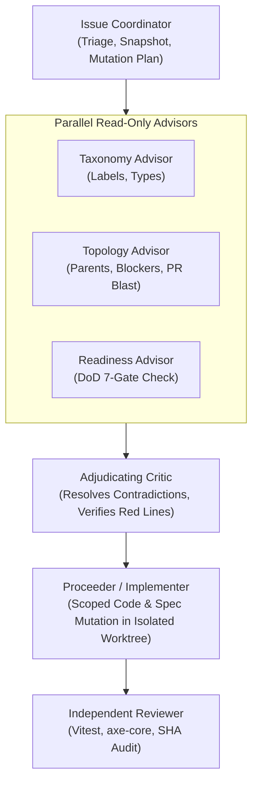

# 🤖 Master AI Agent Operational Contract (`AGENT.md`)

**Document ID:** `CM-LAB-AGENT-CONTRACT-V1` · **Status:** Authoritative Agent Contract  
**Academic Module:** *Computer & Media Lab* (WiSe 2026, SRH University of Applied Sciences) · **Instructor:** Prof. Franziska Schwarz  
**Repository:** [`https://github.com/ettefagh/CM-LAB`](https://github.com/ettefagh/CM-LAB)  
**Governing Documents:** [`GOAL.md`](./GOAL.md) · [`BLUEPRINT.md`](./BLUEPRINT.md) · [`research/architecture-evaluation/`](./research/architecture-evaluation/)

---

## 1. Operating Charter & Multi-Agent Authority Matrix

This contract binds all AI coding assistants (Antigravity, Google Jules, Google Spark, Claude Code, Cursor, Codex) operating in this repository. Agents must act within defined operational boundaries and respect Team 6 role ownership:



### 1.1 Operating Modes (CampusWeb Protocol v9)
Agents must choose the smallest mode that satisfies the task:
- **`Audit`:** Read issue state, repository topology, blockers, evidence, and DoD status. *Zero mutation.*
- **`Engineer`:** Coordinate read-only advisors, formulate the bounded technical proposal, and stop at the human gate.
- **`Proceed`:** Apply only approved changes within an isolated worktree through the Coordinator $\to$ Proceeder $\to$ Reviewer lifecycle.
- **`Repair`:** Reconcile stale or invalid metadata/labels, re-read and verify before proceeding.

### 1.2 Non-Negotiable Agent Red Lines
1. **NO OCR in MVP (`ADR-01`):** Capture strictly uses the `<15s` manual-first Omni-Bar / Prefix-Trie flow.
2. **ZERO Cloud Plaintext Receipts (`GDPR Art. 25`):** User receipts and personal items stay 100% in local IndexedDB (`Dexie.js v4`).
3. **NO Hallucinated Legal/Tax Advice (`ADR-03`):** Legal notices MUST compile from the 5 deterministic templates (`DOC-PRD-02`) with non-removable **`BGH VIII ZR 285/18 (LexFox)` / `RDG §§ 2, 3`** and **`§ 2 StBerG`** footers.
4. **NO Mobile Safari Camera Lockout:** `public/_headers` must set `Permissions-Policy: camera=(self)` and **strictly omit `Cross-Origin-Embedder-Policy: require-corp`**.
5. **STRICT 92h Sprint Budget (`Risk R-5 #17`):** Phase 1 MVP boots strictly from bundled `policy_wiki_seed_v1.json`. External cloud DB migrations belong strictly to Session 6 (`US-06`).

---

## 2. GitFlow Branch Structure & Isolated Worktree Policy

All code and documentation mutations MUST adhere to a strict GitFlow-adapted branching strategy:

### 2.1 Branch Taxonomy
* **`main`:** Canonical production release branch. Direct pushes are prohibited for feature work; merges occur only from approved PRs or fast-forward release branches.
* **`release/vX.Y.Z`:** Release stabilization and QA freeze branch.
* **`codex/issue-<number>-<short-kebab-slug>`:** Implementation branches for individual issue deliverables (e.g. `codex/issue-1-manual-capture-vault`, `codex/issue-3-claim-cancel-generator`).
  - The issue number is mandatory.
  - The slug represents bounded deliverable work—never an agent name, test attempt, or experiment.
  - No loose branches (e.g., `test/*`, `review/*`, `fix-slice-*`, `*-r2`).

### 2.2 Worktree Isolation Policy
* Implementation and review must never contaminate dirty working trees.
* Agents must create or checkout a fresh worktree at the exact commit SHA when conducting independent QA or Storybook verification.
* Before branching, always execute `git fetch origin --prune` and branch from the verified HEAD of `main`.

---

## 3. Issue Ledger Tracking & Multi-Agent Protocol

Derived from the [`campusweb-issue-orchestrator`](file:///C:/Users/admin/.gemini/config/skills/campusweb-issue-orchestrator/SKILL.md) v9 governance contract:

### 3.1 Native GitHub Relationship Source of Truth
Agents must query and manipulate GitHub state using native relationship fields—never simulating hierarchies or dependencies through synthetic labels:
```bash
gh issue view <number> --json number,title,updatedAt,issueType,labels,parent,subIssues,subIssuesSummary,blockedBy,blocking,state,stateReason,comments
```

### 3.2 Bounded Multi-Agent Debate Protocol
For non-trivial triage, architecture decisions, or relationship changes, agents MUST execute a structured bounded debate before mutating state:
1. **Fresh Snapshot:** Fetch `updatedAt` and current issue metadata.
2. **Parallel Advisors:** Spawn or run independent advisors:
   - **Taxonomy Advisor:** Inspects labels, issue types, and deliverable classification.
   - **Topology Advisor:** Inspects parent/child hierarchies, blocker graphs, and AST blast radius.
   - **Readiness Advisor:** Checks prerequisites, test coverage, and capacity fences.
3. **Structured Response Format:** Every advisor must reply strictly with:
   ```markdown
   Evidence: <observable facts and code lines>
   Proposal: <concrete recommended action>
   Risks: <potential regressions or policy violations>
   Open questions: <unresolved dependencies>
   ```
4. **Adjudication:** A Critic reviews all proposals, identifies contradictions, verifies compliance with `BLUEPRINT.md` and `GOAL.md`, and produces a single deterministic mutation plan.

### 3.3 5-Column Kanban Board & DoD Quality Gates (`#30`)
No issue may transition to `5. Done` without passing all 7 Definition of Done gates verified by PM (Jeetkumar) and QA (Mojtaba):
1. **Gate 1 (Core Journey):** Offline `Capture → Store → Alert → Act` functional across Views 1–6.
2. **Gate 2 (Speed Benchmark):** Stopwatch verified unassisted capture $<15.0\text{s}$ (`11.4s` benchmark) and Omni-Bar lookup $<10\text{ms}$.
3. **Gate 3 (Gherkin AC):** 100% test pass rate across `US-01` through `US-05`.
4. **Gate 4 (MCP Protocol):** `POST /api/mcp` passes `tools/list` and all 4 read-only tools (`policy_lookup`, `statutory_law_lookup`, `subscription_category_rules`, `tax_deductibility_check`) in $<200\text{ms}$ with `-32602` error handling.
5. **Gate 5 (Code Quality & Coverage):** `0` TypeScript/Svelte errors (`npm run check`); $\ge 75\%$ coverage across `packages/core/`.
6. **Gate 6 (Accessibility & Responsive):** Zero `axe-core` AA violations; $\ge 48\times 48\text{px}$ touch targets on $375\text{px}–412\text{px}$ mobile screens.
7. **Gate 7 (Statutory Disclaimers):** Automated assertions verify `BGH VIII ZR 285/18` (`RDG §§ 2, 3`) and `§ 2 StBerG` footers on all document exports.

---

## 4. Specialized Tooling & Skill Execution Directives

Agents must follow these exact tooling protocols when developing or reviewing code:

### 4.1 Cloudflare Platform & CLI
* **Rule:** When interacting with Cloudflare, use the **`cf` CLI** unless the project contains a Wrangler configuration file (`wrangler.jsonc`).
* **Edge Execution:**
  - Build and deploy Astro 6 SSR/Static edge pages on Cloudflare Workers/Pages.
  - Deploy and route the stateless `POST /api/mcp` endpoint on Cloudflare Workers.
  - Phase 2: Manage EmDash CMS (`emdashcms.dev`) content pipelines and D1 migrations.

### 4.2 Svelte 5 Runes & MCP Skills (`svelte-code-writer`, `svelte-core-bestpractices`)
* **Runes Purity:**
  - Mandatory use of Svelte 5 runes: `$state`, `$derived`, `$props`, `$effect`.
  - Strictly avoid legacy Svelte 3/4 reactivity (`let count = 0`, `$: double = count * 2`, `writable`, `derived`).
* **Pre-Emission Verification:**
  - Agents MUST execute the `svelte-autofixer` MCP tool on every `.svelte` component before returning code to the user. Repeat until 0 issues remain.
* **Dexie Reactive Bridge:**
  - Bind IndexedDB tables to Svelte 5 runes using `createSubscriber` over Dexie's `liveQuery` inside `wallet.svelte.ts`.

### 4.3 Node-Graph Architect (`/node-graph-architect` / Graphify)
* **Local LLM Warm-Up (MANDATORY):**
  - Before executing any Graphify AST extraction or Tier 2 semantic pass, confirm the local LLM (`qwen3:0.6b`) is resident in memory:
    ```bash
    curl -s http://localhost:11434/api/generate -d '{"model":"qwen3:0.6b","prompt":"ping","keep_alive":-1,"stream":false}' > /dev/null 2>&1
    ```
* **Tier 1 AST-First Investigation:**
  - Query the local knowledge graph via Graphify tools (`query_graph`, `get_node`, `god_nodes`, `graph_stats`, `get_pr_impact`) before performing code modifications.
  - Audit structural health: enforce component boundaries, ensure zero God Nodes, and verify CSS design token compliance.

### 4.4 Frontend Design Taste (`design-taste-frontend`)
* **Anti-Slop Directives:**
  - Prohibit generic AI card templates (repetitive 3-column icon-title-text cards).
  - Ensure balanced margins: left and right content edges must be strictly aligned.
  - No un-scrimmed text over backgrounds: always use an accessible backdrop scrim (`rgba(15, 23, 42, 0.45)` with `backdrop-filter: blur(2px)`).
  - Prohibit neon glows or ungrounded purple-blue gradients.
* **The 3 Aesthetic Dials:**
  - `DESIGN_VARIANCE`: **`6`** (Handcrafted, modern European consumer fintech).
  - `MOTION_INTENSITY`: **`4`** (Tactile micro-interactions: 2px hover lift, 0.98 active press scale, 220ms ease-out FAB morph).
  - `VISUAL_DENSITY`: **`5`** (Balanced mobile productivity, $\ge 48\times 48\text{px}$ touch targets).
* **Multi-Viewport Pre-Flight Check:**
  - Test and verify layouts across `390px` (mobile portrait), `768px` (tablet portrait), `1024px` (laptop), and `1440px` (desktop) viewports.

### 4.5 UI Component, Drawer, Icon & Media Asset Pipeline Rules (`DOC-UX-08`)
All agents modifying UI, drawers, icons, brand marks, or media pipelines must adhere strictly to [`DRAWER_ICON_AND_MEDIA_PIPELINE_SPEC.md`](./development-documents/ux-ui-lead/DRAWER_ICON_AND_MEDIA_PIPELINE_SPEC.md) (`DOC-UX-08`):
* **Runes-First Drawer Primitive (`@harshmandan/svaul`):**
  - Use `@harshmandan/svaul` for all modal sheets and drawer interactions (Contextual Item Detail Drawer, 1-Tap Claim Drawer, Filter Drawer).
  - Enforce dual-mode layout: fixed 520px side drawer on desktop ($\ge 768\text{px}$), tactile bottom-sheet on mobile ($< 768\text{px}$) with drag handle ($36\times 4\text{px}$).
  - Implement velocity snapping (downward swipe release velocity $v \ge 0.5\text{ px/ms}$ dismisses), snap points `[0, 0.5, 0.92]`, WAI-ARIA modal contracts (`role="dialog"`, `aria-modal="true"`, focus trap, `Escape` key dismissal), and backdrop scrim (`rgba(15, 23, 42, 0.45)` with `backdrop-filter: blur(2px)`).
* **Authoritative UI Icon Standard (`lucide-svelte`):**
  - `lucide-svelte` is the exclusive UI icon standard across both web properties (`[Project].pages.dev` and `app.[Project].pages.dev`).
  - Maintain clean $24\times 24$ vector line geometry, $2\text{px}$ stroke width, round caps/joins, and `stroke="currentColor"` bound to W3C DTCG tokens.
  - WCAG 2.1 AA/AAA conformance: decorative icons MUST declare `aria-hidden="true"`; standalone icon buttons MUST declare an explicit `aria-label` with $\ge 48\times 48\text{px}$ touch target padding.
* **Brand Vector Pipeline (`unplugin-icons` with `@iconify-json/simple-icons`):**
  - Brand marks for the Top 20 student brands across the Brand Policy Wiki (`/wiki`) MUST compile at build time on-demand via `unplugin-icons` and `@iconify-json/simple-icons`.
  - Strictly prohibit heavy raster PNG/JPEG logos (eliminating CLS and multi-megabyte bundle bloat). Provide accessible uppercase monograms for arbitrary or uncataloged merchants.
* **Static Showcase Hero Graphics (`astro:assets` / `@sveltejs/enhanced-img`):**
  - Marketing hero visuals, mockups, and architectural explainer diagrams on `[Project].pages.dev` MUST be processed at build time via `astro:assets` (or `@sveltejs/enhanced-img`).
  - Automatically downsample to AVIF/WebP, inject intrinsic `width`/`height` dimensions (zero CLS), generate responsive `srcset`, and strip all camera/EXIF metadata.
* **Preservation of Client-Side Web Worker (`image-compression.worker.ts`):**
  - Build-time media tools MUST NEVER touch runtime consumer receipts.
  - Raw consumer receipt photos ($15\text{MB}+$) MUST be processed locally in the background via `image-compression.worker.ts` (`OffscreenCanvas` $\le 2048\text{px}$, target $<1.5\text{MB}$).
  - Compute pre-encryption `SHA-256` digest on the raw file buffer (GoBD Rn. 108–110 evidentiary proof of purchase) and encrypt locally via `AES-GCM-256` before writing to `Dexie.js v4` (`GDPR Art. 25` zero cloud plaintext).

---

## 5. Quick Command Reference for Agents

```bash
# 1. Warm up local Graphify model
curl -s http://localhost:11434/api/generate -d '{"model":"qwen3:0.6b","prompt":"ping","keep_alive":-1,"stream":false}'

# 2. Type-check & Svelte diagnostic
npm run check

# 3. Run automated test suite with coverage
npm run test:coverage

# 4. View GitHub Issue snapshot
gh issue view <number> --json number,title,updatedAt,issueType,labels,parent,subIssues,blockedBy,blocking,state

# 5. Cloudflare edge build preview
wrangler pages dev apps/showcase/dist
```
