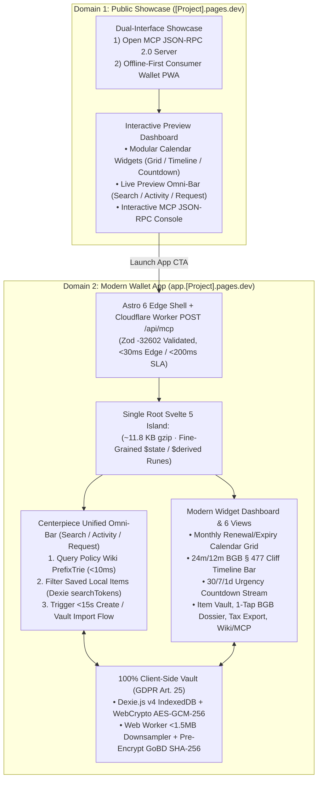

# 🏛️ CM-LAB Master Engineering Blueprint & Canonical Contract (`BLUEPRINT.md`)

**Document ID:** `CM-LAB-MASTER-BLUEPRINT-V1` · **Status:** Ratified Single Source of Truth (SSOT)  
**Academic Module:** *Computer & Media Lab* (WiSe 2026, SRH University of Applied Sciences) · **Instructor:** Prof. Franziska Schwarz  
**Engineering Team:** **Team 6** — *Jeetkumar (PM), AmirHossein (Product/Legal), Prushti (UX/UI), Kyle (Dev), Mojtaba (Quality/Media)*  
**Sprint Commitment:** Session 5 MVP Scope Lock Gate (`92h` Total Capacity · WIP Limit `<= 2` · 7 Quality Gates `#30`)

---

## 1. Authority Hierarchy, Dual-Domain Topology & Non-Negotiable Red Lines

This blueprint reconciles `GOAL.md`, `ADR-01` through `ADR-05`, `workshop-materials/board-c/`, and all five functional role directories inside `development-documents/` into **one executable engineering contract**. Whenever an earlier role document conflicts with this file, **`BLUEPRINT.md` and `GOAL.md` govern**.

### 1.1 Dual-Domain Architecture (`[Project].pages.dev` + `app.[Project].pages.dev`)



### 1.2 The 5 Non-Negotiable Guardrails (`GOAL.md` Red Lines)
1. **NO OCR in MVP (`ADR-01` / `WON'T-HAVE #12`):** Camera/cloud OCR fails on `42%` of faded thermal slips and burns token fees. Capture strictly uses the `<15s` (`11.4s` verified) Omni-Bar / Prefix-Trie flow + camera photo vaulting.
2. **ZERO Cloud Plaintext Receipts (`GDPR Art. 25`):** Personal items and receipt images stay `100%` in local browser IndexedDB (`Dexie.js v4`). Cloudflare edge endpoints handle only public Policy Wiki records and stateless `/api/mcp` calls.
3. **NO Hallucinated Legal or Tax Advice (`Risk R-3 #15` / `ADR-03`):** Statutory notices (`Mängelrüge`, `Kündigung`, `Widerruf`) MUST compile strictly from the 5 verbatim templates (`DOC-PRD-02`) with non-removable **`BGH VIII ZR 285/18 (LexFox)` / `RDG §§ 2, 3`** and **`§ 2 StBerG`** disclaimers.
4. **NO Mobile Safari Camera Lockout:** `public/_headers` MUST set `Permissions-Policy: camera=(self)` and **strictly omit `Cross-Origin-Embedder-Policy: require-corp`** so `<input type="file" accept="image/*" capture="environment">` never deadlocks on iOS WebKit.
5. **STRICT 92h Sprint 1 Fence (`Risk R-5 #17`):** Session 5 boots strictly from bundled `policy_wiki_seed_v1.json` (`0h` cloud DB setup). Cloudflare D1 / EmDash CMS migrations belong strictly to Session 6 (`US-06`).

### 1.3 Ratified Causal ADR Ledger (Prof. Franziska Schwarz Syntax)
* **`ADR-01` (Manual-First Omni-Bar & Prefix-Trie vs. OCR):** *"We chose a **manual-first Prefix-Trie autocomplete flow** because **camera OCR failed on 42% of crumpled thermal receipts while adding $0.02–$0.15/scan and 5–12s latency**, supported by **Team 7 Peer Lab Round 2 where unaided testers completed capture with receipt proof in 11.4s (down from 38.0s) with 100% fidelity**."*
* **`ADR-02` (Unified Hardware Warranties + Digital Subscriptions):** *"We chose to **unify physical hardware warranties and recurring subscriptions on one 4-stage pipeline (`Capture → Store → Alert → Act`)** because **hardware-only apps decay from low purchase frequency (1–3x/year)**, supported by **monthly subscription touchpoints (5–12 active services) sustaining >40% retention ahead of 12m/24m hardware cliffs**."*
* **`ADR-03` (Deterministic Statutory Engine & Open MCP):** *"We chose **deterministic template compilation exposed via UI and JSON-RPC 2.0 MCP** because **free-form LLM legal drafting hallucinates BGB deadlines and violates RDG §§ 2, 3**, supported by **BGH VIII ZR 285/18 (LexFox) safe-harbor jurisprudence and <200ms Zod-validated schema execution**."*
* **`ADR-04` (Hybrid Astro 6 + Svelte 5 Runes Island on Cloudflare Workers):** *"We migrated from our initial **React 19 + Zustand v5** baseline to **Hybrid Astro 6 + a Single Root Svelte 5 Runes Island (`client:only="svelte"`)** because **Zustand required dual-write IndexedDB synchronization and shipped 68.4 KB of client JS**, supported by **an 82.7% bundle reduction to 11.8 KB gzipped, 1.4ms fine-grained DOM updates, and direct `createSubscriber` binding to Dexie `liveQuery`**."*
* **`ADR-05` (Dual-Domain Split + Unified Search/Activity/Request Omni-Bar):** *"We separated the **Public Showcase (`[Project].pages.dev`)** from the **Wallet PWA (`app.[Project].pages.dev`)** and centered the app on a **Unified Search/Activity/Request Omni-Bar** because **mixing marketing/MCP docs with daily personal vault workflows dilutes scannability**, supported by **zero-JS static showcase performance alongside instant `<10ms` single-bar lookup across Policy Wiki, saved items, and new item creation**."*

---

## 2. Canonical Repository & Workspace Structure

```text
cm-lab/
├── apps/
│   ├── showcase/                           # Domain 1: [Project].pages.dev (Astro 6 Static + Interactive Preview Islands)
│   │   ├── astro.config.mjs
│   │   ├── wrangler.jsonc
│   │   └── src/
│   │       ├── pages/index.astro           # Dual-interface hero (MCP + App) & modular preview dashboard
│   │       └── components/                 # Interactive Calendar Previews, Demo Omni-Bar, Live MCP Sandbox
│   │
│   └── app/                                # Domain 2: app.[Project].pages.dev (Astro 6 Edge + Svelte 5 PWA + /api/mcp)
│       ├── astro.config.mjs
│       ├── wrangler.jsonc
│       ├── public/
│       │   ├── _headers                    # Permissions-Policy: camera=(self) — NO COEP: require-corp!
│       │   └── manifest.webmanifest
│       └── src/
│           ├── pages/
│           │   ├── index.astro             # Mounts <WalletApp client:only="svelte" />
│           │   ├── wiki/[slug].astro       # View 6A: Zero-JS static Policy Wiki brand pages
│           │   └── api/mcp.ts              # Stateless POST /api/mcp JSON-RPC 2.0 handler (Zod -32602)
│           ├── components/
│           │   ├── WalletApp.svelte        # Single Root Island Router (Views 1–6)
│           │   ├── fab/
│           │   │   ├── FloatingActionMenu.svelte # Speed dial FAB (+ to ✕ morph, backdrop scrim, keyboard auto-hide)
│           │   │   ├── ActionItem.svelte         # Animated speed-dial action pill item
│           │   │   └── types.ts                  # FloatingAction, ActionInvocationContext contracts
│           │   ├── omnibar/
│           │   │   └── UnifiedOmniBar.svelte # Search Wiki + Saved Items + Create/Import Action Bar
│           │   ├── widgets/
│           │   │   ├── MonthlyCalendarGrid.svelte      # Calendar Type A: Monthly renewal/expiry grid
│           │   │   ├── StatutoryTimelineBar.svelte     # Calendar Type B: 24m BGB § 438 + 12m § 477 cliff
│           │   │   └── UrgencyCountdownWidget.svelte   # Calendar Type C: 30/7/1d countdown stream
│           │   └── views/
│           │       ├── DashboardView.svelte            # View 1: Modular widget dashboard
│           │       ├── QuickCaptureModal.svelte        # View 2: <15s 3-field capture + receipt attach
│           │       ├── ItemDetailVaultView.svelte      # View 3: Timeline + pinch-to-zoom receipt viewer
│           │       ├── ClaimCancelDossierView.svelte   # View 4: 1-tap BGB claim/cancel PDF & clipboard
│           │       ├── TaxSummaryExportView.svelte     # View 5: § 9 EStG / BMF 2022 summary & ELSTER CSV
│           │       └── McpExplorerView.svelte          # View 6B: Interactive JSON-RPC 2.0 console
│           ├── state/
│           │   └── wallet.svelte.ts        # Svelte 5 Runes ($state.raw + createSubscriber over Dexie liveQuery)
│           └── workers/
│               └── image-compression.worker.ts # OffscreenCanvas <=2048px, <1.5MB, pre-encrypt GoBD SHA-256
│
├── packages/
│   ├── core/                               # Pure TypeScript Domain Engine (100% framework-agnostic, >=75% Vitest)
│   │   ├── data/policy_wiki_seed_v1.json   # Canonical Top 20 student brands knowledge graph
│   │   ├── types/contracts.ts              # Shared interfaces (WalletItem, ReceiptVaultBlob, PolicyWikiEntry...)
│   │   ├── search/PrefixTrie.ts            # <10ms brand + alias + saved-item prefix/token matcher
│   │   ├── db/vaultDb.ts                   # Dexie.js v4 stores + WebCrypto AES-GCM-256 + atomic rw commits
│   │   ├── alerts/AlertScheduler.ts        # 09:00 Europe/Berlin scheduler (0h CEST/CET DST drift)
│   │   ├── legal/bgbNoticeCompiler.ts      # 5 verbatim BGB templates (T1–T5) + LexFox RDG safe-harbor
│   │   ├── media/pdfDossierCompiler.ts     # pdf-lib DIN 5008 vector PDF + embedded receipt proof + fallback
│   │   ├── tax/werbungskostenEngine.ts     # BMF 22.02.2022 + BFH GrS 1/06 3-tier split + BOM CSV export
│   │   └── mcp/jsonRpcDispatcher.ts        # policy_lookup & claim_dossier_generate + Zod -32602 guard
│   └── design-tokens/
│       └── tokens.css                      # Official CM-LAB W3C DTCG CSS Custom Properties
├── .storybook/                             # Storybook 10.5+ (@storybook/addon-svelte-csf, addon-a11y, addon-mcp)
└── tests/                                  # Vitest unit/integration + E2E acceptance suites
```

---

## 3. Centerpiece Interaction Contracts: Unified Omni-Bar & Calendar Widgets

### 3.1 Unified Search / Activity / Request Omni-Bar (`UnifiedOmniBar.svelte`)
Anchored persistently at the top of `app.[Project].pages.dev` (and previewed interactively on `[Project].pages.dev`), shortcut `⌘K` / `Ctrl+K` or `/` focuses the Omni-Bar immediately. Every keystroke resolves locally in `<10ms` with zero network calls:

| Omni-Bar State | Trigger Condition | Displayed Result Groups & Primary Actions | Keyboard / ARIA Contract |
| :--- | :--- | :--- | :--- |
| **`IDLE_FOCUSED`** | Focus / `⌘K` with empty input | • **Recent Activity Feed:** Upcoming `<=7d` urgent deadlines & last generated BGB notices.<br>• **Quick Requests:** `+ Log New Purchase (<15s)`, `Import Vault JSON/CSV`, `Test MCP policy_lookup`. | `role="combobox"`, `aria-expanded="true"`, `↑`/`↓` cycles action chips. |
| **`UNIFIED_QUERY`** | Input length `>= 1` char (`q`) | **Group 1 — Saved Wallet Items (`Dexie`):** Matches `name`, `merchant`, `serialNumber`, `searchTokens` with live urgency pill (`🟢/🟡/🔴`) & `1-Tap Claim/Cancel` shortcut.<br>**Group 2 — Policy Wiki Database (`PrefixTrie`):** Matches Top 20 brands & `search_aliases` showing `24m BGB § 438` / `1m § 309 Nr. 9` summary + `+ Quick Log with [Brand] Defaults`.<br>**Group 3 — Create / Import Action:** Always-available prompt: **`Create new item "${q}" (<15s)`** or **`Import receipt / JSON backup`**. | `aria-activedescendant` tracks highlighted row; `Enter` executes primary row action; `Tab` jumps between `Saved`, `Wiki`, and `Create/Import` scopes; `Escape` clears/closes. |
| **`ZERO_MATCH_CREATE`** | `q` matches 0 saved items & 0 Wiki brands | Highlights **`+ Create "${q}" with German Statutory Defaults (24m BGB § 438 / 30d § 309 Nr. 9)`** + **`Import from CSV/JSON Backup`**, opening `QuickCaptureModal` pre-populated with `name = q`. | `Enter` immediately launches pre-filled `QuickCaptureModal` preserving `<15s` budget. |

### 3.2 Modular Dashboard & Distinct Calendar Widget Types
Both `[Project].pages.dev` (interactive demo dataset) and `app.[Project].pages.dev` (live Dexie vault) implement three complementary temporal visualizations on the dashboard grid:
1. **Calendar Widget A — Monthly Renewal & Deadline Grid (`MonthlyCalendarGrid.svelte`):** Interactive `7×5` / `7×6` month matrix in `Europe/Berlin` highlighting subscription billing renewals, `T-30d` cancellation cutoffs, `12m BGB § 477` cliffs, and `24m BGB § 438` expiries with color-coded urgency dots (`#DC2626`, `#D97706`, `#059669`).
2. **Calendar Widget B — Statutory 24m/12m Timeline Bar (`StatutoryTimelineBar.svelte`):** Horizontal lifespan bar (`Iteration C-3 #24`) contrasting **Months 0–12 (`BGB § 477 Abs. 1` Reversed Burden of Proof — Seller Must Prove)** against **Months 13–24 (`BGB § 438` Standard Statutory Coverage)** plus optional manufacturer guarantee overlay (`§ 443 BGB`).
3. **Calendar Widget C — Proactive 30 / 7 / 1-Day Countdown Stream (`UrgencyCountdownWidget.svelte`):** Chronological agenda cards synchronized with `AlertScheduler.ts` (`09:00 Europe/Berlin`, `0h` CEST/CET DST drift) offering direct `1-Tap Claim` or `1-Tap § 312k Cancel` triggers.

### 3.3 Portable Floating Action Menu (FAB Speed Dial) Contract (`FloatingActionMenu.svelte`)
Adapted from the CampusWeb `portable-floating-action-menu` primitive (Svelte 5 runes, rotated `+` to `✕` morph) and refined using the Google Calendar mobile speed-dial interaction pattern:

* **Ergonomics & Placement:** Floating standalone at bottom-right (`bottom: calc(72px + env(safe-area-inset-bottom))`, `right: 20px`), resting directly above the mobile navigation bar within the primary thumb sweep zone.
* **Accessible Backdrop Scrim:** Tapping the `+` expands the menu, morphs the icon into `✕`, and renders a semi-transparent scrim (`rgba(15, 23, 42, 0.45)` with `backdrop-filter: blur(2px)`), dimming background dashboard content to satisfy WCAG 1.4.3 contrast and dismissing on tap.
* **Virtual Keyboard Avoidance:** Subscribes to `window.visualViewport` resize/focus events to auto-hide the speed-dial when mobile virtual keyboards are active, eliminating viewport jitter and input occlusion.
* **Page-Contextual Speed-Dial Action Mapping:**

| Active View / Page | State | Action 1 (Top Primary) | Action 2 | Action 3 | Action 4 (Contextual) |
| :--- | :--- | :--- | :--- | :--- | :--- |
| **Dashboard (`/`)** | `mode: 'menu'` | **📷 Snap / Import Receipt** (`<15s`) | **💻 New Hardware Warranty** (BGB §§ 438/477) | **⚡ New Subscription** (§ 309 Nr. 9) | **🔍 Filter Expiring Soon** ($\le 30$d) |
| **Items Library (`/items`)** | `mode: 'menu'` | **📷 Snap / Import Receipt** | **💻 Add Hardware Item** | **⚡ Add Subscription** | **📦 Export GoBD Vault Backup** |
| **Subscriptions & Tax (`#tax`)** | `mode: 'menu'` | **🧾 Add Tax Receipt** (`isTaxDeductible`) | **⚡ Log SaaS / Tool** (100% AfA) | **📊 Recalculate Mixed-Use AfA** | **📥 Export Werbungskosten CSV** |
| **Brand Wiki & MCP (`/wiki`)** | `mode: 'menu'` | **🔎 Query Open MCP Server** | **💻 Log Brand Warranty Defaults** | **⚡ Log Brand Subscription Defaults** | **📋 Copy MCP Stdio Config JSON** |
| **Capture / Claim Modals** | `mode: 'hidden'` | *Hidden — Focus trapped inside modal* | — | — | — |

---

## 4. Shared TypeScript Data Contracts (`packages/core/types/contracts.ts`)

All five functional leads MUST import from these exact interfaces—never re-declaring divergent field names:

```typescript
export type ItemCategory = 'hardware' | 'subscription';
export type TaxCategory = 'Arbeitsmittel' | 'Fachliteratur' | 'Software';
export type ItemStatus = 'ACTIVE' | 'EXPIRING_SOON' | 'URGENT' | 'EXPIRED' | 'CANCELLED';
export type ReceiptMimeType = 'image/webp' | 'image/jpeg' | 'application/pdf';
export type ProofType = 'receipt_photo' | 'bank_statement' | 'order_confirmation' | 'none';
export type AlarmTriggerType = 'T_MINUS_30D' | 'T_MINUS_7D' | 'T_MINUS_1D' | 'BGB_477_12M_CUTOFF';
export type AlarmStatus = 'PENDING' | 'FIRED' | 'DISMISSED' | 'SUPPRESSED_EXPIRED';
export type DisputeTemplateId =
  | 'T1_HARDWARE_MAENGELRUEGE_0_12M'
  | 'T2_HARDWARE_MAENGELRUEGE_12_24M'
  | 'T3_SUBSCRIPTION_ORDINARY_309_NR9'
  | 'T4_SUBSCRIPTION_FRISTLOS_312K_ABS6'
  | 'T5_COOLING_OFF_WIDERRUF_14D';

/** 1. Dexie Store: `items` */
export interface WalletItem {
  readonly id: string;                    // UUID v4
  name: string;                           // e.g. "Sony WH-1000XM4"
  category: ItemCategory;
  purchaseDate: string;                   // ISO 8601 YYYY-MM-DD (Europe/Berlin calendar date)
  expiryDate: string;                     // ISO 8601 YYYY-MM-DD (§§ 187, 188, 193 BGB)
  cancellationCutoffDate?: string;        // ISO 8601 YYYY-MM-DD (Subscriptions)
  beweislastumkehrDate: string;           // ISO 8601 YYYY-MM-DD (purchaseDate + 12 calendar months)
  statutoryWarrantyMonths: number;        // Default: 24 (BGB § 438 Abs. 1 Nr. 3)
  commercialWarrantyMonths?: number;      // Voluntary § 443 BGB guarantee
  priceEur: number;                       // Gross EUR price incl. VAT (Bruttoprinzip)
  merchant: string;                       // Obligated seller (e.g. "Saturn", "MediaMarkt")
  serviceSlug?: string;                   // Links to PolicyWikiEntry.serviceSlug
  serialNumber?: string;                  // S/N, IMEI, or Contract ID
  isTaxDeductible: boolean;               // § 9 EStG Werbungskosten flag
  taxCategory?: TaxCategory;
  workUsagePercent: number;               // 0..100 (default 50 mixed-use, >=90 => 100% per BFH GrS 1/06)
  sofortabschreibungEligible: boolean;    // BMF 22.02.2022 1-year 100% write-off
  receiptBlobId?: string;                 // 1:1 FK -> receipt_blobs.id
  receiptSha256?: string;                 // 64-char lowercase hex GoBD Rn. 108-110 pre-encryption digest
  status: ItemStatus;                     // URGENT (<=7d) | EXPIRING_SOON (8-30d) | ACTIVE (>30d) | EXPIRED
  searchTokens: string[];                 // Normalized tokens for <10ms UnifiedOmniBar lookup
  createdAt: string;                      // Immutable ISO 8601 UTC timestamp
  updatedAt: string;                      // ISO 8601 UTC timestamp
}

/** 2. Web Worker -> Dexie Ingestion Boundary (Mojtaba -> Kyle) */
export interface ReceiptIngestPayload {
  readonly rawArrayBuffer: ArrayBuffer;   // Strictly < 1_500_000 bytes (<1.5MB)
  readonly mimeType: ReceiptMimeType;
  readonly byteSize: number;              // < 1_500_000
  readonly width: number;                 // <= 2048
  readonly height: number;                // <= 2048
  readonly thumbnailBase64: string;       // 120x120 data:image/jpeg;base64,... (<8KB)
  readonly clientGeneratedSha256: string; // 64-char hex computed BEFORE AES-GCM-256 encryption
}

/** 3. Dexie Store: `receipt_blobs` */
export interface ReceiptVaultBlob {
  readonly id: string;
  itemId: string;
  encryptedCiphertext: ArrayBuffer;       // WebCrypto AES-GCM-256 ciphertext
  iv: Uint8Array;                         // 96-bit (12-byte) CSPRNG IV
  mimeType: ReceiptMimeType;
  byteSize: number;
  width: number;
  height: number;
  thumbnailBase64: string;
  sha256Hex: string;                      // Matches WalletItem.receiptSha256
  createdAt: string;
}

/** 4. Dexie Store: `alarm_schedules` */
export interface AlarmScheduleRecord {
  readonly id: string;
  itemId: string;
  triggerType: AlarmTriggerType;
  targetLocalDate: string;                // YYYY-MM-DD
  targetWallClockTime: '09:00';           // Fixed 09:00 local wall-clock
  computedEpochMs: number;                // Recalibrated dynamically across CEST/CET DST transitions
  lastEvaluatedTimezone: string;          // Default 'Europe/Berlin'
  status: AlarmStatus;
  deepLinkUri: string;
  createdAt: string;
}

/** 5. Canonical Policy Wiki Seed Schema (`policy_wiki_seed_v1.json`) */
export interface PolicyWikiEntry {
  service_slug: string;
  serviceSlug: string;
  brand_name: string;
  brandName: string;
  legal_entity_de: string;
  category: ItemCategory;
  jurisdiction: 'DE' | 'EU';
  statutory_basis: string[];
  governing_code: 'BGB' | 'EU_DIRECTIVE';
  statutory_warranty_months?: number;
  commercial_guarantee_months?: number;
  statutoryNoticeDays?: number;
  cancellation_notice_period?: string;
  cooling_off_days: number;
  cancellation_button_url?: string;
  cancellationButtonUrl?: string;
  cancellation_button_compliant?: boolean;
  escalation_rma_url?: string;
  supportEmail?: string;
  supportPhone?: string;
  remedy_summary: string;
  termsSummaryDe: string;
  termsSummaryEn: string;
  dark_pattern_notes?: string;
  default_tax_category: TaxCategory | null;
  sofortabschreibung_default: boolean;
  search_aliases: string[];
  last_verified: string;
  updatedAt: string;
}
```

### Svelte 5 Runes Reactive Bridge (`wallet.svelte.ts`)
```typescript
import { liveQuery } from 'dexie';
import { createSubscriber } from 'svelte/reactivity';
import { vaultDb } from '@cm-lab/core/db/vaultDb';
import type { WalletItem } from '@cm-lab/core/types/contracts';

export class ReactiveWalletStore {
  #items = $state.raw<WalletItem[]>([]);
  #subscribe: () => void;

  constructor() {
    this.#subscribe = createSubscriber((update) => {
      const sub = liveQuery(() => vaultDb.items.orderBy('expiryDate').toArray()).subscribe({
        next: (rows) => {
          this.#items = rows;
          update();
        }
      });
      return () => sub.unsubscribe();
    });
  }

  get items(): WalletItem[] {
    this.#subscribe();
    return this.#items;
  }
}
```

---

## 5. Official Design Tokens & Accessibility Contract (`packages/design-tokens/tokens.css`)

All Svelte 5 components, Astro pages, and Storybook CSF stories (`.stories.svelte`) MUST use CSS custom properties—never hardcoded hex literals:

```css
:root {
  /* Brand & Surfaces (WCAG 2.1 AA / AAA Verified on #FFFFFF) */
  --color-primary-teal: #2F524C;      /* 7.8:1 AAA — Headers, primary surfaces, active tabs */
  --color-accent-coral: #D96B4B;      /* 4.6:1 AA  — Primary CTAs, Omni-Bar create action */
  --color-bg-canvas: #F4F7F6;         /* Soft neutral dashboard background */
  --color-card-white: #FFFFFF;        /* Elevated widget, card, and modal surfaces */
  --color-text-primary: #111827;      /* 16.8:1 AAA — Body & legal template text */
  --color-text-muted: #4B5563;        /* 7.5:1 AAA  — Metadata & timestamps */
  --color-border-subtle: #D1DBD8;     /* Card & widget hairlines */

  /* Statutory Urgency Semantics */
  --color-urgent-red: #DC2626;        /* 4.8:1 AA  — <= 7 days remaining (Immediate Action) */
  --color-warning-amber: #D97706;     /* 4.5:1 AA  — 8–30 days remaining (Inspection / Cliff Window) */
  --color-protected-green: #059669;   /* 4.9:1 AA  — > 30 days remaining (Active Coverage) */
  --color-expired-slate: #6B7280;     /* 4.8:1 AA  — 0 days remaining (Archived / Lapsed) */

  /* Ergonomics & Layout */
  --touch-target-min: 48px;           /* Mandatory >= 48x48px mobile tap zone (Gate 6) */
  --radius-card: 14px;
  --radius-pill: 9999px;
}
```

* **HTTP Header Guardrail (`public/_headers`):**
  ```text
  /*
    Permissions-Policy: camera=(self)
    X-Content-Type-Options: nosniff
    Referrer-Policy: strict-origin-when-cross-origin
  ```
  *(Never add `Cross-Origin-Embedder-Policy: require-corp` — preserves iOS Safari camera capture.)*

---

## 6. Deterministic Legal (`BGB`), Tax (`§ 9 EStG`) & MCP (`JSON-RPC 2.0`) Rules

1. **Calendar-Month Statutory Arithmetic (`§§ 187 Abs. 1, 188 Abs. 2, 193 BGB`):**
   * `beweislastumkehrDate` (`§ 477 Abs. 1 BGB`): `purchaseDate + 12 calendar months` (clamped to end-of-month for leap years like `2028-02-29 -> 2029-02-28`).
   * `expiryDate` (`§ 438 Abs. 1 Nr. 3 BGB`): `purchaseDate + 24 calendar months`, rolled forward to Monday if landing on Saturday/Sunday (`§ 193 BGB`). Late-stage defects within Month 24 trigger the **4-month suspension notice (`§ 475e Abs. 1 BGB`)**.
2. **5 Verbatim Dossier Templates (`bgbNoticeCompiler.ts`):**
   * `T1`: Hardware *Mängelrüge* `<= 12m` (`§§ 434, 437 Nr. 1, 439 Abs. 1 & 2, 475 Abs. 3, 477 Abs. 1 BGB`, 14-day cure deadline).
   * `T2`: Hardware *Mängelrüge* `12–24m` (`§§ 434, 437 Nr. 1, 438 Abs. 1 Nr. 3, 439, 475e Abs. 1 BGB`).
   * `T3`: Ordinary Subscription Cancellation (`§ 309 Nr. 9 BGB` max 1m rolling notice + SEPA revocation).
   * `T4`: Extraordinary Immediate Termination (`§ 312k Abs. 6 BGB` *fristlose Kündigung jederzeit* when online cancellation button is missing/non-compliant).
   * `T5`: 14-Day Distance Revocation (*Widerruf*, `§§ 312g Abs. 1, 355, 357 BGB`).
   * *Missing Receipt Fallback:* If `has_proof_of_purchase === false`, inject the `§ 286 ZPO` alternative proof clause (*Kontoauszug / Bestellbestätigung / Zeugenbeweis*).
3. **Mandatory Non-Removable Regulatory Safe-Harbor Footers (`Gate 7 DoD`):**
   * **Legal Footer (`RDG` / `LexFox`):** *„Hinweis gem. §§ 2, 3 RDG & BGH VIII ZR 285/18 (LexFox): Dieses Dokument wurde automatisiert anhand standardisierter gesetzlicher Textbausteine und Ihrer tatsächlichen Angaben erstellt. Es stellt keine individuelle Rechtsberatung dar.“*
   * **Tax Footer (`StBerG`):** *„Hinweis gem. § 2 StBerG: Diese Aufstellung dient ausschließlich der technischen Belegorganisation (Werbungskosten gem. § 9 EStG / BMF-Schreiben vom 22.02.2022) und ersetzt keine steuerliche Beratung.“*
4. **German Tax Engine (`werbungskostenEngine.ts`):**
   * `BMF 22.02.2022 (BStBl I S. 187)`: Notebooks, desktops, tablets, monitors, docks, headsets, peripherals, and software qualify for `100%` write-off in purchase year regardless of the `€952` gross GWG cap; smartphones/furniture use `<= €952.00` gross GWG (`§ 6 Abs. 2 EStG`).
   * `BFH GrS 1/06` Split: `u >= 90% => 100%`; `10% <= u < 90% => round2(priceEur * u / 100)`; `u < 10% => €0.00`. Exports UTF-8 with BOM (`\uFEFF`) semicolon-delimited CSV for **Mein ELSTER / WISO Steuer / Taxfix** (Anlage N, Zeilen 46–48).
5. **Authoritative Open MCP Endpoint (`POST /api/mcp` & `stdio`):**
   * The Open MCP Server is strictly an **authoritative, read-only knowledge infrastructure** providing external AI agents (Claude Desktop, Cursor, Gemini CLI) deterministic, zero-hallucination ground truth on German consumer law, brand cancellation rules, and tax depreciation without web scraping.
   * **4 Authoritative Read-Only Tools:**
     1. `policy_lookup`: Retrieves verified brand warranty periods, statutory notice deadlines, cooling-off periods, and direct cancellation URLs (`§ 312k BGB`) for the Top 20 student brands.
     2. `statutory_law_lookup`: Retrieves authoritative German civil code articles (`BGB §§ 434, 437, 438, 439, 475e, 477 Abs. 1, 309 Nr. 9, 312k, 355`) and consumer rights definitions.
     3. `subscription_category_rules`: Returns statutory statutory rules by contract category (telecoms, SaaS, fitness, streaming, insurance) including maximum initial terms, rolling renewals, and notice ceilings.
     4. `tax_deductibility_check`: Deterministic `§ 9 EStG` Werbungskosten and `BMF 22.02.2022` Sofortabschreibung 100% immediate write-off calculation and GWG rules.
   * Client-side dossier and PDF compilation stays entirely in local browser Web Workers (`pdfDossierCompiler.ts`) and Dexie for private user data (`GDPR Art. 25`), eliminating RDG legal practice liability.
   * Invalid or extra fields are rejected by `.strict()` Zod schemas returning JSON-RPC error code **`-32602` (`Invalid params`)** in `<200ms` (`Gate 4 DoD`).

---

## 7. Sprint 1 Parallel Ownership (92h), 7-Gate Verification & SRH AI Disclosure

| Lead | Role & Capacity | Owned Modules & Branch Prefix | Primary Issues |
| :--- | :--- | :--- | :--- |
| **Jeetkumar** | Project Manager (`10h`) | Kanban WIP `<= 2`, `GATE_STATUS.md`, Risk Fence (`R-1..R-5`), 7-Gate Sign-Off (`docs/pm-*`) | `#15`, `#17`, `#21`, `#27`, `#30` |
| **AmirHossein** | Product / Legal (`14h`) | `policy_wiki_seed_v1.json`, `bgbNoticeCompiler.ts` templates, `werbungskostenEngine.ts` rules (`feature/prd-*`) | `#8`, `#9`, `#11`, `#14`, `#15`, `#20` |
| **Prushti** | UX / UI Lead (`26h`) | Showcase UI, `UnifiedOmniBar.svelte`, Calendar Widgets, Views 1–6 Svelte 5 + `.stories.svelte` (`feature/ux-*`) | `#1`, `#4`, `#7`, `#18`, `#22`–`#24`, `#26` |
| **Kyle** | Dev Lead (`22h`) | `vaultDb.ts`, `wallet.svelte.ts`, `PrefixTrie.ts`, `AlertScheduler.ts`, `/api/mcp` Worker (`feature/dev-*`) | `#1`, `#2`, `#5`, `#6`, `#10`, `#16`, `#18` |
| **Mojtaba** | Quality / Media (`20h`) | `image-compression.worker.ts` (`<1.5MB` + `SHA-256`), `pdfDossierCompiler.ts`, `>=75%` Vitest suite (`feature/qa-*`) | `#3`, `#5`, `#8`, `#19`, `#25`, `#30` |

### 7.1 Mandatory 7-Gate CI & Release Verification (`#30`)
1. **Gate 1 (Dual-Domain & Core Journey):** Both `[Project].pages.dev` and `app.[Project].pages.dev` build cleanly (`npm run build`) and execute `Omni-Bar / Capture → Store → Alert → Act` offline.
2. **Gate 2 (Speed Benchmark):** Unassisted item + receipt capture completes in **`< 15.0s`** (`11.4s` baseline) and Omni-Bar search resolves in **`< 10ms`**.
3. **Gate 3 (Gherkin AC):** `100%` pass rate across `US-01` through `US-05` acceptance scenarios.
4. **Gate 4 (MCP Protocol):** `POST /api/mcp` passes `tools/list` and all 4 read-only tools (`policy_lookup`, `statutory_law_lookup`, `subscription_category_rules`, `tax_deductibility_check`) in `< 200ms` and returns `-32602` on malformed JSON-RPC params.
5. **Gate 5 (Quality & Coverage):** `npm run check` (`svelte-check` + `tsc --noEmit`) has `0` errors; `npm run test:coverage` achieves **`>= 75%`** across `packages/core/`.
6. **Gate 6 (Accessibility & Mobile):** Zero `axe-core` AA violations in Storybook (`@storybook/addon-a11y`), touch targets `>= 48×48px` on `375px–412px` viewports, `public/_headers` camera check passed.
7. **Gate 7 (Statutory Disclaimers):** Automated assertions verify non-removable `BGH VIII ZR 285/18` (`RDG §§ 2, 3`) and `§ 2 StBerG` footers on every PDF, plaintext, clipboard, and CSV export.

### 7.2 SRH University Generative AI Disclosure (*Orientierungsrahmen v1.0, 15.07.2025*)
> *„Im Rahmen der Vorarbeit zur Systemarchitektur, der Modellierung von Architekturentscheidungen (ADRs) sowie zur Konsolidierung von Spezifikationen und Komponentenstrukturen wurden KI-gestützte Assistenzsysteme (Google Gemini / Anthropic Claude) eingesetzt. Sämtliche Vorschläge wurden durch Team 6 kritisch auf Konformität mit BGB, GoBD, EStG und Web-Standards geprüft, inhaltlich überarbeitet und eigenständig verantwortet. Eine ungeprüfte Übernahme fand nicht statt.“*
