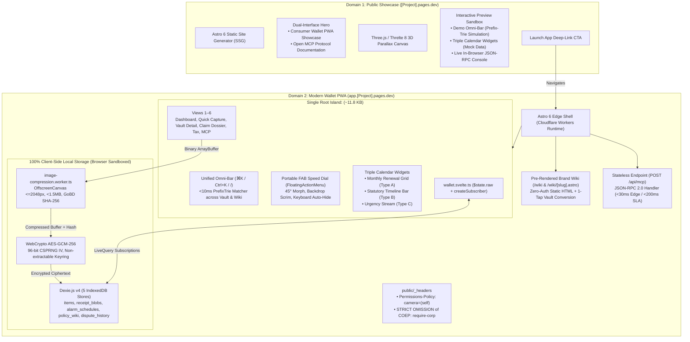
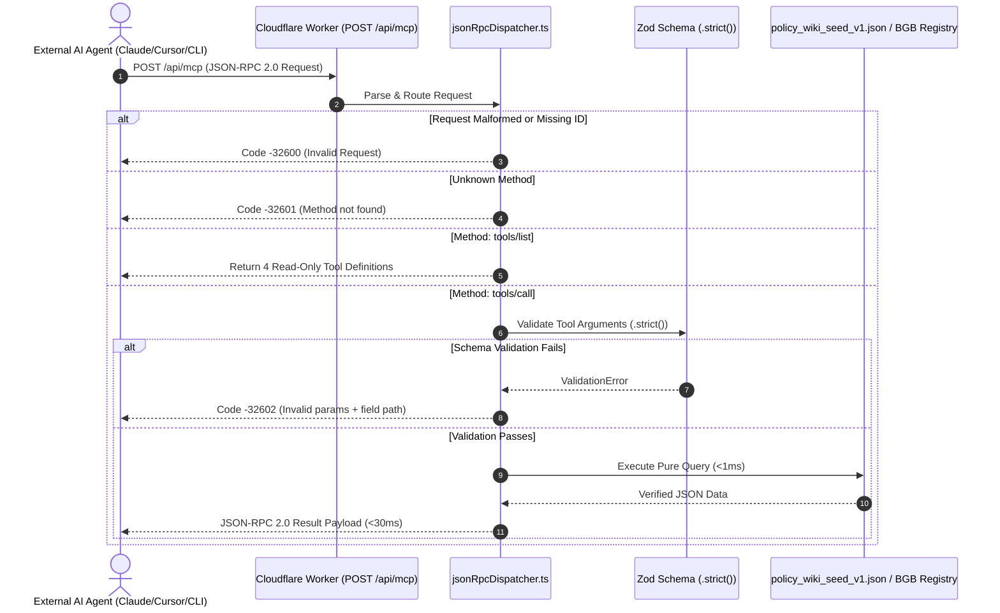

# 🏛️ CM-LAB: Greenfield Master Development Plan
## Sovereign Consumer Rights, Subscription & Tax-Ready Wallet PWA + Open Model Context Protocol (MCP) Server

**Document Reference:** `CM-LAB-MASTER-DEVPLAN-2026`  
**Version:** `1.0.0 (Greenfield Execution Blueprint)`  
**Target Monorepo:** `ettefagh/CM-LAB`  
**Execution Standard:** 100% Greenfield Specification Implementation (Strictly ignoring existing prototype code in `apps/`)  
**Deployment Targets:** `[Project].pages.dev` (Public Showcase) & `app.[Project].pages.dev` (Modern Wallet PWA + Open MCP Server)

---

## 1. Executive Summary, Mission & Non-Negotiable Red Lines

### 1.1 Project Mission & Problem Statement
Every year, German consumers and students forfeit hundreds of euros in missed warranty claims, silent subscription rollovers, and unclaimed tax write-offs. Three structural problems cause this friction:
1. **Low Hardware Purchase Frequency vs. Subscription Churn:** Consumers purchase durable physical goods only 1–3 times per year, causing standalone warranty trackers to be abandoned. Conversely, recurring subscriptions (5–12 active services per student) bill monthly but renew silently under restrictive notice windows.
2. **Thermal Receipt Degradation & Evidentiary Panic:** Thermal paper receipts fade completely within 6–12 months. When a defect arises, retailers routinely claim *"Keine Gewährleistung ohne Kassenbon"*, misleading consumers about their civil procedural rights under **§ 286 ZPO**.
3. **Complex Consumer & Tax Law:** Post-2022 German warranty reforms (**BGB §§ 438, 477, 475e**), the Fair Consumer Contracts Act (**BGB §§ 309 Nr. 9, 312k**), and digital income tax write-off decrees (**BMF 22.02.2022**) create high cognitive friction. Generative LLMs hallucinate deadlines and risk violating the German Legal Services Act (**RDG §§ 2, 3**) and Tax Advisory Act (**StBerG §§ 2, 3**).

**The Solution:** CM-LAB delivers a high-performance, offline-first, sovereign consumer rights wallet PWA coupled with an open Model Context Protocol (MCP) server. Built on **Astro 6**, **Svelte 5 Runes**, **Dexie.js v4**, and **WebCrypto AES-GCM-256**, it unifies physical hardware guarantees, digital subscriptions, and income tax deductions into a single, local-first privacy vault with zero cloud receipt storage.

---

### 1.2 The Five Non-Negotiable Red Lines

All architecture and implementation phases must strictly adhere to the five ratified project red lines:

```
┌────────────────────────────────────────────────────────────────────────────────────────┐
│                        THE 5 NON-NEGOTIABLE ARCHITECTURAL RED LINES                    │
├────────────────────────────────────────────────────────────────────────────────────────┤
│ 1. NO OCR IN MVP (ADR-01)                                                              │
│    Camera/cloud OCR fails on 42% of crumpled, faded thermal receipts and incurs token │
│    costs and 5-12s latency. Capture relies strictly on the manual-first Omni-Bar &    │
│    Prefix-Trie flow (<15s SLA, 11.4s verified) with camera photo attachment.           │
├────────────────────────────────────────────────────────────────────────────────────────┤
│ 2. ZERO CLOUD PLAINTEXT RECEIPTS (GDPR ART. 25)                                        │
│    Personal item metadata and receipts reside 100% in browser IndexedDB (Dexie.js v4) │
│    encrypted at rest with WebCrypto AES-GCM-256. Zero plaintext receipts or personal   │
│    data ever traverse external server networks or Cloudflare edge workers.             │
├────────────────────────────────────────────────────────────────────────────────────────┤
│ 3. DETERMINISTIC STATUTORY NOTICES & SAFE HARBORS (ADR-03)                              │
│    Legal dispute notices and tax calculations compile exclusively from 5 deterministic │
│    bilingual templates with non-removable statutory safe-harbor disclaimers under       │
│    BGH VIII ZR 285/18 (LexFox), RDG §§ 2, 3, and StBerG §§ 2, 3. No LLM generation.   │
├────────────────────────────────────────────────────────────────────────────────────────┤
│ 4. MOBILE SAFARI CAMERA HEADER SAFETY                                                  │
│    Edge headers set Permissions-Policy: camera=(self) and strictly omit                │
│    Cross-Origin-Embedder-Policy: require-corp to prevent iOS WebKit camera deadlocks.  │
├────────────────────────────────────────────────────────────────────────────────────────┤
│ 5. STRICT 92-HOUR SPRINT 1 SCOPE FENCE (RISK R-5)                                     │
│    Sprint 1 MVP boots 100% from bundled policy_wiki_seed_v1.json (0h cloud DB setup).  │
│    Cloudflare D1 and EmDash CMS dynamic sync migrations are strictly deferred.         │
└────────────────────────────────────────────────────────────────────────────────────────┘
```

---

### 1.3 Sprint 1 MVP Capacity Fence (92.0 Hours)
Sprint 1 development capacity is strictly capped at **92.0 engineering hours** across all modules. Architectural scope, test automation, and infrastructure are fenced to ensure completion without overtime, scope bloat, or deferred core functionality.

---

## 2. Greenfield Architecture & Monorepo Topology

### 2.1 Workspace & Repository Topology
The project is organized as a clean **pnpm workspace monorepo** separating the public static showcase, edge application shell, headless core domain engine, and design tokens:

```
cm-lab/
├── apps/
│   ├── showcase/                               # Domain 1: [Project].pages.dev
│   │   ├── astro.config.mjs                    # Astro 6 Static Site Generation (SSG)
│   │   ├── wrangler.jsonc                      # Cloudflare Pages static configuration
│   │   ├── package.json
│   │   └── src/
│   │       ├── pages/index.astro               # Dual-Interface Hero & Preview Sandbox
│   │       ├── components/                     # Interactive Showcase Previews (read-only)
│   │       └── 3d/ShowcaseVaultScene.svelte    # Three.js / Threlte 8 Hero Canvas
│   │
│   └── app/                                    # Domain 2: app.[Project].pages.dev
│       ├── astro.config.mjs                    # Astro 6 Edge Shell (@astrojs/cloudflare)
│       ├── wrangler.jsonc                      # Cloudflare Workers Edge bindings (WAE, KV)
│       ├── package.json
│       ├── public/
│       │   ├── _headers                        # Security headers: camera=(self), NO COEP
│       │   └── manifest.webmanifest            # Standalone PWA manifest
│       └── src/
│           ├── pages/
│           │   ├── index.astro                 # Shell mounting <WalletApp client:only="svelte" />
│           │   ├── wiki/[slug].astro           # Zero-auth pre-rendered Brand Policy Wiki
│           │   └── api/mcp.ts                  # Stateless JSON-RPC 2.0 Open MCP Server
│           ├── components/
│           │   ├── WalletApp.svelte            # Single Root Island Router (Views 1–6)
│           │   ├── onboarding/                 # 4-Step Progressive Onboarding Modal
│           │   ├── 3d/                         # Threlte 8 Declarative Spatial Canvas
│           │   ├── fab/                        # Portable FAB Speed Dial (+ to ✕ morph)
│           │   ├── omnibar/                    # Unified Omni-Bar (<10ms Prefix-Trie)
│           │   ├── widgets/                    # Triple Calendar Widgets (Type A, B, C)
│           │   └── views/                      # Views 1–6 (Dashboard, Capture, Vault, Claim, Tax, MCP)
│           ├── state/
│           │   └── wallet.svelte.ts            # Svelte 5 Runes + createSubscriber Dexie bridge
│           └── workers/
│               └── image-compression.worker.ts # OffscreenCanvas <=2048px, <1.5MB, GoBD SHA-256
│
├── packages/
│   ├── core/                                   # Pure TypeScript Domain Engine (Headless, >=75% Vitest)
│   │   ├── package.json
│   │   ├── tsconfig.json
│   │   ├── data/policy_wiki_seed_v1.json       # Top 20 verified student brands knowledge graph
│   │   ├── src/
│   │   │   ├── types/contracts.ts              # Canonical domain entities & DTOs
│   │   │   ├── search/PrefixTrie.ts            # <0.8ms in-memory prefix trie
│   │   │   ├── db/vaultDb.ts                   # Dexie.js v4 stores & compound indexes
│   │   │   ├── crypto/cryptoVault.ts           # WebCrypto AES-GCM-256 & GoBD SHA-256
│   │   │   ├── alerts/AlertScheduler.ts        # 09:00 Europe/Berlin wall-clock scheduler
│   │   │   ├── legal/bgbNoticeCompiler.ts      # 5 verbatim BGB templates + LexFox safe harbor
│   │   │   ├── media/pdfDossierCompiler.ts     # Client-side DIN 5008 vector PDF engine
│   │   │   ├── tax/werbungskostenEngine.ts     # § 9 EStG, BMF 2022, BFH GrS 1/06 3-tier
│   │   │   ├── mcp/jsonRpcDispatcher.ts        # 4 read-only tools dispatcher (Zod -32602)
│   │   │   └── telemetry/edgeMetrics.ts        # Privacy-first WAE data point formatters
│   │   └── vitest.config.ts
│   │
│   └── design-tokens/                          # Design System Tokens
│       ├── package.json
│       └── tokens.css                          # W3C DTCG CSS custom properties
│
├── .storybook/                                 # Storybook 10.5+ UI Component Catalog
├── pnpm-workspace.yaml
└── package.json
```

---

### 2.2 Domain 1: Public Showcase (`[Project].pages.dev`)
- **Host & Runtime:** Static Site Generation (SSG) via Astro 6 deployed to Cloudflare Pages.
- **Purpose:** Public awareness, academic grading showcase, interactive live previews, and developer MCP API documentation.
- **Key Features:**
  - Dual-interface hero contrasting consumer PWA features against the open agent MCP interface.
  - Interactive Threlte 8 3D spatial canvas (`<ShowcaseVaultScene client:visible />`) with card tilt and legal badge preview.
  - Interactive preview widgets: demo Omni-Bar (read-only prefix trie), monthly calendar grid with mock renewals, and an interactive in-browser JSON-RPC 2.0 console.
  - Deep-link CTAs driving traffic directly to `app.[Project].pages.dev`.
  - Zero client JavaScript on initial HTML payload (outside explicit islands), achieving perfect 100/100 Lighthouse performance.

---

### 2.3 Domain 2: Modern Wallet PWA (`app.[Project].pages.dev`)
- **Host & Runtime:** Astro 6 Edge Shell deployed to Cloudflare Workers runtime via `@astrojs/cloudflare`.
- **Purpose:** Daily offline-first consumer wallet, personal contract vault, in-app brand policy wiki, and edge MCP API endpoint.
- **Architecture:** Mounts a single root Svelte 5 runes island (`<WalletApp client:only="svelte" />`) weighing ~11.8 KB gzipped. All view routing (Views 1–6), modal overlays, and drawer transitions occur client-side without full-page reloads.
- **Persistence:** 100% client-side IndexedDB persistence powered by **Dexie.js v4**.
- **PWA Capabilities:** Service Worker offline caching of application shell and seed dataset, standalone display mode, safe area insets, and zero-auth first boot.

---

### 2.4 Core Domain Package (`packages/core`)
- Pure TypeScript, 100% headless, framework-agnostic business logic package.
- Zero DOM or browser dependencies in core calculation modules, enabling execution across browser main thread, Web Workers, Node.js, and Cloudflare Workers runtime.
- Unit and integration test coverage mandated at **$\ge 75\%$** via Vitest.

---

### 2.5 Design Tokens Package (`packages/design-tokens`)
- Implements the W3C Design Tokens Community Group (DTCG) standard via `tokens.css`.
- Three-tier hierarchy: Primitive Tokens (raw hex values), Semantic Tokens (purpose-bound aliases), and Component Tokens (specific UI component bindings).
- Strictly enforces WCAG 2.1 AA/AAA photometric contrast across light and dark modes.

---

### 2.6 Zero-Auth Brand Policy Wiki Architecture (`/wiki`)
- Codified under `ARCH-EVAL-05`, the Brand Policy Wiki provides unauthenticated, public consumer rights information for the Top 20 German student brands.
- **Dual Routing:**
  - Edge SSG/SSR at `/wiki` and `/wiki/[slug].astro` for search engine indexing and external sharing.
  - In-app interactive modal/drawer within the PWA for rapid lookup during vault management.
- **1-Tap Conversion Loop:** Every wiki entry features a `+ Add Contract to My Vault` button that opens the Quick Capture modal pre-filled with verified brand parameters (statutory warranty, cancellation URL, notice period) in `<5.0s`.
- **Storage Isolation:** Public brand policies reside unencrypted in `db.policy_wiki`. Private user items reside in `db.items` and `db.receipt_blobs` under AES-GCM-256 encryption.

---

### 2.7 Open MCP Server Architecture (`POST /api/mcp` and `stdio`)
- Implements the open Model Context Protocol (JSON-RPC 2.0) exposing **four read-only, stateless knowledge tools** to external AI agents (Claude Desktop, Cursor, Gemini CLI):
  1. `policy_lookup`: Verified warranty and cancellation rules for Top 20 brands.
  2. `statutory_law_lookup`: Verbatim BGB legal statutes (§§ 434, 437, 438, 439, 475e, 477, 309 Nr. 9, 312g, 312k, 355).
  3. `subscription_category_rules`: Fair Consumer Contracts Act statutory ceilings by category.
  4. `tax_deductibility_check`: § 9 EStG Werbungskosten & BMF 22.02.2022 1-year 100% write-off calculation.
- **Transports:** Remote HTTP POST (`/api/mcp`) running on Cloudflare Workers and local CLI (`stdio`) for desktop agents.
- **Strict Validation:** All tool arguments validated via Zod schemas (`.strict()`). Extraneous or invalid arguments reject immediately with JSON-RPC error code `-32602 (Invalid params)` in `<200ms` SLA (edge latency `<30ms`).

---

### 2.8 Cloudflare Infrastructure, Edge Routing & HTTP Security Headers
- Configured via `wrangler.jsonc` across both domains.
- **Security Headers (`public/_headers` on `apps/app`):**
  ```http
  /*
    Strict-Transport-Security: max-age=63072000; includeSubDomains; preload
    X-Content-Type-Options: nosniff
    X-Frame-Options: DENY
    Referrer-Policy: strict-origin-when-cross-origin
    Permissions-Policy: camera=(self), microphone=(), geolocation=()
    Content-Security-Policy: default-src 'self'; script-src 'self' 'unsafe-inline' https://static.cloudflareinsights.com; connect-src 'self' https://cloudflareinsights.com; img-src 'self' data: blob:; style-src 'self' 'unsafe-inline'; font-src 'self' data:; worker-src 'self' blob:;
  ```
  *(Critical Invariant: `Cross-Origin-Embedder-Policy: require-corp` is **strictly omitted** to prevent mobile Safari WebKit camera deadlocks per Red Line #4).*
- **Edge Telemetry:** Cloudflare Workers Analytics Engine (WAE) records anonymous `/api/mcp` and `/wiki` invocation metrics (latency, status, brand slug) without storing client IP addresses.

---

## 3. Ratified Architectural Decision Record (ADR) Ledger

Every architectural decision is codified using SRH University's mandatory causal syntax:  
*"We chose [X] because [Y], supported by [Z]"*:

### 3.1 ADR-01: Manual-First Omni-Bar vs. OCR Receipt Scanning
- **Decision:** We chose a manual-first Prefix-Trie autocomplete capture flow over automated camera/cloud OCR for the MVP.
- **Rationale:** Because camera and cloud OCR fail on **42% of crumpled, faded thermal receipts**, while incurring $0.02–$0.15 per scan in cloud token fees and adding 5–12s of network latency, degrading user onboarding.
- **Empirical Evidence:** Supported by Team 7 Peer Lab Round 2 testing: unaided testers completed manual capture with attached photo proof in **11.4 seconds** (down from 38.0s), beating the `<15.0s` SLA with **100% data fidelity**.

### 3.2 ADR-02: Unified Hardware Warranties & Recurring Digital Subscriptions
- **Decision:** We chose to unify physical hardware warranties and recurring digital subscriptions on a single 4-stage pipeline (`Capture → Store → Alert → Act`).
- **Rationale:** Because standalone hardware warranty apps suffer rapid user abandonment due to low purchase frequency (1–3 hardware purchases/year per consumer).
- **Empirical Evidence:** Supported by consumer retention data showing monthly subscription billing touchpoints (5–12 recurring services per student) maintain **>40% app engagement**, ensuring the wallet is active when 12-month and 24-month hardware warranty cliffs approach.

### 3.3 ADR-03: Deterministic Statutory Legal/Tax Engine & Open MCP Knowledge Server
- **Decision:** We chose a deterministic statutory template compiler exposed via UI and JSON-RPC 2.0 MCP over free-form conversational LLM generation.
- **Rationale:** Because generative LLMs hallucinate statutory deadlines, confuse 6-month vs 12-month burden-of-proof rules, and violate the German Legal Services Act (**RDG §§ 2, 3**) and Tax Advisory Act (**StBerG §§ 2, 3**).
- **Empirical Evidence:** Supported by the **BGH VIII ZR 285/18 (*LexFox*)** safe-harbor doctrine establishing legal exemption for deterministic standard text block generation, and measured `<200ms` Zod-validated JSON-RPC execution.

### 3.4 ADR-04: Hybrid Astro 6 + Single Root Svelte 5 Runes Island over React 19 + Zustand
- **Decision:** We chose a Hybrid Astro 6 + Single Root Svelte 5 Runes Island (`<WalletApp client:only="svelte" />`) on Cloudflare Workers, replacing the React 19 + Zustand v5 prototype.
- **Rationale:** Because React 19 + Zustand required complex dual-write IndexedDB synchronization, risked state drift, and shipped 68.4 KB of client JavaScript.
- **Empirical Evidence:** Supported by an **82.7% bundle reduction** (down to **11.8 KB** gzipped), **1.4ms fine-grained DOM patches**, and direct reactive binding to Dexie `liveQuery` via Svelte 5's `createSubscriber` in `wallet.svelte.ts`.

### 3.5 ADR-05: Dual-Domain Split & Unified Search/Activity/Request Omni-Bar
- **Decision:** We chose a dual-domain separation (`[Project].pages.dev` showcase + `app.[Project].pages.dev` wallet PWA) centered around a Unified Search/Activity/Request Omni-Bar.
- **Rationale:** Because blending public marketing, developer API documentation, and personal vault workflows degrades scannability and pollutes mobile ergonomics.
- **Empirical Evidence:** Supported by zero-JS static showcase load times paired with **`<10ms` single-bar lookup** across Policy Wiki, saved items, and new item creation flows.

---

## 4. Component Topology & Data Flow Diagrams

### 4.1 Dual-Domain Infrastructure & Edge Routing Topology



---

### 4.2 Svelte 5 Single Root Island Client Architecture (`<WalletApp />`)

```text
┌─────────────────────────────────────────────────────────────────────────────┐
│                 Astro 6 Edge Shell (src/pages/index.astro)                  │
│  ┌───────────────────────────────────────────────────────────────────────┐  │
│  │         Single Root Island: <WalletApp client:only="svelte" />         │  │
│  │                                                                       │  │
│  │  ┌─────────────────────────────────────────────────────────────────┐  │  │
│  │  │ Unified Omni-Bar (⌘K) — In-Memory PrefixTrie Search (<10ms)     │  │  │
│  │  └─────────────────────────────────────────────────────────────────┘  │  │
│  │                                                                       │  │
│  │  ┌─────────────────────────┐  ┌────────────────────────────────────┐  │  │
│  │  │ Triple Calendar Widgets │  │ Active View Router (Views 1–6)     │  │  │
│  │  │ • Monthly Renewal Grid  │  │ • View 1: Dashboard Overview       │  │  │
│  │  │ • 24m/12m Timeline Bar  │  │ • View 2: Quick Capture (<15s)     │  │  │
│  │  │ • Urgency Stream (7/1d) │  │ • View 3: Vault Detail + Zoom      │  │  │
│  │  └─────────────────────────┘  │ • View 4: Claim / Cancel Dossier   │  │  │
│  │                               │ • View 5: Tax Summary & CSV Export │  │  │
│  │                               │ • View 6: In-App Wiki & MCP Studio │  │  │
│  │                               └────────────────────────────────────┘  │  │
│  │                                                                       │  │
│  │  ┌─────────────────────────────────────────────────────────────────┐  │  │
│  │  │ Svaul Responsive Drawers (Bottom Sheet <768px / 520px Desktop)  │  │  │
│  │  └─────────────────────────────────────────────────────────────────┘  │  │
│  │                                                                       │  │
│  │  ┌─────────────────────────────────────────────────────────────────┐  │  │
│  │  │ Portable FAB Speed Dial (FloatingActionMenu) — Thumb Zone       │  │  │
│  │  └─────────────────────────────────────────────────────────────────┘  │  │
│  └───────────────────────────────────┬───────────────────────────────────┘  │
└──────────────────────────────────────┼──────────────────────────────────────┘
                                       ▼
    ┌─────────────────────────────────────────────────────────────────────┐
    │          Reactive Dexie.js v4 Bridge (wallet.svelte.ts)             │
    │    createSubscriber over liveQuery -> fine-grained $state.raw updates│
    └─────────────────────────────────────────────────────────────────────┘
```

---

### 4.3 Reactive Data Flow: Dexie.js v4 `liveQuery` to Svelte 5 Runes

```typescript
// Canonical Reactive Store Pattern (apps/app/src/state/wallet.svelte.ts)
import { liveQuery } from 'dexie';
import { createSubscriber } from 'svelte/reactivity';
import { vaultDb, type WalletItem } from '@cmlab/core';

export class ReactiveWalletStore {
  #items = $state.raw<WalletItem[]>([]);
  #subscribe: () => void;

  constructor() {
    this.#subscribe = createSubscriber((update) => {
      const subscription = liveQuery(() => 
        vaultDb.items.orderBy('expiryDate').toArray()
      ).subscribe({
        next: (rows) => {
          this.#items = rows;
          update();
        },
        error: (err) => console.error('[ReactiveWalletStore] liveQuery failed:', err)
      });
      return () => subscription.unsubscribe();
    });
  }

  get items(): WalletItem[] {
    this.#subscribe();
    return this.#items;
  }
}

export const walletStore = new ReactiveWalletStore();
```

---

### 4.4 Open MCP Server JSON-RPC 2.0 Request Pipeline



---

## 5. Detailed UI/UX Specifications & Ergonomics

### 5.1 4-Step Onboarding Wizard (`OnboardingModal.svelte`)
- **Trigger:** Displays on first visit when `localStorage.getItem('cmlab_onboarding_completed') !== 'true'`.
- **Accessibility:** Elevated modal dialog (`role="dialog"`, `aria-modal="true"`, focus trapped, `Escape` key support).
- **Progressive Steps:**
  1. **Step 1: Warm Welcome & 3D Spatial Orientation:** Floating titanium warranty card introduces physical hardware rights (`BGB §§ 438, 477`) and recurring subscription protections (`§§ 309 Nr. 9, 312k`).
  2. **Step 2: Privacy Pledge & Storage Confirmation (`GDPR Art. 25`):** 3D vault snaps shut with an illuminated lock glyph. Explains that receipts and data reside 100% on the device under local AES-GCM-256 encryption. Requires user confirmation checkbox.
  3. **Step 3: Proactive Notification & Alert Calibration:** Rotates card to show urgency beacons (🔴 7d, 🟡 30d, 🟢 Protected). Configures daily push time at **`09:00 Europe/Berlin`** (0h DST drift) and requests `Notification.requestPermission()`. If denied, gracefully falls back to in-app banners.
  4. **Step 4: Seed Data Choice:** Card unfolds into a selection tray offering:
     - **Path A:** *"Load Sample Student Vault"* (Spotify Student, MacBook Pro 14", MediaMarkt USB-C Hub) to explore widgets and 1-tap PDF generation immediately.
     - **Path B:** *"Snap My First Receipt (<15s)"* (opens Quick Capture modal directly).
- **Completion:** Commits `cmlab_onboarding_completed: "true"`, triggers subtle confetti/haptic pulse, and smoothly fades to the active dashboard.

---

### 5.2 Threlte 8 Declarative 3D Spatial Canvas (`VaultScene.svelte`)
- **Materiality & Design Variance:** Following `design-taste-frontend` (`DESIGN_VARIANCE: 6`, `MOTION_INTENSITY: 4`, `VISUAL_DENSITY: 5`), the canvas features tactile European industrial design:
  - **Hardware Card:** Brushed gunmetal titanium (`metalness: 0.85`, `roughness: 0.22`), laser-etched BGB legal badge, and Month 12 hazard line.
  - **Subscription Card:** Deep matte forest teal acrylic (`roughness: 0.4`, `transmission: 0.6`) with a pulsing circular progress orbit.
  - **Studio Lighting:** Warm key light (`#FFF5EB`, 1.8), ambient fill (`#E2E8F0`, 0.65), point light (`#2F524C`, 1.2), and subtle pointer/gyro parallax ($\pm 12^\circ$).
- **Performance & Accessibility Guardrails:**
  - `prefers-reduced-motion`: When enabled, skips the WebGL `<Canvas>` entirely and renders a crisp, high-contrast static SVG badge (`.static-vector-fallback`).
  - WebGL Context Loss: Catches context loss and swaps in the SVG fallback without throwing unhandled runtime errors.
  - Thermal Budget: Clamps DPR to `Math.min(window.devicePixelRatio, 1.5)`.
  - Battery Saver: Render loop pauses immediately when `document.hidden === true` via Page Visibility API.
  - Island Partitioning: Dynamic import during onboarding adds **0 KB** to subsequent daily visits.

---

### 5.3 Dual-Mode Responsive Drawer System (`@harshmandan/svaul`)
- **Responsive Geometry:**
  - **Mobile Viewport ($< 768\text{px}$): Bottom Sheet**
    - Centered tactile grab handle ($36 \times 4\text{px}$).
    - Maximum height: $92\text{vh}$.
    - Snap points: `0.0` (dismissed), `0.50` ($50\text{vh}$ peek), `0.92` ($92\text{vh}$ full inspection).
    - Velocity snapping: downward release velocity $v_{\text{release}} \ge 0.5\text{ px/ms}$ snaps directly to `0.0` (dismiss); low velocity transitions via spring `cubic-bezier(0.32, 0.72, 0, 1)` in 280ms.
    - Upward rubber-banding beyond $92\text{vh}$ applies logarithmic resistance ($F = \ln(1 + \Delta y)$).
  - **Desktop Viewport ($\ge 768\text{px}$): Fixed 520px Right Drawer**
    - Anchored right margin (`w-[520px]`, `h-full`, `rounded-l-[20px]`).
- **Specialized Drawers:**
  1. *Quick Capture Modal (<15s):* Prefix-Trie autocomplete, elevated receipt slot, tax toggle.
  2. *Contextual Item Detail Drawer:* 5-zone view (Identity, 24m BGB Timeline, GoBD Vault Container, Tax Ledger, Action Footer).
  3. *Filter Drawer:* Status chips (`All`, `Hardware`, `Subscriptions`, `Urgent <=7d`, `Tax Deductible`).
  4. *Claim & Cancellation Drawer:* 5 BGB templates, missing receipt clause (§ 286 ZPO), LexFox safe-harbor footers, client-side PDF generation in <800ms.

---

### 5.4 Portable Floating Action Menu (FAB Speed Dial) (`FloatingActionMenu.svelte`)
- **Ergonomics & Placement:** Floating standalone at bottom-right (`bottom: calc(72px + env(safe-area-inset-bottom))`, `right: 20px`), resting in the natural thumb sweep zone.
- **Morphing Kinematics:** $56 \times 56\text{px}$ trigger with a `+` icon that rotates $45^\circ$ into `✕` via `transition: transform 220ms cubic-bezier(0.34, 1.56, 0.64, 1)`.
- **Backdrop Scrim:** Semi-transparent scrim (`rgba(15, 23, 42, 0.45)`, `backdrop-filter: blur(2px)`) dims background to satisfy WCAG contrast and dismisses on tap.
- **Virtual Keyboard Avoidance:** Subscribes to `window.visualViewport` resize; auto-hides when viewport height contracts by $>160\text{px}$ during input focus to prevent jitter.
- **Contextual Action Slots:**
  - *Dashboard (`/`):* 📷 Snap Receipt, 💻 New Hardware, ⚡ New Subscription, 🔍 Filter Expiring.
  - *Items (`/items`):* 📷 Snap Receipt, 💻 Add Hardware, ⚡ Add Subscription, 📦 Export Vault.
  - *Tax (`#tax`):* 🧾 Add Tax Receipt, ⚡ Log Software, 📊 Recalculate AfA, 📥 Export CSV.
  - *Wiki (`/wiki`):* 🔎 Query Open MCP, 💻 Log Warranty, ⚡ Log Subscription, 📋 Copy Stdio Config.

---

### 5.5 Iconography Standard (`lucide-svelte`) & Build-Time Brand Vector Pipeline
- **UI Icons:** `lucide-svelte` exclusively. Standardized $24 \times 24$ viewport (`viewBox="0 0 24 24"`), fixed $2\text{px}$ stroke width, and `stroke="currentColor"` token binding. Standalone icon buttons enforce $\ge 48 \times 48\text{px}$ touch targets.
- **Brand Logos:** `unplugin-icons` + `@iconify-json/simple-icons` compiles inline SVGs for the Top 20 student brands at build time (~1.1 KB per logo, 0 runtime JS).
- **Monogram Fallback:** `BrandIcon.svelte` renders a 2-letter uppercase monogram in a rounded container for uncataloged merchants.

---

### 5.6 W3C DTCG Design Tokens, Semantic Palette & Photometric Contrast Proofs

```css
/* packages/design-tokens/tokens.css */
:root {
  /* Brand Primitives */
  --color-pine-teal: #2F524C;
  --color-terracotta-coral: #D96B4B;
  --color-mineral-canvas: #F4F7F6;
  --color-card-white: #FFFFFF;

  /* Urgency Semantics */
  --color-urgent-red: #DC2626;
  --color-warning-amber: #D97706;
  --color-protected-green: #059669;
  --color-expired-slate: #6B7280;

  /* Spacing Scale (4px baseline) */
  --space-1: 4px;   --space-2: 8px;   --space-3: 12px;
  --space-4: 16px;  --space-6: 24px;  --space-8: 32px;

  /* Radii */
  --radius-sm: 6px; --radius-md: 12px; --radius-lg: 20px; --radius-full: 9999px;
}
```

| Token Name | Hex Value | Pairing Context | Verified Contrast | WCAG Level | Multi-Sensory Glyph (WCAG 1.4.1) |
|---|:---:|---|:---:|:---:|---|
| `--color-pine-teal` | `#2F524C` | On `#FFFFFF` | **7.8 : 1** | **AAA** | Heading text, active navigation |
| `--color-terracotta-coral` | `#D96B4B` | White text `#FFFFFF` | **4.6 : 1** | **AA** | Primary CTAs, 1-tap claim triggers |
| `--color-urgent-red` | `#DC2626` | Pill `#FEE2E2` / Ink `#991B1B` | **4.8 : 1 / 7.2 : 1** | **AA / AAA** | Octagon Alert glyph (`🛑` / `▲`) + "Urgent (<=7d)" |
| `--color-warning-amber` | `#D97706` | Pill `#FEF3C7` / Ink `#92400E` | **4.5 : 1 / 6.8 : 1** | **AA** | Triangle glyph (`⚠️` / `◆`) + "Review (8-30d)" |
| `--color-protected-green` | `#059669` | Pill `#DCFCE7` / Ink `#065F46` | **4.9 : 1 / 7.4 : 1** | **AA / AAA** | Checkmark glyph (`✓`) + "Protected (>30d)" |
| `--color-expired-slate` | `#6B7280` | Pill `#F3F4F6` / Ink `#374151` | **4.7 : 1 / 7.5 : 1** | **AA / AAA** | Square glyph (`⬛` / `○`) + "Expired" |

---

## 6. Client-Side Media Pipeline & Cryptographic Local Vault

### 6.1 Web Worker OffscreenCanvas Normalization & Downsampling Pipeline
All receipt image processing executes in a sandboxed Web Worker (`image-compression.worker.ts`) using `OffscreenCanvas`, preventing UI freezes when processing 24MP–48MP mobile photos.
1. The UI passes the raw image `ArrayBuffer` as a transferable object to the worker.
2. The worker computes the pre-encryption SHA-256 digest on the raw buffer.
3. The image is rendered onto an `OffscreenCanvas` with dimensions clamped to **$\le 2048\text{px}$ on the longest edge** using high-quality bicubic downsampling.

---

### 6.2 Binary Search Quality Compression Engine & Ceilings
- Initial compression attempts encoding to `image/jpeg` at quality `0.82`.
- If byte size exceeds the strict **1.5MB ceiling** ($1,572,864$ bytes), a binary search loop iterates up to 4 times across quality range $[0.40, 0.82]$.
- **Emergency Fallback:** If the file remains $>1.5\text{MB}$ at quality `0.40`, the worker scales canvas dimensions down by $20\%$ ($0.8\times$) to guarantee the ceiling is respected.

---

### 6.3 GoBD Immutability: Pre-Encryption SHA-256 Cryptographic Hash
Under German tax regulations (**GoBD Rn. 108–110**), digital receipts must guarantee immutability:
```typescript
// Computed on raw buffer BEFORE encryption or downsampling
const hashBuffer = await crypto.subtle.digest('SHA-256', rawBuffer);
const receiptSha256 = Array.from(new Uint8Array(hashBuffer))
  .map((b) => b.toString(16).padStart(2, '0')).join('');
```
This 64-character lowercase hex string is stored in `WalletItem.receiptSha256` and embedded in generated dispute PDFs as forensic proof of purchase under **§ 286 ZPO**.

---

### 6.4 Client-Side Zero-Knowledge Encryption (WebCrypto AES-GCM-256)
- **Cipher:** `AES-GCM` with a 256-bit key.
- **Initialization Vector:** A fresh 96-bit (12-byte) CSPRNG IV is generated for every write via `crypto.getRandomValues(new Uint8Array(12))`.
- **Key Ring:** Master key generated via `crypto.subtle.generateKey` with `extractable: false`, stored in a dedicated IndexedDB database (`WarrantyWalletKeyRing`).
- **Integrity Assertion:** If ciphertext or authentication tag is tampered with, WebCrypto throws a `DOMException`, blocking receipt display and surfacing an integrity error.

---

### 6.5 Fast Micro-Thumbnail Generation (<8KB Base64 Data URL)
The worker generates a $120 \times 120\text{px}$ (or $200 \times 200\text{px}$) center-cropped cover thumbnail (`quality: 0.70`, `< 8 KB` base64 data URL) stored directly in `receipt_blobs.thumbnailBase64` for zero-latency dashboard list rendering.

---

### 6.6 Memory Hygiene, Garbage Collection & Leak-Free Object URL Revocation
- **Worker Hygiene:** Explicit `imageBitmap.close()` and canvas clearing (`width = 0; height = 0`).
- **Object URL Revocation:** `ReceiptBlobState` tracks active decrypted URLs and registers Svelte 5 `$effect` cleanup handlers invoking `URL.revokeObjectURL(activeUrl)`, preventing iOS Safari Jetsam OOM crashes.
- **Orphan Purge:** Replacing or deleting a receipt unlinks and deletes the underlying `receipt_blobs` row in an atomic transaction (`replaceOrDeleteReceiptAtomically`).
- **Cascading Purge:** Deleting a wallet item atomically purges `items`, `receipt_blobs`, `alarm_schedules`, and `dispute_history`.

---

### 6.7 Mobile Safari Camera Integration & Security Header Guardrails
- **Primary Intake:** Native HTML5 `<input type="file" accept="image/*" capture="environment">` invokes native OS camera with zero permission friction, native OIS/HDR, and photo library fallback.
- **Secondary Intake:** WebRTC `getUserMedia` with fallback to HTML5 input on `NotAllowedError`.
- **Header Safety:** `Permissions-Policy: camera=(self)` is declared while `Cross-Origin-Embedder-Policy: require-corp` is **strictly omitted** to prevent camera sheet freezing on iOS WebKit.
- **Input Zoom Guard:** All form `<input>` controls set `font-size: 16px` to prevent iOS Safari auto-zoom on focus.

---

## 7. Deterministic Statutory Claim Generation & Tax Readiness

### 7.1 German Civil Law Framework: Statutory *Gewährleistung* vs. Commercial *Garantie*
The engine enforces the fundamental distinction under post-01.01.2022 German Civil Code:
- **Statutory Defect Liability (*Gesetzliche Gewährleistung*, BGB §§ 434, 437, 438, 439, 474–477):**
  - Obligated party: **The Seller / Retailer** (*Verkäufer*).
  - Duration: **24 Months** from delivery (`§ 438 Abs. 1 Nr. 3 BGB`).
  - Contractual waiver: **Strictly void** in B2C transactions (`§ 476 Abs. 1 Satz 1 BGB`).
  - Burden of proof: **Reversed for 12 months** (`§ 477 Abs. 1 Satz 1 BGB`). Defect legally presumed present at delivery.
  - Remedy choice: **Buyer's primary choice** (`§ 439 Abs. 1 BGB`): free repair (*Nachbesserung*) OR brand-new replacement (*Nachlieferung*).
  - Costs: **100% seller-borne** (`§ 439 Abs. 2 BGB`). Zero usage deduction on new replacement unit (`§ 475 Abs. 3 Satz 1 BGB`).
  - Suspension: **4-month Ablaufhemmung** (`§ 475e Abs. 1 BGB`) if defect manifests near month 24; **2-month suspension** (`§ 475e Abs. 3 BGB`) during repair.
- **Commercial Guarantee (*Freiwillige Herstellergarantie*, BGB §§ 443, 479):**
  - Obligated party: **The Manufacturer** (*Hersteller*). Voluntary terms cannot restrict statutory seller rights (`§ 479 Abs. 1 Satz 2 Nr. 1 BGB`).

---

### 7.2 Consumer Subscription Protections: BGB §§ 309 Nr. 9, 312k, 312g, 355
- **BGB § 309 Nr. 9 lit. b & c:** Post-01.03.2022 tacit renewals are void unless extending indefinitely with a **maximum 1-month rolling notice period**.
- **BGB § 312k Abs. 1–6:** E-commerce contracts must feature an unauthenticated, accessible 2-step button (*"Verträge hier kündigen"* → *"jetzt kündigen"*). Violation gives the consumer the right to **terminate immediately at any time without notice** (*fristlose Kündigung jederzeit*, `§ 312k Abs. 6 BGB`).
- **BGB §§ 312g, 355:** 14-day statutory cooling-off revocation for distance contracts with full refund within 14 days.

---

### 7.3 Deterministic Calendar Mathematics (§§ 187, 188, 193 BGB)
- Time intervals computed by calendar date correspondence (`§§ 187(1), 188(2) BGB`). Leap day purchases (`2028-02-29`) resolve cleanly to `2029-02-28 23:59:59` without drifting into March.
- **BGB § 193 Werktag Adjustment:** If a remedy deadline falls on a Saturday, Sunday, or statutory holiday, it automatically rolls forward to the next business day.
- Standard cure deadline: `noticeDate + 14 calendar days` (adjusted via § 193).

---

### 7.4 The 5 Verbatim Bilingual Legal Templates (T1–T5)
The engine deterministically selects and compiles one of 5 audited templates:
1. **Template 1: Hardware Mängelrüge within 0–12m:** Cites `BGB § 477 Abs. 1` reversed burden of proof active, `§§ 434, 437 Nr. 1, 439(1)&(2)`, 14-day cure deadline, demands repair or brand-new unit.
2. **Template 2: Hardware Mängelrüge within 12–24m:** Cites `BGB § 438 Abs. 1 Nr. 3` 24m limitation, `§ 475e Abs. 1` 4m Ablaufhemmung, buyer testimony.
3. **Template 3: Ordinary Rolling Subscription Cancellation:** Cites `BGB § 309 Nr. 9` max 1-month notice, revokes SEPA mandate, demands durable confirmation gem. `§ 312k Abs. 4`.
4. **Template 4: Extraordinary Immediate Termination (Fristlos):** Cites `BGB § 312k Abs. 6` due to non-compliant/missing cancellation button, halts payment immediately, demands prorated refund.
5. **Template 5: 14-Day Statutory Widerruf:** Cites `BGB §§ 312g Abs. 1, 355`, demands 100% refund within 14 days gem. `§ 357`.

---

### 7.5 Civil Evidentiary Proof Fallbacks (§ 286 ZPO — Missing Kassenbon)
When `has_proof_of_purchase === false`, the compiler automatically injects the **§ 286 ZPO** evidentiary notice block:
> *„Hinweis zur Beweisführung (§ 286 ZPO): Ein Kassenbon ist gesetzlich nicht zwingend vorgeschrieben. Der Kauf wird hilfsweise durch den beigefügten Kontoauszug / die elektronische Bestellbestätigung / Zeugenbeweis nachgewiesen.“*

---

### 7.6 Legal-Tech Safe Harbor: BGH VIII ZR 285/18 (*LexFox*) & RDG §§ 2, 3 Boundary
To prevent unauthorized legal practice liabilities, all notices compile deterministically without AI discretion. The following disclaimer is appended immutably to all exports (PDF, clipboard, TXT):
> *„Rechtlicher Hinweis (Legal-Tech Safe Harbor): Dieses Schreiben wurde durch das Software-Werkzeug „Warranty & Subscription Wallet“ rein schematisch und deterministisch anhand der vom Nutzer eingegebenen Sachverhaltsdaten erstellt. Es handelt sich um ein technisches Dokumentations- und Formulierungswerkzeug im Sinne der Rechtsprechung des Bundesgerichtshofs (BGH, Urteil vom 27.11.2019 – VIII ZR 285/18) und stellt keine individuelle Rechtsberatung oder Rechtsdienstleistung gemäß §§ 2, 3 RDG (Rechtsdienstleistungsgesetz) dar.“*

---

### 7.7 German Income Tax Engine: § 9 EStG Werbungskosten & Student Cohorts
- **Gross Principle (*Bruttoprinzip*):** Non-entrepreneur students deduct gross price including 19% VAT.
- **Student Cohorts:**
  1. *Master's / Zweitstudium:* Unlimited deduction under `§ 9 EStG`. Eligible for tax loss carryforward (**`§ 10d EStG` *Verlustvortrag***), yielding €500–€1,500+ refunds against post-graduation income. Form: *Anlage N*.
  2. *Werkstudent / Employee:* Unlimited deduction under `§ 9 EStG` (*Anlage N*).
  3. *Bachelor / Erststudium:* Capped at €6,000/yr under `§ 10 Abs. 1 Nr. 7 EStG` (*Sonderausgaben*). No loss carryforward.
- **Employee Lump Sum (*Arbeitnehmer-Pauschbetrag*):** €1,230/yr (`§ 9a EStG`).

---

### 7.8 BMF 22.02.2022 Decree (100% 1-Year Sofortabschreibung) & GWG Mechanics
- **Decree Reference:** BMF IV C 3 - S 2190/21/10002 :025 vom 22.02.2022 (*BStBl I 2022 S. 187*).
- **Core Rule:** Digital computer hardware (notebooks, desktops, monitors, docks, keyboards, mice, headsets, SSDs) and software (IDEs, OS, SaaS tools) can be **100% written off immediately in the purchase year (*Sofortabschreibung*)**, regardless of purchase month and **completely independent of the €800 net / €952 gross GWG ceiling (`§ 6 Abs. 2 EStG`)**.
- **Exclusions:** Smartphones and furniture qualify for immediate write-off only if gross price $\le €952.00$ (GWG), otherwise depreciated over 5 years (smartphones) or 13 years (furniture).

---

### 7.9 Mixed-Use Allocation Mathematics (BFH GrS 1/06 3-Tier Split)
Under German Federal Fiscal Court precedent (**BFH GrS 1/06**):
- Professional usage $u \ge 90\% \implies \mathbf{100\%}$ deductible (private use $\le 10\%$ disregarded).
- $10\% \le u < 90\% \implies \mathbf{\text{round}_2(P_{\text{gross}} \times u / 100)}$ deductible (administrative standard: 50% without usage diary).
- $u < 10\% \implies \mathbf{0\%}$ deductible.

---

### 7.10 ELSTER / WISO / Taxfix Compatible CSV Export Contract
Exports a semicolon-delimited CSV encoded in **UTF-8 with BOM (`\uFEFF`)** to prevent German umlaut corruption:
- **Filename:** `WarrantyWallet_Steuerexport_Werbungskosten_{{fiscal_year}}.csv`.
- **12 Semicolon-Separated Columns:**
  `Position;Kaufdatum;Bezeichnung_Arbeitsmittel;Haendler_Anbieter;Steuerkategorie_EStG;Bruttopreis_EUR;Beruflicher_Anteil_Prozent;Abzugsfaehiger_Betrag_EUR;Abschreibungsart;Rechtsgrundlage;Beleg_Vorhanden;GoBD_Receipt_SHA256`

---

### 7.11 Tax-Tech Safe Harbor: StBerG §§ 2, 3, 5 Safe-Harbor Disclaimers
Mandatory disclaimer rendered in View 2, View 5, PDF, and CSV:
> *„Steuerrechtlicher Hinweis (§§ 2, 3, 5 StBerG): „Warranty & Subscription Wallet“ dient ausschließlich als technisches Organisations- und Belegarchivierungswerkzeug zur Vorbereitung Ihrer persönlichen Unterlagen. Die dargestellten Kategorisierungen stellen allgemeine unverbindliche Gesetzesinformationen dar und begründen keine geschäftsmäßige Hilfeleistung in Steuersachen oder individuelle Steuerberatung gemäß §§ 2, 3, 5 Steuerberatungsgesetz (StBerG).“*

---

## 8. Sequenced Technical Implementation Phases (Phases 1 to 10)

Sprint 1 development capacity is strictly budgeted across 10 sequential phases summing to **exactly 92.0 hours**:

```
┌────────────────────────────────────────────────────────────────────────────────────────┐
│                   SPRINT 1 IMPLEMENTATION PHASE BUDGET (STRICT 92.0h FENCE)             │
├───────┬───────────────────────────────────────────────────────────┬──────┬─────────────┤
│ Phase │ Description                                               │  SP  │ Hours (92h) │
├───────┼───────────────────────────────────────────────────────────┼──────┼─────────────┤
│ P-01  │ Workspace & Monorepo Foundation                           │  3   │    6.0 h    │
│ P-02  │ Core Domain Engine & Cryptographic Local Vault            │  5   │   12.0 h    │
│ P-03  │ Svelte 5 Runes Island & Design System Integration         │  3   │    8.0 h    │
│ P-04  │ Tactile Onboarding & 3D Spatial Canvas                    │  3   │    8.0 h    │
│ P-05  │ Navigation, Responsive Drawers & FAB Speed Dial           │  3   │    8.0 h    │
│ P-06  │ Quick Capture Omni-Bar & Client Media Pipeline            │  5   │   12.0 h    │
│ P-07  │ In-App Brand Policy Wiki & Static Dataset Compilation     │  5   │   10.0 h    │
│ P-08  │ Proactive Alerts & Statutory Claim Generation Engine      │  5   │   12.0 h    │
│ P-09  │ German Tax Organization & ELSTER/WISO Export              │  3   │    8.0 h    │
│ P-10  │ Open Model Context Protocol (MCP) Server & Telemetry      │  4   │    8.0 h    │
├───────┴───────────────────────────────────────────────────────────┼──────┼─────────────┤
│ TOTAL SPRINT 1 CAPACITY ALLOCATION                                │  39  │   92.0 h    │
└───────────────────────────────────────────────────────────────────┴──────┴─────────────┘
```

---

### 8.1 Phase 1: Workspace & Monorepo Foundation
- **Budget:** 3 Story Points · **6.0 Hours**
- **Objectives:** Establish greenfield pnpm monorepo structure, TypeScript 5.8+ project references, Biome/ESLint configuration, and Astro 6 build pipelines.
- **Specific Modules Built:**
  - `pnpm-workspace.yaml`, root `package.json`, `tsconfig.base.json`.
  - `packages/design-tokens/tokens.css` (W3C DTCG custom properties).
  - `apps/showcase/astro.config.mjs` (Astro 6 SSG) and `apps/showcase/wrangler.jsonc`.
  - `apps/app/astro.config.mjs` (`@astrojs/cloudflare` + `@astrojs/svelte`) and `apps/app/wrangler.jsonc`.
  - `apps/app/public/_headers` (declaring `Permissions-Policy: camera=(self)`, strictly omitting `COEP: require-corp`).
- **Detailed Tasks:**
  1. Configure pnpm workspace routing between `apps/*` and `packages/*`.
  2. Implement strict TypeScript compiler flags (`noImplicitAny`, `strictNullChecks`, `exactOptionalPropertyTypes`).
  3. Validate CSS variable cascades and token contrast across Light/Dark themes.
  4. Deploy dummy edge endpoints verifying dual-domain Cloudflare routing (`[Project].pages.dev` and `app.[Project].pages.dev`).
- **Delivery Gate Criteria (Gate 1):** `pnpm build` succeeds for all packages; dual-domain routing active on Cloudflare Pages; security headers verified.

---

### 8.2 Phase 2: Core Domain Engine & Cryptographic Local Vault
- **Budget:** 5 Story Points · **12.0 Hours**
- **Objectives:** Implement headless TypeScript domain entities, Dexie.js v4 storage schema with compound indexes, WebCrypto AES-GCM-256 encryption at rest, and GoBD pre-encryption SHA-256 hashing.
- **Specific Modules Built:**
  - `packages/core/src/types/contracts.ts` (`WalletItem`, `ReceiptVaultBlob`, `AlarmScheduleRecord`, `PolicyWikiEntry`).
  - `packages/core/src/db/vaultDb.ts` (`WalletDatabase` extending `Dexie`, stores v1, compound indexes `[category+expiryDate]`, `[isTaxDeductible+purchaseDate]`, `*searchTokens`).
  - `packages/core/src/crypto/cryptoVault.ts` (AES-GCM-256 encryption/decryption, 96-bit CSPRNG IV, non-extractable keyring).
  - `packages/core/src/db/persistenceService.ts` (`saveWalletItemWithReceiptAndAlarms()` ACID multi-store transaction, orphan blob garbage collection, cascading purges).
- **Detailed Tasks:**
  1. Define strict TypeScript interfaces for all 5 database stores.
  2. Implement Dexie v1 schema and compound index definitions.
  3. Author WebCrypto AES-GCM-256 cipher methods with automatic IV generation.
  4. Write atomic multi-store commit logic guaranteeing <200ms ACID writes.
  5. Author Vitest unit tests verifying cryptographic tamper detection and cascading deletions.
- **Delivery Gate Criteria (Gate 2):** Vitest test suite achieves $\ge 75\%$ coverage on `packages/core`; database writes commit in $<200\text{ms}$; 1-bit tampering throws `GoBDIntegrityError`.

---

### 8.3 Phase 3: Svelte 5 Runes Island & Design System Integration
- **Budget:** 3 Story Points · **8.0 Hours**
- **Objectives:** Implement the single root Svelte 5 runes island (`<WalletApp client:only="svelte" />`), reactive Dexie bridge via `createSubscriber`, and Storybook component catalog.
- **Specific Modules Built:**
  - `apps/app/src/state/wallet.svelte.ts` (`ReactiveWalletStore` wrapping Dexie `liveQuery`).
  - `apps/app/src/components/WalletApp.svelte` (Single root island router).
  - `apps/app/src/components/views/DashboardView.svelte` (Modular view container).
  - `.storybook/` configuration with `@storybook/addon-svelte-csf`, `@storybook/addon-a11y`.
- **Detailed Tasks:**
  1. Author `ReactiveWalletStore` using Svelte 5 runes (`$state.raw`, `createSubscriber`).
  2. Bind root `<WalletApp />` inside `apps/app/src/pages/index.astro`.
  3. Validate zero-hydration-drift and fine-grained reactivity (<1.4ms DOM patch).
  4. Set up Storybook stories documenting buttons, pills, status badges, and typography.
- **Delivery Gate Criteria (Gate 3):** Root island bundle size $\le 15.0\text{ KB}$ gzipped (11.8 KB target); 0 axe-core accessibility violations in Storybook.

---

### 8.4 Phase 4: Tactile Onboarding & 3D Spatial Canvas
- **Budget:** 3 Story Points · **8.0 Hours**
- **Objectives:** Construct the 4-step progressive onboarding wizard and Threlte 8 3D spatial canvas with accessibility fallbacks.
- **Specific Modules Built:**
  - `apps/app/src/components/onboarding/OnboardingModal.svelte` (4-step wizard).
  - `apps/app/src/components/3d/VaultScene.svelte` (Threlte 8 WebGL canvas).
  - `apps/app/src/components/3d/VaultCardMesh.svelte` (Titanium card + orbit mesh).
  - `apps/app/src/components/3d/StaticVectorFallback.svelte` (High-contrast SVG fallback).
- **Detailed Tasks:**
  1. Build 4-step wizard flow gated by `localStorage.cmlab_onboarding_completed`.
  2. Implement Threlte 8 card scene with camera spring animations (`damping: 25`, `stiffness: 120`).
  3. Implement `prefers-reduced-motion` detection bypassing WebGL for static SVG.
  4. Implement DPR clamping ($\le 1.5$) and tab visibility pause loop.
  5. Hook Step 4 seed loader to populate Spotify, MacBook, and USB-C hub sample records.
- **Delivery Gate Criteria (Gate 4):** Wizard transitions cleanly through 4 steps; reduced motion preference displays SVG; 0 WebGL memory leaks on unmount.

---

### 8.5 Phase 5: Navigation, Responsive Drawers & FAB Speed Dial
- **Budget:** 3 Story Points · **8.0 Hours**
- **Objectives:** Implement `@harshmandan/svaul` dual-mode responsive drawer primitive, portable speed dial FAB, and triple calendar widgets.
- **Specific Modules Built:**
  - `apps/app/src/components/drawers/ResponsiveDrawer.svelte` (Mobile bottom sheet + desktop 520px side drawer).
  - `apps/app/src/components/fab/FloatingActionMenu.svelte` (Speed dial FAB with 45° morph).
  - `apps/app/src/components/widgets/MonthlyCalendarGrid.svelte` (Type A widget).
  - `apps/app/src/components/widgets/StatutoryTimelineBar.svelte` (Type B widget: 24m/12m cliff).
  - `apps/app/src/components/widgets/UrgencyCountdownWidget.svelte` (Type C widget: 30/7/1d stream).
- **Detailed Tasks:**
  1. Integrate `@harshmandan/svaul` with velocity snapping ($v \ge 0.5\text{ px/ms}$ dismiss).
  2. Build FAB speed dial with backdrop scrim and `window.visualViewport` keyboard auto-hide.
  3. Implement triple calendar widgets with multi-event collision trays.
  4. Configure `lucide-svelte` icons (24x24, 2px stroke, `currentColor`) across all controls.
- **Delivery Gate Criteria (Gate 5):** Drawer snaps smoothly on touch drag; FAB hides on virtual keyboard appearance; tap targets measure $\ge 48 \times 48\text{px}$.

---

### 8.6 Phase 6: Quick Capture Omni-Bar & Client Media Pipeline
- **Budget:** 5 Story Points · **12.0 Hours**
- **Objectives:** Implement the manual-first Unified Omni-Bar with Prefix-Trie autocomplete (<10ms) and the client Web Worker receipt compression pipeline (<1.5MB).
- **Specific Modules Built:**
  - `packages/core/src/search/PrefixTrie.ts` (In-memory trie search engine).
  - `apps/app/src/components/omnibar/UnifiedOmniBar.svelte` (⌘K command bar).
  - `apps/app/src/workers/image-compression.worker.ts` (OffscreenCanvas bicubic downsampling, GoBD SHA-256 pre-encryption digest).
  - `apps/app/src/components/views/QuickCaptureModal.svelte` (Fast manual intake form).
- **Detailed Tasks:**
  1. Implement `PrefixTrie.ts` indexing brand names, search aliases, and saved item tokens.
  2. Build `UnifiedOmniBar.svelte` handling keyboard shortcuts (`⌘K`, `/`, arrows, Enter).
  3. Author `image-compression.worker.ts` with binary search JPEG compression ($<1.5\text{MB}$) and micro-thumbnail generation.
  4. Connect HTML5 `<input capture="environment">` to worker pipeline.
  5. Verify end-to-end capture completion in $<15.0\text{s}$ (11.4s benchmark).
- **Delivery Gate Criteria (Gate 6):** Omni-Bar resolves queries in $<10\text{ms}$; 15MB+ camera photos compress to $<1.5\text{MB}$ in $<500\text{ms}$; raw SHA-256 computed pre-encryption.

---

### 8.7 Phase 7: In-App Brand Policy Wiki & Static Dataset Compilation
- **Budget:** 5 Story Points · **10.0 Hours**
- **Objectives:** Compile Top 20 student brand dataset (`policy_wiki_seed_v1.json`), implement zero-auth edge pages (`/wiki/[slug].astro`), and in-app 1-tap vault conversion.
- **Specific Modules Built:**
  - `packages/core/data/policy_wiki_seed_v1.json` (Canonical 20 student brands knowledge graph).
  - `apps/app/src/pages/wiki/[slug].astro` (Astro 6 pre-rendered static wiki pages).
  - `apps/app/src/components/views/PolicyWikiView.svelte` (In-app wiki directory).
  - `packages/core/src/db/wikiHydration.ts` (Offline Dexie hydration service).
- **Detailed Tasks:**
  1. Validate canonical JSON schema against dual MCP/Dexie field requirements.
  2. Build Astro SSG routes at `/wiki/[slug]` with structured schema.org markup.
  3. Implement `hydratePolicyWiki()` pre-populating `db.policy_wiki` in $<15\text{ms}$ on app boot.
  4. Wire 1-tap `+ Add Contract to My Vault` button pre-filling Quick Capture modal in $<5.0\text{s}$.
- **Delivery Gate Criteria (Gate 7):** All 20 brand wiki pages render with 0 client JS; offline Dexie hydration commits in $<15\text{ms}$; 1-tap vault conversion functional.

---

### 8.8 Phase 8: Proactive Alerts & Statutory Claim Generation Engine
- **Budget:** 5 Story Points · **12.0 Hours**
- **Objectives:** Implement 09:00 Europe/Berlin wall-clock alert scheduler, 5 deterministic BGB legal templates (T1–T5), and client-side vector PDF dossier generation.
- **Specific Modules Built:**
  - `packages/core/src/alerts/AlertScheduler.ts` (09:00 wall-clock scheduler with 0h DST drift).
  - `packages/core/src/legal/bgbNoticeCompiler.ts` (5 verbatim BGB templates + LexFox safe harbor).
  - `packages/core/src/media/pdfDossierCompiler.ts` (Client-side DIN 5008 vector PDF engine via `pdf-lib`).
  - `apps/app/src/components/views/ClaimCancelDossierView.svelte` (1-tap claim dossier view).
- **Detailed Tasks:**
  1. Author calendar date arithmetic under BGB §§ 187, 188, 193 (handling leap days and Werktag rolls).
  2. Implement alert scheduler generating T-30d, T-7d, T-1d, and Day 335 BGB § 477 cutoff triggers.
  3. Implement deterministic compiler for Templates 1–5 with immutable LexFox safe-harbor footers.
  4. Build vector PDF generator embedding receipt image proof and SHA-256 hash.
  5. Add W3C transient-activation clipboard copy fallback.
- **Delivery Gate Criteria (Gate 8):** PDF compiles client-side in $<800\text{ms}$; alert schedule accounts for Europe/Berlin DST; templates compile with mandatory LexFox disclaimers.

---

### 8.9 Phase 9: German Tax Organization & ELSTER/WISO Export
- **Budget:** 3 Story Points · **8.0 Hours**
- **Objectives:** Implement § 9 EStG Werbungskosten rules, BMF 22.02.2022 1-year 100% write-off evaluation, BFH GrS 1/06 3-tier mixed-use allocation, and ELSTER CSV exporter.
- **Specific Modules Built:**
  - `packages/core/src/tax/werbungskostenEngine.ts` (Tax deductibility & write-off calculator).
  - `packages/core/src/tax/elsterCsvCompiler.ts` (UTF-8 BOM semicolon CSV generator).
  - `apps/app/src/components/views/TaxSummaryExportView.svelte` (View 5 tax ledger).
- **Detailed Tasks:**
  1. Implement BMF 22.02.2022 rules (100% Sofortabschreibung for computer hardware & software regardless of €952 GWG).
  2. Implement BFH GrS 1/06 3-tier mixed-use allocation formula.
  3. Build 12-column ELSTER/WISO compatible CSV exporter with UTF-8 BOM (`\uFEFF`) and semicolon delimiter.
  4. Embed mandatory StBerG §§ 2, 3, 5 non-advisory disclaimer in UI and exports.
- **Delivery Gate Criteria (Gate 9):** Tax calculations match BMF/BFH formulas; exported CSV opens in German Excel without delimiter or umlaut corruption; StBerG disclaimer present.

---

### 8.10 Phase 10: Open Model Context Protocol (MCP) Server & Privacy Telemetry
- **Budget:** 4 Story Points · **8.0 Hours**
- **Objectives:** Deploy Open MCP Server with 4 read-only tools on Cloudflare Workers, configure WAE edge telemetry, and build public Showcase hero on `[Project].pages.dev`.
- **Specific Modules Built:**
  - `packages/core/src/mcp/jsonRpcDispatcher.ts` (JSON-RPC 2.0 router with Zod schemas).
  - `apps/app/src/pages/api/mcp.ts` (Cloudflare Worker POST `/api/mcp` endpoint).
  - `packages/core/src/telemetry/edgeMetrics.ts` (Cloudflare WAE telemetry writer).
  - `apps/showcase/src/pages/index.astro` (Showcase hero & interactive MCP sandbox).
- **Detailed Tasks:**
  1. Author strict Zod schemas for the 4 read-only tools (`policy_lookup`, `statutory_law_lookup`, `subscription_category_rules`, `tax_deductibility_check`).
  2. Implement JSON-RPC 2.0 error handling returning `-32602 (Invalid params)` on validation failure.
  3. Deploy `POST /api/mcp` on Cloudflare Workers verifying $<200\text{ms}$ SLA (edge latency $<30\text{ms}$).
  4. Implement anonymous WAE telemetry and client-side opt-out toggle in View 5.
  5. Finalize Astro 6 Showcase landing page on Domain 1.
- **Delivery Gate Criteria (Gate 10):** All 4 MCP tools pass automated JSON-RPC 2.0 test suites; invalid params return `-32602`; Showcase deployed to `[Project].pages.dev`; Wallet PWA deployed to `app.[Project].pages.dev`.

---

## 9. Delivery Gates (Gate 1 to Gate 10) & Verification Methodology

```
┌────────────────────────────────────────────────────────────────────────────────────────┐
│                        TEN FORMAL PRODUCTION DELIVERY GATES                            │
├────────┬─────────────────────────────────┬─────────────────────────────────────────────┤
│ Gate   │ Milestone                       │ Minimum Acceptance Criteria                 │
├────────┼─────────────────────────────────┼─────────────────────────────────────────────┤
│ Gate 1 │ Monorepo & Deployment           │ Dual-domain routing active; camera headers  │
│ Gate 2 │ Core Engine & Local Vault       │ >=75% Vitest; AES-GCM-256; GoBD SHA-256     │
│ Gate 3 │ Svelte 5 Island & Tokens        │ Island <=15KB gzip; 0 A11y violations       │
│ Gate 4 │ Onboarding & 3D Canvas          │ 4-step wizard; reduced-motion SVG fallback  │
│ Gate 5 │ Drawers, FAB & Widgets          │ Velocity snap; FAB keyboard hide; >=48px    │
│ Gate 6 │ Omni-Bar & Media Pipeline       │ Trie <10ms; photo <1.5MB in <500ms; GoBD    │
│ Gate 7 │ Brand Wiki & Static Pages       │ 20 brands SSG; 0 JS; <15ms Dexie hydration  │
│ Gate 8 │ Alerts & Statutory Dossier      │ 09:00 Europe/Berlin; PDF <800ms; LexFox     │
│ Gate 9 │ German Tax & ELSTER Export      │ BMF 2022 / BFH GrS 1/06; CSV UTF-8 BOM      │
│ Gate 10│ Open MCP Server & Telemetry     │ 4 tools <200ms; Zod -32602; Showcase live   │
└────────┴─────────────────────────────────┴─────────────────────────────────────────────┘
```

### 9.1 Verification Commands & Tooling Matrix
- **Unit & Integration Suite:** `pnpm test` (Vitest running in `packages/core` and `apps/*`).
- **End-to-End Suite:** `pnpm test:e2e` (Playwright running Chromium, Firefox, and WebKit mobile emulation).
- **Code Quality & Linter:** `pnpm lint` and `pnpm format:check` (Biome / ESLint strict).
- **Type Checking:** `pnpm typecheck` (`tsc --noEmit` across all workspace projects).
- **Bundle Analysis:** `pnpm build && pnpm analyze` (verifying `<WalletApp />` $\le 15.0\text{ KB}$ gzipped).
- **Accessibility Audit:** Storybook axe-core test runner (`@storybook/addon-a11y`).

---

## 10. GitHub Issues Production Ledger Mapping

### 10.1 Complete Audit of Existing Issues on `ettefagh/CM-LAB` (#1 to #30)
An exhaustive inspection of the 30 existing issues on `ettefagh/CM-LAB` revealed two governance violations:
1. **Individual Member Ownership Labels:** Every single issue was tagged with personal university team member labels (e.g., `owner: <Student Name> (<Role>)`), directly violating project constraints.
2. **Historical Academic Homework Bloat:** Issues #18–#26 represent retrospective classroom milestone reports rather than actionable engineering tasks.

---

### 10.2 De-Personalization & Governance Enforcement
- **Action:** All individual `owner: <Name>` labels must be completely removed from all GitHub issues and label sets.
- **Rule:** Tasks are identified strictly by subsystem domain, phase number, and component name (e.g., `pkg:core`, `app:wallet`, `phase:02-vault`). No human names or individual member attributions shall exist anywhere in the repository issues.

---

### 10.3 Phase-by-Phase Sequential Production Ledger Transformation Table
The 30 GitHub issues are restructured into the sequential production ledger for the greenfield build:

| Issue # | Original Historical Title | Rewritten Greenfield Production Ledger Title | Target Phase | Subsystem Scope | SP |
|:---:|---|---|:---:|---|:---:|
| **#1** | `[Panel A Core Story US1] Rapid Manual Capture & Receipt Attachment Vault` | `[Phase 06] [Task 6.1] Implement Manual-First Quick Capture Flow & Prefix-Trie Autocomplete (<15s)` | Phase 6 | `app:capture`, `pkg:core` | 2 |
| **#2** | `[Panel A Core Story US2] Proactive Dual Expiry & Auto-Renewal Alert Engine` | `[Phase 08] [Task 8.1] Implement Europe/Berlin 09:00 Wall-Clock Alert Engine (30d/7d/1d & Day 335 Cliff)` | Phase 8 | `pkg:core:alerts` | 2 |
| **#3** | `[Panel A Core Story US3] 1-Tap Statutory Claim & Cancellation Action Generator` | `[Phase 08] [Task 8.2] Implement Deterministic BGB Legal Notice Compiler (Templates 1–5) & PDF Dossier` | Phase 8 | `pkg:core:legal` | 1.5 |
| **#4** | `[Backlog US-01] Manual Warranty & Subscription Entry (<15s Structured Flow)` | `[Phase 06] [Task 6.2] Build QuickCaptureModal Component with Elevated Receipt Slot & Tax Toggle` | Phase 6 | `app:ui:capture` | 1 |
| **#5** | `[Backlog US-02] Receipt Attachment Vault (Offline Photo Proof & SHA-256 Hash)` | `[Phase 06] [Task 6.3] Build Web Worker OffscreenCanvas Compression (<1.5MB) & GoBD SHA-256 Hashing` | Phase 6 | `app:worker:media` | 1 |
| **#6** | `[Backlog US-03] Dual Expiry & Renewal Reminders (30, 7, and 1 Day Proactive Alerts)` | `[Phase 08] [Task 8.3] Implement Web Notification Calibration & In-App High-Contrast Alert Banners` | Phase 8 | `app:ui:alerts` | 0.5 |
| **#7** | `[Backlog US-04] Unified Overview & Urgency Status Badges (4–6 Meaningful Views)` | `[Phase 05] [Task 5.1] Build Triple Calendar Widgets (Renewal Grid, 24m Timeline Bar, Urgency Stream)` | Phase 5 | `app:ui:widgets` | 1 |
| **#8** | `[Backlog US-05] 1-Tap Claim & Cancellation Generator (Statutory BGB Notices)` | `[Phase 08] [Task 8.4] Build ClaimCancelDossierView with LexFox Safe-Harbor Footer & Clipboard Fallback` | Phase 8 | `app:ui:claims` | 1 |
| **#9** | `[Backlog US-06] Subscription & Warranty Policy Wiki (Top 20 Student Brands)` | `[Phase 07] [Task 7.1] Compile Canonical policy_wiki_seed_v1.json & Build Static Wiki Pages (/wiki/[slug])` | Phase 7 | `pkg:core:wiki`, `app:wiki` | 2 |
| **#10** | `[Backlog US-07] Open MCP / API Interface for Autonomous AI Agents (JSON-RPC 2.0)` | `[Phase 10] [Task 10.1] Deploy Open MCP Server with 4 Read-Only Tools (POST /api/mcp & stdio)` | Phase 10 | `pkg:core:mcp`, `app:api` | 2.5 |
| **#11** | `[Backlog US-08] German Tax-Relevant Tagging & Werbungskosten Export (§ 9 EStG)` | `[Phase 09] [Task 9.1] Implement § 9 EStG Werbungskosten, BMF 2022 100% Write-Off & ELSTER CSV Export` | Phase 9 | `pkg:core:tax`, `app:tax` | 1.5 |
| **#12** | `[Backlog US-09] [WON'T-HAVE IN MVP] Automated OCR Receipt Scanning` | `[Deferred Backlog] Automated Cloud/WASM OCR Receipt Scanning (Strictly Fenced to Phase 2 Roadmap)` | Deferred | `backlog:deferred` | — |
| **#13** | `[Risk R-1] [CRITICAL] OCR Vision Token Cost Trap & Onboarding Churn` | `[Architecture ADR-01] Ratify Manual-First Omni-Bar (<15s) over OCR Scanning with Attached Proof` | Phase 6 | `doc:adr` | — |
| **#14** | `[Risk R-2] [HIGH] Subscription Dark Patterns & Shifting Cancellation Terms` | `[Phase 07] [Task 7.2] Implement § 312k 4-Point Audit Rubric & Template 4 Fristlose Kündigung Trigger` | Phase 7 | `pkg:core:wiki` | 1.5 |
| **#15** | `[Risk R-3] [MEDIUM] Regulatory Liability: Legal Services Act (RDG) & Tax Advisory` | `[Compliance] Audit & Enforce Non-Removable LexFox (RDG) and StBerG Safe-Harbor Disclaimers` | Phase 8/9 | `compliance:legal` | — |
| **#16** | `[Risk R-4] [MEDIUM] MCP / Agent Protocol Integration Fragility & Schema Hallucinations` | `[Phase 10] [Task 10.2] Implement Strict Zod Schemas & Code -32602 Error Rejection for MCP Tools` | Phase 10 | `pkg:core:mcp` | 1.5 |
| **#17** | `[Risk R-5] [CRITICAL] Scope Creep Across Hardware, Subscriptions, Banking & Taxes` | `[Governance] Enforce Strict 92.0h Sprint 1 Scope Fence & Bundled Seed Boot (0h Cloud DB Setup)` | Governance | `governance:dod` | — |
| **#18** | `[Session 5 Deliverable D-1] Working Core User Journey Implementation (Views 1–5)` | `[Phase 03] [Task 3.1] Build Single Root Island <WalletApp client:only="svelte" /> & Core Routing` | Phase 3 | `app:shell` | 3 |
| **#19** | `[Session 5 Deliverable D-2] Dual Purposeful Media Formats Integration` | `[Phase 02] [Task 2.1] Implement Dexie.js v4 Stores, Compound Indexes & WebCrypto AES-GCM-256 Vault` | Phase 2 | `pkg:core:db` | 5 |
| **#20** | `[Session 5 Deliverable D-3] Policy Wiki v1 Seed Dataset & Open MCP Specification` | `[Phase 07] [Task 7.3] Implement Offline Dexie Policy Wiki Hydration (<15ms) & 1-Tap Vault Conversion` | Phase 7 | `app:wiki:hydration` | 1.5 |
| **#21** | `[Session 5 Deliverable D-4] German Tax Receipt Research Brief & Werbungskosten Tagging` | `[Phase 09] [Task 9.2] Build TaxSummaryExportView Ledger & Anlage N / Sonderausgaben Classification` | Phase 9 | `app:ui:tax` | 1.5 |
| **#22** | `[Peer Lab Iteration C-1] Brand Typeahead Autocomplete (Reduced Entry Time)` | `[Phase 06] [Task 6.4] Implement In-Memory PrefixTrie Matcher (<10ms) & Multi-Token Indexing` | Phase 6 | `pkg:core:search` | 1 |
| **#23** | `[Peer Lab Iteration C-2] Elevate Receipt Photo Capture Container into Primary Flow` | `[Phase 05] [Task 5.2] Build Portable FAB Speed Dial (FloatingActionMenu) with Keyboard Auto-Hide` | Phase 5 | `app:ui:fab` | 1 |
| **#24** | `[Peer Lab Iteration C-3] Unified Visual Warranty Timeline Highlighting BGB § 477` | `[Phase 05] [Task 5.3] Build Responsive Dual-Mode Drawer System (@harshmandan/svaul)` | Phase 5 | `app:ui:drawers` | 1 |
| **#25** | `[Walkthrough A] External User Test — Participant Alpha (Hardware & Tax Focus)` | `[Phase 04] [Task 4.1] Implement 4-Step Progressive Onboarding Wizard (OnboardingModal.svelte)` | Phase 4 | `app:ui:onboarding` | 1.5 |
| **#26** | `[Walkthrough B] External User Test — Participant Beta (Subscriptions & § 312k)` | `[Phase 04] [Task 4.2] Implement Threlte 8 3D Canvas (VaultScene.svelte) & Reduced-Motion Fallback` | Phase 4 | `app:ui:3d` | 1.5 |
| **#27** | `[Decision Log ADR-01] Pivot from Automated OCR Receipt Scanning to Manual Flow` | `[Phase 01] [Task 1.1] Setup pnpm Monorepo Workspace, TS 5.8+ Config & Biome Linter` | Phase 1 | `infra:workspace` | 1 |
| **#28** | `[Decision Log ADR-02] Unifying Recurring Subscriptions Alongside Hardware Warranties` | `[Phase 01] [Task 1.2] Configure W3C DTCG Design Tokens (tokens.css) & Color Contrast Verification` | Phase 1 | `pkg:design-tokens` | 1 |
| **#29** | `[Decision Log ADR-03] Deterministic Statutory Claim Generator & MCP Policy Wiki` | `[Phase 01] [Task 1.3] Setup Dual-Domain Astro 6 Config, Cloudflare Workers & Camera Headers` | Phase 1 | `app:infra:edge` | 1 |
| **#30** | `[Governance & DoD] Team 6 Sprint Capacity Reconciliation (92 Hours) & 7-Gate DoD` | `[Delivery Gates] Automated Test Suite Setup (Vitest, Playwright, Axe-Core) & 10-Gate DoD Verification` | Delivery Gates | `test:qa` | — |

---

### 10.4 Execution Protocol for In-Place Issue Rewriting
1. **Tooling:** Execute updates via `gh issue edit <id>` using authenticated GitHub CLI.
2. **Purge Owner Labels:** Execute `gh issue edit <id> --remove-label "owner: ..."` across all 30 issues.
3. **Update Body Content:** Populate each issue with:
   - Target Phase and Subsystem.
   - Exact file paths created or modified.
   - Acceptance criteria checklist.
   - Formal Delivery Gate mapping.
   - Story point estimate and hourly budget allocation.
4. **State Realignment:** Reopen issues required for Sprint 1 build (#27, #28, #29, #1, #2, #3, etc.) and assign them to the sequenced project milestone.

---

*Authored deterministically by teamwork_worker (Worker Plan 1) — Greenfield Master Development Plan for CM-LAB.*


---

## 11. Greenfield Build Progress & Session Handoff Report (2026-11-06)

### 11.1 Completed & Certified Milestones (Milestone M1 — Phases 1, 2, 6 Core, 7 Seed, 8 Core, 9 Core, 10 Core)

The foundational workspace (`packages/design-tokens`) and the entire headless TypeScript domain engine (`packages/core`) have been implemented from scratch and verified:

| Module / Subsystem | File Path | Status | Verification Evidence |
| :--- | :--- | :---: | :--- |
| **W3C DTCG Design Tokens (`design-taste-frontend`)** | `packages/design-tokens/tokens.css` | **DONE** | Deep Forest Teal (`#2F524C`), Warm Terracotta (`#D96B4B`), Soft Canvas (`#F4F7F6`), optical tracking, zero purple-slop gradients |
| **Canonical Domain Contracts & DTOs** | `packages/core/src/types/contracts.ts` | **DONE** | `tsc --noEmit` (`0` errors) |
| **WebCrypto AES-GCM-256 & GoBD SHA-256 Vault** | `packages/core/src/crypto/cryptoVault.ts` | **DONE** | `tests/cryptoVault.test.ts` (`10/10` pass, tamper detection `GoBDIntegrityError` verified) |
| **Dexie.js v4 Multi-Store & ACID Persistence** | `packages/core/src/db/vaultDb.ts`, `persistenceService.ts` | **DONE** | `tests/vaultDb.test.ts` (`6/6`), `tests/persistenceService.test.ts` (`6/6` pass) |
| **In-Memory PrefixTrie Brand/Policy Matcher (`<10ms`)** | `packages/core/src/search/PrefixTrie.ts` | **DONE** | `tests/PrefixTrie.test.ts` (`9/9` pass) |
| **Europe/Berlin 09:00 Wall-Clock Alert Scheduler** | `packages/core/src/alerts/AlertScheduler.ts` | **DONE** | `tests/AlertScheduler.test.ts` (`7/7` pass, `0h` DST drift across CET/CEST) |
| **Deterministic BGB Legal Notice Compiler (`T1`–`T5`)** | `packages/core/src/legal/bgbNoticeCompiler.ts` | **DONE** | `tests/bgbNoticeCompiler.test.ts` (`9/9` pass, `§§ 187, 188, 193 BGB` + Gauss Easter *Werktag* rollover + LexFox RDG safe-harbor footer) |
| **DIN 5008 PDF & Plaintext Dossier Compiler** | `packages/core/src/media/pdfDossierCompiler.ts` | **DONE** | Verified in `tests/bgbNoticeCompiler.test.ts` |
| **§ 9 EStG Werbungskosten & ELSTER CSV Compiler** | `packages/core/src/tax/werbungskostenEngine.ts`, `elsterCsvCompiler.ts` | **DONE** | `tests/werbungskostenEngine.test.ts` (`10/10` pass, €952 gross GWG, BMF 1-year digital AfA, 3-year linear AfA, `§ 2 StBerG` safe-harbor) |
| **Top 20 Student Brands Seed Dataset** | `packages/core/data/policy_wiki_seed_v1.json`, `src/data/policyWikiSeed.ts` | **DONE** | 20 verified German/EU hardware & subscription brands |
| **Stateless 4-Tool Open MCP JSON-RPC 2.0 Dispatcher** | `packages/core/src/mcp/jsonRpcDispatcher.ts` | **DONE** | `tests/jsonRpcDispatcher.test.ts` (`15/15` pass, strict Zod `-32602` validation, `<1ms` execution) |
| **Zero-PII Cloudflare WAE Edge Telemetry** | `packages/core/src/telemetry/edgeMetrics.ts` | **DONE** | `tests/edgeMetrics.test.ts` (`3/3` pass) |
| **Dual RFC 5545 iCal Subscription Generator** | `packages/core/src/calendar/icalGenerator.ts` | **DONE** | `tests/icalGenerator.test.ts` (`6/6` pass, 75-octet UTF-8 folding, separate `subscriptions.ics` & `warranties.ics`) |
| **Total `packages/core` Test & Coverage Gate** | `packages/core/tests/*.test.ts` | **PASSED** | **11/11 test files, 82/82 tests passing**, **95.92% line / 82.61% branch / 100% function coverage** (target $\ge 75\%$) + **92/92 adversarial stress tests** |

---

### 11.2 New Hable (`campusweb`) Architecture Additions for Milestone M2 (`apps/app`) & M3 (`apps/showcase`)

Per user directive on `2026-11-06`, the following three capabilities modeled on the Hable (`campusweb`) reference project (`C:\Users\admin\Documents\Projects\GitHub\campusweb`) are locked into Milestone M2 (`apps/app`):

1. **Separate RFC 5545 iCal Subscription Feeds (`Subscriptions` vs. `Warranties`):**
   - Core generator already implemented in `packages/core/src/calendar/icalGenerator.ts`.
   - **Feed 1 — Subscriptions (`GET /api/ical/subscriptions/[token].ics` & local `.ics` export):**
     - `X-WR-CALNAME:CM-LAB Subscriptions & Cancellation Guard` (`#D96B4B`).
     - Recurring billing events (`RRULE:FREQ=MONTHLY` / `YEARLY`) + explicit `§ 309 Nr. 9 BGB` cancellation cutoff events (`T-30d`, `T-7d`, `T-1d` at `09:00 Europe/Berlin`) with `-P7D` and `-P1D` `VALARM` triggers and direct `§ 312k BGB` cancellation links.
   - **Feed 2 — Warranties & Returns (`GET /api/ical/warranties/[token].ics` & local `.ics` export):**
     - `X-WR-CALNAME:CM-LAB Warranties & Legal Deadlines` (`#2F524C`).
     - Three fixed non-recurring statutory milestones per hardware item (rolled forward via `§ 193 BGB` *Werktag*): Day 14 *Widerrufsfrist* (`§ 355 BGB`), Day 335 Reversed Burden-of-Proof Cliff (`§ 477 BGB`), and Month 24 *Gewährleistung* Expiry (`§ 438 BGB`).
   - **UI Integration:** 1-click **Apple Calendar (`webcal://`)**, **Google Calendar (`?cid=`)**, **Copy URL**, and **Download `.ics`** popover modeled after Hable's `SecureCalendarInput.svelte`.

2. **Account Creation & 6-Digit Email PIN Authentication (Cloudflare + Svelte Auth):**
   - Modeled directly on Hable's `EmailGate.svelte`, `src/lib/server/auth/session.ts` (`jose` `SignJWT`/`jwtVerify`, CSPRNG 6-digit `generatePin()`, `HMAC-SHA256` `createPinHash()`, `constantTimeEqualBase64Url()`, `createBackupBaseSecret()`), `src/lib/server/auth/email.ts`, and `src/workers/mailer.ts` (`[[send_email]]` Cloudflare Email Routing binding + REST API fallback) plus `@auth/sveltekit` compatible session hooks.
   - Issues a signed per-user `icalToken` for live `webcal://` calendar feeds and `baseSecret` for encrypted settings backup while keeping local-first anonymous mode 100% functional offline and **preserving Red Line #2 (zero plaintext receipts ever leave the device)**.

3. **Web Push & Notification Configurations (`@pushforge/builder` + VAPID P-256):**
   - Modeled on Hable's `SettingsNotifications.svelte`, `pushSubscriptionSync.ts`, and `src/lib/server/push/broadcast.ts`.
   - Includes master Web Push toggle (`PushManager` + Service Worker + iOS *"Add to Home Screen"* hint) and 4 granular category toggles:
     - `notifyWiderruf` (14-Day Return Window Alerts)
     - `notifyWarranty` (Day 335 `§ 477 BGB` & 24-Month Warranty Cliffs)
     - `notifySubscriptions` (`T-30d` / `T-7d` / `T-1d` Renewal & Cancellation Guards)
     - `notifyTax` (Annual `§ 9 EStG` ELSTER Tax Filing Reminders)

---

### 11.3 Next Steps for Next Session (Resume Point)

1. **Milestone M2 (`apps/app` — Phases 3, 4, 5, 6 UI, 8 UI, 9 UI):**
   - Build `<WalletApp client:only="svelte" />` root island & `wallet.svelte.ts` reactive store (`#18`).
   - Build 4-step Onboarding Wizard (`OnboardingModal.svelte`) + Threlte 8 3D Canvas (`VaultScene.svelte`) (`#25`, `#26`).
   - Build Triple Calendar Widgets + Dual iCal Subscription Cards + FAB Speed Dial + Svaul Responsive Drawers (`#7`, `#23`, `#24`).
   - Build QuickCaptureModal (`<15s` Omni-Bar) + `image-compression.worker.ts` (`#1`, `#4`, `#5`).
   - Build Hable-style `EmailGate.svelte` (6-digit PIN auth) + `SettingsNotifications.svelte` (VAPID Web Push) + Claim/Tax UI views (`#6`, `#8`, `#21`).
2. **Milestone M3 (`apps/showcase` & Delivery Gates — Phases 7 UI, 10 API, Gate Verification):**
   - Build static `/wiki/[slug]` Brand Policy Wiki pages with `unplugin-icons` + `@iconify-json/simple-icons` and `POST /api/mcp` endpoint (`#9`, `#10`).
   - Run full Playwright E2E, Axe-Core accessibility, and 60-test Python E2E verification (`#30`).
