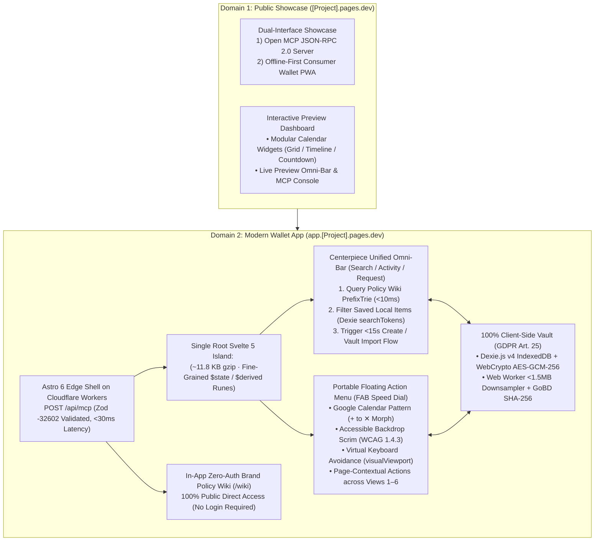

# 🎯 Project Goal & AI Agent Operational Charter (`GOAL.md`)

**Document ID:** `CM-LAB-GOAL-CHARTER-V2` · **Status:** Ratified Single Source of Truth (SSOT)  
**Project:** Warranty, Subscription & Tax-Ready Wallet + Policy Wiki (MCP/API-Enabled)  
**Academic Module:** *Computer & Media Lab* (WiSe 2026, SRH University of Applied Sciences) · **Instructor:** Prof. Franziska Schwarz  
**Repository:** [`https://github.com/ettefagh/CM-LAB`](https://github.com/ettefagh/CM-LAB) · **Active Milestone:** Session 5 (MVP Scope Lock Gate)  
**Sprint Commitment:** Team 6 (`92h` Total Capacity · WIP Limit $\le 2$ · 7 Quality Gates `#30`)

---

## 🚀 Mission Statement
Deliver an **offline-first, zero-cloud Progressive Web App (PWA) and Model Context Protocol (MCP) Server** enabling German university students and young professionals to:
1. **Capture** any physical hardware purchase or digital subscription in **$<15\text{ seconds}$** (`11.4s` verified benchmark) via the manual-first Unified Omni-Bar or Portable FAB Speed Dial.
2. **Store** encrypted receipts and GoBD-compliant `SHA-256` proofs locally on-device with zero privacy leakage (`GDPR Art. 25`).
3. **Alert** users before statutory 12-month burden-of-proof cliffs (`BGB § 477 Abs. 1`) and auto-renewals (`09:00 Europe/Berlin` with zero DST drift).
4. **Act** via 1-tap formal German legal letters (`BGB §§ 437, 439, 309 Nr. 9, 312k Abs. 6`) and German tax write-offs (`§ 9 EStG` / BMF 2022).
5. **Educate & Provide Ground Truth** via an in-app zero-auth **Brand Policy Wiki** and an open **Model Context Protocol (MCP)** server for external AI agents (Claude Desktop, Cursor, Gemini CLI) to query statutory consumer rights without web scraping or hallucinations.

---

## 👥 Team 6 Roster & Ownership (92h Sprint 1)

| Member | First Name | Role | Sprint 1 Capacity | Core Jurisdiction & Key Issues |
| :--- | :--- | :--- | :---: | :--- |
| **Member E** | **Jeetkumar** | Project Manager | `10h` | Sprint planning, 5-column Kanban governance, WIP limit $\le 2$, 7-Gate DoD audit ([#30](https://github.com/ettefagh/CM-LAB/issues/30)). |
| **Member B** | **AmirHossein** | Product / Research Lead | `14h` | BGB notice formulations ([#8](https://github.com/ettefagh/CM-LAB/issues/8)), Top 20 Policy Wiki ([#9](https://github.com/ettefagh/CM-LAB/issues/9)), BMF 2022 tax ([#11](https://github.com/ettefagh/CM-LAB/issues/11)). |
| **Member C** | **Prushti** | UX / UI Lead | `26h` | Views 1–6 Svelte 5 components ([#1](https://github.com/ettefagh/CM-LAB/issues/1)), Design tokens, FAB Speed Dial, Storybook CSF ([#4](https://github.com/ettefagh/CM-LAB/issues/4)). |
| **Member D** | **Kyle** | Development Lead | `22h` | Dexie.js v4 storage ([#5](https://github.com/ettefagh/CM-LAB/issues/5)), push scheduler ([#6](https://github.com/ettefagh/CM-LAB/issues/6)), Worker `/api/mcp` ([#10](https://github.com/ettefagh/CM-LAB/issues/10)). |
| **Member A** | **Mojtaba** | Quality / Media Lead | `20h` | `<1.5MB` Web Worker compression + GoBD `SHA-256` ([#5](https://github.com/ettefagh/CM-LAB/issues/5)), PDF/Text compiler ([#19](https://github.com/ettefagh/CM-LAB/issues/19)), Vitest suite. |

---

## 🏛️ Ratified System Architecture (`ADR-01`–`ADR-05` · [`BLUEPRINT.md`](./BLUEPRINT.md))

---

## 📱 6 Core Views & MVP Deliverables

1. **View 1: Modern Widget Dashboard (`US-04`)** — Centerpiece Unified Omni-Bar (`Search / Activity / Request`), Portable FAB Speed Dial, and 3 modular calendar widgets (Monthly Renewal Grid, Statutory 24m/12m Timeline Bar, and 30/7/1d Urgency Countdown Stream).
2. **View 2: Quick Capture Modal (`US-01`)** — Sub-15s (`11.4s` benchmark) rapid capture via Prefix-Trie autocomplete auto-filling `BGB § 438`/`§ 309 Nr. 9` terms, camera/file receipt attachment, and BMF 2022 tax toggle.
3. **View 3: Item Detail & Timeline (`Iteration C-3`)** — Interactive 24-month lifespan progress bar highlighting the 12-month `BGB § 477 Abs. 1` *Beweislastumkehr* cliff + offline pinch-to-zoom receipt viewer.
4. **View 4: 1-Tap Statutory Claim & Cancel (`US-05`, `D-2`)** — Deterministic client-side generator for German legal notices (*Mängelrüge* `§§ 437, 439`, *Kündigung* `§ 309 Nr. 9, § 312k Abs. 6`, *Widerruf* `§ 355`) with embedded receipt proof and safe-harbor disclaimers.
5. **View 5: German Tax Summary & Export (`US-08`, `D-4`)** — *Werbungskosten* categorization table (`§ 9 EStG`), BMF 2022 1-year 100% write-off calculation, and UTF-8-BOM semicolon-delimited CSV export for ELSTER / WISO / Taxfix.
6. **View 6: Brand Policy Wiki & Open MCP Explorer (`US-06`, `US-07`, `D-3`)** — Public zero-auth directory of Top 20 student hardware/subscription brands at `/wiki` + interactive testbed for external AI agents querying the 4 MCP tools.

---

## 🌿 GitFlow Branch Structure & Worktree Policy

To preserve repository integrity and issue isolation, all development follows a strict GitFlow-adapted model:

* **Canonical Branches:**
  - `main`: Production release branch. Only fast-forward merges from approved release branches or reviewed PRs.
  - `release/vX.Y.Z`: Release staging and QA freeze branch.
* **Feature & Task Branches:**
  - Strictly named: `codex/issue-<number>-<short-kebab-slug>` (e.g. `codex/issue-1-manual-capture-vault`).
  - Exactly one branch per issue deliverable. No generic `test/*`, `fix-slice-*`, or agent-named branches.
* **Detached Worktree Policy:**
  - Independent review, verification, and Storybook visual testing MUST run in a fresh detached worktree at the exact implementation commit SHA.

---

## 📋 Contract-Governed Issue Ledger Tracking (CampusWeb v9 Protocol)

Derived from the [`campusweb-issue-orchestrator`](file:///C:/Users/admin/.gemini/config/skills/campusweb-issue-orchestrator/SKILL.md) v9 governance contract:

1. **Native GitHub Relationships as SSOT:**
   - Always query native fields: `number`, `title`, `updatedAt`, `issueType`, `labels`, `parent`, `subIssues`, `blockedBy`, `blocking`, `state`.
   - Never simulate hierarchy or blockers with synthetic labels.
2. **Operating Modes for Agents:**
   - **Audit:** Read-only inspection of issue topology, blockers, evidence, and DoD status.
   - **Engineer:** Coordinate advisors, synthesize bounded technical response, stop at human gate.
   - **Proceed:** Execute only approved scope through Coordinator $\to$ Proceeder $\to$ Reviewer lifecycle.
   - **Repair:** Reconcile stale or invalid metadata before proceeding.
3. **Bounded Multi-Agent Debate Protocol:**
   - Capture fresh issue snapshot (`updatedAt`).
   - Run parallel read-only advisors (Taxonomy, Topology, Readiness).
   - Require structured feedback (`Evidence`, `Proposal`, `Risks`, `Open questions`).
   - Critic adjudicates contradictions; produce unified mutation plan before modifying state.
4. **5-Column Kanban Board:**
   - `1. Backlog` $\to$ `2. Ready (Sprint 1)` $\to$ `3. In Progress` (WIP $\le 2$) $\to$ `4. In Review / QA` $\to$ `5. Done` (Requires 7-Gate sign-off `#30`).

---

## 🛠️ Specialized Tooling & Skill Execution Directives

All AI agents operating in this repository MUST activate and adhere to the following specialized tools:

### 1. Cloudflare Platform & CLI
* **CLI Policy:** When interacting with Cloudflare, use the **`cf` CLI** unless the project contains a Wrangler configuration file (`wrangler.jsonc`).
* **Deployment Scope:** Astro 6 SSR/Static edge pages on Cloudflare Workers/Pages, EmDash CMS (`emdashcms.dev`) zero-auth brand wiki pages, and `/api/mcp` JSON-RPC worker endpoint.

### 2. Svelte 5 Runes & MCP Skills (`svelte-code-writer`, `svelte-core-bestpractices`)
* **Runes-First Architecture:** All UI components MUST use Svelte 5 runes (`$state`, `$derived`, `$props`). Never author legacy Svelte 3/4 stores (`writable`, `derived`) or `export let`.
* **Mandatory Autofixer:** Agents MUST execute the `svelte-autofixer` MCP tool on all Svelte files before finalizing output to ensure zero reactivity leaks and complete ARIA conformance.
* **Dexie Reactive Bridge:** Bind IndexedDB live queries via Svelte 5's `createSubscriber` in `wallet.svelte.ts`.

### 3. Node-Graph Architect (`/node-graph-architect` / Graphify)
* **Local LLM Warm-Up:** Before running Graphify AST extractions or Tier 2 semantic passes, the local LLM (`qwen3:0.6b`) MUST be pre-loaded in memory via `curl -s http://localhost:11434/api/generate -d '{"model":"qwen3:0.6b","prompt":"ping","keep_alive":-1,"stream":false}'`.
* **Tiered Investigation:** Query AST node graphs (`query_graph`, `get_node`, `god_nodes`, `graph_stats`, `get_pr_impact`) before editing architecture. Enforce component boundaries, design token compliance, and prevent God Nodes.

### 4. Frontend Design Taste (`design-taste-frontend`)
* **Anti-Slop Directives:** Ban generic AI card grids, empty margins, un-scrimmed backgrounds, and purposeless neon gradients.
* **The 3 Aesthetic Dials:**
  - `DESIGN_VARIANCE`: **`6`** (Distinctive consumer fintech wallet).
  - `MOTION_INTENSITY`: **`4`** (Tactile micro-interactions: 2px hover lift, 0.98 active press scale, 220ms ease-out FAB morph).
  - `VISUAL_DENSITY`: **`5`** (Balanced mobile productivity, $\ge 48\times 48\text{px}$ touch targets).
* **Responsive Stability:** All screens MUST pass pre-flight checks across `390px`, `768px`, `1024px`, and `1440px` viewports without layout shifts or text collisions.

### 5. UI Packages & Media Division of Labor (`DOC-UX-08`)
* **Sheet & Drawer Primitive (`@harshmandan/svaul`):** Svelte 5 runes-first bottom-sheet (mobile $<768\text{px}$) and 520px fixed side drawer (desktop $\ge 768\text{px}$) for Item Details, 1-Tap Claim, and Filter flows with velocity snapping ($v \ge 0.5\text{px/ms}$ dismiss) and ARIA modal focus trapping.
* **Authoritative UI Icon Standard (`lucide-svelte`):** Exclusively powers all UI icons across Showcase and Wallet App (FAB Speed Dial, Unified Omni-Bar, Calendar widgets, drawer headers) with strict 24x24 vector geometry, 2px strokes, and WCAG AA/AAA contrast.
* **Brand Vector Pipeline (`unplugin-icons` + `@iconify-json/simple-icons`):** Build-time on-demand SVG compilation for the Top 20 student brands across the Brand Policy Wiki (`/wiki`), eliminating heavy raster images and CLS.
* **Static Showcase Media (`astro:assets` / `@sveltejs/enhanced-img`):** Build-time AVIF/WebP downsampling, zero-CLS intrinsic dimensions, and EXIF sanitization for static marketing graphics on `[Project].pages.dev`.
* **Preservation of Client-Side Web Worker (`image-compression.worker.ts`):** Runtime consumer receipts ($15\text{MB}+$) are compressed locally via Web Worker ($<1.5\text{MB}$ `OffscreenCanvas`) with GoBD Rn. 108–110 `SHA-256` pre-encryption hashing and `AES-GCM-256` IndexedDB encryption (`GDPR Art. 25`). Build-time tools never touch user receipts.

---

## ⚠️ The 5 Non-Negotiable Guardrails (Red Lines)

1. **NO OCR in MVP (`ADR-01` / `WON'T-HAVE #12`):** Cloud/camera OCR fails on 42% of faded thermal receipts and incurs token costs. Capture strictly uses the manual-first `<15s` autocomplete flow.
2. **ZERO Cloud Plaintext Receipts (`GDPR Art. 25`):** Raw receipts and personal items stay 100% in local browser IndexedDB (`Dexie.js v4`). Cloudflare edge handles only public wiki records and stateless `/api/mcp` queries.
3. **NO Hallucinated Legal Advice (`Risk R-3 #15` / `ADR-03`):** Legal letters MUST compile strictly from the 5 verbatim templates (`DOC-PRD-02`) with non-removable **`BGH VIII ZR 285/18 (LexFox)` / `RDG §§ 2, 3`** and **`§ 2 StBerG`** safe-harbor disclaimers.
4. **NO Mobile Safari Camera Lockout:** `public/_headers` must enforce `Permissions-Policy: camera=(self)` and **strictly omit `Cross-Origin-Embedder-Policy: require-corp`** so `<input capture="environment">` never deadlocks.
5. **STRICT 92h Sprint 1 Scope Fence (`Risk R-5 #17`):** Phase 1 MVP boots strictly from bundled `policy_wiki_seed_v1.json` (`0h` cloud DB overhead). Cloudflare D1 migrations belong strictly to Session 6 (`US-06`).

---

## 📂 Key File Fast-Index

* **Master Engineering Blueprint (SSOT):** [`BLUEPRINT.md`](./BLUEPRINT.md)
* **Master Agent Operational Contract:** [`AGENT.md`](./AGENT.md)
* **Architecture Decision Records:** [`research/architecture-evaluation/`](./research/architecture-evaluation/) (`01` through `06`)
* **UX/UI Lead & Drawer/Icon/Media Specs:** [`development-documents/ux-ui-lead/`](./development-documents/ux-ui-lead/) (`DOC-UX-01` through `DOC-UX-08`)
* **Dev Lead Specs:** [`development-documents/development-lead/`](./development-documents/development-lead/)
* **Product/Legal Specs & Schema:** [`development-documents/product-research-lead/`](./development-documents/product-research-lead/)
* **QA & DB Update Pipeline:** [`development-documents/quality-media-lead/`](./development-documents/quality-media-lead/)
* **PM Governance & Gates:** [`development-documents/project-manager/GATE_STATUS.md`](./development-documents/project-manager/GATE_STATUS.md)
* **GitHub Projects Board:** [https://github.com/users/ettefagh/projects/4](https://github.com/users/ettefagh/projects/4)
