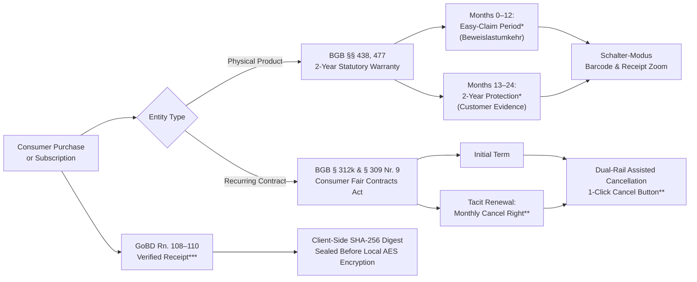

# 🛡️ Rights & Renewals

> **Sovereign Consumer Rights, Subscription & Warranty Wallet with Brand Policy Wiki and Open MCP Server**

[](https://rightsandrenewals-app.pages.dev)
[](https://rightsandrenewals.pages.dev/wiki)
[](https://github.com/ettefagh/CM-LAB)
[](https://github.com/ettefagh/CM-LAB)
[](https://rightsandrenewals-app.pages.dev)
[](https://svelte.dev)

---

## 📖 Overview

**Rights & Renewals** is an offline-first, client-side encrypted Progressive Web Application (PWA) and consumer rights toolkit built to protect individuals from subscription traps, forgotten warranty expirations, and opaque retail return hurdles.

Grounded in German and European consumer protection law (**BGB §§ 437, 438, 477**, **BGB § 312k**, **BGB § 309 Nr. 9**, and **GoBD Rn. 108–110**), the platform pairs a zero-knowledge local encrypted vault with a public Brand Policy Wiki, an editorial change-monitoring CMS (*EmDash*), and an open Model Context Protocol (MCP) server for autonomous AI agents.

```
                  ┌─────────────────────────────────────────────────────────┐
                  │                 RIGHTS & RENEWALS                       │
                  │   Sovereign Consumer Protection Monorepo Architecture   │
                  └────────────────────────────┬────────────────────────────┘
                                               │
             ┌─────────────────────────────────┴─────────────────────────────────┐
             ▼                                                                   ▼
┌───────────────────────────────┐                               ┌───────────────────────────────┐
│     @cmlab/app (PWA)          │                               │     @cmlab/showcase           │
│  https://rightsandrenewals-   │                               │  https://rightsandrenewals.   │
│         app.pages.dev         │                               │           pages.dev           │
├───────────────────────────────┤                               ├───────────────────────────────┤
│ • Astro 5 + Svelte 5 Runes    │                               │ • Brand Policy Wiki (/wiki)   │
│ • Client-side AES-GCM-256     │                               │ • EmDash Editorial CMS        │
│ • IndexedDB Sovereign Vault   │                               │ • Open MCP JSON-RPC Server    │
│ • Daily-Life Dashboard        │                               │ • Threlte / Three.js 3D Scene │
│ • Dual-Rail § 312k Cancel     │                               │ • Pre-rendered SSR on Edge    │
│ • Schalter-Modus Return Pass  │                               │ • Zero-PII Cloudflare Worker  │
│ • Dual iCal Feeds & PIN Auth  │                               └───────────────┬───────────────┘
└───────────────┬───────────────┘                                               │
                │                                                               │
                └──────────────────────────────┬────────────────────────────────┘
                                               ▼
                        ┌───────────────────────────────────────────────┐
                        │              SHARED CORE PACKAGES             │
                        ├───────────────────────────────────────────────┤
                        │ • @cmlab/core: Models, Notice Compiler, Vault │
                        │ • @cmlab/design-tokens: Tokens, CSS Variables │
                        └───────────────────────────────────────────────┘
```

---

## 🚀 Live Cloudflare Deployments

The application and showcase are deployed across Cloudflare Pages edge infrastructure with automatic SSL, HTTP/3, and zero-PII edge analytics:

| Surface | Canonical URL | Alternative / Mirror URLs | Purpose & Features |
| :--- | :--- | :--- | :--- |
| 📱 **Sovereign Wallet App (PWA)** | [**`rightsandrenewals-app.pages.dev`**](https://rightsandrenewals-app.pages.dev) | [`rights-and-renewals-app.pages.dev`](https://rights-and-renewals-app.pages.dev)<br>[`cm-lab-app.pages.dev`](https://cm-lab-app.pages.dev) | Primary user application: offline-first vault, daily dashboard, spend donut chart, 1-click cancel, in-store return pass, full entry editing. |
| 🤖 **AI Agent Setup Guide** | [**`rightsandrenewals.pages.dev/agent-setup`**](https://rightsandrenewals.pages.dev/agent-setup) | [`rightsandrenewals.pages.dev/setup`](https://rightsandrenewals.pages.dev/setup) | Cloudflare-styled agent setup desk with 1-click prompt, tabbed configurations for 6 major AI agents, and copyable CLI commands. |
| 🌐 **Brand Policy Wiki** | [**`rightsandrenewals.pages.dev/wiki`**](https://rightsandrenewals.pages.dev/wiki) | [`rights-and-renewals.pages.dev/wiki`](https://rights-and-renewals.pages.dev/wiki)<br>[`cm-lab-showcase.pages.dev/wiki`](https://cm-lab-showcase.pages.dev/wiki) | Static encyclopedia covering statutory cancellation pathways, return addresses, and retention dark patterns across 20 major consumer brands. |
| 📰 **EmDash CMS & Telemetry Desk** | [**`rightsandrenewals.pages.dev/emdash`**](https://rightsandrenewals.pages.dev/emdash) | [`/_emdash/admin`](https://rightsandrenewals.pages.dev/_emdash/admin) | Real EmDash v1.4.0 headless CMS integration on Cloudflare D1/R2, real-time AGB change telemetry, and SHA-256 audit seal ledger. |
| 🔌 **Rights & Renewals MCP Server** | [**`rightsandrenewals.pages.dev/api/mcp`**](https://rightsandrenewals.pages.dev/api/mcp) | POST endpoint (`rights-and-renewals`) | Rebranded Model Context Protocol server exposing 5 statutory tools for autonomous AI agents (Claude, Cursor, Windsurf, Gemini). |
| 📡 **AI Discovery Manifests** | [`/.well-known/mcp/server-card.json`](https://rightsandrenewals.pages.dev/.well-known/mcp/server-card.json)<br>[`/.well-known/agent-skills/index.json`](https://rightsandrenewals.pages.dev/.well-known/agent-skills/index.json) | [`/.well-known/ai-catalog.json`](https://rightsandrenewals.pages.dev/.well-known/ai-catalog.json)<br>[`/agent-setup/prompt.md`](https://rightsandrenewals.pages.dev/agent-setup/prompt.md) | Standardized AI agent discovery cards (SEP-2127, agentskills.io, ARD v1.0, RFC 8288 Link headers, WebMCP). |
| 📅 **Dual iCal Feeds** | [`/api/calendar/subscriptions.ics`](https://rightsandrenewals-app.pages.dev/api/calendar/subscriptions.ics)<br>[`/api/calendar/warranties.ics`](https://rightsandrenewals-app.pages.dev/api/calendar/warranties.ics) | Direct URL import | Universal `.ics` subscription renewal and warranty expiration calendar feeds compatible with Apple, Google, and Outlook calendars. |

---

## ⚖️ Legal Architecture & Statutory Grounding

Rights & Renewals embeds deterministic German and European consumer protection law into software workflows:



### 1. Easy-Claim Period & 2-Year Statutory Warranty (`§§ 438, 477 BGB`)
* **Months 1–12 (*Easy-Claim Period\**):** Under § 477 Abs. 1 BGB (*Beweislastumkehr*), any defect appearing within the first year is legally presumed to have existed at delivery. The seller must prove otherwise.
* **Months 13–24 (*2-Year Protection\**):** Statutory warranty remains active through month 24 (§ 438 Abs. 1 Nr. 3 BGB), with the app tracking timeline milestones and preparing ready-to-sign formal notice letters.

### 2. 1-Click Cancel & Monthly Cancel Right (`§ 312k & § 309 Nr. 9 BGB`)
* **Mandatory Cancellation Button (§ 312k BGB):** Online providers must provide a direct, 2-step cancellation button on their websites without requiring customer support calls or hidden retention forms.
* **Monthly Cancellation of Renewed Contracts (§ 309 Nr. 9 BGB):** Automatic contract renewals (*stillschweigende Verlängerung*) cannot lock users into annual cycles; consumers retain the right to terminate monthly with maximum 1 month's notice.

### 3. GoBD Tamper-Proof Audit Seal (`GoBD Rn. 108–110`)
* When capturing receipt photos, the browser Web Worker downsamples the image and calculates a client-side SHA-256 cryptographic digest **before** local encryption. This proves the receipt photo was not modified after capture, fulfilling German tax and accounting evidentiary standards.

### 4. Sofortabschreibung Tax Deductibility (`§ 9 EStG` & `BMF 22.02.2022`)
* Work and study equipment (laptops, software, peripherals) qualify for 100% digital immediate depreciation (*Sofortabschreibung*) in the year of acquisition. The app generates an annual, audit-compliant *Werbungskosten* tax summary.

---

## ✨ Key Features & Capabilities

### 📱 Daily-Life Dashboard & Navigation
* **Clean Header:** Features only the official App Icon (`/favicon.svg`) and Name (`Rights & Renewals`) alongside a live Notification Center button.
* **Separated Universal Omni-Bar (`⌘K` / `Ctrl+K`):** Decoupled from the header for instant cross-entity searching across warranties, subscriptions, brand policies, and system commands (`>tax`, `>claim`, `>wiki`).
* **Interactive SVG Monthly Auto-Pay Donut Chart:** Visualizes exact monthly cash outflow with color-coded slices for each active recurring subscription.
* **First-Glance Subscriptions by Concurrency & Price:** Subscriptions are strictly prioritized by billing frequency (`Daily` $\to$ `Weekly` $\to$ `Monthly` $\to$ `Quarterly` $\to$ `Yearly`) and price descending, with clear `● Auto-Pay` (automatic deduction) or `Invoice Due` (manual transfer) indicators.
* **Price-Free Warranty Cards with Progress Bars:** Sunk laptop or hardware purchase prices are hidden; cards showcase a visual **Coverage Lifespan Progress Bar**, remaining coverage time, and Easy-Claim Period badges.
* **Full Entry Editing:** 1-tap **`Edit` (`Pencil`)** buttons on every card and in the detail drawer allow editing of all fields (title, provider, cycle, payment method, serial number, barcode, cancellation URL, tax status).
* **Human-Friendly Date Formatting:** Replaces raw ISO strings with natural dates (`July 7th, 2026`) and relative badges (`in 3d`, `7 mos left`).
* **Consumer Rights Glossary Footer:** Asterisked terms (`*`, `**`, `***`) are explained in plain English and hyperlinked directly to the public wiki.

### 🛡️ Retail Counter Desk Mode (*Schalter-Modus*)
* **Instant Code 128 Barcode:** Renders high-contrast, scannable SVGs from receipt codes or serial numbers for retail handheld scanners at customer service desks.
* **1-Tap Serial / IMEI Copy:** High-contrast monospace display with instant clipboard copy for store clerks.
* **Full-Screen Receipt Zoom (*Kassenbeleg*):** High-contrast, pinch-to-zoom photo viewer for presenting proof-of-purchase in bright retail lighting.

### 🔄 Dual-Rail § 312k Assisted Cancellation
* **Rail A (Statutory Web Route):** Copies contract/account tokens to clipboard and opens the provider's direct cancellation page in one tap. Initiates a 14-day tracking window for statutory cancellation confirmation (§ 312k Abs. 4 BGB).
* **Rail B (Deterministic Written Notice):** Generates DIN 5008 formal cancellation letters with SEPA direct-debit revocation for email, fax, or registered mail, including emergency termination when a cancellation button is missing (§ 312k Abs. 6 BGB).

### 🔒 Zero-Knowledge Client-Side Cryptography
* All user records, receipt images, and alarm schedules are encrypted on-device via **AES-GCM-256** with keys derived using **PBKDF2** (100,000 iterations, SHA-256).
* Zero unencrypted user data ever touches a remote server or database.

### 🤖 Rights & Renewals MCP Server
* Public MCP endpoint: `https://rightsandrenewals.pages.dev/api/mcp` (Streamable HTTP; no OAuth sign-in required).
* Connect with the setup instructions at [`/agent-setup`](https://rightsandrenewals.pages.dev/agent-setup). Verify the live connection and inspect the tools exposed by the server before relying on it.
* OAuth sign-in for the separate EmDash CMS, if enabled, applies only to EmDash resources and does not authenticate the public MCP endpoint.
* **AI-Agent Discovery Standards:**
  * **MCP Server Card:** SEP-2127 manifest at [`/.well-known/mcp/server-card.json`](https://rightsandrenewals.pages.dev/.well-known/mcp/server-card.json)
  * **Agent Skills Discovery:** agentskills.io format at [`/.well-known/agent-skills/index.json`](https://rightsandrenewals.pages.dev/.well-known/agent-skills/index.json) and [`SKILL.md`](https://rightsandrenewals.pages.dev/.well-known/agent-skills/rights-and-renewals/SKILL.md)
  * **Agent Resource Discovery (ARD):** [`/.well-known/ai-catalog.json`](https://rightsandrenewals.pages.dev/.well-known/ai-catalog.json)
  * **RFC 8288 Link Headers:** Emitted across all responses linking to `api-catalog` and `service-doc`.
  * **In-Browser WebMCP Helper:** Client-side tool registration via `src/components/webmcp.ts`.

### 📰 Real EmDash CMS (v1.4.0) & Telemetry Desk
* **Open-Source Astro Integration:** Built directly with the official [`emdash@1.4.0`](https://github.com/emdash-cms/emdash) package and `@emdash-cms/cloudflare`.
* **Edge Architecture:** Integrated into `@cmlab/showcase` with Cloudflare D1 (`DB`), R2 bucket (`MEDIA`), and KV session storage (`SESSION`).
* **Visual Admin Studio ([`/_emdash/admin`](https://rightsandrenewals.pages.dev/_emdash/admin)):** React-based editorial studio with passkey authentication, Portable Text editing, media management, and dev-bypass login for local development.
* **Live Telemetry & Policy Diffing ([`/emdash`](https://rightsandrenewals.pages.dev/emdash)):** High-density desk displaying real-time AGB SHA-256 cryptographic fingerprints, 90-day SLA freshness counters (20/20 Fresh), and interactive click-to-load brand inspection.

---

## 🏗️ Monorepo Structure

```
optimistic-bardeen/
├── apps/
│   ├── app/                         # Sovereign Consumer Wallet (PWA)
│   │   ├── src/
│   │   │   ├── components/          # Svelte 5 UI components (Runes)
│   │   │   │   ├── auth/            # Email PIN authentication gate
│   │   │   │   ├── capture/         # <15s Quick Capture modal
│   │   │   │   ├── omnibar/         # Unified Universal Omni-Bar (⌘K)
│   │   │   │   ├── views/           # ItemDetailDrawer, AssistedCancellation, Zoom
│   │   │   │   └── widgets/         # CounterDeskCard, TimelineBar, UrgencyRadar
│   │   │   ├── state/               # wallet.svelte.ts reactive store
│   │   │   ├── utils/               # dateFormatters.ts, seedVaultUtility.ts
│   │   │   └── workers/             # image-compression.worker.ts (GoBD SHA-256)
│   │   └── dist/                    # Cloudflare Pages SSR build output
│   │
│   └── showcase/                    # Public Brand Policy Wiki & Open MCP Server
│       ├── src/
│       │   ├── components/          # Three.js / Threlte 3D showcase & EmDash desk
│       │   ├── data/                # policy_wiki_seed_v1.json (20 brands)
│       │   └── pages/
│       │       ├── api/             # /api/mcp (JSON-RPC 2.0), /api/emdash
│       │       ├── emdash.astro     # EmDash CMS editorial desk
│       │       ├── wiki/            # Static pre-rendered brand wiki pages
│       │       └── index.astro      # Public interactive landing showcase
│       └── dist/                    # Cloudflare Pages SSR build output
│
├── packages/
│   ├── core/                        # Shared TypeScript business logic
│   │   ├── src/
│   │   │   ├── crypto/              # AES-GCM-256 Web Crypto vault
│   │   │   ├── legal/               # DIN 5008 & PDF statutory notice compiler
│   │   │   ├── scheduler/           # 30/7/1-day push alert scheduler (DST-safe)
│   │   │   ├── search/              # PrefixTrie brand autocomplete
│   │   │   ├── telemetry/           # Zero-PII Cloudflare Analytics Engine
│   │   │   └── types/               # TypeScript domain contracts
│   │   └── tests/                   # Vitest unit test suite (88 tests)
│   │
│   └── design-tokens/               # Design token engine & CSS variables
│       └── tokens/                  # Colors (Pine Teal, Terracotta), typography
│
├── docs/                            # Canonical UX lexicon & project glossary
│   └── PROJECT_GLOSSARY.md          # Canonical terminology & footnote rules
├── tests/
│   ├── e2e/                         # Python multi-tier E2E test harness
│   │   ├── runner.py                # Universal test runner CLI
│   │   ├── test_tier1_feature_coverage.py
│   │   ├── test_tier2_data_and_schema_integrity.py
│   │   ├── test_tier3_fsm_and_combinations.py
│   │   └── test_tier4_student_journeys.py
│   └── test_m2_adversarial_challenger.mjs
│
├── pitch-deck/                      # 16:9 Widescreen Investor Pitch Deck
├── workshop-materials/              # 4-Block Workshop Canvas & Slide visuals
└── package.json                     # Monorepo scripts & pnpm workspace config
```

---

## 🛠️ Tech Stack & Engineering Standards

| Layer | Technologies | Key Rationale |
| :--- | :--- | :--- |
| **Frontend Framework** | **Svelte 5** (`$state`, `$derived`, `$props`, runes), **Astro 5** | Unmatched reactivity performance, zero virtual DOM overhead, native SSR. |
| **Storage & Encryption** | **Dexie.js** (IndexedDB), **Web Crypto API** (AES-GCM-256, PBKDF2) | True offline-first sovereignty with zero unencrypted server-side data retention. |
| **Worker Processing** | **Web Workers**, **OffscreenCanvas** | Non-blocking receipt image downsampling ($\le 2048$px, $<1.5$MB) and GoBD SHA-256 hashing. |
| **Edge & Hosting** | **Cloudflare Pages**, **Workers SSR Adapter** | Sub-50ms global latency, automatic edge caching, zero cold starts. |
| **Document Generation** | **`pdf-lib`**, **DIN 5008 Layout Engine** | Deterministic, client-side PDF and plaintext legal dossier generation. |
| **Agent Protocols** | **Model Context Protocol (MCP)**, JSON-RPC 2.0 | Native compatibility with autonomous AI agents (Codex, Claude, ChatGPT). |
| **Quality & Testing** | **Vitest**, **Python E2E Harness**, **`svelte-autofixer`** | Multi-tier test pyramid verifying DOM contracts, state machines, and legal math. |

---

## 🧪 Testing & Verification

The codebase maintains a zero-regression, multi-tier verification harness covering unit logic, DOM contracts, and real-world student journeys:

### 1. Unit & Integration Suite (`Vitest`)
```powershell
cmd /c pnpm test
```
* **88/88 Vitest tests passed** across `@cmlab/core`.
* Validates AES-GCM encryption/decryption, GoBD SHA-256 digest sealing, DST alert recalibration, DIN 5008 dossier formatting, and PrefixTrie indexing.

### 2. Multi-Tier End-to-End Suite (`Python`)
```powershell
cmd /c python tests/e2e/runner.py --all
```
* **61/61 tests passed** (100.0%) covering:
  * **Tier 1:** DOM & accessibility contracts (`#app-header`, `#omnibar-root`, `#app-dashboard-grid`, `/agent-setup` tabs, ARIA roles, copy contracts).
  * **Tier 2:** Data & schema integrity (Dexie schema v1/v2, Web App Manifest, JSON-RPC schemas, SEP-2127 server card).
  * **Tier 3:** Finite state machines & cross-feature workflows (OmniBar $\to$ Drawer $\to$ Notice Compiler).
  * **Tier 4:** End-to-end student journeys (Spotify cancellation, MacBook 12m cliff, unlisted purchase capture, Werbungskosten export).

### 3. Live Edge Verification
```powershell
cmd /c node scratch/verify_live_cloudflare.mjs
```
* **48/48 live Cloudflare checks passed** across production and mirror domains, verifying HTTP 200 responses, brand assets, wiki slugs, iCal calendar feeds, and MCP endpoints.

---

## 💻 Getting Started

### Prerequisites
* **Node.js:** $\ge 20.0.0$
* **pnpm:** $\ge 9.0.0$
* **Python:** $\ge 3.10$ (for the E2E test harness)

### Installation
```bash
# Clone the repository
git clone https://github.com/ettefagh/CM-LAB.git
cd CM-LAB

# Install monorepo dependencies
pnpm install

# Build all packages
pnpm build
```

### Running Locally
```bash
# Launch the Sovereign Wallet PWA (Port 3001)
pnpm --filter @cmlab/app dev

# Launch the Public Brand Policy Wiki & Showcase (Port 3000)
pnpm --filter @cmlab/showcase dev
```

Visit [`http://localhost:3001`](http://localhost:3001) for the Wallet App and [`http://localhost:3000`](http://localhost:3000) for the Policy Wiki & Showcase.

---

## 👥 Academic Context & Team Roster

**Rights & Renewals** was designed and engineered as part of the *Computer & Media Lab* course at **SRH University of Applied Sciences** (*SRH Hochschule*), Wintersemester 2026.

* **Course Module:** Computer & Media Lab
* **Supervising Professor:** Prof. Franziska Schwarz
* **Working Group:** **Team 6**

### Team 6 Role Assignments & Contributions

| Role | Team Member | Primary Assigned Scope & Architecture |
| :--- | :--- | :--- |
| **Project Manager** | **Jeetkumar** | Agile sprint governance, MoSCoW backlog management, 5-column Kanban oversight, Risk Register (`R-1`–`R-5`), and 7-Gate Definition of Done. |
| **Product & Research Lead** | **AmirHossein** ([`@ettefagh`](https://github.com/ettefagh)) | User discovery, statutory BGB notices (§§ 437, 438, 477, 309, 312k), Policy Wiki 20-brand taxonomy, German tax logic (§ 9 EStG / BMF 2022), and Project Glossary. |
| **UX / UI Lead** | **Prushti** | Mobile & desktop interaction design, Svelte 5 component architecture, `<15s` Quick Capture flow, WCAG 2.1 AA accessibility, and design tokens. |
| **Development Lead** | **Kyle** | Sovereign offline-first Dexie storage engine, DST-safe alert scheduler, Cloudflare Pages SSR adapter, and Open MCP JSON-RPC 2.0 server. |
| **Quality & Media Lead** | **Mojtaba** | Client-side receipt compression, GoBD SHA-256 audit sealing, DIN 5008 PDF/text notice compiler, and automated Python E2E test harness. |

---

## ⚖️ Legal Notice & Safe Harbor

> **Hinweis zur Rechtsberatung (RDG / StBerG):**  
> *Rights & Renewals* ist ein technisches Organisationswerkzeug für Verbraucher. Die bereitgestellten Vorlagen, Fristberechnungen und Wiki-Inhalte stellen keine Rechtsberatung im Sinne des Rechtsdienstleistungsgesetzes (RDG) und keine Steuerberatung im Sinne des Steuerberatungsgesetzes (StBerG) dar. Alle gesetzlichen Fristen basieren auf den Regelungen des Bürgerlichen Gesetzbuches (BGB) und Richtlinien des Bundesfinanzministeriums (BMF). Im Streitfall wird die Konsultation einer Verbraucherzentrale oder eines zugelassenen Rechtsanwalts empfohlen.

---

## 📄 License

This project is licensed under the [MIT License](./LICENSE).  
Copyright © 2026 Team 6 · SRH University of Applied Sciences.
