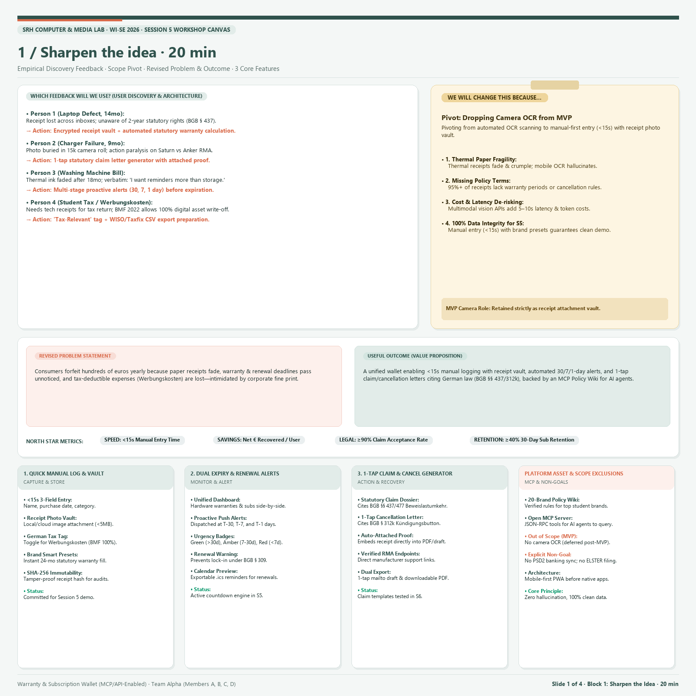
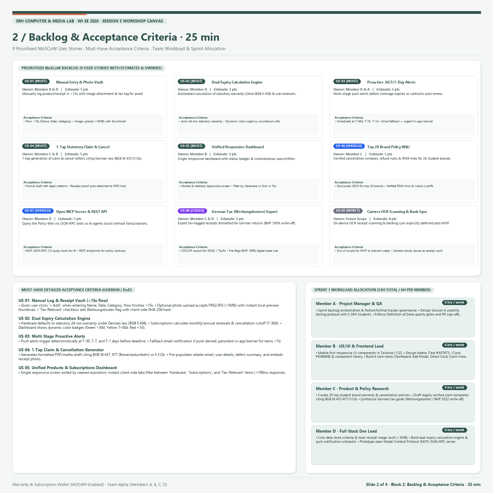
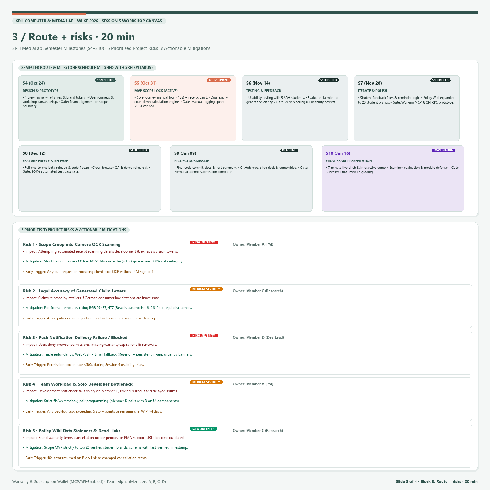
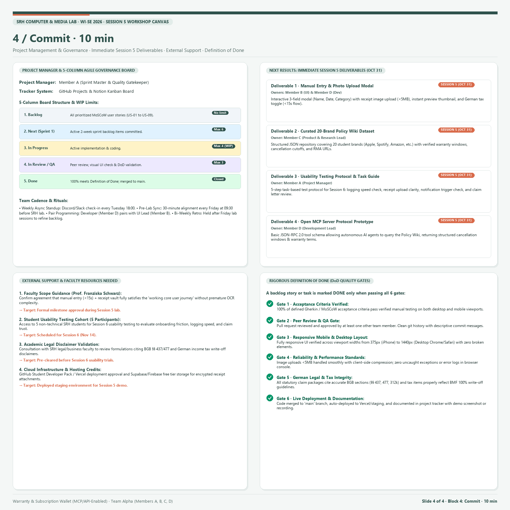
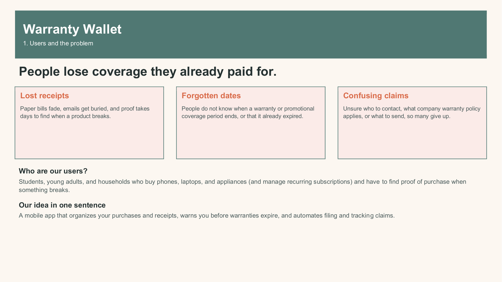
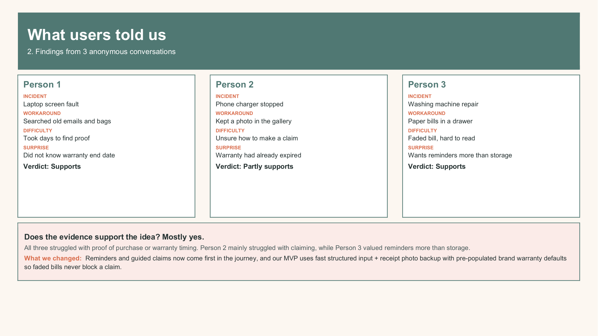
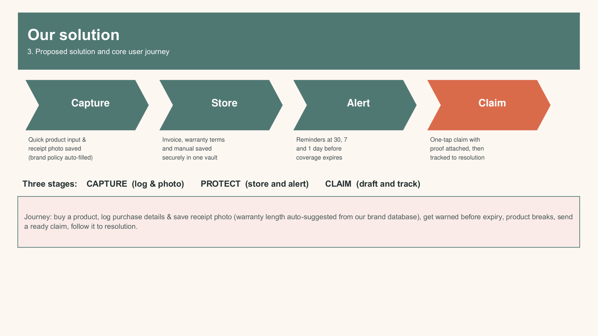
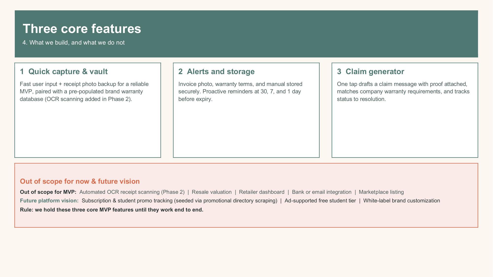
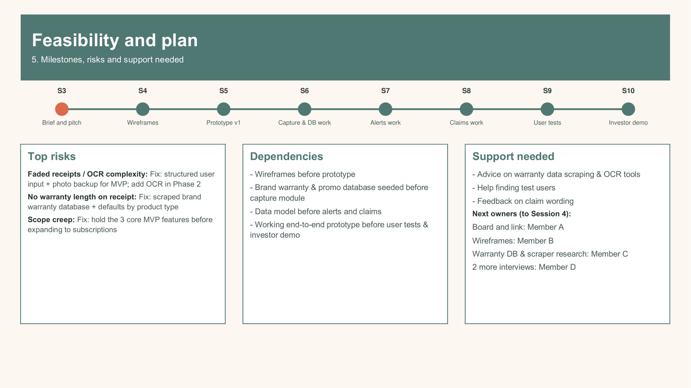
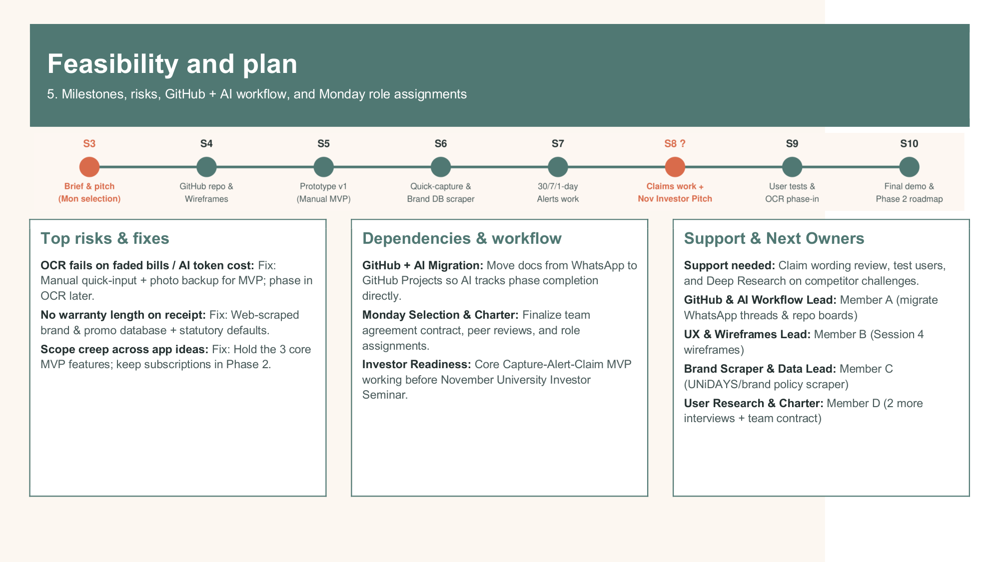

# 🛡️ Warranty, Subscription & Tax-Ready Wallet + Policy Wiki (MCP/API-Enabled)

**Academic Institution:** SRH University of Applied Sciences (*SRH Hochschule*)  
**Course Module:** *Computer & Media Lab* (Wintersemester 2026) · **Instructor:** Prof. Franziska Schwarz  
**Working Team:** **Team 8** (Peer Testing Collaboration with Team 7)  
**Active Milestone:** **Session 5 — MVP Scope Control & Working Core User Journey Gate**  

[](https://github.com/ettefagh/CM-LAB/issues)
[](https://github.com/ettefagh/CM-LAB/issues?q=is%3Aissue+is%3Aclosed)
[](https://github.com/ettefagh/CM-LAB/milestones)

---

## 📌 Quick Navigation & Repository Index

| Document / Asset | Purpose & Contents | Format |
| :--- | :--- | :--- |
| [**`WORKSHOP_CANVAS_TEAM_8.md`**](./WORKSHOP_CANVAS_TEAM_8.md) | **Official 4-Panel Team 8 Workshop Canvas:** Panel A (Requirements Clinic `US1–US3`), Panel B (6-Step Core User Journey + 2 Exception Flows), Panel C (6 Paper Prototype Views & Team 7 Peer Lab Results), Panel D (Homework Launchpad, Walkthroughs A & B, 3 Causal Decisions, Session 4 Status Report) | Markdown (67 KB) |
| [**`WORKSHOP_BOARD_RECOMMENDATIONS.md`**](./WORKSHOP_BOARD_RECOMMENDATIONS.md) | **Master 4-Block Workshop Board Specification:** Block 1 (Sharpen the Idea), Block 2 (9 MoSCoW User Stories & Full Gherkin Criteria), Block 3 (Milestones `S1–S10` & 5 Prioritized Risks), Block 4 (Commit, 5-Column Kanban Board, 92h Role Capacity, 7-Gate DoD) | Markdown (73 KB) |
| [**`PROJECT_MEMORY_AND_RESEARCH.md`**](./PROJECT_MEMORY_AND_RESEARCH.md) | **Comprehensive Research Dossier:** Empirical user interviews (Persons 1–4), German Civil Code (`BGB §§ 437, 438, 477 Abs. 1, 475e, 309 Nr. 9, 312k Abs. 6`), German Tax Law (`§ 9 EStG`, `BMF 22.02.2022` 100% digital depreciation, `GoBD` SHA-256 hashing), and MCP JSON-RPC 2.0 specification | Markdown (41 KB) |
| [**`Warranty_Wallet_Pitch_Deck_Rebuilt.pdf`**](./Warranty_Wallet_Pitch_Deck_Rebuilt.pdf) | **Rebuilt 6-Slide Widescreen (16:9) Investor Pitch Deck** ([Google Slides Live Link](https://docs.google.com/presentation/d/152nLrrfXt9FgDuTi3W5siGW7zZGjtU2nYvfdToobWGA/edit?usp=drivesdk)) | PDF / PPTX / DOCX |
| [**GitHub Issues (`#1`–`#30`)**](https://github.com/ettefagh/CM-LAB/issues) | **Live Issue Tracker:** All 3 Panel A Core Stories, 9 Granular MoSCoW Stories (`US-01`–`US-09`), 5 Risks (`R-1`–`R-5`), 4 Session 5 Deliverables (`D-1`–`D-4`), 3 Peer Lab Iterations (`C-1`–`C-3`), 2 Walkthroughs (`A` & `B`), 3 ADRs, and DoD Governance | GitHub Issues |
| [**Course Milestones (`S1`–`S10`)**](https://github.com/ettefagh/CM-LAB/milestones) | **Full Semester Route:** Completed `S1–S4`, Active `S5` (Oct 31, 2026), Upcoming `S6–S10` (through Final Viva Exam Jan 16, 2027) | GitHub Milestones |

---

## 🖼️ 4-Block Workshop Board Visuals (1:1 Square Slides)

| Block 1: Sharpen the Idea (20 min) | Block 2: Backlog & Criteria (25 min) |
| :---: | :---: |
|  |  |
| **Block 3: Route + Risks (20 min)** | **Block 4: Commit & Governance (10 min)** |
|  |  |

---

## 📋 Official 5-Column Agile Kanban Board (Live Issue Mapping)

In strict compliance with SRH Course Governance (Slide 29), our workflow enforces a **5-Column Kanban Structure** with a strict **Work-in-Progress (WIP) limit of $\le 2$ active items per member**:

| 1. Backlog (`column: 1-backlog`) | 2. Ready / Sprint 1 (`column: 2-ready-sprint-1`) | 3. In Progress (`column: 3-in-progress`) | 4. In Review / QA (`column: 4-in-review-qa`) | 5. Done (`column: 5-done`) |
| :--- | :--- | :--- | :--- | :--- |
| • [#9 US-06: Policy Wiki (5 SP)](https://github.com/ettefagh/CM-LAB/issues/9)<br>• [#10 US-07: Open MCP Server (5 SP)](https://github.com/ettefagh/CM-LAB/issues/10)<br>• [#11 US-08: German Tax Export (3 SP)](https://github.com/ettefagh/CM-LAB/issues/11)<br>• [#12 US-09: Camera OCR (Won't-Have, 13 SP)](https://github.com/ettefagh/CM-LAB/issues/12) | • [#3 Panel A US3: 1-Tap Claim & Cancel (5 SP)](https://github.com/ettefagh/CM-LAB/issues/3)<br>• [#6 US-03: 30/7/1-Day Alerts (5 SP)](https://github.com/ettefagh/CM-LAB/issues/6)<br>• [#8 US-05: 1-Tap Claim Generator (5 SP)](https://github.com/ettefagh/CM-LAB/issues/8)<br>• [#16 Risk R-4: MCP Schema Validation](https://github.com/ettefagh/CM-LAB/issues/16) | • [#1 Panel A US1: Capture & Vault (10 SP)](https://github.com/ettefagh/CM-LAB/issues/1)<br>• [#2 Panel A US2: Alert Engine (8 SP)](https://github.com/ettefagh/CM-LAB/issues/2)<br>• [#4 US-01: Manual Entry <15s (5 SP)](https://github.com/ettefagh/CM-LAB/issues/4)<br>• [#5 US-02: Receipt Photo Vault (5 SP)](https://github.com/ettefagh/CM-LAB/issues/5)<br>• [#7 US-04: Unified Dashboard (3 SP)](https://github.com/ettefagh/CM-LAB/issues/7)<br>• [#14 Risk R-2: Dark Patterns Wiki](https://github.com/ettefagh/CM-LAB/issues/14)<br>• [#18 Deliverable D-1: Core Journey](https://github.com/ettefagh/CM-LAB/issues/18)<br>• [#19 Deliverable D-2: Dual Media](https://github.com/ettefagh/CM-LAB/issues/19) | • [#13 Risk R-1: OCR Cost Trap Guardrail](https://github.com/ettefagh/CM-LAB/issues/13)<br>• [#15 Risk R-3: RDG & StBerG Disclaimers](https://github.com/ettefagh/CM-LAB/issues/15)<br>• [#17 Risk R-5: MoSCoW Scope Fence](https://github.com/ettefagh/CM-LAB/issues/17)<br>• [#20 Deliverable D-3: Wiki Seed & MCP Spec](https://github.com/ettefagh/CM-LAB/issues/20)<br>• [#30 Governance & 7-Gate DoD Tracker](https://github.com/ettefagh/CM-LAB/issues/30) | • [#21 Deliverable D-4: German Tax Brief](https://github.com/ettefagh/CM-LAB/issues/21)<br>• [#22 Peer Lab C-1: Brand Autocomplete (11.4s)](https://github.com/ettefagh/CM-LAB/issues/22)<br>• [#23 Peer Lab C-2: Primary Receipt Container](https://github.com/ettefagh/CM-LAB/issues/23)<br>• [#24 Peer Lab C-3: Visual BGB § 477 Timeline](https://github.com/ettefagh/CM-LAB/issues/24)<br>• [#25 Walkthrough A: Participant Alpha](https://github.com/ettefagh/CM-LAB/issues/25)<br>• [#26 Walkthrough B: Participant Beta](https://github.com/ettefagh/CM-LAB/issues/26)<br>• [#27 ADR-01: Manual-First vs OCR](https://github.com/ettefagh/CM-LAB/issues/27)<br>• [#28 ADR-02: Unified Subs + Warranties](https://github.com/ettefagh/CM-LAB/issues/28)<br>• [#29 ADR-03: Deterministic BGB & MCP](https://github.com/ettefagh/CM-LAB/issues/29) |

---

## 👥 Team 8 Role Distribution & Sprint Capacity Reconciliation (92 Hours)

| Role Identifier & Title | Student Owner | Direct Story Implementation | Sprint Governance / Research | Total Allocated Capacity |
| :--- | :--- | :---: | :---: | :---: |
| **Member A** *(Project Manager / QA Lead)* | Team Member A | 0h | 10h (Kanban governance, WIP limits, DoD checks) | **10h** (10.9%) |
| **Member B** *(UX / UI & Frontend Lead)* | Team Member B | 26h ([#4 US-01](https://github.com/ettefagh/CM-LAB/issues/4): 16h; [#7 US-04](https://github.com/ettefagh/CM-LAB/issues/7): 10h) | 0h | **26h** (28.3%) |
| **Member C** *(Policy / Legal & Research Lead)* | Team Member C | 8h ([#8 US-05](https://github.com/ettefagh/CM-LAB/issues/8): statutory BGB notices) | 6h (Policy Wiki curation & German tax brief) | **14h** (15.2%) |
| **Member D** *(Full-Stack Dev & Quality/Media Lead)* | Team Member D | 42h ([#5 US-02](https://github.com/ettefagh/CM-LAB/issues/5): 16h; [#6 US-03](https://github.com/ettefagh/CM-LAB/issues/6): 16h; [#8 US-05](https://github.com/ettefagh/CM-LAB/issues/8): 10h) | 0h | **42h** (45.7%) |
| **Total Team 8 Sprint Commitment** | **4 Members** | **76h (23 Must-Have SP)** | **16h** | **92h (100.0%)** |

---

## 📊 Rebuilt 16:9 Investor Pitch Deck Preview

| Slide 1: Hook & Core Problem | Slide 2: User Discovery Insights | Slide 3: Solution & 4-Stage Engine |
| :---: | :---: | :---: |
|  |  |  |
| **Slide 4: Core MVP & Policy Wiki (MCP)** | **Slide 5: Market Validation & Wedge** | **Slide 6: Roadmap & Team 8** |
|  |  |  |

---

## 🛠️ Syncing to GitHub Projects (v2) UI Board

All 30 issues, 10 milestones, and 26 labels (including `column: 1-backlog` through `column: 5-done`) are live on [`ettefagh/CM-LAB`](https://github.com/ettefagh/CM-LAB/issues). To also mirror these issues into a user-level **GitHub Projects (v2)** visual table/board via GraphQL:

```powershell
# 1. Grant the `project` scope to your GitHub CLI token (one-time browser confirmation):
gh auth refresh -h github.com -s project,read:project

# 2. Run the automated Projects v2 setup & population script:
python setup_github_project_v2.py
```
