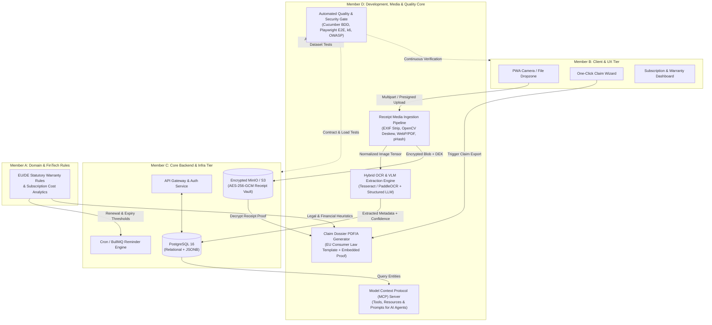

# Member D Role & Deliverables Matrix: Development Lead

**Project:** Warranty & Subscription Wallet  
**Course / Module:** SRH University — Computer & Media Lab  
**Milestone:** Milestone 5 (Final Engineering Implementation, QA Verification, Media Pipeline & Technical Handover)  
**Role Owner:** Member D — *Development Lead*  
**Document Version:** 1.0.0  
**Status:** Approved / Production Baseline  

---

## 1. Executive Role Audit & Charter

Within the four-person engineering team structure for the **Warranty & Subscription Wallet** project at SRH University Computer & Media Lab, **Member D (Development Lead)** serves as the technical linchpin bridging **core full-stack implementation**, **computer-vision/media asset pipelines**, **automated quality assurance (BDD/E2E/Performance)**, and **AI Agent / Model Context Protocol (MCP) extensibility**.

### 1.1 Why Member D is Critical to Milestone 5
While Milestone 1–4 established product discovery, UX prototypes, and foundational CRUD scaffolds, **Milestone 5** evaluates whether the system functions as a resilient, secure, media-capable software product ready for real-world deployment. Member D owns the three highest-risk technical domains in a consumer financial & document wallet:
1. **Unstructured Media to Structured Financial Data (Receipt Vault & OCR/VLM Pipeline):** Consumers upload skewed, low-light, multi-language (DE/EN) thermal receipts and PDF invoices. Member D architects the image pre-processing, perceptual hashing, encrypted blob storage, and OCR/VLM extraction pipeline.
2. **Deterministic Legal/Commercial Output (Warranty Claim PDF Generator):** Turning stored warranty metadata and receipt proof into a standardized, cryptographically verifiable EU/German consumer warranty claim dossier (*Gewährleistungs-/Garantieanspruch-Dossier*).
3. **End-to-End Quality Gatekeeping & AI Interoperability:** Enforcing Gherkin/BDD acceptance criteria, security/GDPR compliance testing, and exposing wallet capabilities safely via an **MCP Server** so users can query their warranties and subscriptions through AI assistants.

---

## 2. Comprehensive Milestone 5 Deliverables Catalog (Member D)

The table below audits and defines every required engineering document, architectural artifact, and verification asset owned or co-owned by Member D for Milestone 5 submission.

| Deliverable ID | Artifact Filename / Component | Primary Domain | Engineering Scope & Contents | Milestone 5 Verification Method |
| :--- | :--- | :--- | :--- | :--- |
| **D-DOC-00** | `00_Member_D_Role_and_Deliverables_Matrix.md` | Governance & QA | Role charter, cross-team RACI matrix, deliverable audit, acceptance criteria, and SRH grading rubric mapping. | Peer review & faculty rubric check |
| **D-DOC-01** | `01_System_Architecture_TDD.md` | System Architecture | End-to-end Technical Design Document (TDD), C4/Mermaid architecture diagrams, PostgreSQL DDL schemas, API contracts, GDPR security model, and CI/CD topology. | Architecture review & schema validation |
| **D-DOC-02** | `02_Media_Pipeline_and_Receipt_Vault_Spec.md` *(Scope Defined)* | Media Engineering | Receipt ingestion pipeline (EXIF stripping, deskewing, adaptive thresholding), AES-256-GCM envelope encryption, perceptual hash deduplication, and Claim PDF generation engine. | Pipeline benchmark & visual PDF inspection |
| **D-DOC-03** | `03_QA_Test_Strategy_and_BDD_Suite.md` *(Scope Defined)* | Quality Assurance | Test pyramid strategy, Gherkin/Cucumber BDD feature specifications, Playwright E2E test suites, k6 load testing profiles, and OWASP ASVS security test cases. | Automated CI test execution (>85% coverage) |
| **D-DOC-04** | `04_MCP_Server_and_AI_Integration_Spec.md` *(Scope Defined)* | AI & Extensibility | Model Context Protocol (MCP) server specification (`warranty-wallet-mcp`), JSON-RPC tool schemas, resource URIs, prompt templates, and zero-trust PII guardrails. | MCP Inspector verification & schema validation |
| **D-ENG-01** | Receipt Ingestion & OCR Worker | Backend / Media | Asynchronous worker processing `image/jpeg`, `image/png`, `image/webp`, `application/pdf` into structured JSON (`merchant`, `purchase_date`, `line_items`, `warranty_months`). | Unit + integration suite with synthetic receipts |
| **D-ENG-02** | Warranty Claim PDF Generator | Media Output | Server-side PDF/A-1b renderer combining product metadata, statutory EU/DE consumer rights citations (§ 437 BGB), and embedded high-DPI receipt proof. | Snapshot & PDF/A compliance validation |
| **D-ENG-03** | Automated QA Gate & CI Pipeline | DevOps / QA | GitHub Actions workflow running linting, type-checking, Vitest unit tests, Testcontainers PostgreSQL integration tests, and Playwright E2E flows. | Green CI badge on `main` branch release tag |

---

## 3. Cross-Team Role Responsibility Matrix (RACI)

To ensure zero ambiguity during the Milestone 5 sprint and oral defense at SRH University, the team is structured into four specialized roles:
- **Member A:** *Product, Project Management & Domain/FinTech Lead* (Business logic, subscription financial analytics, agile governance, stakeholder presentation)
- **Member B:** *UX/UI Design & Frontend Experience Lead* (Design system, responsive PWA views, accessibility WCAG 2.1 AA, interactive client state)
- **Member C:** *Core Backend, Database & Cloud Infrastructure Lead* (Auth/IAM, core CRUD APIs, database migrations, Docker/Kubernetes deployment, notification scheduler)
- **Member D:** *Development Lead* (System TDD orchestration, Receipt Vault media pipeline, OCR/VLM extraction, Claim PDF generator, QA/BDD automation, MCP Server integration)

### 3.1 RACI Definitions
- **R (Responsible):** Engineers who execute the work and write the code/specification.
- **A (Accountable):** The single owner who signs off on quality and holds final accountability for the deliverable.
- **C (Consulted):** Team members providing domain, UX, or infrastructure input.
- **I (Informed):** Team members kept updated on progress and interface changes.

### 3.2 Milestone 5 Master RACI Matrix

| Workstream / Deliverable Area | Member A (Product / FinTech) | Member B (UX / Frontend) | Member C (Backend / Infra) | Member D (Dev / QA & Media Lead) |
| :--- | :---: | :---: | :---: | :---: |
| **1. Architecture & Technical Design** | | | | |
| 1.1 System Architecture & TDD (`01_System_Architecture_TDD.md`) | C | C | R | **A / R** |
| 1.2 PostgreSQL Schema & Entity-Relationship Design | C | I | **A / R** | R |
| 1.3 REST / GraphQL API Contract & OpenAPI 3.1 Spec | C | C | R | **A / R** |
| 1.4 GDPR, Envelope Encryption & Privacy Architecture | C | I | R | **A / R** |
| **2. Core Application Development** | | | | |
| 2.1 Authentication, RBAC & Session Management (Passkeys/JWT) | I | C | **A / R** | C |
| 2.2 Warranty Lifecycle & Statutory Rights Engine (§ 437 BGB) | **A / R** | C | R | R |
| 2.3 Subscription Cashflow, Burn-Rate & Cancellation Alerts | **A / R** | R | R | C |
| 2.4 PWA Frontend Views, Camera Capture UI & Offline Sync | C | **A / R** | I | R (Media Capture SDK) |
| **3. Media Pipeline & Document Engineering (Computer & Media Lab Focus)** | | | | |
| 3.1 Receipt Image Pre-processing (EXIF Strip, Deskew, Contrast) | I | C | I | **A / R** |
| 3.2 Encrypted Object Storage (S3/MinIO + AES-256-GCM) | I | I | R | **A / R** |
| 3.3 OCR + Vision LLM Structured Data Extraction Pipeline | C | I | C | **A / R** |
| 3.4 Perceptual Hashing (pHash) Duplicate Receipt Detection | C | I | I | **A / R** |
| 3.5 Warranty Claim Dossier PDF/A-1b Generation Service | C | C (Layout) | I | **A / R** |
| **4. AI Extensibility & MCP Server** | | | | |
| 4.1 MCP Server Architecture (`warranty-wallet-mcp`) | C | I | C | **A / R** |
| 4.2 MCP Tools (`search_warranties`, `analyze_subscriptions`, `draft_claim`) | R | I | C | **A / R** |
| 4.3 AI Privacy Guardrails & PII Redaction Proxy | C | I | C | **A / R** |
| **5. Quality Assurance, BDD & Release Engineering** | | | | |
| 5.1 Master QA Strategy & Test Pyramid Governance | C | C | C | **A / R** |
| 5.2 Gherkin BDD Acceptance Scenarios (`*.feature`) | R | C | C | **A / R** |
| 5.3 Unit & Integration Test Suites (Vitest + Testcontainers) | C | R (UI) | R (API) | **A / R** |
| 5.4 End-to-End Browser & Mobile Viewport Automation (Playwright) | I | R | I | **A / R** |
| 5.5 Load, Stress & Media Throughput Testing (k6) | I | I | C | **A / R** |

---

## 4. How Member D Bridges the Four Technical Pillars

### 4.1 Bridging Frontend & Backend Development
- **Contract-First Engineering:** Member D maintains the shared TypeScript/Zod and OpenAPI 3.1 schemas consumed by Member B's frontend PWA and implemented by Member C's backend controllers.
- **Optimistic UI vs. Asynchronous Media Processing:** Because receipt OCR and VLM extraction take 1.5–4.0 seconds, Member D implements the Server-Sent Events (SSE) / WebSocket state machine (`UPLOADED` -> `PREPROCESSING` -> `OCR_EXTRACTING` -> `AWAITING_CONFIRMATION` -> `VERIFIED`) so Member B's UI renders real-time progress skeletons smoothly.

### 4.2 Bridging Media Engineering & Legal/FinTech Utility
- **Computer & Media Lab Excellence:** Instead of treating receipts as passive file attachments, Member D treats every uploaded receipt as a **digital media asset** undergoing a deterministic signal-processing pipeline:
  1. **Sanitization:** Strip GPS/camera EXIF metadata for privacy and validate magic bytes.
  2. **Geometric & Photometric Normalization:** Auto-crop receipt boundaries, perspective deskew, CLAHE contrast enhancement for faded thermal ink, and multi-resolution derivative generation (300 DPI archival master + 400px WebP thumbnail).
  3. **Cryptographic Integrity:** Compute SHA-256 content hash (for tamper evidence) and 64-bit perceptual hash (`pHash`) to prevent duplicate uploads of the same receipt.
  4. **Document Synthesis:** Render print-ready, legally structured PDF/A-1b warranty claim packages with embedded receipt crops and QR verification codes.

### 4.3 Bridging Quality Assurance & System Reliability
- **Shift-Left BDD Workflow:** Member D translates Member A's user stories into executable Gherkin `.feature` files before feature code is merged.
- **Golden Dataset Evaluation for OCR/AI:** Member D curates a golden evaluation dataset of 50+ annotated German and English receipts (MediaMarkt, Amazon.de, Apple, IKEA, Saturn, Telekom, Spotify, Netflix) to benchmark extraction precision/recall (`F1 >= 0.92` on total amount and purchase date) on every CI run.

---

## 5. Milestone 5 Deliverables Checklist & Acceptance Criteria

### 5.1 Architecture & Documentation Checklist
- [x] **AC-DOC-1:** Complete Role & Deliverables Matrix (`00_Member_D_Role_and_Deliverables_Matrix.md`) with RACI, acceptance criteria, and SRH grading alignment.
- [x] **AC-DOC-2:** Complete System Architecture Technical Design Document (`01_System_Architecture_TDD.md`) covering C4/Mermaid topology, full PostgreSQL DDL, API contracts, security/GDPR architecture, and observability.
- [x] **AC-DOC-3:** All Mermaid diagrams (`flowchart TD`, `sequenceDiagram`, `erDiagram`, `stateDiagram-v2`) use quoted node labels and valid syntax for clean rendering.

### 5.2 Functional & Engineering Acceptance Criteria (Member D Scope)

| ID | Feature / Subsystem | Measurable Acceptance Criteria (Definition of Done) |
| :--- | :--- | :--- |
| **AC-MED-01** | **Receipt Upload & Validation** | Rejects non-whitelisted MIME types (`exe`, `svg`, `html`) via magic-byte inspection; accepts `JPEG`, `PNG`, `WEBP`, `HEIC`, `PDF` up to 15 MB per file; strips all GPS EXIF tags prior to disk/object persistence. |
| **AC-MED-02** | **Image Enhancement & Thumbnailing** | Automatically deskews receipts tilted up to $\pm 25^\circ$, applies adaptive contrast enhancement for thermal paper, and generates a $< 35\text{ KB}$ WebP thumbnail within $800\text{ ms}$ (p95). |
| **AC-MED-03** | **OCR / VLM Extraction Accuracy** | Extracts `merchant_name`, `purchase_date` (ISO-8601), `total_amount`, `currency`, and `line_items` from German/English receipts with $\ge 92\%$ field-level F1 accuracy on the Golden Receipt Test Set; flags fields with confidence $< 0.75$ for human review in UI. |
| **AC-MED-04** | **Duplicate Receipt Detection** | Computes SHA-256 (exact match) and 64-bit DCT perceptual hash (`pHash`). Alerts user when Hamming distance $\le 6$ against existing user receipts. |
| **AC-PDF-01** | **Warranty Claim PDF Dossier** | Generates a downloadable, compliant PDF/A-1b document in $< 1.5\text{ s}$ (p95) containing: Claimant details, Merchant details, Product serial/model, Purchase date, Statutory/Commercial warranty timeline, Defect description, Legal notice (DE/EN), and high-resolution receipt image appendix. |
| **AC-SEC-01** | **Envelope Encryption & GDPR** | Every receipt media asset is encrypted at rest using a unique per-object AES-256-GCM Data Encryption Key (DEK), wrapped by a Key Encryption Key (KEK). Executing `DELETE /api/v1/users/me` cryptographically shreds user DEKs and purges all database records and S3 objects within $60\text{ s}$. |
| **AC-QA-01** | **Automated Test Suite & Coverage** | Unit & integration coverage $\ge 85\%$ on core domain/media modules; 100% pass rate on critical Playwright E2E user journeys (Onboarding -> Upload Receipt -> Confirm OCR -> Set Reminder -> Export Claim PDF). |
| **AC-MCP-01** | **MCP Server Compliance** | Exposes standardized MCP capabilities (`tools/list`, `tools/call`, `resources/list`, `resources/read`, `prompts/list`) over stdio/SSE transport; enforces read-only scoped tokens and redacts raw payment card digits before returning context to LLM hosts. |

---

## 6. Alignment with SRH University Computer & Media Lab Grading Rubric

At SRH University (CORE Principle — *Competence Oriented Research and Education*), the **Computer & Media Lab** Milestone 5 assessment evaluates both **Software Engineering Rigor** and **Media Processing / Interactive Systems Competence**. The table below maps Member D's deliverables directly to the academic evaluation criteria:

| SRH Evaluation Dimension | Weight | Expected Competence Level (Grade 1.0 / Very Good) | How Member D's Deliverables Satisfy This Criterion |
| :--- | :---: | :--- | :--- |
| **1. System Architecture & Technical Depth** | 25% | Cohesive, scalable, modular architecture with clear separation of concerns, justified technology choices, and production-ready data modeling. | `01_System_Architecture_TDD.md` provides full C4-equivalent Mermaid diagrams, normalized PostgreSQL 16 DDL with indexes/constraints, idempotency semantics, and trade-off matrices. |
| **2. Media Processing & Algorithmic Engineering** | 25% | Advanced handling of digital media assets (image processing, computer vision/OCR, document synthesis, format optimization, cryptographic storage). | Full multi-stage Receipt Media Pipeline (EXIF sanitization, OpenCV deskew/CLAHE, WebP derivative pyramid, pHash deduplication, OCR+VLM extraction, and PDF/A-1b claim synthesis). |
| **3. Software Quality, Testing & Reliability** | 20% | Comprehensive automated verification strategy (BDD, unit, integration, E2E, load testing) integrated into CI/CD with reproducible metrics. | Shift-left BDD scenarios, Testcontainers database verification, Golden Dataset OCR benchmarking, Playwright E2E flows, and k6 performance SLAs. |
| **4. Security, Privacy & EU Regulatory Compliance** | 15% | Privacy-by-design implementation addressing GDPR Articles 15, 17, 20, 25, and 32, secure authentication, and zero-trust media handling. | Envelope encryption (AES-256-GCM per receipt), cryptographic erasure on account deletion, strict PII redaction in logs/MCP, and EU-central data residency architecture. |
| **5. Innovation, Extensibility & Team Collaboration** | 15% | Integration of modern paradigms (AI agents, MCP protocol, offline-first PWA) and transparent cross-functional engineering governance. | Native **Model Context Protocol (MCP)** server enabling natural-language wallet queries + clear RACI governance bridging Members A, B, C, and D. |

---

## 7. Sign-Off & Handover Protocol

1. **Architecture Freeze:** All database table definitions and REST/MCP contracts in `01_System_Architecture_TDD.md` serve as the single source of truth for Milestone 5 integration.
2. **Pull Request Quality Gate:** No PR may merge into `main` without passing Member D's automated CI workflow (`lint` -> `typecheck` -> `unit-tests` -> `integration-tests` -> `ocr-golden-eval` -> `playwright-e2e`).
3. **Demo Readiness:** For the live SRH Milestone 5 presentation, Member D provides a pre-seeded demo account containing 12 realistic warranties, 8 recurring subscriptions, 5 multi-language receipts (including a skewed thermal receipt for live upload demonstration), and a live Claude Desktop / MCP Inspector connection.
