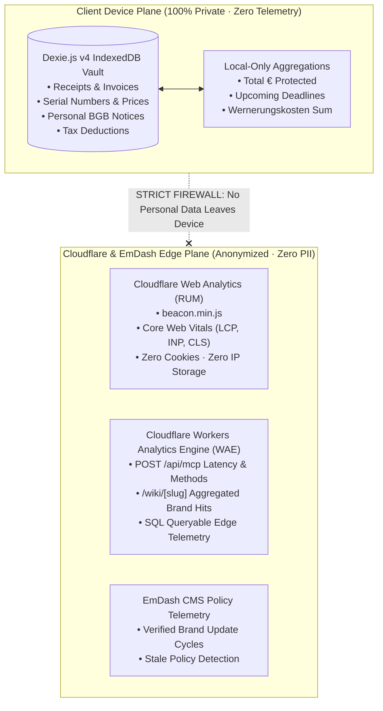

# 📊 Cloudflare & EmDash Privacy-First Analytics Specification (`DOC-DEV-05`)

**Document Reference:** `DOC-DEV-05-ANALYTICS` · **Status:** Ratified Implementation Contract  
**Academic Context:** *Computer & Media Lab* (WiSe 2026, SRH University of Applied Sciences) · **Instructor:** Prof. Franziska Schwarz  
**Author / Role:** **Kyle** *(Development Lead)* & Platform Systems Engineer  
**Sprint Alignment:** Session 5 MVP Scope Lock & Session 6 Production Architecture  
**Direct Governance Mappings:** [`GOAL.md`](../../GOAL.md) (Red Line 2: `GDPR Art. 25`) · [`BLUEPRINT.md`](../../BLUEPRINT.md) · [`AGENT.md`](../../AGENT.md)

---

## 1. Executive Summary & Privacy-by-Design Thesis

The CM-LAB platform establishes a **strictly privacy-first telemetry architecture**. Unlike conventional consumer applications that bundle invasive tracking SDKs (e.g., Google Analytics, Meta Pixel, Mixpanel) to monitor user purchases and personal habits, CM-LAB enforces an architectural firewall:



### Non-Negotiable Privacy Red Lines (`GDPR Art. 25`):
1. **ZERO Personal Data Transmission:** Receipts, item names, purchase amounts, serial numbers, seller names, and generated legal letters **NEVER** leave the user's browser.
2. **ZERO Cookies & Zero Fingerprinting:** Neither Cloudflare Web Analytics nor EmDash CMS sets cookies, local storage tracking IDs, or canvas/audio device fingerprints.
3. **Stateless Edge Telemetry Only:** Telemetry measures exclusively operational health: HTTP status codes, serverless execution latency ($<200\text{ms}$ SLA), and public brand policy lookup frequencies.

---

## 2. Cloudflare Web Analytics (Frontend RUM)

Cloudflare Web Analytics provides privacy-preserving Real User Monitoring (RUM) for both domains without tracking individual user identities.

### 2.1 Monitored Web Properties
* **Domain 1 (`[Project].pages.dev`):** Public Showcase & Open MCP Explorer.
* **Domain 2 (`app.[Project].pages.dev`):** Modern Wallet PWA application shell.

### 2.2 Content Security Policy & HTTP Headers (`public/_headers`)
To permit Cloudflare's lightweight beacon while preventing unauthorized tracking scripts or XSS vulnerabilities, `public/_headers` configures:

```text
/*
  Permissions-Policy: camera=(self), microphone=(), geolocation=()
  X-Content-Type-Options: nosniff
  Referrer-Policy: strict-origin-when-cross-origin
  Content-Security-Policy: default-src 'self'; script-src 'self' 'unsafe-inline' https://static.cloudflareinsights.com; connect-src 'self' https://cloudflareinsights.com; img-src 'self' data: blob:; style-src 'self' 'unsafe-inline'; font-src 'self' data:; worker-src 'self' blob:;
```
*(Strictly omits `Cross-Origin-Embedder-Policy: require-corp` to maintain Mobile Safari camera capture compatibility).*

### 2.3 Astro 6 Layout Integration (`apps/showcase` & `apps/app`)
The beacon is mounted conditionally in `src/layouts/Layout.astro`:

```astro
---
// apps/showcase/src/layouts/Layout.astro
interface Props {
  title: string;
}
const { title } = Astro.props;
const CF_ANALYTICS_TOKEN = import.meta.env.PUBLIC_CF_ANALYTICS_TOKEN;
---

<!doctype html>
<html lang="en">
  <head>
    <meta charset="UTF-8" />
    <meta name="viewport" content="width=device-width, initial-scale=1.0" />
    <title>{title}</title>
  </head>
  <body>
    <slot />

    <!-- Privacy-Preserving Cloudflare Web Analytics Beacon (Zero Cookies) -->
    {CF_ANALYTICS_TOKEN && (
      <script
        defer
        src="https://static.cloudflareinsights.com/beacon.min.js"
        data-cf-beacon={JSON.stringify({ token: CF_ANALYTICS_TOKEN })}
      ></script>
    )}
  </body>
</html>
```

---

## 3. Cloudflare Workers Analytics Engine (WAE) for `/api/mcp` & `/wiki`

To monitor API health, verify the `<200ms` SLA (`Gate 4 DoD`), and observe which public brand policies students query most frequently, the Cloudflare Worker implements **Workers Analytics Engine (WAE)**.

### 3.1 Wrangler Configuration (`wrangler.jsonc`)

```jsonc
{
  "name": "cm-lab-edge-api",
  "main": "src/api/mcp.ts",
  "compatibility_date": "2026-11-01",
  "analytics_engine_datasets": [
    {
      "binding": "CMLAB_ANALYTICS"
    }
  ]
}
```

### 3.2 WAE Telemetry Data Point Schema
Each edge invocation writes a structured data point without logging client IP addresses:

```typescript
// packages/core/src/telemetry/edgeMetrics.ts
export interface EdgeAnalyticsPayload {
  endpoint: '/api/mcp' | '/wiki';
  method?: string;            // e.g. "policy_lookup", "statutory_law_lookup"
  brandSlug?: string;         // e.g. "spotify", "apple", "mediamarkt"
  statusCode: number;         // 200, 400, 404, 500, -32602
  latencyMs: number;          // e.g. 14.2
  requestBytes: number;
  responseBytes: number;
}

export function recordEdgeMetric(env: { CMLAB_ANALYTICS: AnalyticsEngineDataset }, data: EdgeAnalyticsPayload) {
  if (!env.CMLAB_ANALYTICS) return;

  env.CMLAB_ANALYTICS.writeDataPoint({
    blobs: [
      data.endpoint,
      data.method ?? 'GET',
      data.brandSlug ?? 'none',
      data.statusCode.toString()
    ],
    doubles: [
      data.latencyMs,
      data.requestBytes,
      data.responseBytes
    ],
    indexes: [
      data.brandSlug ?? data.endpoint // Enables fast indexed group-by queries
    ]
  });
}
```

### 3.3 Worker Handler Instrumentation (`apps/app/src/pages/api/mcp.ts`)

```typescript
import type { APIRoute } from 'astro';
import { recordEdgeMetric } from '@cm-lab/core/telemetry/edgeMetrics';
import { handleJsonRpcRequest } from '@cm-lab/core/mcp/jsonRpcDispatcher';

export const POST: APIRoute = async ({ request, locals }) => {
  const start = performance.now();
  const requestBytes = Number(request.headers.get('content-length') ?? 0);
  let statusCode = 200;
  let method = 'unknown';

  try {
    const body = await request.json();
    method = body.method ?? 'unknown';

    const response = await handleJsonRpcRequest(body);
    if ('error' in response) {
      statusCode = response.error.code === -32602 ? 400 : 500;
    }

    const duration = performance.now() - start;
    const responseBody = JSON.stringify(response);

    // Record anonymous performance telemetry to Cloudflare WAE
    recordEdgeMetric(locals.runtime.env, {
      endpoint: '/api/mcp',
      method,
      brandSlug: body.params?.service_slug ?? 'none',
      statusCode,
      latencyMs: duration,
      requestBytes,
      responseBytes: responseBody.length
    });

    return new Response(responseBody, {
      status: 200,
      headers: { 'Content-Type': 'application/json' }
    });
  } catch (err) {
    const duration = performance.now() - start;
    recordEdgeMetric(locals.runtime.env, {
      endpoint: '/api/mcp',
      method,
      statusCode: 500,
      latencyMs: duration,
      requestBytes,
      responseBytes: 0
    });

    return new Response(JSON.stringify({ jsonrpc: '2.0', error: { code: -32603, message: 'Internal error' }, id: null }), {
      status: 500,
      headers: { 'Content-Type': 'application/json' }
    });
  }
};
```

---

## 4. EmDash CMS Content & Policy Telemetry

EmDash CMS (`emdashcms.dev`) manages the verified content lifecycle for the Top 20 Brand Policy Wiki. EmDash telemetry focuses on **data freshness and integrity** rather than user behavior:

### 4.1 Telemetry Invariants
1. **AGB Revision Hash Tracking:** Logs the SHA-256 hash of provider terms upon monthly automated audits.
2. **Staleness Counter:** Flags brand entries whose `last_verified` timestamp exceeds 90 days.
3. **Query Volume per Brand:** Identifies which consumer cancellation workflows (e.g. Spotify `§ 309 Nr. 9`, FitX `§ 312k`) require immediate AGB review due to high student query frequency.

---

## 5. Client-Side Sovereignty & Settings Toggle

In compliance with user agency and SRH academic ethics, the wallet application provides an explicit opt-out toggle in **View 5 / Settings View**:

* **Setting Label:** *"Anonymous Performance Telemetry"*
* **Description:** *"Permits Cloudflare to monitor Core Web Vitals (LCP, CLS) and edge latency. Absolutely zero personal items, receipts, or prices are ever recorded."*
* **Behavior:** When toggled to `OFF`, the application dynamically prevents the Cloudflare `beacon.min.js` script from executing and sets `cmlab_telemetry_disabled = "true"` in `localStorage`.
