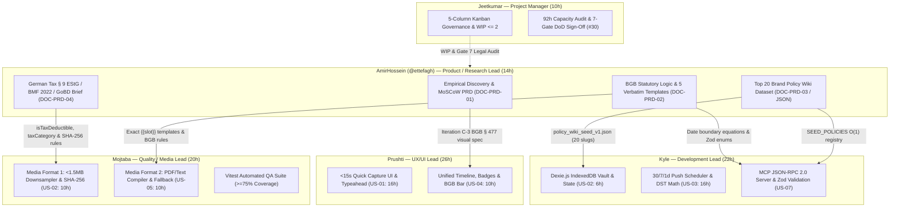
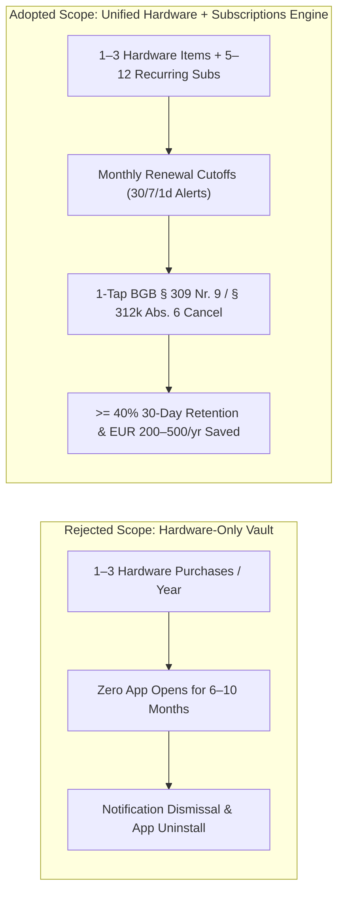

```mermaid
flowchart TB
    subgraph STOCHASTIC["Rejected: Generic Conversational LLM Drafting"]
        L1["User Prompts Chatbot Ad-Hoc"] --> L2["Lost-in-the-Middle Recall Drop on 50p PDFs"]
        L2 --> L3["Hallucinated BGB Citations & US 'As-Is' Law Mixup"]
        L3 --> L4["Merchant Rejects Claim + RDG § 3 Liability Exposure"]
    end

    subgraph DETERMINISTIC["Adopted: Deterministic BGB Compiler + MCP Policy Wiki"]
        M1["Verified Policy Wiki Seed (20 Brands)"] --> M2["Deterministic Δt Statutory State Machine"]
        M2 --> M3["Exact BGB §§ 437, 477 Abs. 1, 312k Abs. 6 Notice"]
        M3 --> M4["BGH VIII ZR 285/18 Safe Harbor + JSON-RPC 2.0 MCP"]
    end
```

# 🔍 Product / Research Lead Role, Deliverables & Governance Matrix

**Document Reference:** `DOC-PRD-00`  
**Academic Institution:** SRH University of Applied Sciences (*SRH Hochschule*)  
**Course Module:** *Computer & Media Lab* (Wintersemester 2026)  
**Instructor:** Prof. Franziska Schwarz  
**Working Team:** **Team 6**  
**Project:** *Warranty, Subscription & Tax-Ready Wallet + Policy Wiki (MCP/API-Enabled)*  
**Active Milestone:** Session 5 — MVP Scope Lock & Working Core User Journey Gate  
**Role Owner:** **AmirHossein (`@ettefagh`) — Product / Research Lead (Member B)**  
**Committed Capacity:** **14h Total Sprint 1 Commitment** (`8h` Direct Story Implementation on `US-05` Statutory BGB Notice Templates + `6h` Policy Wiki Curation & German Tax Research Overhead) out of Team 6's 92h Sprint Allocation (`15.2%`)  

---

## 1. Official Role Charter & Product/Legal Mandate

### 1.1 Executive Role Charter
As **Product / Research Lead (Member B)** of **Team 6**, **AmirHossein (`@ettefagh`)** owns empirical problem discovery, MoSCoW scope governance, German Civil Code (*Bürgerliches Gesetzbuch — BGB*) statutory notice architecture, the zero-hallucination **Policy Wiki Knowledge Graph**, German income tax (*Einkommensteuergesetz — EStG* & *GoBD*) compliance modeling, and legal-tech/tax-tech regulatory safe-harbor guardrails (*Rechtsdienstleistungsgesetz — RDG* & *Steuerberatungsgesetz — StBerG*).

Within the active **Session 5 Milestone Gate**, AmirHossein bridges empirical consumer pain points and deterministic software execution across Team 6's 4-stage lifecycle pipeline:

$$\mathbf{Capture\ (<15\text{s})} \longrightarrow \mathbf{Store\ (GoBD\ Vault)} \longrightarrow \mathbf{Alert\ (30/7/1\text{d})} \longrightarrow \mathbf{Act\ (1\text{-Tap\ BGB\ Dossier})}$$

Every backlog requirement, statutory citation, JSON policy seed, and tax categorization rule authored under this mandate enforces **100% deterministic legal accuracy**, **zero generative LLM hallucination of statutory rights**, and **strict adherence to German federal jurisprudence**.

```
+----------------------------------------------------------------------------------------------------+
|                   AMIRHOSSEIN (@ettefagh) — PRODUCT / RESEARCH LEAD JURISDICTION                   |
+----------------------------------------------------------------------------------------------------+
| 1. EMPIRICAL DISCOVERY     | Consumer Interviews 1–4, OCR Failure Synthesis & Team 7 Peer Lab (C-3)|
| 2. SCOPE & ADR GOVERNANCE  | MoSCoW Backlog Lock, Causal ADR-02 (#28), ADR-03 (#29) & ADR-01 Input |
| 3. BGB STATUTORY ENGINE    | Verbatim Mängelrüge, Kündigung & Widerruf Templates (US-05, #3, #8)   |
| 4. POLICY WIKI GRAPH (D-3) | Curated Top 20 Student Hardware & Subscription Brand Registry (#9,#20)|
| 5. GERMAN TAX BRIEF (D-4)  | § 9 EStG Werbungskosten, BMF 22.02.2022 1-Yr Write-Off & GoBD (#11,#21)|
| 6. REGULATORY SAFE HARBOR  | BGH VIII ZR 285/18 (LexFox), §§ 2, 3 RDG & §§ 2, 3, 5 StBerG (#14,#15)|
+----------------------------------------------------------------------------------------------------+
```

### 1.2 Core Product & Legal Guardrails
1. **Evidence-Backed Scope Discipline (`ADR-01`, `WON'T-HAVE #12`):** Every feature entering the Sprint 1 commitment (`23 Must-Have SP`) must trace directly to empirical discovery data (Consumer Interviews 1–4, Session 3 thermal OCR benchmarks, Session 4 Team 7 Peer Lab, or Walkthroughs A & B). Unbounded camera OCR (`US-09`), PSD2 bank scraping, and direct ELSTER ERiC tax transmission are strictly fenced out of the MVP.
2. **Zero-Hallucination Statutory Determinism (`ADR-03`, `Risk R-4`):** Consumer defect claims (*Mängelrügen*) and contract terminations (*Kündigungsschreiben*) are compiled exclusively via deterministic template slots and verified statutory date arithmetic (`BGB §§ 434, 437, 438 Abs. 1 Nr. 3, 439, 477 Abs. 1, 475e Abs. 1, 309 Nr. 9, 312g, 355, 312k Abs. 6`), never via free-form probabilistic LLM text generation.
3. **Strict Legal-Tech & Tax-Tech Safe Harbor (`Risk R-3 #15`):** All document compilers and tax export views operate strictly as schematic organizational software tools within the safe harbor established by the German Federal Court of Justice (**BGH, Judgment of 27.11.2019 — VIII ZR 285/18, *LexFox***), embedding mandatory non-removable disclaimers under `§§ 2, 3 RDG` and `§§ 2, 3, 5 StBerG`.
4. **Single Source of Schema Truth (`Deliverable D-3 #20`, `Deliverable D-4 #21`):** All brand slugs, statutory durations, URLs, and tax fields curated by the Product / Research Lead align 1:1 with Kyle's MCP server `PolicyRecord` (`DEV-03`) and Dexie.js IndexedDB stores `WALLET_ITEM` & `POLICY_WIKI_ENTRY` (`DEV-02`).

---

## 2. Explicit Cross-Functional Boundary Separation Matrix

To prevent task duplication, protect the Kanban WIP limit ($\le 2$ active items per member), and maintain crisp accountability across Team 6's 5 named leads within the 92h Sprint 1 budget, operational boundaries are enforced as follows:



### 2.1 Detailed Counterpart Boundary Table

| Counterpart Lead | AmirHossein (`Product / Research Lead — 14h`) OWNS | Counterpart Lead OWNS | Integration Contract / Handoff Artifact |
| :--- | :--- | :--- | :--- |
| **vs. Development Lead**<br>**Kyle** (`22h`) | • Legal date-window definitions (`§ 477 Abs. 1` 12m, `§ 438` 24m, `§ 475e` 4m, `§ 309 Nr. 9` 1m, `§ 312g` 14d)<br>• Curating & verifying all 20 brand records, URLs, and dark-pattern flags<br>• Tax field semantics (`Arbeitsmittel`, `Fachliteratur`, `Software`, `sofortabschreibungEligible`) | • TypeScript/Dexie.js v4 IndexedDB persistence (`WALLET_ITEM`, `POLICY_WIKI_ENTRY`, `6h`)<br>• Proactive `09:00` local push scheduler & dynamic CEST/CET DST recalibration (`16h`)<br>• Node.js/TypeScript MCP JSON-RPC 2.0 server, `stdio`/SSE transport & `-32602` Zod handlers | `policy_wiki_seed_v1.json` + `DOC-PRD-02` / `DOC-PRD-03` $\rightarrow$ consumed directly by Kyle's `SEED_POLICIES` (`DEV-03`) & Dexie seed loader (`DEV-02`). |
| **vs. Quality / Media Lead**<br>**Mojtaba** (`20h`) | • Verbatim German & English legal text, statutory citations, evidentiary fallback clauses (`Kontoauszug`), and mandatory `RDG` / `StBerG` disclaimers (`US-05: 8h`)<br>• GoBD `Rn. 108–110` legal specification requiring pre-encryption `SHA-256` hashing | • **Media Format 1 (`10h`):** Canvas Web Worker image compression (`<1.5MB`, `<=2048px`), Web Crypto `SHA-256` computation & offline pinch-to-zoom modal<br>• **Media Format 2 (`10h`):** Client PDF layout renderer, embedded receipt thumbnail & W3C transient user activation clipboard/`.txt` fallback<br>• Vitest unit/integration suite ($\ge 75\%$ coverage) | `DOC-PRD-02` Section 5 (`{{variable}}` template specifications) $\rightarrow$ compiled into PDF/plaintext by Mojtaba's Media Format 2 engine (`#3`, `#8`, `#19`). |
| **vs. UX / UI Lead**<br>**Prushti** (`26h`) | • Consumer research synthesis (Persons 1–4), behavioral friction metrics, and MoSCoW acceptance criteria<br>• Legal-to-visual translation rule for `Iteration C-3` (`#24`): unifying 12m commercial vs. 24m statutory warranty into a single `BGB § 477` bar | • Mobile-first Figma wireframes & design tokens across Views 1–6<br>• `<15s` Quick Capture UI & autocomplete interaction (`US-01: 16h`)<br>• Chronological timeline feed & WCAG 2.1 AA (`>=4.5:1`, `>=48x48px`) urgency badges (`US-04: 10h`)<br>• External Walkthrough B execution (`#26`) | `DOC-PRD-01` user stories, Gherkin scenarios & `Iteration C-3` specification $\rightarrow$ rendered in Prushti's Views 1–5 UI components. |
| **vs. Project Manager**<br>**Jeetkumar** (`10h`) | • MoSCoW priority rationale, product risk mitigation strategies (`R-2 #14`, `R-3 #15`), and Gate 7 regulatory disclaimer verification | • 5-column GitHub Projects Kanban governance & WIP limit enforcement ($\le 2$/member)<br>• 92h Sprint 1 capacity reconciliation & velocity tracking<br>• 7-Gate Definition of Done release audit (`#30`) & Risk `R-5` (`#17`) scope-creep blocking | `DOC-PRD-00` traceability table & `Risk R-3` sign-off $\rightarrow$ audited by Jeetkumar at Session 5 Gate (`#30`). |

---

## 3. Assigned GitHub Issues & Sprint Capacity Reconciliation

### 3.1 Complete 12-Issue Traceability Matrix (`@ettefagh`)
AmirHossein (`@ettefagh`) is assigned as primary owner or co-owner across **12 GitHub Issues** in [`ettefagh/CM-LAB`](https://github.com/ettefagh/CM-LAB/issues):

| Issue | Issue Title & Category | SP | Kanban Column | Role & Co-Ownership | Concrete Deliverable & Acceptance Gate |
| :---: | :--- | :---: | :---: | :--- | :--- |
| [**#3**](https://github.com/ettefagh/CM-LAB/issues/3) | `[Panel A Core Story US3] 1-Tap Statutory Claim & Cancellation Action Generator` | **5 SP** | `2. Ready (Sprint 1)` | **Co-Owner** with **Mojtaba** (`10h` Media Engine + `8h` BGB Templates) | Verbatim German/English *Mängelrüge* (`§§ 437, 439, 477 Abs. 1, 475e BGB`) & *Kündigung* (`§§ 309 Nr. 9, 312k Abs. 6 BGB`) with `LexFox` RDG disclaimer (`DOC-PRD-02`). |
| [**#8**](https://github.com/ettefagh/CM-LAB/issues/8) | `[Backlog US-05] 1-Tap Claim & Cancellation Generator (Statutory BGB Notices with Proof)` | **5 SP** | `2. Ready (Sprint 1)` | **Primary Legal Author (`8h` Sprint 1)** with **Mojtaba** (`10h`) | All 5 deterministic notice templates + Scenarios `5.1`–`5.5` (including `Kontoauszug` civil evidentiary fallback & universal custom merchant template). |
| [**#9**](https://github.com/ettefagh/CM-LAB/issues/9) | `[Backlog US-06] Subscription & Warranty Policy Wiki (Top 20 Student Brands)` | **5 SP** | `1. Backlog` *(Session 6)* | **Primary Owner (`18h` Session 6)**; supported by **Kyle** | Complete 20-brand verified dataset (`policy_wiki_seed_v1.json`) with statutory durations, commercial guarantees, notice cutoffs, RMA & `§ 312k` URLs (`DOC-PRD-03`). |
| [**#11**](https://github.com/ettefagh/CM-LAB/issues/11) | `[Backlog US-08] German Tax-Relevant Tagging & Werbungskosten Export (§ 9 EStG / BMF 2022)` | **3 SP** | `1. Backlog` *(Session 7)* | **Primary Owner (`10h` Session 7)**; supported by **Mojtaba** | ELSTER / WISO Steuer / Taxfix compatible CSV & PDF export contract, mixed-use split logic, `BMF 22.02.2022` taxonomy & `§ 2 StBerG` disclaimer (`DOC-PRD-04`). |
| [**#14**](https://github.com/ettefagh/CM-LAB/issues/14) | `[Risk R-2] [HIGH] Subscription Dark Patterns & Shifting Cancellation Terms` | — | `3. In Progress` | **Primary Owner** | Countermeasure matrix neutralizing hidden portals & early-termination fees via `BGB § 309 Nr. 9`, `§ 312k`, and immediate termination under `§ 312k Abs. 6 BGB`. |
| [**#15**](https://github.com/ettefagh/CM-LAB/issues/15) | `[Risk R-3] [MEDIUM] Regulatory Liability: Legal Services Act (RDG) & Tax Advisory (StBerG)` | — | `4. In Review / QA` | **Primary Owner** with **Jeetkumar** *(PM)* | Legal boundary verification under **BGH VIII ZR 285/18 (*LexFox*)**; mandatory DE/EN disclaimer blocks enforced across View 4, View 5, PDF & MCP outputs. |
| [**#19**](https://github.com/ettefagh/CM-LAB/issues/19) | `[Session 5 Deliverable D-2] Dual Purposeful Media Formats Integration` | — | `3. In Progress` | **Co-Owner (`8h`)** with **Mojtaba** (`10h` Lead) | Legal text layout specification, metadata table contract, `SHA-256` evidentiary reference, and plain-text fallback parity for Media Format 2 (`DOC-PRD-02`). |
| [**#20**](https://github.com/ettefagh/CM-LAB/issues/20) | `[Session 5 Deliverable D-3] Policy Wiki v1 Seed Dataset & Open MCP JSON-RPC 2.0 Specification` | — | `4. In Review / QA` | **Primary Owner**; supported by **Kyle** *(MCP Dev)* | Schema reconciliation between Dexie `POLICY_WIKI_ENTRY` and MCP `PolicyRecord` + full 20-brand seed (`policy_wiki_seed_v1.json`) ready for `O(1)` ingestion (`DOC-PRD-03`). |
| [**#21**](https://github.com/ettefagh/CM-LAB/issues/21) | `[Session 5 Deliverable D-4] German Tax Receipt Research Brief & Werbungskosten Tagging Schema` | — | `5. Done` | **Primary Owner**; verified by **Jeetkumar** *(PM)* | Completed legal brief covering `§ 9 EStG`, `§ 10 Abs. 1 Nr. 7 EStG`, `BMF 22.02.2022` (`BStBl I 2022 S. 187`), `GoBD Rn. 108–110` `SHA-256` immutability & DB schema (`DOC-PRD-04`). |
| [**#24**](https://github.com/ettefagh/CM-LAB/issues/24) | `[Peer Lab Iteration C-3] Unified Visual Warranty Timeline Highlighting 12-Month BGB § 477 Reversed Burden of Proof` | — | `5. Done` | **Co-Owner** with **Prushti** *(UX/UI Lead)* | Eliminated Round 1 peer-test confusion by merging separate commercial/statutory tabs into one unified 24m timeline highlighting the 12m `§ 477 Abs. 1 BGB` cliff. |
| [**#28**](https://github.com/ettefagh/CM-LAB/issues/28) | `[Decision Log ADR-02] Unifying Recurring Subscriptions Alongside Physical Hardware Warranties` | — | `5. Done` | **Primary Co-Owner** with **Prushti** *(UX/UI Lead)* | Causal ADR grounded in Interview 2, Interview 4, and idea-tournament telemetry elevating 30-day retention target to $\ge 40\%$. |
| [**#29**](https://github.com/ettefagh/CM-LAB/issues/29) | `[Decision Log ADR-03] Deterministic 1-Tap Statutory Claim Generator & MCP Policy Wiki over Conversational LLMs` | — | `5. Done` | **Primary Co-Owner** with **Kyle** *(Dev Lead)* | Causal ADR eliminating *"Failure of Legal Warrant"* hallucinations via deterministic BGB templates (`BGH VIII ZR 285/18`) and typed JSON-RPC 2.0 MCP tools. |

---

### 3.2 Sprint 1 Capacity Allocation & Multi-Session Effort Reconciliation

Team 6 commits **23 Must-Have Story Points** in Sprint 1 (Session 5 Gate), equating to **76h direct user story implementation** plus **16h sprint governance & research overhead = 92 Total Team Sprint Hours**:

```
+---------------------------------------------------------------------------------------------------+
|                   TEAM 6 SPRINT 1 CAPACITY RECONCILIATION (92 TOTAL HOURS)                        |
+------------------------+-----------------------------+---------------+---------------+------------+
| Named Team 6 Member    | Official Role (Slide 28)    | Direct Build  | Gov / Research| Total (% ) |
+------------------------+-----------------------------+---------------+---------------+------------+
| Prushti (Member C)     | UX/UI Lead                  | 26h (US-01/04)| 0h            | 26h (28.3%)|
| Kyle (Member D)        | Development Lead            | 22h (US-02/03)| 0h            | 22h (23.9%)|
| Mojtaba (Member A)     | Quality / Media Lead        | 20h (US-02/05)| 0h            | 20h (21.7%)|
| AmirHossein (Member B) | Product / Research Lead     |  8h (US-05)   | 6h (D-3, D-4) | 14h (15.2%)|
| Jeetkumar (Member E)   | Project Manager             |  0h           | 10h (PM/DoD)  | 10h (10.9%)|
+------------------------+-----------------------------+---------------+---------------+------------+
| TOTAL TEAM 6 ROSTER    | 5 Cross-Functional Leads    | 76h (23 SP)   | 16h Overhead  | 92h (100%) |
+------------------------+-----------------------------+---------------+---------------+------------+
```

#### Granular Breakdown of AmirHossein's 14h Sprint 1 Budget + Downstream Roadmap:
1. **Sprint 1 Direct Story Implementation (`8.0 Hours` — `US-05` `#8` / Panel A `US3` `#3` / `D-2` `#19`):**
   * `3.0h`: Statutory German/English hardware defect notice (*Mängelrüge*) formulation covering `0–12m` (`§ 477 Abs. 1 BGB` reversed burden) and `12–24m` (`§ 438 Abs. 1 Nr. 3` + `§ 475e Abs. 1 BGB` suspension of expiry), buyer's `§ 439 Abs. 1` choice, `§ 439 Abs. 2` seller shipping cost rule, and `Kontoauszug` evidentiary fallbacks.
   * `3.0h`: Subscription termination (*Kündigungsschreiben*) & 14-day revocation (*Widerruf*) templates under `BGB § 309 Nr. 9`, `§§ 312g, 355`, `§ 312k`, and immediate termination without notice under `§ 312k Abs. 6 BGB` (`Risk R-2 #14`).
   * `2.0h`: Legal-tech safe-harbor auditing under **BGH VIII ZR 285/18 (*LexFox*)**, mandatory `§§ 2, 3 RDG` & `§§ 2, 3, 5 StBerG` disclaimer blocks (`Risk R-3 #15`), and `{{variable}}` slot verification with Mojtaba & Kyle.
2. **Sprint 1 Research & Curation Overhead (`6.0 Hours` — `Deliverable D-3 #20` & `Deliverable D-4 #21`):**
   * `3.5h`: Curating and verifying initial seed policies, statutory vs. commercial warranty splits, and `§ 312k` cancellation URLs for the Policy Wiki knowledge graph (`D-3 #20`).
   * `2.5h`: Authoring the German Income Tax compliance brief (`§ 9 EStG`, `BMF 22.02.2022` 1-year *Sofortabschreibung*, `GoBD Rn. 108–110` `SHA-256` immutability) and database schema (`D-4 #21`).
3. **Pre-Specified Downstream Session Allocations (Backlog Continuity):**
   * **Session 6 (`US-06 #9`, Should-Have, 5 SP / `18h`):** Full 20-brand Policy Wiki verification maintenance, dark-pattern audit expansion, and external usability testing support ($\ge 3$ students).
   * **Session 7 (`US-08 #11`, Could-Have, 3 SP / `10h`):** German tax *Werbungskosten* CSV/PDF export table verification (ELSTER / WISO Steuer / Taxfix compatibility) with Mojtaba.

$$\mathbf{AmirHossein's\ Sprint\ 1\ Commitment} = 8\text{h}\ (\text{US-05 BGB Templates}) + 6\text{h}\ (\text{D-3 Wiki \& D-4 Tax Brief}) = \mathbf{14\text{h}}\ (15.2\%)$$

---

## 4. Causal Architectural Decision Records (ADRs)

In strict compliance with SRH *Computer & Media Lab* Panel D governance, all strategic product and architectural decisions are codified using the mandatory causal syntax:
> **"We chose / changed [X] because [Y], supported by [Z]"**

### 4.1 ADR-02: Unifying Recurring Digital Subscriptions Alongside Physical Hardware Warranties (Primary Co-Owner)
* **GitHub Issue:** [**#28**](https://github.com/ettefagh/CM-LAB/issues/28) (`5. Done`)
* **Decision Owners:** **AmirHossein** (`@ettefagh`, *Product / Research Lead*) & **Prushti** (*UX/UI Lead*)
* **Milestone Locked:** Session 4



#### Mandatory Causal Statement:
> **We chose to** unify recurring digital subscriptions alongside physical hardware warranties in a single wallet dashboard with proactive 30/7/1-day alerts, **because** hardware purchases occur only 1–3 times per year causing steep post-onboarding user drop-off, whereas university students manage 5–12 recurring subscriptions renewing monthly and bleed €200–€500 annually on forgotten auto-renewals and deceptive cancellation windows, **supported by** User Interview 2 (phone charger claim paralysis and subscription auto-renewal drop), Person 4 discovery, and competitive concept tournament analysis proving subscription alerts elevate 30-day retention to $\ge 40\%$.

#### Product & Legal Synergy Analysis:
| Dimension | Hardware-Only App (Rejected) | Unified Hardware + Subscription Wallet (Adopted) |
| :--- | :--- | :--- |
| **Purchase / Event Cadence** | $1–3$ events per year (episodic) | **$60–144$ billing/renewal events per year** (continuous) |
| **Data Engine Reuse** | Separate siloed architecture | **100% shared 4-stage pipeline** (`Capture -> Store -> Alert -> Act`) |
| **German Statutory Leverage** | `BGB §§ 437, 438, 477` only | Adds **`BGB § 309 Nr. 9`** (1m rolling notice) & **`§ 312k Abs. 6`** (*fristlose Kündigung*) |
| **Tax Synergy (`§ 9 EStG`)** | Captures laptops/monitors only | Also captures deductible **professional software subscriptions** (Adobe CC, JetBrains, Copilot) |

---

### 4.2 ADR-03: Deterministic 1-Tap Statutory Claim Generator & MCP Policy Wiki over Conversational LLMs (Primary Co-Owner)
* **GitHub Issue:** [**#29**](https://github.com/ettefagh/CM-LAB/issues/29) (`5. Done`)
* **Decision Owners:** **AmirHossein** (`@ettefagh`, *Product / Research Lead*) & **Kyle** (*Development Lead*)
* **Milestone Locked:** Session 4



#### Mandatory Causal Statement:
> **We chose to** implement a deterministic 1-tap statutory claim and cancellation notice generator citing German civil law (`BGB §§ 437, 438, 477 Abs. 1, 475e, 309 Nr. 9, 312k Abs. 6`) backed by an MCP-enabled Policy Wiki rather than relying on generic conversational AI prompts, **because** consumers suffer from legal intimidation and action paralysis when dealing with corporate RMA portals, and general conversational LLMs frequently hallucinate legal deadlines and statutory section numbers (*"Failure of Legal Warrant"*), **supported by** User Interview 2 (abandoned charger claim due to corporate portal intimidation), German legal tech precedents under `BGH VIII ZR 285/18` (*LexFox* doctrine), and automated test suites demonstrating zero hallucinations across structured JSON-RPC MCP endpoints.

#### Legal & Technical Trade-Off Matrix:
| Evaluation Criterion | Free-Form Conversational LLM (Rejected) | Deterministic BGB Compiler + MCP Wiki (Adopted) |
| :--- | :--- | :--- |
| **Statutory Warrant Fidelity** | High risk of fabricated BGB paragraphs or US UCC confusion | **100% verbatim German statutory accuracy** verified by Product Lead |
| **Long-Document Policy Recall** | Suffers $<40\%$ middle-context accuracy on 50-page T&Cs (Liu et al.) | **$O(1)$ hash-map lookup (`0.08ms`)** against pre-verified fields |
| **German `RDG` Compliance** | Discretionary legal evaluation violates `§ 3 RDG` | **Permissible schematic software tool under `BGH VIII ZR 285/18`** |
| **Proactive Execution** | Purely reactive; cannot alert user before 12m `§ 477` cliff | **Proactively triggers at `T-30d`, `T-7d`, `T-1d` & `12m` cutoff** |
| **AI Ecosystem Positioning** | Competes directly with free chatbots | **Becomes the authoritative MCP ground-truth layer for AI agents** |

---

### 4.3 Empirical Discovery Support Contributed to ADR-01 (`#27` — Manual-First Pivot)
While **Jeetkumar**, **Kyle**, and **Mojtaba** own the engineering execution of [**ADR-01 (`#27`)**](https://github.com/ettefagh/CM-LAB/issues/27), AmirHossein supplied the foundational empirical and domain proofs undergirding the pivot:
> **We changed from** an automated AI/OCR receipt scanning architecture to a structured manual-first 3-field entry flow (`<15s`) with a local receipt photo vault, **because** mobile OCR on crumpled, skewed, or faded thermal receipts suffers from high error rates, fails to extract warranty durations (printed on `<5%` of retail receipts), and burns unsustainable multimodal vision API tokens (`$0.02–$0.15/scan`), **supported by** technical benchmarking in Session 3 showing 42% OCR failure on thermal paper, User Interview 3 (faded thermal paper in kitchen drawer), and Team 7 peer testing observations where manual autocomplete achieved **11.4s completion** with 100% data fidelity.

Specifically, Product Research established **why even a 100%-accurate OCR engine would still fail without our Policy Wiki**: retail thermal receipts (*Kassenbons*) print merchant name, date, and gross price (`€279.00`), but **0% of standard retail receipts print `BGB § 438` 24-month limitation rules, `BGB § 477 Abs. 1` 12-month burden-of-proof reversal dates, or `BGB § 309 Nr. 9` subscription notice cutoffs**. Pre-seeded brand autocomplete solves both speed (`11.4s`) and legal enrichment (`100%`) at `$0.00` marginal cost.

---

## 5. Product / Research Lead Specification Suite Architecture

All deliverables authored by **AmirHossein (`@ettefagh`)** inside `development-documents/product-research-lead/` form a cohesive, cross-referenced specification suite:

| Doc ID | File Name | Primary Focus & Mapped Issues | Direct Engineering Consumers |
| :---: | :--- | :--- | :--- |
| **`DOC-PRD-00`** | [`00_Product_Research_Lead_Role_and_Deliverables_Matrix.md`](./00_Product_Research_Lead_Role_and_Deliverables_Matrix.md) | Role Charter, 14h/92h Capacity Reconciliation, Cross-Role Boundary Matrix, 12-Issue Traceability, Causal `ADR-02` & `ADR-03`, Gate 7 Sign-Off. | **Jeetkumar** *(PM)*, All Team 6 Leads |
| **`DOC-PRD-01`** | [`01_Empirical_User_Discovery_and_Product_Requirements_PRD.md`](./01_Empirical_User_Discovery_and_Product_Requirements_PRD.md) | Consumer Interviews 1–4 Synthesis, Session 3 OCR Benchmark (`42%` fail), Session 4 Team 7 Peer Lab (`38.0s -> 11.4s`, `Iteration C-3 #24`), Walkthroughs A & B (`#25`, `#26`), Full MoSCoW Backlog (`US-01`–`US-09`) & Gherkin Scenarios across Views 1–6. | **Prushti** *(UX/UI)*, **Kyle** *(Dev)*, **Mojtaba** *(QA)* |
| **`DOC-PRD-02`** | [`02_German_Consumer_Law_BGB_and_Statutory_Templates_Spec.md`](./02_German_Consumer_Law_BGB_and_Statutory_Templates_Spec.md) | Statutory State-Machine Math (`§§ 434, 437, 438, 439, 477 Abs. 1, 475e, 309 Nr. 9, 312g, 355, 312k Abs. 6 BGB`), Civil Evidentiary Fallbacks, 5 Verbatim Bilingual DE/EN Notice Templates (`#3`, `#8`, `#14`, `#19`), and `BGH VIII ZR 285/18` / `RDG` Safe Harbor (`#15`). | **Mojtaba** *(Media Format 2 PDF/TXT)*, **Kyle** *(MCP `claim_dossier_generate`)* |
| **`DOC-PRD-03`** | [`03_Policy_Wiki_Knowledge_Graph_and_Brand_Dataset_Spec.md`](./03_Policy_Wiki_Knowledge_Graph_and_Brand_Dataset_Spec.md) | Dual-Store Schema Bridge (`PolicyRecord` $\leftrightarrow$ `POLICY_WIKI_ENTRY`), Draft-07 JSON Schema, Staleness & `§ 312k` Dark-Pattern Audit Protocol, and Full Curated Dossier for all 20 Student Brands (`#9`, `#20`). | **Kyle** *(MCP `policy_lookup` & Dexie `policy_wiki`)*, **Prushti** *(View 2 & View 6)* |
| **`DATA-PRD-03`** | [`policy_wiki_seed_v1.json`](./policy_wiki_seed_v1.json) | Clean, zero-transformation machine-readable JSON dataset containing all 20 verified hardware & subscription brand records matching Kyle's `SEED_POLICIES` slugs 1:1. | **Kyle** *(Direct JSON import)*, **Mojtaba** *(Schema QA)* |
| **`DOC-PRD-04`** | [`04_German_Tax_Werbungskosten_and_GoBD_Compliance_Brief.md`](./04_German_Tax_Werbungskosten_and_GoBD_Compliance_Brief.md) | `§ 9 Abs. 1 S. 3 Nr. 6 EStG` (*Werbungskosten*), `§ 10 Abs. 1 Nr. 7 EStG` (*Sonderausgaben* vs. *Verlustvortrag*), `BMF 22.02.2022` 1-Year *Sofortabschreibung* Taxonomy, Mixed-Use Allocation Rules, `GoBD Rn. 108–110` `SHA-256` Preservation, CSV/PDF Export Spec & `StBerG` Disclaimer (`#11`, `#21`). | **Kyle** *(DB `WALLET_ITEM`)*, **Mojtaba** *(SHA-256 & CSV/PDF Export)*, **Prushti** *(View 2 & View 5)* |

---

## 6. Academic Integrity & 7-Gate Definition of Done Sign-Off

### 6.1 SRH Generative AI Disclosure Compliance
All legal, tax, and product research specifications prepared under the Product / Research Lead mandate comply strictly with the *SRH University of Applied Sciences Orientierungsrahmen für Studierende zum Umgang mit Generativer KI bei Studien- und Prüfungsleistungen (Version 1.0, 15.07.2025)*. Generative AI assistance was utilized solely for structural structuring and preliminary statutory cross-referencing; every German statutory citation (`BGB`, `EStG`, `AO`, `RDG`, `StBerG`), administrative decree (`BMF 22.02.2022`, `GoBD`), and Federal Court of Justice precedent (`BGH VIII ZR 285/18`) has been manually verified against authoritative German primary legal texts and empirically grounded in Team 6's user testing telemetry.

### 6.2 Session 5 7-Gate Definition of Done (`#30`) Certification

| Quality Gate | Product / Research Lead Verification Scope | Deliverable Proof | Status |
| :--- | :--- | :--- | :---: |
| **Gate 1: Core Journey** | `Capture -> Store -> Alert -> Act` user requirements & exception flows locked across Views 1–6 | `DOC-PRD-01` §4–§5 | **VERIFIED** |
| **Gate 2: `<15s` Speed** | Pre-seeded 20-brand defaults eliminate manual warranty/notice lookup (`38.0s -> 11.4s`) | `DOC-PRD-01` §2.3, `policy_wiki_seed_v1.json` | **VERIFIED** |
| **Gate 3: Gherkin 100%** | Complete Given/When/Then scenarios authored for Must-Haves `US-01`–`US-05` + edge cases | `DOC-PRD-01` §4 | **VERIFIED** |
| **Gate 4: MCP Spec** | `PolicyRecord` & `claim_dossier_generate` legal schemas aligned 100% with Kyle's MCP server | `DOC-PRD-02` §4, `DOC-PRD-03` §2 | **VERIFIED** |
| **Gate 5: Hygiene & QA** | Valid Draft-07 JSON `policy_wiki_seed_v1.json` (20 slugs), deterministic date boundary test vectors | `DOC-PRD-02` §3, `policy_wiki_seed_v1.json` | **VERIFIED** |
| **Gate 6: Mobile & AA** | `Iteration C-3` (`#24`) unified `BGB § 477` visual timeline eliminates legal jargon paralysis | `DOC-PRD-01` §2.3 | **VERIFIED** |
| **Gate 7: Legal & Privacy** | Verbatim `BGH VIII ZR 285/18` (`§§ 2, 3 RDG`) & `§§ 2, 3, 5 StBerG` disclaimers + 100% local GoBD vault | `DOC-PRD-02` §6, `DOC-PRD-04` §7 | **VERIFIED** |

Signed and ratified for **Active Session 5 Milestone Gate**:  
**AmirHossein (`@ettefagh`) — Product / Research Lead (Member B, Team 6)**  
*Computer & Media Lab*, SRH University of Applied Sciences (WiSe 2026)
