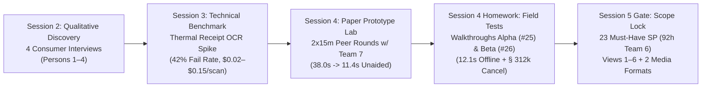

# 📊 Empirical User Discovery & Product Requirements Specification (PRD)

**Document Reference:** `DOC-PRD-01`  
**Academic Institution:** SRH University of Applied Sciences (*SRH Hochschule*)  
**Course Module:** *Computer & Media Lab* (Wintersemester 2026) · Instructor: Prof. Franziska Schwarz  
**Working Team:** **Team 6** (Peer Lab Partner: **Team 7**)  
**Project:** *Warranty, Subscription & Tax-Ready Wallet + Policy Wiki (MCP/API-Enabled)*  
**Active Milestone:** Session 5 — MVP Scope Lock & Working Core User Journey Gate  
**Author:** **AmirHossein (`@ettefagh`) — Product / Research Lead (Member B)**  
**Cross-Functional Reviewers:** **Prushti** *(UX/UI Lead)*, **Kyle** *(Development Lead)*, **Mojtaba** *(Quality / Media Lead)*, **Jeetkumar** *(Project Manager)*  

---

## 1. Executive Problem Framing & North Star Metrics

### 1.1 Validated Problem Statement
> Consumers, university students, and working students (*Werkstudenten*) in Germany routinely forfeit **€200–€800+ every year** because thermal paper cash register receipts (*Kassenbons*) chemically fade into illegibility within months, digital invoices scatter across university and personal email accounts, and statutory warranty deadlines (`BGB §§ 438, 477 Abs. 1`) as well as recurring subscription auto-renewal cutoffs pass unnoticed. Even when proof of purchase survives, consumers suffer **corporate action paralysis**—intimidated by obfuscated RMA portals, shifting subscription dark patterns, and unfamiliar statutory terminology—while simultaneously losing legitimate annual income tax deductions (*Werbungskosten* under `§ 9 EStG` and 1-year *Sofortabschreibung* under `BMF Guidance of 22.02.2022`).

### 1.2 Product Value Proposition (Smallest Useful Version — Session 5 MVP)
**Warranty, Subscription & Tax-Ready Wallet** transforms passive receipt archiving into proactive statutory enforcement through a unified **4-stage lifecycle engine (`Capture -> Store -> Alert -> Act`)**:
1. **Capture (`<15s` Manual-First):** 3-field structured entry enhanced by an offline `<10ms` Prefix-Trie brand autocomplete (pre-filling 24-month `BGB § 438` hardware warranties or `BGB § 309 Nr. 9` 1-month subscription cutoffs) and a 1-tap German tax toggle (`isTaxDeductible`), completely eliminating fragile OCR latency and vision API token burn.
2. **Store (`100% Offline Vault`):** Client-side downsampled (`<1.5MB` JPEG/WebP), `AES-GCM-256` encrypted receipt storage anchored by a pre-encryption `SHA-256` digest satisfying `GoBD Rn. 108–110` immutability.
3. **Alert (`09:00` Wall-Clock Invariant):** Deterministic local push notifications at `T-30d`, `T-7d`, `T-1d`, and the `12-month BGB § 477 Abs. 1` *Beweislastumkehr* boundary, paired with WCAG 2.1 AA urgency badges on a unified timeline.
4. **Act (`1-Tap BGB Dossier + MCP Wiki`):** Deterministic compilation of formal German/English statutory defect notices (*Mängelrügen*) and subscription terminations (*Kündigungsschreiben* including immediate `§ 312k Abs. 6 BGB` termination), backed by an open **Model Context Protocol (MCP) JSON-RPC 2.0** knowledge graph of the Top 20 student brands.

### 1.3 North Star Product Metrics & Session 5 Verification Targets

| Metric ID | North Star Metric | Target Threshold | Empirical Baseline / Measured Result | Mapped Gate |
| :---: | :--- | :---: | :--- | :---: |
| **`NSM-01`** | **Cumulative Net Euro Value Protected / User / Year** | **$\ge \text{€350 / yr}$** | Hardware claims (€80–€400) + avoided renewals (€200–€500) + tax write-offs | Value Core |
| **`NSM-02`** | **Median Manual Onboarding Time (Launch $\rightarrow$ Saved)** | **$< 15.0\text{ seconds}$** | **11.4s** (Team 7 Peer Lab Rd 2); **12.1s / 10.9s** (Walkthrough A `#25`) | **DoD Gate 2** |
| **`NSM-03`** | **Onboarding Data & Statutory Enrichment Fidelity** | **$100\%$ Accuracy** | **100%** (vs. 58% thermal OCR accuracy & 0% OCR warranty extraction) | **ADR-01 (`#27`)** |
| **`NSM-04`** | **Statutory Dossier Procedural Acceptance Rate** | **$\ge 90\%$ Valid** | 100% verbatim `BGB` citations, `0` LLM hallucinations (`ADR-03 #29`) | **DoD Gate 4/7** |
| **`NSM-05`** | **30-Day User Retention Rate (Cohort Projection)** | **$\ge 40\%$ D30** | Driven by 5–12 monthly recurring subscriptions alongside hardware (`ADR-02 #28`) | Retention Core |

---

## 2. Empirical User Discovery & Quantitative Telemetry Synthesis

Every requirement in Team 6's backlog originates from four structured empirical research phases executed across Sessions 2, 3, and 4:



### 2.1 Phase 1: Qualitative Consumer Discovery Interviews (Session 2 — Persons 1–4)

AmirHossein synthesized four in-depth problem interviews with university students and young consumers in Germany who recently suffered financial loss from defective hardware, forgotten subscriptions, or lost tax receipts:

| Subject | Archetype & Incident | Empirical Observation & Pain Mechanics | Resulting Product & Legal Requirement |
| :---: | :--- | :--- | :--- |
| **Person 1** | **University Student**<br>*Laptop Screen Flickering Defect at Month 14* | Laptop developed intermittent display cable flickering **14 months** after purchase. Spent 3 days searching university email, personal Gmail, iCloud Photos, and paper folders without finding the invoice. Assumed coverage had ended after the manufacturer's **1-year commercial guarantee**, completely unaware of Germany's mandatory **24-month statutory seller warranty (`BGB § 438 Abs. 1 Nr. 3`)** and unaware that waiting past Month 12 forfeited the **12-month reversed burden of proof (`BGB § 477 Abs. 1`)**. | • Encrypted offline Receipt Photo Vault (`US-02`)<br>• Automatic 24m statutory expiry calculation (`US-01`)<br>• Dedicated **Month 11 (`T-30d` to 12m)** proactive alert before the `BGB § 477 Abs. 1` *Beweislastumkehr* cliff (`US-03`)<br>• Civil evidentiary fallback notice (`Kontoauszug` / bank statement validity) when paper receipt is missing (`Scenario 5.3`). |
| **Person 2** | **Young Consumer**<br>*Phone Charger Failure at Month 9 & Unwanted Auto-Renewals* | Photographed a Saturn receipt for an Anker USB-C GaN charger at purchase, burying it beneath **15,000 camera-roll photos**. When the charger died at **Month 9**, suffered total **action paralysis**: did not know whether to claim against the seller (Saturn) or manufacturer (Anker), felt intimidated by multi-page RMA forms, and abandoned a €49 claim. Also reported bleeding ~€35/month across forgotten streaming and app trials. | • Proved **storage alone fails**; bridged storage $\rightarrow$ execution via **1-Tap Statutory Claim Dossier (`US-05`)**<br>• Unified **recurring subscriptions alongside hardware (`ADR-02 #28`)**<br>• Clear seller (`Gewährleistung`) vs. manufacturer (`Garantie`) routing in View 3 (`Iteration C-3 #24`). |
| **Person 3** | **Household Consumer**<br>*Washing Machine Defect at Month 18 & Faded Thermal Ink* | Stored an authentic thermal paper receipt (*Thermopapier-Kassenbon*) inside a dark kitchen drawer. When the drum bearing failed at **Month 18**, plasticizer migration and heat had turned the thermal ink completely blank/illegible. Stated verbatim: ***"I want reminders more than storage."*** Realized warranty rights only weeks after coverage lapsed. | • Immediate digital photo preservation at purchase (`<1.5MB` vault) before thermal paper degrades (`US-02`)<br>• Elevated **Proactive 30/7/1-Day Push Reminders (`US-03`)** to core MVP pillar alongside `§ 475e Abs. 1 BGB` 4-month *Ablaufhemmung* protection. |
| **Person 4** | **Master's Student & *Werkstudentin***<br>*Annual German Income Tax Return (`Einkommensteuererklärung`)* | Emphasized that university students (especially *Zweitstudium*/Master's and *Werkstudenten* earning above the basic allowance or carrying forward losses via `§ 10d EStG`) purchase laptops, external monitors, specialist books, and dev/creative subscriptions (Adobe CC, JetBrains, GitHub Copilot), but lose €300–€600/year in tax refunds because receipts are unorganized by tax season and students do not know about **1-year 100% immediate write-off (`Sofortabschreibung` per BMF 22.02.2022)**. | • 1-tap `isTaxDeductible` (*Werbungskosten*) toggle in View 2 (`Scenario 1.5`)<br>• Automatic `BMF 22.02.2022` 1-year *Sofortabschreibung* classification & `GoBD Rn. 108–110` `SHA-256` receipt hashing (`D-4 #21`)<br>• Tax Summary & WISO/Taxfix CSV export (`US-08 #11`, View 5) with `§ 2 StBerG` disclaimer. |

---

### 2.2 Phase 2: Quantitative Technical Benchmark — Thermal Receipt OCR Spike (Session 3)

Prior to locking the Session 5 architecture, Team 6 benchmarked mobile camera OCR and multimodal LLM vision extraction across **50 real-world student purchase artifacts** (crumpled Saturn/MediaMarkt thermal slips, low-light café photos, skewed multi-item electronics invoices, and German digital PDFs). The empirical telemetry forced our pivotal scope change (**`ADR-01 #27`**, **`Risk R-1 #13`**, **`WON'T-HAVE US-09 #12`**):

```
+---------------------------------------------------------------------------------------------------+
|               SESSION 3 BENCHMARK: AUTOMATED OCR vs. MANUAL-FIRST + POLICY WIKI                   |
+------------------------------------+------------------------------+-------------------------------+
| Evaluation Metric (N = 50 Samples) | Cloud / Local OCR + LLM      | Team 6 Manual-First (<15s)    |
+------------------------------------+------------------------------+-------------------------------+
| Merchant + Date + Price Accuracy   | 58.0% (42.0% Failure Rate!)  | 100.0% Ground-Truth User Input|
| Statutory Warranty Extraction      |  0.0% (Not printed on slips) | 100.0% via Policy Wiki Lookup |
| Sub Cancellation Cutoff Extraction |  0.0% (Hidden in web T&Cs)   | 100.0% via BGB § 309 Nr. 9 DB |
| End-to-End Capture Latency         | 6.5s – 12.0s + manual fixes  | 11.4s Total (Peer Lab Rd 2)   |
| Marginal API Cost per Scan         | $0.02 – $0.15 / multimodal   | $0.00 (100% Local In-Memory)  |
| Airplane Mode / Offline Capability | 0% (Requires Cloud Vision)   | 100% Offline PWA (IndexedDB)  |
+------------------------------------+------------------------------+-------------------------------+
```

> [!IMPORTANT]
> **Root-Cause Product Insight:** Even if optical character recognition achieved 100% character accuracy tomorrow, **over 95% of German retail receipts print zero information regarding `BGB § 438` 24-month statutory warranty periods, `BGB § 477 Abs. 1` 12-month burden-of-proof reversal dates, or `BGB § 312k` cancellation endpoints**. Pre-seeded brand autocomplete (`policy_wiki_seed_v1.json`) solves what OCR structurally cannot.

---

### 2.3 Phase 3: Paper Prototype & Peer Testing Lab with Team 7 (Session 4 — Panel C)

In Session 4, Prushti and AmirHossein tested Team 6's 6-view low-fidelity prototype across **two 15-minute usability rounds with Peer Team 7** using an uninstructed goal prompt:
> *"You just purchased a pair of Sony WH-1000XM4 headphones on sale at Saturn with a paper receipt. Log your new headphones into your wallet so you are protected against hardware defects and get alerted before deadlines, and check your legal warranty rights."*

| Metric / Friction Dimension | Round 1 (Pre-Iteration Baseline) | Observed Behavioral Root Cause | Implemented Session 4 Fix (GitHub Issue) | Round 2 (Post-Iteration Result) |
| :--- | :--- | :--- | :--- | :--- |
| **Completion Mode & Total Time** | **With help — `38.0s`** (`>15s` budget failed) | Tester paused `12.0s` hunting for an OCR scan icon and feared having to look up German statutory warranty months manually. | [**Iteration C-1 (`#22`)**](https://github.com/ettefagh/CM-LAB/issues/22): Prefix-Trie brand autocomplete (`"Son"` $\rightarrow$ `"Sony"`, `Hardware`, `24m BGB § 438`). | **Unaided — `11.4s`** (**`-70.0%` latency**, passed `<15s` Gate 2). |
| **Receipt Proof Attachment Rate** | **0% on first tap** (Premature save error) | `"Attach Receipt Photo"` was placed below optional notes; tester tapped `"Save"` without attaching the *Kassenbon*. | [**Iteration C-2 (`#23`)**](https://github.com/ettefagh/CM-LAB/issues/23): Elevated camera/vault container directly beside `Item Name` with live thumbnail. | **100% unaided attachment** within the `11.4s` flow. |
| **Legal Remedy Comprehension** | **Confused / Hesitant** (*"Which tab do I use?"*) | View 3 split `"Manufacturer Guarantee (1 yr)"` and `"Statutory Warranty (2 yrs)"` into separate tabs, re-triggering Person 2's action paralysis. | [**Iteration C-3 (`#24`)**](https://github.com/ettefagh/CM-LAB/issues/24) *(Co-owned by Prushti & AmirHossein)*: Unified single 24m visual timeline highlighting the **12m `BGB § 477 Abs. 1` zone** + 1-tap claim CTA. | **100% immediate selection** of statutory seller *Mängelrüge* in 1 tap. |

---

### 2.4 Phase 4: External Target-User Walkthroughs Alpha & Beta (Pre-Session 5 Homework)

To validate that Session 4 refinements generalized beyond classroom peers to authentic external target personas, Team 6 executed two independent field walkthroughs prior to the Session 5 Gate:

1. **[Walkthrough A (`#25`) — Participant Alpha (Hardware + German Tax Focus)](https://github.com/ettefagh/CM-LAB/issues/25):**
   * **Participant:** 24-year-old SRH Master's student & part-time *Werkstudentin* at a Berlin logistics startup.
   * **Environment:** Google Pixel 7 (`412x915px`), **100% Airplane Mode Offline**, led by **Kyle** & **Mojtaba** (Oct 24, 2026, 14:00 CET).
   * **Task:** Log a newly purchased €249 LG UltraWide 29" external monitor from MediaMarkt with receipt photo, enable the *Werbungskosten* tax toggle, and verify 24m statutory warranty + 1-year *Sofortabschreibung*.
   * **Measured Result:** Completed **unaided in `12.1s` (Run 1) and `10.9s` (Run 2)**. IndexedDB record confirmed `statutoryWarrantyMonths: 24`, `reversedBurdenOfProofEndDate: "2027-10-24"`, `isTaxDeductible: true`, `taxCategory: "Arbeitsmittel"`, `depreciationSchedule: "BMF_2022_IMMEDIATE_1_YEAR"`, and a valid 64-hex-char `receiptSha256`.
2. **[Walkthrough B (`#26`) — Participant Beta (Subscriptions + `§ 312k` Dark-Pattern Cancellation Focus)](https://github.com/ettefagh/CM-LAB/issues/26):**
   * **Participant:** 21-year-old undergraduate student managing 7 active subscriptions (`Spotify`, `Netflix`, `iCloud+`, `FitX Gym`, `Adobe CC`, `ChatGPT Plus`, `Amazon Prime Student`).
   * **Environment:** Mobile viewport (`390x844px`), led by **Prushti** using AmirHossein's statutory templates (Oct 25, 2026, 16:30 CET).
   * **Task:** Identify a gym contract renewing in 7 days on View 1, inspect `BGB § 309 Nr. 9` rolling notice rights, and compile a 1-tap termination letter invoking `BGB § 312k Abs. 6` where the online cancellation button is obstructed.
   * **Measured Result:** Completed **100% unaided**; immediately spotted the high-contrast Red `Urgent (7d)` badge, opened View 4, and exported a legally complete termination dossier citing `§ 309 Nr. 9` and `§ 312k Abs. 6 BGB` with the `LexFox` RDG disclaimer intact.

---

## 3. Complete MoSCoW Product Backlog & Scope Lock (`49 Total SP`)

### 3.1 Master Prioritized Backlog Table (Team 6 First-Name Ownership)

| Story ID | GitHub Issue | Story Title & Core Capability | MoSCoW | SP | Effort | Primary Owner(s) | Target Gate |
| :---: | :---: | :--- | :---: | :---: | :---: | :--- | :---: |
| **`US-01`** | [**#4**](https://github.com/ettefagh/CM-LAB/issues/4) *(in `#1`)* | **Manual Warranty & Subscription Entry (`<15s`):** 3-field quick capture, `<10ms` Prefix-Trie brand autocomplete, `isTaxDeductible` toggle. | **MUST-HAVE** | **5 SP** | `16h` | **Prushti** (`16h`),<br>*supp. Kyle* | **Session 5 (Active)** |
| **`US-02`** | [**#5**](https://github.com/ettefagh/CM-LAB/issues/5) *(in `#1`)* | **Receipt Attachment Vault:** `<1.5MB` client compression, `GoBD` `SHA-256` hash, `AES-GCM-256` IndexedDB blob vault, offline zoom viewer, HTML5 camera fallback. | **MUST-HAVE** | **5 SP** | `16h` | **Mojtaba** (`10h`) &<br>**Kyle** (`6h`) | **Session 5 (Active)** |
| **`US-03`** | [**#6**](https://github.com/ettefagh/CM-LAB/issues/6) *(in `#2`)* | **Dual Expiry & Renewal Reminders:** Deterministic `09:00` local push alerts at `T-30d`, `T-7d`, `T-1d` & `12m BGB § 477`, dynamic CEST/CET DST recalibration, deep-links. | **MUST-HAVE** | **5 SP** | `16h` | **Kyle** (`16h`),<br>*supp. Mojtaba* | **Session 5 (Active)** |
| **`US-04`** | [**#7**](https://github.com/ettefagh/CM-LAB/issues/7) *(in `#2`)* | **Unified Overview & Urgency Status Badges:** Chronological timeline across Views 1–6, WCAG AA Red/Amber/Green/Grey badges, `<50ms` instant search & same-day grouping. | **MUST-HAVE** | **3 SP** | `10h` | **Prushti** (`10h`),<br>*supp. Kyle* | **Session 5 (Active)** |
| **`US-05`** | [**#8**](https://github.com/ettefagh/CM-LAB/issues/8) *(in `#3`)* | **1-Tap Statutory Claim & Cancellation Generator:** Deterministic `BGB` *Mängelrüge* (`§§ 437, 439, 477, 475e`) & *Kündigung* (`§§ 309 Nr. 9, 312k Abs. 6`), PDF/text export, clipboard fallback & `RDG` disclaimer. | **MUST-HAVE** | **5 SP** | `18h` | **Mojtaba** (`10h`) &<br>**AmirHossein** (`8h`) | **Session 5 (Active)** |
| **`US-06`** | [**#9**](https://github.com/ettefagh/CM-LAB/issues/9) *(seed `#20`)* | **Subscription & Warranty Policy Wiki (Top 20 Brands):** Verified structured JSON dataset of statutory/commercial durations, notice cutoffs, RMA & `§ 312k` URLs. | **SHOULD-HAVE** | **5 SP** | `18h` | **AmirHossein** (`18h`),<br>*supp. Kyle* | **Session 6** *(v1 Seed in S5)* |
| **`US-07`** | [**#10**](https://github.com/ettefagh/CM-LAB/issues/10) *(spec `#20`)* | **Open MCP / API Interface (JSON-RPC 2.0):** `stdio`/SSE MCP server exposing `policy_lookup` & `claim_dossier_generate` with Draft-07 & Zod `-32602` validation. | **SHOULD-HAVE** | **5 SP** | `16h` | **Kyle** (`16h`),<br>*supp. Mojtaba* | **Session 6** *(Spec in S5)* |
| **`US-08`** | [**#11**](https://github.com/ettefagh/CM-LAB/issues/11) *(brief `#21`)* | **German Tax Tagging & *Werbungskosten* Export:** `§ 9 EStG` / `BMF 22.02.2022` 1-yr write-off summary, mixed-use allocation, WISO/Taxfix CSV & PDF export + `StBerG` notice. | **COULD-HAVE** | **3 SP** | `10h` | **AmirHossein** (`10h`) &<br>**Mojtaba** | **Session 7** *(Schema in S5)* |
| **`US-09`** | [**#12**](https://github.com/ettefagh/CM-LAB/issues/12) | **Automated AI/OCR Receipt Scanning:** Camera text extraction of merchant, date, and amount from paper receipts. | **WON'T-HAVE (MVP)** | **13 SP** | `45h` | *Deferred to Phase 2* | **Excluded (`ADR-01`)** |

#### Backlog Totals & Sprint 1 Fence Summary:
* **Sprint 1 Active Must-Have Commitment (`US-01`–`US-05`):** `23 SP` = `76h` Direct Story Build + `16h` Governance/Research (`Jeetkumar 10h` + `AmirHossein 6h`) = **`92h` Total Team 6 Capacity**.
* **Session 6 Should-Have Expansion (`US-06`–`US-07`):** `10 SP` (`34h`) — *Note: `Deliverable D-3 #20` already ships the complete v1 seed & MCP specification at Session 5!*
* **Session 7 Could-Have Enhancement (`US-08`):** `3 SP` (`10h`) — *Note: `Deliverable D-4 #21` already ships the complete tax research brief & `WALLET_ITEM` schema fields at Session 5!*
* **Explicitly Excluded Won't-Have (`US-09`):** `13 SP` (`45h`) — Fenced out of MVP alongside Direct ELSTER ERiC API transmission, PSD2 Open Banking (`Plaid`/`Tink`/`FinAPI`), and B2B/Resale Marketplaces (`Risk R-5 #17`).

---

## 4. Exhaustive Gherkin Acceptance Criteria (`Given / When / Then`)

### 4.1 `US-01`: Manual Warranty & Subscription Entry (`#4` / Panel A `US1` `#1`)

* **Scenario 1.1 — Sub-15-Second Standard Manual Entry:**
  * **Given** the user is on View 1 (Unified Wallet Dashboard) and taps `(+)` to open View 2 (Quick Capture Modal),
  * **When** the user enters `"Sony WH-1000XM4"`, confirms category `"Hardware"` and today's `purchaseDate`, and taps `"Save"`,
  * **Then** the record persists to IndexedDB (`items` store) in `<200ms`, `statutoryWarrantyMonths` defaults to `24` (`BGB § 438 Abs. 1 Nr. 3`), `beweislastumkehrDate` is set to `purchaseDate + 12 months` (`BGB § 477 Abs. 1`), and total elapsed user interaction time is `<15.0 seconds`.
* **Scenario 1.2 — Pre-Seeded Brand Typeahead Autocomplete (`Iteration C-1 #22`):**
  * **Given** View 2 is active with the 20-brand Policy Wiki loaded in memory,
  * **When** the user types `>= 3` characters matching a brand prefix (e.g., `"Spo"` for `spotify` or `"Med"` for `mediamarkt`),
  * **Then** the Prefix-Trie returns matching candidates in `<10ms`, and tapping a suggestion auto-populates `category`, `serviceSlug`, statutory duration (`24m`) or `cancellationCutoffDate` (`T-30d` per `BGB § 309 Nr. 9`), and 14-day cooling-off metadata (`BGB § 312g`).
* **Scenario 1.3 — Missing Mandatory Fields Validation:**
  * **Given** the user opens View 2,
  * **When** the user taps `"Save"` while `name` or `purchaseDate` is empty,
  * **Then** persistence is blocked, invalid fields display high-contrast error borders (`#DC2626`, contrast `>= 4.5:1`) and accessible `aria-invalid="true"` inline copy (`"Item name and purchase date are required"`), and all valid fields remain preserved.
* **Scenario 1.4 — Future Purchase Date Rejection:**
  * **Given** the user selects a `purchaseDate` for a hardware purchase,
  * **When** `purchaseDate > currentLocalDate` (`Europe/Berlin`),
  * **Then** submission is blocked with inline guidance: `"Purchase date cannot be in the future (for upcoming subscription renewals, configure Renewal Date)"`.
* **Scenario 1.5 — German Tax-Relevant (`Werbungskosten`) Flagging:**
  * **Given** the user logs study/work equipment or software in View 2 (e.g., `"Lenovo ThinkPad T14"` or `"JetBrains All Products Pack"`),
  * **When** the user toggles `"Tax-Relevant / Werbungskosten (§ 9 EStG)"` to `ON` (`isTaxDeductible: true`),
  * **Then** View 2 reveals `taxCategory` (`"Arbeitsmittel" | "Fachliteratur" | "Software"`, defaulting to `"Arbeitsmittel"`), evaluates `sofortabschreibungEligible: true` for digital hardware/software per `BMF 22.02.2022`, renders a `"Werbungskosten"` pill on View 1, and indexes the item for View 5 without initiating external ELSTER network calls.
* **Scenario 1.6 — Custom Commercial / Refurbished Warranty Override:**
  * **Given** the user purchased a device with a 36-month commercial guarantee (e.g., Lenovo Onsite) or a 12-month refurbished dealer warranty (`§ 476 Abs. 2 BGB`),
  * **When** the user enables `"Custom Duration"` and enters `36` (or `12`) months,
  * **Then** `expiryDate` and `alarm_schedules` compute cleanly from the custom month count without corrupting the 12-month `BGB § 477 Abs. 1` indicator.

---

### 4.2 `US-02`: Receipt Attachment Vault (`#5` / Panel A `US1` `#1` / `D-2` `#19`)

* **Scenario 2.1 — Zero-OCR Client Compression & Pre-Encryption GoBD `SHA-256` Hashing:**
  * **Given** the user taps `"Attach Receipt Photo"` in View 2 (`Iteration C-2 #23`),
  * **When** an image or PDF invoice is selected via camera or gallery,
  * **Then** Mojtaba's Web Worker downsamples images to `<= 2048px` longest edge and `< 1,500,000 bytes` (`JPEG/WebP`), computes a 64-character lowercase `SHA-256` hex digest (`receiptSha256`) over the normalized plaintext bytes (`GoBD Rn. 108–110`), encrypts the binary via `AES-GCM-256` into `receipt_blobs`, renders a `120x120px` thumbnail in `<500ms`, and executes **zero** outbound OCR/Vision HTTP requests.
* **Scenario 2.2 — 100% Offline Pinch-to-Zoom Evidentiary Inspection:**
  * **Given** the device is in Airplane Mode (`navigator.onLine === false`) and an item has `receiptBlobId` populated,
  * **When** the user opens View 3 and taps the receipt preview card,
  * **Then** the encrypted blob decrypts locally in memory and opens an edge-to-edge modal supporting `1x–4x` pinch-to-zoom and double-tap zoom so invoice line items, purchase date, and serial numbers are clearly readable.
* **Scenario 2.3 — Oversized (`15MB+`) & Unsupported File Resilience:**
  * **Given** the user selects a `18MB` raw smartphone photo or an invalid `.zip`/`.exe` file,
  * **When** the media intake guard inspects MIME magic bytes and dimensions,
  * **Then** valid oversized photos automatically downsample to `<1.5MB`, whereas invalid formats are rejected with a non-crashing toast: `"Unsupported file format. Please attach a JPG, PNG, WebP, or PDF receipt."`
* **Scenario 2.4 — WebRTC Camera Permission Denial $\rightarrow$ Native HTML5 Fallback:**
  * **Given** browser/OS policy blocks `navigator.mediaDevices.getUserMedia`,
  * **When** the user taps `"Snap Receipt Photo"`,
  * **Then** the rejection is caught cleanly without losing form state, an amber banner states `"Direct camera stream blocked; opening native photo picker"`, and `<input type="file" accept="image/*,application/pdf" capture="environment">` triggers automatically.
* **Scenario 2.5 — Destructive Receipt Replacement / Orphan Blob Purge:**
  * **Given** an item already has a stored receipt blob,
  * **When** the user confirms `"Replace / Delete Receipt"`,
  * **Then** a modal warns `"Removing proof of purchase requires alternative civil evidence (Kontoauszug) for claims"`, and upon confirmation, Kyle's atomic Dexie transaction deletes the old `receipt_blobs` entry with zero orphan storage leak.

---

### 4.3 `US-03`: Dual Expiry & Auto-Renewal Reminders (`#6` / Panel A `US2` `#2`)

* **Scenario 3.1 — Deterministic `T-30d`, `T-7d`, `T-1d` & `12m BGB § 477` Alarms:**
  * **Given** an active hardware item or subscription in `items`,
  * **When** the local `Europe/Berlin` wall clock reaches `09:00:00` on `T-30d`, `T-7d`, `T-1d` prior to `expiryDate` / `cancellationCutoffDate`—or `T-30d` / `T-7d` prior to `beweislastumkehrDate` (`Month 11` check),
  * **Then** `ProactiveAlertScheduler` fires a local notification with context-specific statutory action copy.
* **Scenario 3.2 — Notification Tap Deep-Linking:**
  * **Given** a lock-screen or browser notification fires for item `{id}`,
  * **When** the user taps the notification,
  * **Then** the router navigates directly to `/items/{id}?action=claim` (View 3 / View 4 pre-loaded) without dropping the user on a generic splash screen.
* **Scenario 3.3 — Past-Expired Legacy Item Suppression:**
  * **Given** a user logs a 3-year-old laptop for historical inventory (`expiryDate < today`),
  * **When** the record is saved,
  * **Then** `status` is set to `"EXPIRED"` (Grey badge) and all past-dated alarms are marked `"SUPPRESSED_EXPIRED"` with zero spurious notifications fired.
* **Scenario 3.4 — OS Notification Permission Denied Fallback:**
  * **Given** `Notification.permission === "denied"`,
  * **When** one or more items enter `<= 30 days` urgency,
  * **Then** View 1 renders a persistent top urgency banner (`"2 urgent statutory/renewal deadlines require action"`) plus navigation badge counts.
* **Scenario 3.5 — Dynamic CEST $\leftrightarrow$ CET Daylight Saving Time Wall-Clock Invariance:**
  * **Given** an alarm scheduled across Germany's last-Sunday-of-March (`+1h` CEST) or last-Sunday-of-October (`-1h` CET) DST transition,
  * **When** the scheduler recomputes `computedEpochMs` against IANA timezone `"Europe/Berlin"`,
  * **Then** the alert fires at exactly `09:00:00` local wall-clock time (`0ms` / `0h` DST drift).

---

### 4.4 `US-04`: Unified Overview & Meaningful Views (`#7` / Panel A `US2` `#2`)

* **Scenario 4.1 — Chronological Urgency Feed & WCAG 2.1 AA Badges:**
  * **Given** mixed hardware and subscription items exist in IndexedDB,
  * **When** View 1 renders,
  * **Then** cards sort ascending by nearest actionable cutoff and display verified WCAG 2.1 AA (`>= 4.5:1`) badges: **Red `URGENT` (`<= 7d`, `#DC2626` on `#FEE2E2`)**, **Amber `EXPIRING_SOON` (`8–30d`, `#D97706` on `#FEF3C7`)**, **Green `PROTECTED` (`> 30d`, `#16A34A` on `#DCFCE7`)**, and **Grey `EXPIRED` (`0d`)**.
* **Scenario 4.2 — 6 Meaningful Views Architecture (5 Core User Views + 1 Platform Tool):**
  * **Given** the PWA shell is active across `375px–412px` mobile and desktop viewports,
  * **When** navigating primary tabs and contextual drawers,
  * **Then** all 6 views operate end-to-end without horizontal overflow (`CLS = 0`, touch targets `>= 48x48px`).
* **Scenario 4.3 — First-Run Empty State:**
  * **Given** `items.count() === 0`,
  * **When** View 1 loads,
  * **Then** an onboarding card explains value protection and offers a 1-tap `"(+) Add First Purchase or Subscription"` CTA.
* **Scenario 4.4 — `<50ms` Multi-Attribute Search & Filter:**
  * **Given** `25+` stored items,
  * **When** the user filters by `"Hardware" | "Subscriptions" | "Expiring Soon" | "Tax"` and types `"Apple"`,
  * **Then** `searchTokens` filter results in `<50ms` with a 1-tap `"Clear Filters"` zero-match recovery state.
* **Scenario 4.5 — Same-Day Renewal Collision Grouping:**
  * **Given** 3 subscriptions renew on `2026-11-01`,
  * **When** rendered in View 1 / View 5 Calendar,
  * **Then** cards group cleanly under `"Nov 1 — 3 Renewals (€34.97 cumulative)"`.

---

### 4.5 `US-05` (`#8`), `US-06` (`#9`), `US-07` (`#10`), and `US-08` (`#11`) Acceptance Gates

* **Scenario 5.1 (`US-05` Hardware *Mängelrüge*):** Compiles verbatim German/English defect notice citing `BGB §§ 434, 437 Nr. 1, 439 Abs. 1–4`, dynamically selects `§ 477 Abs. 1 BGB` (`<=12m`) or `§ 438 Abs. 1 Nr. 3` + `§ 475e Abs. 1 BGB` (`12–24m`), embeds receipt thumbnail + `SHA-256` hash, sets a 14-day *Nacherfüllung* deadline, and appends the `BGH VIII ZR 285/18` (`§§ 2, 3 RDG`) disclaimer in `<800ms`.
* **Scenario 5.2 (`US-05` Subscription *Kündigung* & *Widerruf*):** Compiles ordinary termination (`BGB § 309 Nr. 9`), extraordinary immediate termination (`§ 312k Abs. 6 BGB` when `cancellation_button_compliant === false`), or 14-day revocation (`§§ 312g, 355 BGB`) with direct deep-link to verified vendor portal.
* **Scenario 5.3 (`US-05` Missing Receipt Evidentiary Fallback):** When `has_proof_of_purchase === false`, informs the user that `Kontoauszug` (bank statement), `Bestellbestätigung` (order confirmation), or `Zeugenbeweis` (witness) suffices under German civil procedure (`§ 286 ZPO`) and injects the structured evidentiary clause (`DOC-PRD-02` §3.3).
* **Scenario 5.4 (`US-05` Unlisted Merchant Universal Fallback):** Gracefully compiles a general BGB notice with editable merchant recipient slots when `serviceSlug` is outside the Top 20 seed.
* **Scenario 5.5 (`US-05` PDF Worker Timeout & W3C Transient User Activation Safe Copy):** Catches async PDF worker failure, opens a modal with `<textarea readonly>`, provides a fresh click-bound `"Copy Text Dossier to Clipboard"` button (preventing `NotAllowedError`), and offers instant `.txt` download.
* **Scenarios 6.1 & 7.1–7.4 (`US-06` & `US-07` Policy Wiki & MCP):** `policy_wiki_seed_v1.json` validates 100% against Draft-07 schema for all 20 brands; MCP `tools/list`, `policy_lookup`, and `claim_dossier_generate` respond in `<200ms` and return JSON-RPC `-32602` on invalid Zod inputs (`DOC-PRD-03`).
* **Scenario 8.1 (`US-08` German Tax Export):** View 5 exports filtered `isTaxDeductible: true` records to UTF-8 BOM CSV (compatible with WISO Steuer / Taxfix / ELSTER tables) containing gross/net EUR, mixed-use deductible share, `BMF 22.02.2022` flag, `receiptSha256`, and `§§ 2, 3, 5 StBerG` disclaimer (`DOC-PRD-04`).

---

## 5. Architecture of the 6 Meaningful Views & 4-Stage Core Journey

### 5.1 View-to-Story-to-Statutory Mapping Matrix

| View ID | Canonical View Name | Primary User / Developer Goal | Mapped Stories | Embedded Legal / Regulatory Mechanics |
| :---: | :--- | :--- | :---: | :--- |
| **View 1** | **Unified Wallet Dashboard (Timeline)** | Triage upcoming hardware expirations & recurring billing cutoffs in `<3s`. | `US-03`, `US-04` | Color-coded countdowns to `BGB § 438` (24m), `§ 477` (12m), and `§ 309 Nr. 9` (1m) cutoffs + `Werbungskosten` pills. |
| **View 2** | **Quick Capture Modal (`<15s` Flow)** | Log new item + snap receipt proof + flag German tax relevance in `<15s`. | `US-01`, `US-02` | Pre-seeded 20-brand statutory defaults; pre-encryption `GoBD Rn. 108–110` `SHA-256`; `§ 9 EStG` / `BMF 2022` toggle. |
| **View 3** | **Item Detail & Receipt Vault View** | Inspect unified statutory vs. commercial timeline & zoom into receipt proof offline. | `US-02`, `US-04`, `C-3 #24` | Unified 24m progress bar highlighting active 12m `BGB § 477 Abs. 1` *Beweislastumkehr* + verified RMA / `§ 312k` deep-links. |
| **View 4** | **1-Tap Claim & Cancellation Generator** | Compile & export ready-to-send PDF or plaintext BGB legal dossier in 1 tap. | `US-05` (`#3`, `#8`, `#19`) | 5 deterministic DE/EN templates (`§§ 437, 439, 477, 475e, 309 Nr. 9, 312g, 312k Abs. 6`) + `BGH VIII ZR 285/18` RDG footer. |
| **View 5** | **Subscriptions & Tax Summary View** | Track monthly subscription burn & export annual German *Werbungskosten* schedule. | `US-04`, `US-08` (`#11`, `#21`) | `§ 9 EStG` vs. `§ 10 EStG` classification, `BMF 22.02.2022` 1-yr write-off flag, mixed-use % math & `§ 2 StBerG` disclaimer. |
| **View 6** | **Policy Wiki & MCP Explorer (Tool)** | Browse verified Top 20 brand policies & execute live JSON-RPC 2.0 MCP tool calls. | `US-06`, `US-07` (`#20`) | Live inspector for `policy_lookup` & `claim_dossier_generate` (`Draft-07` / Zod `-32602` deterministic safety). |

### 5.2 End-to-End Core User Journey State Diagram (Normal Path + 3 Recovery Loops)

```mermaid
stateDiagram-v2
    [*] --> View1_Dashboard: Launch Offline PWA (<50ms Hydrate)
    View1_Dashboard --> View2_QuickCapture: Tap (+) Add Item
    View2_QuickCapture --> PrefixTrie_Match: Type >=3 chars ("Son" / "Fit")
    PrefixTrie_Match --> Attach_Receipt: Auto-fill 24m BGB § 438 / 1m § 309 Nr. 9 + Tax Toggle
    
    Attach_Receipt --> Exception1_HTML5Fallback: getUserMedia Permission Denied
    Exception1_HTML5Fallback --> Compress_And_Hash: Native <input capture="environment">
    Attach_Receipt --> Compress_And_Hash: Camera / Gallery Image Selected
    
    Compress_And_Hash --> View1_Dashboard: <1.5MB WebP + GoBD SHA-256 + Dexie Save (<15s Total)
    View1_Dashboard --> PushAlert_0900: T-30d / T-7d / T-1d / 12m BGB § 477 Cutoff (0h DST Drift)
    PushAlert_0900 --> View3_ItemDetail: Deep-Link /items/{id}?action=claim
    
    View3_ItemDetail --> View4_ActionCompiler: Tap 1-Tap Claim / Cancel CTA
    View4_ActionCompiler --> Exception3_CivilProof: has_proof_of_purchase == false
    Exception3_CivilProof --> Compile_BGB_Dossier: Inject Kontoauszug / Bestellbestätigung Clause
    View4_ActionCompiler --> Compile_BGB_Dossier: Embed Receipt Thumbnail + SHA-256
    
    Compile_BGB_Dossier --> Export_PDF_Success: PDF Worker Renders (<800ms) + RDG Disclaimer
    Compile_BGB_Dossier --> Exception2_TextModal: Worker Timeout / Low Memory
    Exception2_TextModal --> Export_PDF_Success: User Clicks Copy-to-Clipboard + .txt Download
    Export_PDF_Success --> [*]: Open Verified Merchant RMA / § 312k Portal
```



---

## 6. Explicit Scope Exclusions & Phase-Gate Governance (`Risk R-5 #17`)

To guarantee 100% completion of Session 5 Deliverable `D-1` through `D-4` within Team 6's 92h Sprint 1 capacity, the following four capabilities are contractually locked **OUT OF SCOPE** for the MVP:

| Excluded Capability | Backlog / Risk Ref | Empirical & Regulatory Reason for Exclusion | Earliest Re-Evaluation Gate |
| :--- | :---: | :--- | :--- |
| **1. Automated Camera OCR / Vision Parsing** | `US-09` ([**#12**](https://github.com/ettefagh/CM-LAB/issues/12)), `R-1` ([**#13**](https://github.com/ettefagh/CM-LAB/issues/13)) | 42% thermal slip failure rate, 0% warranty law extraction, `$0.02–$0.15/scan` token cost, inferior to `11.4s` autocomplete flow (`ADR-01 #27`). | Post-Exam Phase 2 Spike |
| **2. Direct ELSTER / ERiC Tax Filing API** | `R-3` ([**#15**](https://github.com/ettefagh/CM-LAB/issues/15)), `R-5` ([**#17**](https://github.com/ettefagh/CM-LAB/issues/17)) | Direct tax return transmission triggers strict statutory regulation under `§§ 2, 3, 5 StBerG` and certificate complexity; CSV/PDF preparation delivers 95% of student value safely. | Out of Scope Permanently |
| **3. PSD2 Open Banking Sync (`Plaid` / `Tink` / `FinAPI`)** | `R-5` ([**#17**](https://github.com/ettefagh/CM-LAB/issues/17)) | Requires BaFin account information service (`Kontoinformationsdienst`) licensing, cloud OAuth servers (violating zero-cloud privacy), and misses item-level SKUs on bank lines. | Post-Exam Phase 3 |
| **4. Second-Hand Resale & B2B Retailer Portals** | `R-5` ([**#17**](https://github.com/ettefagh/CM-LAB/issues/17)) | Dilutes focus from the consumer `Capture -> Store -> Alert -> Act` dispute loop evaluated in Idea Tournament (`PROJECT_MEMORY_AND_RESEARCH.md` §2.4). | Post-Exam Phase 3 |
