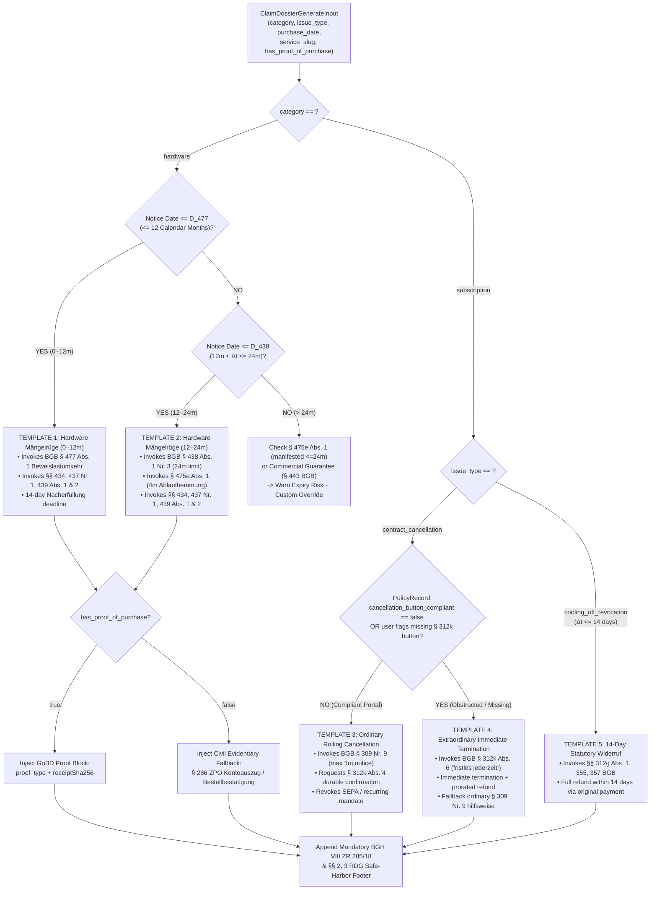

# ⚖️ German Consumer Law (BGB) Engine & Statutory Notice Templates Specification

**Document Reference:** `DOC-PRD-02`  
**Academic Institution:** SRH University of Applied Sciences (*SRH Hochschule*)  
**Course Module:** *Computer & Media Lab* (Wintersemester 2026) · Instructor: Prof. Franziska Schwarz  
**Working Team:** **Team 6**  
**Project:** *Warranty, Subscription & Tax-Ready Wallet + Policy Wiki (MCP/API-Enabled)*  
**Active Milestone:** Session 5 — MVP Scope Lock & Working Core User Journey Gate  
**Primary Author:** **AmirHossein (`@ettefagh`) — Product / Research Lead (Member B, `8h` Sprint 1 `US-05` Allocation)**  
**Co-Integration Owners:** **Mojtaba** *(Quality / Media Lead — `10h` Media Format 2 PDF/Text Compiler `#19`)* & **Kyle** *(Development Lead — MCP `claim_dossier_generate` `#10`, `#20`)*  
**Mapped GitHub Issues:** [**#3**](https://github.com/ettefagh/CM-LAB/issues/3), [**#8**](https://github.com/ettefagh/CM-LAB/issues/8), [**#14**](https://github.com/ettefagh/CM-LAB/issues/14), [**#15**](https://github.com/ettefagh/CM-LAB/issues/15), [**#19**](https://github.com/ettefagh/CM-LAB/issues/19), [**#24**](https://github.com/ettefagh/CM-LAB/issues/24), [**#29**](https://github.com/ettefagh/CM-LAB/issues/29)  

---

## 1. Purpose, Legal Architecture & Zero-Hallucination Guarantee

### 1.1 Architectural Mandate (`ADR-03 #29`)
Consumer Interviews 1 and 2 demonstrated that storing a receipt image does not resolve consumer loss: when hardware fails at Month 9 or Month 14, or when a fitness/software vendor conceals its cancellation workflow behind retention dark patterns, consumers abandon valid claims due to **procedural intimidation**. Conversely, delegating legal notice drafting to unconstrained conversational LLMs introduces catastrophic **"Failures of Legal Warrant"**—fabricating BGB paragraphs, conflating US *"As-Is"* warranty waivers with non-waivable EU/German consumer rights (`§ 476 Abs. 1 BGB`), or triggering unauthorized legal practice liability under `§ 3 RDG`.

This specification defines Team 6's **100% deterministic statutory rule engine and verbatim bilingual template library**:
1. Every legal branch is governed by a pure, auditable mathematical function over ISO-8601 dates and typed enum flags—**zero stochastic LLM generation** occurs inside statutory assertions.
2. Every template interpolates exact `{{variable}}` slots shared identically between **Kyle's** MCP `claim_dossier_generate` endpoint (`DEV-03`) and **Mojtaba's** client-side Media Format 2 PDF/plaintext compiler (`#19`).
3. Every compiled output embeds non-removable regulatory safe-harbor notices compliant with **BGH VIII ZR 285/18 (*LexFox* doctrine)** and **`§§ 2, 3 RDG`**.

---

## 2. German Statutory Framework: Hardware *Sachmängelhaftung* vs. *Garantie*

### 2.1 Structural Distinction (`Iteration C-3 #24` Legal Basis)
A pervasive corporate anti-pattern in German electronics retail is **improper manufacturer redirection** (*Abwimmelung an den Hersteller*): store staff tell consumers with a defective laptop or headphones at Month 13 that *"Apple/Sony only gives a 1-year warranty."* Under German Civil Code (*Bürgerliches Gesetzbuch — BGB*, post-01.01.2022 transposition of **EU Sale of Goods Directive (EU) 2019/771 / *Warenkauf-Richtlinie***), two independent legal regimes operate concurrently:

| Legal Dimension | Statutory Defect Liability (*Gesetzliche Gewährleistung / Mängelhaftung*) | Commercial Guarantee (*Freiwillige Herstellergarantie / Haltbarkeitsgarantie*) |
| :--- | :--- | :--- |
| **Statutory Basis** | **`BGB §§ 434, 437, 438, 439, 474–477`** *(Verbrauchsgüterkauf)* | **`BGB §§ 443, 479`** *(Garantieerklärung)* |
| **Obligated Counterparty** | **The Seller / Retailer** (*Verkäufer / Vertragshändler*, e.g., Saturn, MediaMarkt, Amazon EU S.à r.l.) | **The Guarantor / Manufacturer** (e.g., Apple Distribution International, Sony Europe B.V., Anker) |
| **Mandatory Duration** | **24 Months** from delivery (*Gefahrübergang*, `§ 438 Abs. 1 Nr. 3 BGB`); min. 12m only for used goods if expressly agreed per `§ 476 Abs. 2 BGB` | Voluntary (`12m` Apple/Sony, `18m` Anker, `24m` Dyson/Bose/Samsung); **cannot restrict statutory rights (`§ 479 Abs. 1 Satz 2 Nr. 1 BGB`)** |
| **Contractual Waiver** | **Strictly Void (`§ 476 Abs. 1 Satz 1 BGB`)** — *Unabdingbarkeit* in B2C sales | Governed by manufacturer's published guarantee statement (`Garantiebedingungen`) |
| **Burden of Proof** | **Reversed for first 12 months (`§ 477 Abs. 1 Satz 1 BGB`)**: defect presumed present at delivery | Defined by guarantee terms (for *Haltbarkeitsgarantie*, `§ 443 Abs. 2 BGB` presumes defect during guarantee period) |
| **Choice of Remedy** | **Buyer's primary choice (`§ 439 Abs. 1 BGB`)**: Repair (*Nachbesserung*) OR New Replacement (*Nachlieferung*) | Determined by guarantor (often refurbished swap or depot repair) |
| **Shipping / Labor Costs** | **100% borne by Seller (`§ 439 Abs. 2 BGB`)**; zero usage deduction on replacement (`§ 475 Abs. 3 Satz 1 BGB`) | May impose handling conditions unless prohibited by guarantee statement |

### 2.2 Core Hardware Statutory Articles Codified in Engine
1. **`§ 434 BGB` (*Sachmangel*):** Defines material defect under the unified subjective AND objective conformity standard (*subjektive und objektive Anforderungen sowie Montageanforderungen*, effective 01.01.2022). Even if an item matches marketing specs, failing normal durability or functionality expectations of goods of the same type constitutes an actionable *Sachmangel*.
2. **`§ 437 Nr. 1 & § 439 Abs. 1–4 BGB` (*Nacherfüllung*):** Grants the consumer the primary right to choose between free repair (*Beseitigung des Mangels*) or delivery of a defect-free replacement item (*Lieferung einer mangelfreien Sache*). Under **`§ 439 Abs. 2 BGB`**, the seller must bear all expenses necessary for supplementary performance, specifically **transport, shipping, labor, and material costs** (*Transport-, Wege-, Arbeits- und Materialkosten*). Under **`§ 475 Abs. 3 Satz 1 BGB`**, if the seller delivers a brand-new replacement unit, the consumer owes **zero compensation for prior use** (*kein Nutzungsersatz*).
3. **`§ 477 Abs. 1 Satz 1 BGB` (*Beweislastumkehr — 12 Monate*):** If any non-conformity manifests within **12 months** of delivery (*Gefahrübergang*, doubled from 6 to 12 months on 01.01.2022), German law **presumes** the item was already defective at delivery unless the seller proves incompatibility with the nature of the goods or defect. *(Note: For Goods with Digital Elements requiring continuous cloud/firmware supply under `§ 475b BGB`, `§ 477 Abs. 2 BGB` extends burden reversal across the entire agreed supply period, minimum 24 months).*
4. **`§ 438 Abs. 1 Nr. 3 BGB` (*24-Monatige Verjährungsfrist*) & `§ 475e Abs. 1 & Abs. 3 BGB` (*Ablaufhemmung*):**
   * Claims expire 24 months after delivery (`§ 438 Abs. 1 Nr. 3, Abs. 2 BGB`).
   * **Critical Late-Stage Protection (`§ 475e Abs. 1 BGB`):** If a defect first manifests *within* the 24-month limitation period (e.g., at Month 23, Day 20), limitation **does not occur before 4 months have elapsed** after the time the defect first manifested! This prevents consumers from losing claims while gathering documents in Month 24.
   * **Post-Inspection Protection (`§ 475e Abs. 3 BGB`):** Once the consumer hands the item to the seller/guarantor for inspection or repair, expiry is suspended and cannot occur until **2 months after** the repaired/inspected item is returned to the consumer.
5. **`§ 475d BGB` (*Entbehrlichkeit der Fristsetzung für Rücktritt/Minderung*):** In B2C consumer sales (`Verbrauchsgüterkauf`), setting a specific day-count deadline is legally satisfied once the consumer notifies the seller of the defect and a reasonable period elapses without cure; nonetheless, our templates explicitly set a clear **14-calendar-day deadline** (`{{remedy_deadline_date}}`) to create indisputable documentary certainty for downstream withdrawal (*Rücktritt*, `§§ 437 Nr. 2, 323 BGB`), price reduction (*Minderung*, `§ 441 BGB`), or damages (`§ 280 BGB`).

---

## 3. Deterministic Date & Statutory State-Machine Mathematics

### 3.1 Calendar-Month Precision (`§§ 187 Abs. 1, 188 Abs. 2, 193 BGB`)
In German civil law, statutory month and year periods are computed by **calendar date correspondence** (`§§ 187 Abs. 1, 188 Abs. 2 BGB`), **not** naive `365 * 86400s` multiplication (which drifts by 1 day across leap years such as 2028):
* Given delivery/purchase date $D_{\text{purchase}} = (Y_0, M_0, d_0)$ in `Europe/Berlin`:
  * **12-Month `BGB § 477 Abs. 1` Cutoff ($D_{\text{477}}$):** Calendar date $(Y_0 + 1, M_0, \min(d_0, \text{daysInMonth}(Y_0 + 1, M_0)))$ at `23:59:59` local time. *(Example: Purchased `2026-03-15` $\rightarrow$ `§ 477` window runs through `2027-03-15`; purchased `2028-02-29` $\rightarrow$ `2029-02-28`).*
  * **24-Month `BGB § 438 Abs. 1 Nr. 3` Limitation Cutoff ($D_{\text{438}}$):** Calendar date $(Y_0 + 2, M_0, \min(d_0, \text{daysInMonth}(Y_0 + 2, M_0)))$, adjusted forward to the next working day (*Werktag*) under **`§ 193 BGB`** if $D_{\text{438}}$ falls on a Saturday, Sunday, or statutory holiday at the place of performance.
  * **14-Day Statutory Cure Deadline ($D_{\text{cure}}$):** $D_{\text{notice}} + 14\text{ calendar days}$, adjusted forward via `§ 193 BGB` if falling on a weekend.
  * **14-Day Cooling-Off Revocation Cutoff ($D_{\text{widerruf}}$):** $D_{\text{contract/delivery}} + 14\text{ calendar days}$ (`§§ 312g Abs. 1, 355 Abs. 2 BGB`).

### 3.2 Deterministic Template Selection State Machine



### 3.3 German Civil Evidentiary Fallback Rules (`Scenario 5.3` — Missing/Faded *Kassenbon*)
Retailers frequently claim *"Ohne Original-Kassenbon keine Gewährleistung!"* (No warranty without original cash register slip). Under settled German civil procedure (**`§ 286 ZPO` — *Freie Beweiswürdigung***), **this assertion is legally false**:
* Statutory warranty rights (`§ 437 BGB`) require only that the buyer prove *that* the item was purchased from the specific seller on a given date; the law prescribes **no form requirement** restricting proof to thermal cash register paper.
* Valid alternative proofs of purchase include:
  1. **Bank or EC/Girocard Statement (*Kontoauszug*)** or **Credit Card Statement (*Kreditkartenabrechnung*)** showing merchant, date, and transaction amount (unrelated lines may be redacted for privacy).
  2. **Electronic Order Confirmation / Invoice (*Bestellbestätigung / PDF-Rechnung*)** or loyalty-account history (e.g., *myMediaMarkt* / *mySaturn* order log).
  3. **Witness Testimony (*Zeugenbeweis*, `§§ 373 ff. ZPO`)** of a person present at purchase.
* *(Distinction noted clearly in UI)*: Only **voluntary store goodwill returns** (*Kulanzumtausch* of defect-free goods) or voluntary manufacturer guarantees (`§ 443 BGB`) can contractually require the original *Kassenbon*—never mandatory statutory seller warranty (`§ 437 BGB`).

---

## 4. Subscription Law & Dark-Pattern Countermeasures (`Risk R-2 #14`)

University students manage 5–12 recurring contracts (streaming, fitness studios, creative/IDE software, cloud storage). Merchants deploy aggressive **retention dark patterns** (*Confirmshaming*, multi-screen labyrinth flows, hidden early-termination fees, phone-only cancellation walls). Team 6 neutralizes these practices deterministically through three German statutory pillars:

| Dark Pattern Vector (`Risk R-2 #14`) | Merchant Example Observed in Research | German Statutory Countermeasure | Legal Consequence Enforced by Template |
| :--- | :--- | :--- | :--- |
| **Silent 12-Month Auto-Extension**<br>*(Stillschweigende Vertragsverlängerung um 1 Jahr)* | Fitness studios (`FitX`, `McFIT`) or software plans claiming contract locked for another 12 months after Year 1. | **`BGB § 309 Nr. 9 lit. b & c`**<br>*(Gesetz für faire Verbraucherverträge, in force since 01.03.2022)* | Any tacit renewal clause for contracts concluded from 01.03.2022 onward is **void (`unwirksam`)** unless extended indefinitely with a **maximum 1-month rolling notice period** (`höchstens ein Monat Kündigungsfrist`). |
| **50% Early Termination Penalty After Renewal**<br>*(Vorfälligkeitsentschädigung nach Erstlaufzeit)* | `Adobe Creative Cloud` Annual Billed Monthly plan demanding 50% of remaining year after silent Year-2 renewal. | **`BGB § 309 Nr. 9 lit. b` & `§ 307 Abs. 1 BGB`** | Post-initial-term penalty fees that penalize exercising the statutory 1-month rolling termination right are invalid under German AGB control (`§§ 307, 309 Nr. 9 BGB`). |
| **Hidden, Broken, or Login-Gated Cancellation Button**<br>*(Fehlender oder versteckter Kündigungsbutton)* | Web subscription provider requiring phone call, postal letter, or hiding cancel button behind login walls / 6+ retention screens. | **`BGB § 312k Abs. 1–5`** & **`§ 312k Abs. 6 BGB`** *(in force since 01.07.2022)* | `§ 312k Abs. 2` requires an immediately accessible, clearly labeled 2-step button (*"Verträge hier kündigen"* $\rightarrow$ *"jetzt kündigen"* **without forcing login first** per German case law, e.g., LG Köln / OLG Nürnberg). Violation triggers **`§ 312k Abs. 6 BGB`: immediate termination at any time without notice (*fristlose Kündigung jederzeit*)**! |
| **Free-Trial-to-Paid Conversion Trap**<br>*(Unbemerkter Übergang aus Probeabo)* | `Amazon Prime`, `Adobe`, or AI tools converting 7/14/30-day trials into paid billing. | **`BGB §§ 312g Abs. 1, 355, 356`** *(14-Day Widerrufsrecht)* + `T-7d / T-1d` Wallet Alerts | Consumer may revoke distance contracts within **14 calendar days** of conclusion without giving reasons (`§ 355 Abs. 1 BGB`), requiring full reimbursement within 14 days (`§ 357 Abs. 1 BGB`). |

---

## 5. Unified Variable Interpolation Contract & Verbatim Bilingual Templates

### 5.1 Deterministic Variable Slot Schema (`{{slot}}` Contract)
Every template below uses pure `{{variable_name}}` interpolation slots—zero loops or untyped eval expressions—ensuring identical rendering in Kyle's TypeScript MCP server (`DEV-03`) and Mojtaba's client-side PDF/plaintext compiler (`#19`):

| Interpolation Slot | Source (`ClaimDossierGenerateInput` / `WalletItem` / Computed) | Fallback Default (if Optional) | Example Value |
| :--- | :--- | :--- | :--- |
| `{{consumer_full_name}}` | Local User Profile / Editable View 4 Header | `"[Vor- und Nachname des Verbrauchers / Consumer Name]"` | `"Lukas Weber"` |
| `{{consumer_address}}` | Local User Profile / Editable View 4 Header | `"[Anschrift des Verbrauchers / Consumer Address]"` | `"Ernst-Reuter-Platz 10, 10587 Berlin"` |
| `{{consumer_email}}` | Local User Profile / Editable View 4 Header | `"[E-Mail-Adresse / Consumer Email]"` | `"lukas.weber@stud.srh-campus-berlin.de"` |
| `{{merchant_name}}` | `PolicyRecord.brand_name` or `WalletItem.merchant` | `service_slug` capitalized | `"Saturn Electro-Handelsgesellschaft mbH"` |
| `{{merchant_contact_endpoint}}` | `escalation_rma_url` / `cancellation_button_url` / `supportEmail` | `"[Kundendienst-Kontakt / Merchant Support]"` | `"https://www.saturn.de/de/myaccount/orders"` |
| `{{item_name}}` | `input.item_name` / `WalletItem.name` | *(Required by Zod)* | `"Sony WH-1000XM4 Wireless Headphones"` |
| `{{purchase_date}}` | `input.purchase_date` / `WalletItem.purchaseDate` (`YYYY-MM-DD`) | *(Required by Zod)* | `"2026-03-15"` |
| `{{notice_date}}` | Current local ISO date (`Europe/Berlin`, `YYYY-MM-DD`) | Computed deterministic clock | `"2026-11-04"` |
| `{{remedy_deadline_date}}` | `notice_date + 14 calendar days` (`§ 193 BGB` adjusted) | Computed deterministic clock | `"2026-11-18"` |
| `{{price_eur}}` | `WalletItem.priceEur` formatted `0.00 EUR` | `"lt. Kaufbeleg / per invoice"` | `"279.00 EUR"` |
| `{{contract_or_serial_number}}` | `input.contract_or_serial_number` / `WalletItem.serialNumber` | `"N/A (siehe Kaufnachweis)"` | `"SN-84920491-EU"` |
| `{{defect_description}}` | `input.defect_description` | *(Required by Zod, min 10 chars)* | `"Linker Ohrhörer lädt im Ladecase nicht mehr und verliert sporadisch die Audioverbindung."` |
| `{{preferred_remedy_de}}` | User radio choice in View 4 (`§ 439 Abs. 1 BGB`) | `"mangelfreie Ersatzlieferung (Nachlieferung) oder fachgerechte Reparatur (Nachbesserung)"` | `"Lieferung einer mangelfreien neuen Sache (Nachlieferung gem. § 439 Abs. 1 Alt. 2 BGB)"` |
| `{{preferred_remedy_en}}` | User radio choice in View 4 (`§ 439 Abs. 1 BGB`) | `"replacement with a defect-free unit or professional repair"` | `"delivery of a defect-free replacement unit (Nachlieferung pursuant to § 439(1) alt. 2 BGB)"` |
| `{{proof_block_de}}` | Conditional on `has_proof_of_purchase` & `proof_type` | Civil fallback clause (§3.3) | `"Kopie des Kaufbelegs (receipt_photo, GoBD SHA-256: 8f4b2c9a...)"` |
| `{{proof_block_en}}` | Conditional on `has_proof_of_purchase` & `proof_type` | Civil fallback clause (§3.3) | `"Copy of purchase receipt (receipt_photo, GoBD SHA-256: 8f4b2c9a...)"` |
| `{{receipt_sha256}}` | `WalletItem.receiptSha256` (`64-char hex`) | `"Nicht hinterlegt (Alternativnachweis gem. § 286 ZPO)"` | `"8f4b2c9a71d3e04b55c82a1940f71b6e9d04c2a183f5e6b7c8d9e0f1a2b3c4d5"` |

#### Conditional Proof Block Values (`{{proof_block_de}}` / `{{proof_block_en}}`):
* **When `has_proof_of_purchase === true`:**
  * **DE:** `Der Nachweis des Vertragsschlusses ist durch den beigefügten Beleg ({{proof_type}}) dokumentiert (Kryptografischer Integritäts-Prüfwert SHA-256: {{receipt_sha256}}).`
  * **EN:** `Proof of contract conclusion is documented via the attached record ({{proof_type}}, cryptographic integrity digest SHA-256: {{receipt_sha256}}).`
* **When `has_proof_of_purchase === false` (`Scenario 5.3`):**
  * **DE:** `Beweismittel-Hinweis (§ 286 ZPO): Ein physischer Thermopapier-Kassenbon ist für die gesetzliche Sachmängelhaftung nach §§ 437 ff. BGB rechtlich nicht zwingend erforderlich. Der Kaufnachweis erfolgt durch beigefügten Kontoauszug / Kartenabrechnung / elektronische Bestellbestätigung bzw. benannten Zeugenbeweis: [BITTE KONTOAUSZUG ODER BESTELLBESTÄTIGUNG BEIFÜGEN].`
  * **EN:** `Evidentiary Notice (§ 286 ZPO): Under German civil law, a physical cash register slip is not legally required to assert statutory warranty rights under §§ 437 et seq. BGB. Proof of purchase is established via attached bank/card statement, electronic order confirmation, or witness testimony: [PLEASE ATTACH BANK STATEMENT OR ORDER CONFIRMATION].`

---

### 5.2 Template 1: Hardware *Mängelrüge* Within 0–12 Months (`BGB § 477 Abs. 1` Active)

#### 5.2.1 Authoritative German Legal Text (`DE` — Primary Submission Binding)
```markdown
# GESETZLICHE MÄNGELRÜGE & AUFFORDERUNG ZUR NACHERFÜLLUNG (§§ 437 Nr. 1, 439, 477 Abs. 1 BGB)

**Absender (Käufer / Verbraucher):**
{{consumer_full_name}}
{{consumer_address}}
E-Mail: {{consumer_email}}

**Empfänger (Verkäufer / Vertragshändler):**
{{merchant_name}}
Einreichungskanal / RMA-Endpunkt: {{merchant_contact_endpoint}}

**Datum:** {{notice_date}}
**Betreff:** Gesetzliche Mängelanzeige und Aufforderung zur Nacherfüllung gem. §§ 434, 437 Nr. 1, 439 BGB
**Kaufgegenstand:** {{item_name}}
**Kauf- / Lieferdatum:** {{purchase_date}} · **Kaufpreis:** {{price_eur}}
**Seriennummer / Bestell- bzw. Vertragsreferenz:** {{contract_or_serial_number}}

Sehr geehrte Damen und Herren,

am {{purchase_date}} habe ich bei Ihnen als Verbraucher (§ 13 BGB) den oben bezeichneten Kaufgegenstand **{{item_name}}** erworben. An der Kaufsache ist folgender Sachmangel im Sinne des § 434 BGB aufgetreten:

> {{defect_description}}

### 1. Gesetzliche Beweislastumkehr zugunsten des Verbrauchers (§ 477 Abs. 1 BGB)
Da sich der oben beschriebene Mangel innerhalb von **zwölf Monaten** seit Gefahrübergang gezeigt hat, greift die gesetzliche Vermutung des **§ 477 Abs. 1 Satz 1 BGB** (in Umsetzung der EU-Warenkauf-Richtlinie (EU) 2019/771). Es wird kraft Gesetzes vermutet, dass die Ware bereits im Zeitpunkt des Gefahrübergangs mangelhaft war. Eine Beweislast meinerseits für die Ursächlichkeit bei Übergabe besteht nicht.

### 2. Ausübung des Käufer-Wahlrechts auf kostenfreie Nacherfüllung (§ 439 Abs. 1–4, § 475 Abs. 3 BGB)
Hiermit mache ich meine gesetzlichen Gewährleistungsrechte unmittelbar gegenüber Ihnen als Verkäufer geltend (etwaige freiwillige Herstellergarantien nach § 443 BGB lassen Ihre gesetzliche Einstandspflicht gem. § 479 Abs. 1 BGB unberührt). Gemäß **§ 439 Abs. 1 BGB** wähle ich als Art der Nacherfüllung:
**{{preferred_remedy_de}}**.

Ich fordere Sie auf, die Nacherfüllung unverzüglich, spätestens jedoch bis zum **{{remedy_deadline_date}}** (14 Kalendertage), vollständig durchzuführen. Gemäß **§ 439 Abs. 2 BGB** haben Sie sämtliche zum Zwecke der Nacherfüllung erforderlichen Aufwendungen – insbesondere **Transport-, Versand-, Wege-, Arbeits- und Materialkosten** – zu tragen; bitte stellen Sie mir hierfür umgehend ein kostenfreies Rücksendeetikett zur Verfügung. Im Falle einer Ersatzlieferung schulde ich gem. **§ 475 Abs. 3 Satz 1 BGB** keinen Nutzungsersatz.

### 3. Kaufnachweis & Ablaufhemmung (§ 475e BGB)
{{proof_block_de}}
Vorsorglich weise ich auf den Eintritt der gesetzlichen Ablaufhemmung gem. **§ 475e Abs. 1 und Abs. 3 BGB** hin. Sollte die Nacherfüllung nicht fristgerecht erfolgen oder fehlschlagen, behalte ich mir ausdrücklich die Ausübung meiner weitergehenden gesetzlichen Rechte auf Rücktritt vom Kaufvertrag (§§ 437 Nr. 2, 323, 475d BGB), Kaufpreisminderung (§ 441 BGB) sowie Schadensersatz (§§ 437 Nr. 3, 280 BGB) vor.

Mit freundlichen Grüßen

{{consumer_full_name}}

---
*Rechtlicher Hinweis (Legal-Tech Safe Harbor): Dieses Schreiben wurde durch das Software-Werkzeug „Warranty & Subscription Wallet“ rein schematisch und deterministisch anhand der vom Nutzer eingegebenen Sachverhaltsdaten erstellt. Es handelt sich um ein technisches Dokumentations- und Formulierungswerkzeug im Sinne der Rechtsprechung des Bundesgerichtshofs (BGH, Urteil vom 27.11.2019 – VIII ZR 285/18) und stellt keine individuelle Rechtsberatung oder Rechtsdienstleistung gemäß §§ 2, 3 RDG (Rechtsdienstleistungsgesetz) dar.*
```

#### 5.2.2 Companion English Reference Translation (`EN` — International Student Accessibility)
```markdown
# FORMAL STATUTORY NOTICE OF DEFECT & DEMAND FOR CURE (GERMAN BGB §§ 437(1), 439, 477(1))

**Sender (Buyer / Consumer):** {{consumer_full_name}}, {{consumer_address}} · Email: {{consumer_email}}
**Recipient (Seller / Merchant):** {{merchant_name}} ({{merchant_contact_endpoint}})
**Date:** {{notice_date}}
**Subject:** Statutory Warranty Notice of Non-Conformity (Mängelrüge) pursuant to §§ 434, 437 No. 1, 439 BGB
**Item:** {{item_name}} · **Purchase Date:** {{purchase_date}} · **Price:** {{price_eur}}
**Serial / Order Reference:** {{contract_or_serial_number}}

Dear Sir or Madam,

On {{purchase_date}}, I purchased **{{item_name}}** from you as a consumer (§ 13 BGB). The item exhibits the following material non-conformity within the meaning of § 434 BGB:

> {{defect_description}}

### 1. Statutory 12-Month Reversed Burden of Proof (§ 477(1) BGB / EU Directive 2019/771)
Because this defect manifested within **12 months** of delivery, **§ 477(1) sentence 1 BGB** establishes the statutory presumption that the goods were already defective at the time of delivery. The consumer bears no burden of proving the root cause existed at handover.

### 2. Buyer's Primary Choice of Free Cure (§ 439(1)–(4), § 475(3) BGB)
I hereby assert my mandatory statutory warranty rights directly against you as the seller (any voluntary manufacturer guarantee under § 443 BGB does not limit seller liability pursuant to § 479(1) BGB). Exercising my statutory election under **§ 439(1) BGB**, I request: **{{preferred_remedy_en}}**.

Please complete supplementary performance no later than **{{remedy_deadline_date}}** (14 calendar days). Pursuant to **§ 439(2) BGB**, you bear 100% of all necessary transport, return shipping, labor, and material costs; please provide a prepaid return label immediately. In the event of replacement, no compensation for prior use is owed (**§ 475(3) sentence 1 BGB**).

### 3. Proof of Purchase & Suspension of Expiry (§ 475e BGB)
{{proof_block_en}}
Take notice that statutory suspension of limitation applies under **§ 475e(1) and (3) BGB**. Should cure not be completed within the stated period, I reserve my statutory rights to contract rescission/refund (§§ 437 No. 2, 323, 475d BGB), price reduction (§ 441 BGB), and damages (§ 280 BGB).

Sincerely,
{{consumer_full_name}}

---
*Regulatory Notice: This document was compiled deterministically from user-supplied factual inputs by the "Warranty & Subscription Wallet" organizational software tool in accordance with German Federal Court of Justice jurisprudence (BGH VIII ZR 285/18). It does not constitute individualized legal assessment or legal advice under §§ 2, 3 of the German Legal Services Act (RDG).*
```

---

### 5.3 Template 2: Hardware *Mängelrüge* Within 12–24 Months (`BGB § 438 Abs. 1 Nr. 3` + `§ 475e Abs. 1`)

#### 5.3.1 Authoritative German Legal Text (`DE`)
```markdown
# GESETZLICHE MÄNGELRÜGE INNERHALB DER 24-MONATIGEN GEWÄHRLEISTUNGSFRIST (§§ 437, 438 Abs. 1 Nr. 3, 475e BGB)

**Absender (Käufer / Verbraucher):**
{{consumer_full_name}}
{{consumer_address}}
E-Mail: {{consumer_email}}

**Empfänger (Verkäufer / Vertragshändler):**
{{merchant_name}}
Einreichungskanal / RMA-Endpunkt: {{merchant_contact_endpoint}}

**Datum:** {{notice_date}}
**Betreff:** Gesetzliche Mängelanzeige gem. §§ 434, 437 Nr. 1, 438 Abs. 1 Nr. 3, 439 BGB sowie Ablaufhemmung gem. § 475e BGB
**Kaufgegenstand:** {{item_name}}
**Kauf- / Lieferdatum:** {{purchase_date}} · **Kaufpreis:** {{price_eur}}
**Seriennummer / Bestell- bzw. Vertragsreferenz:** {{contract_or_serial_number}}

Sehr geehrte Damen und Herren,

am {{purchase_date}} habe ich bei Ihnen als Verbraucher (§ 13 BGB) den Kaufgegenstand **{{item_name}}** erworben. Innerhalb der laufenden **24-monatigen gesetzlichen Verjährungsfrist gem. § 438 Abs. 1 Nr. 3 BGB** ist an dem Gerät folgender Sachmangel im Sinne des § 434 Abs. 1 und Abs. 3 BGB (Abweichung von der objektiven Beschaffenheits- und Haltbarkeitserwartung) zutage getreten:

> {{defect_description}}

### 1. Sachmangelanlage & Unzulässigkeit eines Verweises auf abgelaufene Herstellergarantien
Das Gerät wurde ausschließlich bestimmungsgemäß und pfleglich genutzt; äußere Gewalteinwirkung, Sturz- oder Flüssigkeitsschäden liegen nicht vor, sodass der Ausfall auf einen bereits bei Gefahrübergang angelegten Material-, Fertigungs- oder Konstruktionsmangel zurückzuführen ist. Ich weise vorsorglich darauf hin, dass ein etwaiger Ablauf einer 12-monatigen freiwilligen Herstellergarantie (§ 443 BGB) Ihre zwingende 24-monatige gesetzliche Verkäuferhaftung gem. **§§ 437, 438 Abs. 1 Nr. 3, 476 Abs. 1 BGB** in keiner Weise verkürzt.

### 2. Gesetzliche Ablaufhemmung (§ 475e Abs. 1 und Abs. 3 BGB)
Da sich der Mangel innerhalb der regulären Verjährungsfrist gezeigt hat, tritt gemäß **§ 475e Abs. 1 BGB** eine gesetzliche Ablaufhemmung ein: Die Verjährung tritt keinesfalls vor Ablauf von **vier Monaten** nach dem Zeitpunkt ein, in dem sich der Mangel erstmals gezeigt hat. Übergebe ich Ihnen die Ware zur Prüfung oder Nacherfüllung, ist die Verjährung darüber hinaus gem. **§ 475e Abs. 3 BGB** bis zum Ablauf von zwei Monaten nach Rückgabe der geprüften oder nachgebesserten Sache gehemmt.

### 3. Aufforderung zur kostenfreien Nacherfüllung (§ 439 Abs. 1 und Abs. 2 BGB)
Gemäß **§ 439 Abs. 1 BGB** fordere ich Sie auf, bis spätestens zum **{{remedy_deadline_date}}** (14 Kalendertage) folgende Nacherfüllung vorzunehmen:
**{{preferred_remedy_de}}**.
Sämtliche Versand-, Transport-, Arbeits- und Materialkosten gehen gem. **§ 439 Abs. 2 BGB** zu Ihren Lasten; bitte übersenden Sie mir ein kostenfreies Rücksendeetikett.

### 4. Kaufnachweis & Vorbehalt weiterer Rechte
{{proof_block_de}}
Für den Fall des fruchtlosen Fristablaufs oder der endgültigen Verweigerung behalte ich mir Rücktritt (§§ 437 Nr. 2, 323, 475d BGB) und Minderung (§ 441 BGB) ausdrücklich vor.

Mit freundlichen Grüßen

{{consumer_full_name}}

---
*Rechtlicher Hinweis (Legal-Tech Safe Harbor): Dieses Schreiben wurde durch das Software-Werkzeug „Warranty & Subscription Wallet“ rein schematisch und deterministisch anhand der vom Nutzer eingegebenen Sachverhaltsdaten erstellt. Es handelt sich um ein technisches Dokumentations- und Formulierungswerkzeug im Sinne der Rechtsprechung des Bundesgerichtshofs (BGH, Urteil vom 27.11.2019 – VIII ZR 285/18) und stellt keine individuelle Rechtsberatung oder Rechtsdienstleistung gemäß §§ 2, 3 RDG (Rechtsdienstleistungsgesetz) dar.*
```

#### 5.3.2 Companion English Reference Translation (`EN`)
```markdown
# FORMAL STATUTORY NOTICE OF DEFECT WITHIN 24-MONTH LIMITATION PERIOD (BGB §§ 437, 438(1) No. 3, 475e)

**Sender (Buyer / Consumer):** {{consumer_full_name}}, {{consumer_address}} · Email: {{consumer_email}}
**Recipient (Seller / Merchant):** {{merchant_name}} ({{merchant_contact_endpoint}})
**Date:** {{notice_date}}
**Subject:** Statutory Defect Claim within 24-Month Warranty Window (§ 438(1) No. 3 BGB) & Suspension of Expiry (§ 475e BGB)
**Item:** {{item_name}} · **Purchase Date:** {{purchase_date}} · **Price:** {{price_eur}}
**Serial / Order Reference:** {{contract_or_serial_number}}

Dear Sir or Madam,

On {{purchase_date}}, I purchased **{{item_name}}** from you as a consumer (§ 13 BGB). Within the mandatory **24-month statutory limitation period under § 438(1) No. 3 BGB**, the following non-conformity in materials, workmanship, and objective durability (§ 434(1), (3) BGB) has manifested:

> {{defect_description}}

### 1. Inherent Defect & Non-Waivable Seller Liability
The device has been operated strictly within normal intended usage without external impact, drop, or liquid damage, indicating a latent manufacturing or component defect present at delivery. Please note that expiry of any voluntary 12-month manufacturer guarantee (§ 443 BGB) does not shorten your mandatory 24-month statutory seller liability (**§§ 437, 438(1) No. 3, 476(1) BGB**).

### 2. Statutory 4-Month Suspension of Expiry (§ 475e(1) & (3) BGB)
Because this defect manifested during the statutory limitation period, **§ 475e(1) BGB** suspends expiry such that limitation cannot occur earlier than **4 months** after initial manifestation. Furthermore, upon handover for inspection or repair, expiry remains suspended until **2 months** after return of the goods (**§ 475e(3) BGB**).

### 3. Demand for Free Supplementary Performance (§ 439(1) & (2) BGB)
Pursuant to **§ 439(1) BGB**, I demand completion of cure no later than **{{remedy_deadline_date}}** (14 calendar days) via: **{{preferred_remedy_en}}**. Under **§ 439(2) BGB**, all shipping, labor, and material costs are borne by you as seller; please issue a prepaid return label.

### 4. Proof of Purchase & Reservation of Remedies
{{proof_block_en}}
Should you fail to cure within the deadline, I reserve my statutory rights to contract rescission (§§ 437 No. 2, 323, 475d BGB) and price reduction (§ 441 BGB).

Sincerely,
{{consumer_full_name}}

---
*Regulatory Notice: This document was compiled deterministically from user-supplied factual inputs by the "Warranty & Subscription Wallet" organizational software tool in accordance with German Federal Court of Justice jurisprudence (BGH VIII ZR 285/18). It does not constitute individualized legal assessment or legal advice under §§ 2, 3 of the German Legal Services Act (RDG).*
```

---

### 5.4 Template 3: Ordinary Rolling Subscription Cancellation (*Ordentliche Kündigung gem. § 309 Nr. 9 BGB*)

#### 5.4.1 Authoritative German Legal Text (`DE`)
```markdown
# ORDENTLICHE VERTRAGSKÜNDIGUNG EINES DAUERSCHULDVERHÄLTNISSES (§ 309 Nr. 9 BGB)

**Absender (Verbraucher):**
{{consumer_full_name}}
{{consumer_address}}
Registrierte Konto-E-Mail: {{consumer_email}}

**Empfänger (Vertragspartner / Diensteanbieter):**
{{merchant_name}}
Kündigungsportal / Kontakt: {{merchant_contact_endpoint}}

**Datum:** {{notice_date}}
**Betreff:** Fristgerechte Kündigung meines Abonnements / Vertrages „{{item_name}}“
**Kunden- / Vertragsnummer:** {{contract_or_serial_number}} · **Vertragsbeginn:** {{purchase_date}}

Sehr geehrte Damen und Herren,

hiermit kündige ich meinen bestehenden Vertrag über **{{item_name}}** (Vertrags- bzw. Kontoreferenz: **{{contract_or_serial_number}}**) ordentlich und fristgerecht zum **nächstmöglichen gesetzlichen bzw. vertraglichen Beendigungszeitpunkt**.

### 1. Gesetzliche Höchstkündigungsfrist (§ 309 Nr. 9 BGB – Gesetz für faire Verbraucherverträge)
Für den Fall, dass sich der Vertrag nach Ablauf einer etwaigen Mindestvertragslaufzeit stillschweigend verlängert hat, mache ich von meinem gesetzlichen Recht gemäß **§ 309 Nr. 9 Buchstabe b und c BGB** Gebrauch, das Vertragsverhältnis jederzeit mit einer Frist von **höchstens einem Monat** zu kündigen. Entgegenstehende AGB-Klauseln über längere Verlängerungszeiträume oder Strafgebühren nach Ablauf der Erstlaufzeit sind gesetzlich unwirksam (§§ 307, 309 Nr. 9 BGB). Ergänzender Hinweis: {{defect_description}}

### 2. Widerruf der Einzugsermächtigung & Bestätigungspflicht (§ 312k Abs. 4 BGB)
Mit Wirksamwerden der Vertragsbeendigung widerrufe ich hiermit vorsorglich ein erteiltes SEPA-Lastschriftmandat bzw. die Berechtigung zur wiederkehrenden Belastung meines hinterlegten Zahlungsmittels (Kreditkarte / PayPal / App-Billing).

Bitte übermitteln Sie mir unverzüglich eine **Kündigungsbestätigung in Textform auf einem dauerhaften Datenträger** (E-Mail genügt, vgl. § 312k Abs. 4 BGB) unter ausdrücklicher Angabe des genauen Vertragsende-Datums. Von telefonischen oder schriftlichen Rückgewinnungsversuchen bitte ich abzusehen.

Mit freundlichen Grüßen

{{consumer_full_name}}

---
*Rechtlicher Hinweis (Legal-Tech Safe Harbor): Dieses Schreiben wurde durch das Software-Werkzeug „Warranty & Subscription Wallet“ rein schematisch und deterministisch anhand der vom Nutzer eingegebenen Sachverhaltsdaten erstellt. Es handelt sich um ein technisches Dokumentations- und Formulierungswerkzeug im Sinne der Rechtsprechung des Bundesgerichtshofs (BGH, Urteil vom 27.11.2019 – VIII ZR 285/18) und stellt keine individuelle Rechtsberatung oder Rechtsdienstleistung gemäß §§ 2, 3 RDG (Rechtsdienstleistungsgesetz) dar.*
```

#### 5.4.2 Companion English Reference Translation (`EN`)
```markdown
# FORMAL ORDINARY SUBSCRIPTION CANCELLATION NOTICE (GERMAN BGB § 309 No. 9)

**Sender (Consumer):** {{consumer_full_name}}, {{consumer_address}} · Account Email: {{consumer_email}}
**Recipient (Service Provider):** {{merchant_name}} ({{merchant_contact_endpoint}})
**Date:** {{notice_date}}
**Subject:** Formal Termination of Subscription / Membership "{{item_name}}"
**Contract / Account ID:** {{contract_or_serial_number}} · **Commencement Date:** {{purchase_date}}

Dear Sir or Madam,

I hereby formally terminate my subscription / membership contract for **{{item_name}}** (Reference: **{{contract_or_serial_number}}**) effective at the **earliest permissible statutory or contractual termination date**.

### 1. Maximum 1-Month Rolling Notice Period (§ 309 No. 9 BGB — Fair Consumer Contracts Act)
Where any initial commitment period has elapsed, I invoke my mandatory statutory right under **§ 309 No. 9(b) and (c) BGB** to terminate tacitly extended consumer contracts at any time subject to a **maximum notice period of one (1) month**. Any standard-form clauses imposing silent multi-month/annual lock-ins or post-initial-term early termination penalties are void under §§ 307, 309 No. 9 BGB. Note: {{defect_description}}

### 2. Revocation of Payment Mandate & Durable Confirmation (§ 312k(4) BGB)
Effective upon contract end, I revoke any SEPA direct-debit mandate or recurring billing authorization on file. Please send prompt written confirmation on a durable medium (email) specifying the exact termination effective date (§ 312k(4) BGB), and refrain from retention marketing contact.

Sincerely,
{{consumer_full_name}}

---
*Regulatory Notice: This document was compiled deterministically from user-supplied factual inputs by the "Warranty & Subscription Wallet" organizational software tool in accordance with German Federal Court of Justice jurisprudence (BGH VIII ZR 285/18). It does not constitute individualized legal assessment or legal advice under §§ 2, 3 of the German Legal Services Act (RDG).*
```

---

### 5.5 Template 4: Extraordinary Immediate Termination (*Außerordentliche fristlose Kündigung gem. § 312k Abs. 6 BGB* — Dark-Pattern Remedy)

#### 5.5.1 Authoritative German Legal Text (`DE`)
```markdown
# AUSSERORDENTLICHE FRISTLOSE KÜNDIGUNG GEMÄSS § 312k Abs. 6 BGB (HILFSWEISE ORDENTLICHE KÜNDIGUNG)

**Absender (Verbraucher):**
{{consumer_full_name}}
{{consumer_address}}
Registrierte Konto-E-Mail: {{consumer_email}}

**Empfänger (Vertragspartner / Diensteanbieter):**
{{merchant_name}}
Kontaktkanal: {{merchant_contact_endpoint}}

**Datum:** {{notice_date}}
**Betreff:** Sofortige fristlose Kündigung meines Vertrages „{{item_name}}“ gem. § 312k Abs. 6 BGB wegen Verstoßes gegen die Kündigungsbutton-Pflicht
**Kunden- / Vertragsnummer:** {{contract_or_serial_number}} · **Vertragsbeginn:** {{purchase_date}}

Sehr geehrte Damen und Herren,

hiermit kündige ich meinen im elektronischen Geschäftsverkehr begründeten Verbrauchervertrag über **{{item_name}}** (Vertragsreferenz: **{{contract_or_serial_number}}**) **außerordentlich und fristlos mit sofortiger Wirkung gemäß § 312k Abs. 6 BGB**, hilfsweise ordentlich zum nächstmöglichen Zeitpunkt gem. § 309 Nr. 9 BGB.

### 1. Gesetzliches Recht zur jederzeitigen fristlosen Kündigung (§ 312k Abs. 1, 2 und 6 BGB)
Gemäß **§ 312k Abs. 1 und Abs. 2 BGB** sind Unternehmer, die auf einer Website den Abschluss von Verbraucherverträgen über Dauerschuldverhältnisse im elektronischen Geschäftsverkehr ermöglichen, gesetzlich verpflichtet, eine ständig verfügbare, unmittelbar und leicht zugängliche zweistufige Kündigungsschaltfläche (*„Verträge hier kündigen“* → Bestätigungsseite mit *„jetzt kündigen“* ohne vorgeschaltete Login-Hürde oder irreführende Dark Patterns) sowie eine sofortige elektronische Eingangsbestätigung auf dauerhaftem Datenträger (§ 312k Abs. 4 BGB) vorzuhalten.

Festgestellter Verstoß auf Ihrer Online-Präsenz am {{notice_date}}:
> {{defect_description}}

Da mir keine den zwingenden Vorgaben des § 312k Abs. 2 bis 4 BGB entsprechende Schaltfläche und Bestätigungsseite zur Verfügung gestellt wurde, bin ich gemäß **§ 312k Abs. 6 Satz 1 BGB** gesetzlich berechtigt, den Vertrag **jederzeit und ohne Einhaltung einer Kündigungsfrist** mit sofortiger Wirkung zu beenden.

### 2. Zahlungseinstellung, anteilige Rückerstattung & SEPA-Widerruf
Das Vertragsverhältnis endet mit Zugang dieses Schreibens am **{{notice_date}}**. Etwaige für den Zeitraum nach Zugang dieses Schreibens im Voraus eingezogene Entgelte sind unverzüglich anteilig auf mein ursprüngliches Zahlungsmittel zurückzuerstatten (§ 812 Abs. 1 BGB). Sämtliche Einzugsermächtigungen und wiederkehrenden Abbuchungsbefugnisse widerrufe ich hiermit mit sofortiger Wirkung. Bitte bestätigen Sie mir die sofortige Vertragsbeendigung binnen **7 Kalendertagen** in Textform.

Mit freundlichen Grüßen

{{consumer_full_name}}

---
*Rechtlicher Hinweis (Legal-Tech Safe Harbor): Dieses Schreiben wurde durch das Software-Werkzeug „Warranty & Subscription Wallet“ rein schematisch und deterministisch anhand der vom Nutzer eingegebenen Sachverhaltsdaten erstellt. Es handelt sich um ein technisches Dokumentations- und Formulierungswerkzeug im Sinne der Rechtsprechung des Bundesgerichtshofs (BGH, Urteil vom 27.11.2019 – VIII ZR 285/18) und stellt keine individuelle Rechtsberatung oder Rechtsdienstleistung gemäß §§ 2, 3 RDG (Rechtsdienstleistungsgesetz) dar.*
```

#### 5.5.2 Companion English Reference Translation (`EN`)
```markdown
# EXTRAORDINARY IMMEDIATE CONTRACT TERMINATION WITHOUT NOTICE (GERMAN BGB § 312k(6))

**Sender (Consumer):** {{consumer_full_name}}, {{consumer_address}} · Account Email: {{consumer_email}}
**Recipient (Service Provider):** {{merchant_name}} ({{merchant_contact_endpoint}})
**Date:** {{notice_date}}
**Subject:** Immediate Termination Without Notice of "{{item_name}}" pursuant to § 312k(6) BGB (Non-Compliant Online Cancellation Button)
**Contract / Account ID:** {{contract_or_serial_number}} · **Commencement Date:** {{purchase_date}}

Dear Sir or Madam,

I hereby terminate my e-commerce consumer subscription contract for **{{item_name}}** (Reference: **{{contract_or_serial_number}}**) **extraordinarily and with immediate effect without notice pursuant to § 312k(6) BGB**, and in the alternative ordinarily to the earliest lawful date under § 309 No. 9 BGB.

### 1. Statutory Right to Immediate Termination Without Notice (§ 312k(1), (2), and (6) BGB)
Under **§ 312k(1)–(4) BGB**, traders offering recurring consumer contracts online must provide a continuously available, directly and easily accessible two-step online cancellation button (*"Verträge hier kündigen"* → *"jetzt kündigen"*, accessible without mandatory login walls or obstructive dark patterns) plus immediate durable electronic confirmation.

Documented non-compliance observed on {{notice_date}}:
> {{defect_description}}

Because you failed to provide a compliant cancellation button and confirmation workflow under § 312k(2)–(4) BGB, **§ 312k(6) sentence 1 BGB** grants me the mandatory statutory right to terminate this contract **at any time without observing any notice period**.

### 2. Immediate Billing Cessation & Prorated Refund
This contract terminates immediately upon receipt on **{{notice_date}}**. Any fees pre-collected for periods following today must be refunded pro rata immediately (§ 812(1) BGB), and all recurring payment/SEPA mandates are revoked immediately. Please confirm immediate termination in text form within **7 calendar days**.

Sincerely,
{{consumer_full_name}}

---
*Regulatory Notice: This document was compiled deterministically from user-supplied factual inputs by the "Warranty & Subscription Wallet" organizational software tool in accordance with German Federal Court of Justice jurisprudence (BGH VIII ZR 285/18). It does not constitute individualized legal assessment or legal advice under §§ 2, 3 of the German Legal Services Act (RDG).*
```

---

### 5.6 Template 5: 14-Day Statutory Cooling-Off Revocation (*Widerrufserklärung gem. §§ 312g, 355 BGB*)

#### 5.6.1 Authoritative German Legal Text (`DE`)
```markdown
# GESETZLICHER WIDERRUF EINES FERNABSATZVERTRAGES (§§ 312g Abs. 1, 355 BGB)

**Absender (Verbraucher):**
{{consumer_full_name}}
{{consumer_address}}
E-Mail: {{consumer_email}}

**Empfänger (Unternehmer):**
{{merchant_name}}
Widerrufskontakt: {{merchant_contact_endpoint}}

**Datum:** {{notice_date}}
**Betreff:** Ausübung des gesetzlichen 14-tägigen Widerrufsrechts gem. §§ 312g, 355 BGB für „{{item_name}}“
**Bestell- / Vertragsnummer:** {{contract_or_serial_number}} · **Vertragsschluss- / Lieferdatum:** {{purchase_date}}

Sehr geehrte Damen und Herren,

hiermit widerrufe ich den von mir abgeschlossenen Fernabsatzvertrag über den Kauf der Ware bzw. die Erbringung der Dienstleistung **{{item_name}}** (Vertragsreferenz: **{{contract_or_serial_number}}**, abgeschlossen/geliefert am **{{purchase_date}}**, Betrag: **{{price_eur}}**) fristgerecht gemäß **§§ 312g Abs. 1, 355 Abs. 1 und Abs. 2 BGB** (Anmerkung: {{defect_description}}).

Zur Wahrung der 14-tägigen Widerrufsfrist genügt gemäß **§ 355 Abs. 1 Satz 5 BGB** die rechtzeitige Absendung dieser Erklärung. Ich fordere Sie gemäß **§ 357 Abs. 1 und Abs. 3 BGB** auf, mir sämtliche geleisteten Zahlungen (einschließlich etwaiger Standard-Hinsendekosten) unverzüglich und spätestens binnen **14 Kalendertagen** ab Zugang dieser Widerrufserklärung über dasselbe Zahlungsmittel zurückzuerstatten, das bei der ursprünglichen Transaktion eingesetzt wurde. Bitte bestätigen Sie mir den Eingang dieses Widerrufs kurzfristig per E-Mail.

Mit freundlichen Grüßen

{{consumer_full_name}}

---
*Rechtlicher Hinweis (Legal-Tech Safe Harbor): Dieses Schreiben wurde durch das Software-Werkzeug „Warranty & Subscription Wallet“ rein schematisch und deterministisch anhand der vom Nutzer eingegebenen Sachverhaltsdaten erstellt. Es handelt sich um ein technisches Dokumentations- und Formulierungswerkzeug im Sinne der Rechtsprechung des Bundesgerichtshofs (BGH, Urteil vom 27.11.2019 – VIII ZR 285/18) und stellt keine individuelle Rechtsberatung oder Rechtsdienstleistung gemäß §§ 2, 3 RDG (Rechtsdienstleistungsgesetz) dar.*
```

#### 5.6.2 Companion English Reference Translation (`EN`)
```markdown
# STATUTORY 14-DAY DISTANCE CONTRACT REVOCATION (GERMAN BGB §§ 312g(1), 355)

**Sender (Consumer):** {{consumer_full_name}}, {{consumer_address}} · Email: {{consumer_email}}
**Recipient (Trader):** {{merchant_name}} ({{merchant_contact_endpoint}})
**Date:** {{notice_date}}
**Subject:** Exercise of 14-Day Statutory Right of Withdrawal (Widerruf) under §§ 312g, 355 BGB for "{{item_name}}"
**Order / Contract ID:** {{contract_or_serial_number}} · **Conclusion / Delivery Date:** {{purchase_date}}

Dear Sir or Madam,

I hereby exercise my statutory right of withdrawal and revoke the distance contract concluded for **{{item_name}}** (Reference: **{{contract_or_serial_number}}**, dated **{{purchase_date}}**, amount: **{{price_eur}}**) within the 14-day statutory cooling-off period pursuant to **§§ 312g(1), 355(1) and (2) BGB** (Note: {{defect_description}}).

Timely dispatch of this declaration suffices to meet the 14-day deadline (**§ 355(1) sentence 5 BGB**). Pursuant to **§ 357(1) and (3) BGB**, please refund all payments received (including standard outbound delivery charges, if applicable) promptly and no later than **14 calendar days** from receipt of this revocation using the original payment method. Please confirm receipt via email.

Sincerely,
{{consumer_full_name}}

---
*Regulatory Notice: This document was compiled deterministically from user-supplied factual inputs by the "Warranty & Subscription Wallet" organizational software tool in accordance with German Federal Court of Justice jurisprudence (BGH VIII ZR 285/18). It does not constitute individualized legal assessment or legal advice under §§ 2, 3 of the German Legal Services Act (RDG).*
```

---

## 6. Legal-Tech Safe Harbor & `RDG` Compliance Analysis (`Risk R-3 #15`)

### 6.1 Statutory Boundary under `§§ 2, 3 RDG` and **BGH VIII ZR 285/18 (*LexFox*)**
Under **`§ 3 RDG` (*Rechtsdienstleistungsgesetz*)**, providing independent out-of-court *Rechtsdienstleistungen* (legal services) requires statutory authorization (e.g., licensed *Rechtsanwalt*). **`§ 2 Abs. 1 RDG`** defines a *Rechtsdienstleistung* as:
> *"jede Tätigkeit in konkreten fremden Angelegenheiten, sobald sie eine **rechtliche Prüfung des Einzelfalls** erfordert"* (any activity in specific third-party matters as soon as it requires a **legal examination of the individual case**).

In its landmark Legal-Tech decisions (**BGH, Judgment of 27.11.2019 — VIII ZR 285/18, *wenigermiete.de / LexFox***; affirmed and refined in **BGH, Judgment of 08.04.2020 — VIII ZR 130/19** and **BGH, Judgment of 09.09.2021 — I ZR 113/20, *Smartlaw* automated contract generator**), the German Federal Court of Justice (*Bundesgerichtshof*) drew a crystal-clear line between **prohibited legal services** and **permissible software tools**:
* **Permissible Software Tool (Outside `§ 2 Abs. 1 RDG` — Zero License Required):** Software that takes factual inputs supplied by the user (purchase date, item name, user-written defect description, contract category), executes **purely schematic, rule-based mathematical comparisons** (`Δt <= 12 months`), and populates pre-authored standardized text blocks (`Textbausteine`) for the user to dispatch in their own name **does NOT constitute a *Rechtsdienstleistung*** under `§ 2 Abs. 1 RDG`! As the BGH held in *Smartlaw* (`I ZR 113/20`), schematic decision-tree document assembly lacks individualized discretionary *Rechtsprüfung* and operates lawfully as a modern digital equivalent of a printed legal form book (*Formularhandbuch*).
* **Prohibited Activity (Avoided 100% by Team 6):** Evaluating ambiguous photographic evidence to tell a user *"Your cracked screen was definitely not your fault"*, representing the consumer in third-party negotiations against Saturn in Warranty Wallet's own name, or generating discretionary legal opinions via unconstrained LLMs.

### 6.2 Five Architectural Guardrails Enforced Across Views 3, 4 & 6 (`Gate 7 DoD`)
1. **User-Authored Factual Premise:** `defect_description` is entered verbatim by the user; the app never judges whether the user's description is factually true or legally meritorious.
2. **Consumer-Named Dispatch:** Every letter lists `{{consumer_full_name}}` as sole sender; Warranty Wallet never acts as representative, assignee, or debt collector (*Inkassodienstleister*).
3. **Zero Stochastic Legal Synthesis:** Neither the PWA nor the MCP server calls an LLM to write statutory paragraphs; only the 5 audited templates in §5.2–§5.6 are compiled.
4. **Non-Removable Document & UI Disclaimers:** Both View 4 UI preview, Mojtaba's PDF/TXT footer, and Kyle's MCP `claim_dossier_generate` output hardcode the `BGH VIII ZR 285/18` / `§§ 2, 3 RDG` boundary notice.
5. **Deterministic Boundary Unit Tests (Mojtaba's Vitest Suite):** Automated tests verify exact transitions at `Δt = 365d` (`<= 12 calendar months` $\rightarrow$ Template 1), `Δt = 366d` (`12m + 1d` $\rightarrow$ Template 2), `Δt = 14d` (`cooling_off_revocation` $\rightarrow$ Template 5), and `cancellation_button_compliant = false` ($\rightarrow$ Template 4).
