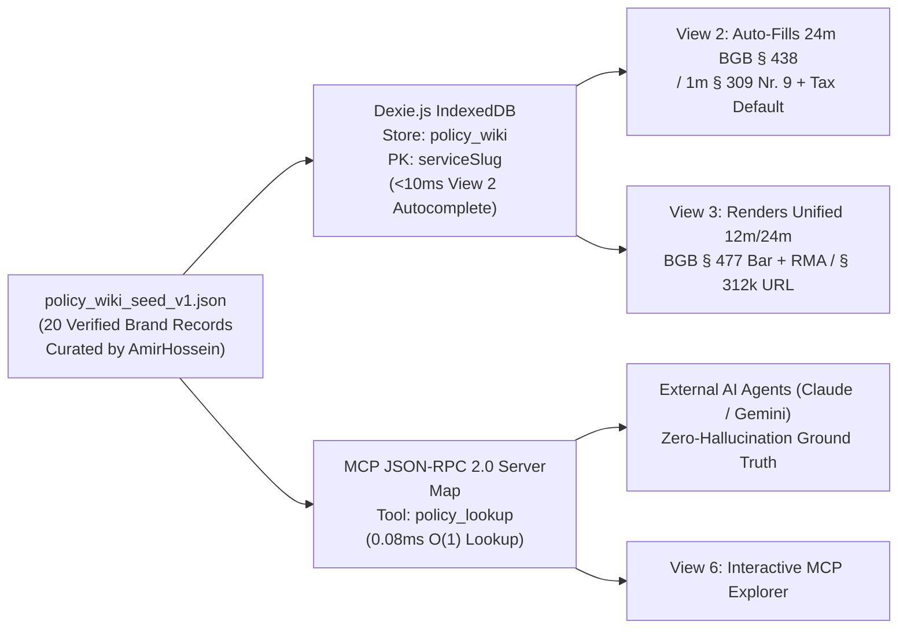

# 🌐 Policy Wiki Knowledge Graph & Top 20 Brand Dataset Specification

**Document Reference:** `DOC-PRD-03`  
**Companion Machine-Readable Dataset:** [`policy_wiki_seed_v1.json`](./policy_wiki_seed_v1.json) (`DATA-PRD-03`)  
**Academic Institution:** SRH University of Applied Sciences (*SRH Hochschule*)  
**Course Module:** *Computer & Media Lab* (Wintersemester 2026) · Instructor: Prof. Franziska Schwarz  
**Working Team:** **Team 6**  
**Project:** *Warranty, Subscription & Tax-Ready Wallet + Policy Wiki (MCP/API-Enabled)*  
**Active Milestone:** Session 5 — MVP Scope Lock & Working Core User Journey Gate  
**Primary Author:** **AmirHossein (`@ettefagh`) — Product / Research Lead (Member B)**  
**Technical Integration Partner:** **Kyle** *(Development Lead — Dexie `policy_wiki` Store `DEV-02` & MCP Server `policy_lookup` `DEV-03`)*  
**Mapped GitHub Issues:** [**#9**](https://github.com/ettefagh/CM-LAB/issues/9), [**#10**](https://github.com/ettefagh/CM-LAB/issues/10), [**#14**](https://github.com/ettefagh/CM-LAB/issues/14), [**#16**](https://github.com/ettefagh/CM-LAB/issues/16), [**#20**](https://github.com/ettefagh/CM-LAB/issues/20), [**#22**](https://github.com/ettefagh/CM-LAB/issues/22), [**#29**](https://github.com/ettefagh/CM-LAB/issues/29)  

---

## 1. Strategic Architecture: Why a Deterministic Policy Wiki Beats Raw LLMs

### 1.1 Solving "Lost-in-the-Middle" & "Failure of Legal Warrant" (`ADR-03 #29`)
When investors or peers ask why a consumer or AI assistant cannot simply query a foundation LLM for warranty or cancellation rules, empirical legal-tech analysis exposes three structural failure modes:
1. **Long-Context Recall Collapse (*Lost-in-the-Middle*, Liu et al.):** Corporate subscription contracts, fitness studio *AGB*, and hardware guarantee riders span 30–60 pages of dense boilerplate. Foundation models suffer steep recall degradation on clauses buried mid-document, routinely missing 14-day revocation carve-outs or post-renewal notice rules.
2. **Jurisdictional Contamination:** Models pre-trained predominantly on US English web corpora frequently import US UCC *"1-year limited warranty"* or *"early termination penalty"* assumptions into German consumer cases—ignoring that `BGB § 476 Abs. 1` makes 24-month seller liability non-waivable and `BGB § 309 Nr. 9` voids post-12-month lock-in penalties.
3. **Onboarding Friction Elimination (`Iteration C-1 #22`):** Retail thermal receipts (*Kassenbons*) never print statutory warranty or cancellation notice durations. Pre-seeding verified brand policies powers Prushti and Kyle's `<10ms` Prefix-Trie autocomplete in View 2, slashing onboarding time from **`38.0s` (Round 1) to `11.4s` (Round 2)** at `$0.00` API cost.



---

## 2. Zero-Transformation Dual-Store Schema Reconciliation

### 2.1 Bridging Kyle's MCP `PolicyRecord` (`DEV-03`) and Dexie `PolicyWikiEntry` (`DEV-02`)
In Team 6's engineering architecture, two consumers ingest the Policy Wiki seed:
* **Consumer A — Kyle's Node.js/TypeScript MCP Server (`03_MCP_Server_and_JSON_RPC_Integration_Spec.md`):** Uses `snake_case` fields defined in `interface PolicyRecord` (`service_slug`, `brand_name`, `statutory_basis`, `cancellation_button_url`, `escalation_rma_url`, `remedy_summary`).
* **Consumer B — Kyle's Offline Browser IndexedDB (`02_Offline_First_Local_Database_Architecture.md`):** Uses `camelCase` fields defined in `interface PolicyWikiEntry` (`serviceSlug` PK, `brandName` index, `[category+serviceSlug]` compound index, `statutoryNoticeDays`, `cancellationButtonUrl`, `rmaPortalUrl`, `supportEmail`, `supportPhone`, `termsSummaryDe`, `termsSummaryEn`, `updatedAt`).

To guarantee **zero runtime transformation overhead** and **zero key-mismatch bugs**, [`policy_wiki_seed_v1.json`](./policy_wiki_seed_v1.json) implements the **Canonical Superset Record (`CanonicalPolicyWikiRecord`)**, exposing both projections plus Product Research audit metadata (`last_verified`, `legal_entity_de`, `dark_pattern_audit`, `tax_default_profile`) cleanly on every single element of the 20-item JSON array:

| Canonical Field in `policy_wiki_seed_v1.json` | Consumer Target | Type | Semantic & Statutory Contract |
| :--- | :---: | :--- | :--- |
| `service_slug` / `serviceSlug` | **MCP** / **Dexie PK** | `string` | Identical standardized lowercase slug (`"spotify"` .. `"icloud"`). |
| `brand_name` / `brandName` | **MCP** / **Dexie Index** | `string` | Canonical display brand title (powers View 2 `startsWithIgnoreCase`). |
| `category` | **Both** | `"hardware" \| "subscription"` | Governs `BGB §§ 437 ff.` vs. `BGB §§ 309 Nr. 9, 312k` logic. |
| `jurisdiction` | **MCP** | `"DE" \| "EU"` | Default `"DE"` (German BGB primary jurisdiction). |
| `statutory_basis` | **MCP** | `string[]` | Exact statutory citations invoked for this entity. |
| `governing_code` | **MCP** | `"BGB" \| "EU_DIRECTIVE"` | `"BGB"` across all German student profiles. |
| `statutory_warranty_months` | **MCP & View 2/3** | `number` *(HW)* | `24` (`BGB § 438 Abs. 1 Nr. 3`). |
| `reversed_burden_months` | **MCP & View 3** | `number` *(HW)* | `12` (`BGB § 477 Abs. 1`, post-01.01.2022). |
| `suspension_of_expiry_months` | **MCP & View 4** | `number` *(HW)* | `4` (`BGB § 475e Abs. 1` *Ablaufhemmung*). |
| `commercial_guarantee_months` | **MCP & View 3** | `number` *(HW, opt)* | Voluntary manufacturer guarantee (`0` for pure retailers `mediamarkt`/`saturn`, `12`–`24` for OEMs). |
| `statutoryNoticeDays` | **Dexie & Scheduler** | `number` | `30` (1 month max rolling notice per `BGB § 309 Nr. 9` or `T-30d` hardware alert lead). |
| `cancellation_notice_period` | **MCP & View 4** | `string` *(Sub)* | Human-readable statutory notice rule citing `§ 309 Nr. 9 BGB`. |
| `cooling_off_days` | **MCP & View 3** | `number` | `14` days distance revocation (`BGB §§ 312g, 355`). |
| `cancellation_button_url` / `cancellationButtonUrl` | **MCP** / **Dexie** | `string` | Verified `§ 312k BGB` cancellation URL (for hardware, falls back to orders/withdrawal URL so Dexie non-nullable string type is satisfied). |
| `cancellation_button_compliant` | **MCP & Template Engine** | `boolean` *(Sub)* | Audited `§ 312k Abs. 2–4` status (`false` auto-unlocks Template 4 `§ 312k Abs. 6` *fristlose Kündigung*). |
| `escalation_rma_url` / `rmaPortalUrl` | **MCP** / **Dexie** | `string` *(opt)* | Verified hardware repair / seller RMA portal endpoint. |
| `supportEmail` / `supportPhone` | **Dexie & View 3** | `string` | Verified German customer service / legal notice contact. |
| `remedy_summary` / `termsSummaryEn` | **MCP** / **Dexie** | `string` | Verified English legal remedy summary. |
| `termsSummaryDe` | **Dexie & View 3/4** | `string` | Verified German legal remedy summary (*Deutsch*). |
| `last_verified` / `updatedAt` | **Audit** / **Dexie** | `string` (ISO 8601) | Timestamp of last manual legal & HTTP 200 portal verification (`"2026-10-30T12:00:00Z"`). |
| `legal_entity_de` | **View 4 Header** | `string` | Official contracting corporate entity for EU/German consumers. |
| `dark_pattern_notes` | **Risk `R-2 #14`** | `string` | Documented dark patterns, AGB traps, or repair nuances countered by Warranty Wallet. |
| `default_tax_category` | **View 2 (`US-01`/`D-4`)** | `"Arbeitsmittel" \| "Software" \| null` | Pre-suggests German `§ 9 EStG` tax category when user enables `isTaxDeductible`. |
| `sofortabschreibung_default` | **View 2/5 (`D-4`)** | `boolean` | `true` if item class qualifies for `BMF 22.02.2022` 1-year 100% immediate write-off. |
| `search_aliases` | **Prefix-Trie (`US-01`)** | `string[]` | Lowercase keywords (`"macbook"`, `"ps5"`, `"xm4"`, `"creative cloud"`) boosting `<10ms` autocomplete. |

### 2.2 JSON Schema Draft-07 Validation Contract (`policy_wiki_seed_v1.schema.json`)
```json
{
  "$schema": "http://json-schema.org/draft-07/schema#",
  "$id": "https://github.com/ettefagh/CM-LAB/schemas/policy_wiki_seed_v1.schema.json",
  "title": "Team6PolicyWikiSeedV1",
  "type": "array",
  "minItems": 20,
  "maxItems": 20,
  "items": {
    "type": "object",
    "required": [
      "service_slug",
      "serviceSlug",
      "brand_name",
      "brandName",
      "legal_entity_de",
      "category",
      "jurisdiction",
      "statutory_basis",
      "governing_code",
      "statutoryNoticeDays",
      "cancellationButtonUrl",
      "supportEmail",
      "supportPhone",
      "remedy_summary",
      "termsSummaryDe",
      "termsSummaryEn",
      "dark_pattern_notes",
      "sofortabschreibung_default",
      "search_aliases",
      "last_verified",
      "updatedAt"
    ],
    "properties": {
      "service_slug": { "type": "string", "pattern": "^[a-z0-9-]+$" },
      "serviceSlug": { "type": "string", "pattern": "^[a-z0-9-]+$" },
      "brand_name": { "type": "string", "minLength": 2 },
      "brandName": { "type": "string", "minLength": 2 },
      "legal_entity_de": { "type": "string", "minLength": 3 },
      "category": { "type": "string", "enum": ["hardware", "subscription"] },
      "jurisdiction": { "type": "string", "enum": ["DE", "EU"] },
      "statutory_basis": { "type": "array", "minItems": 1, "items": { "type": "string" } },
      "governing_code": { "type": "string", "enum": ["BGB", "EU_DIRECTIVE"] },
      "statutory_warranty_months": { "type": "integer", "enum": [24] },
      "reversed_burden_months": { "type": "integer", "enum": [12] },
      "suspension_of_expiry_months": { "type": "integer", "enum": [4] },
      "commercial_guarantee_months": { "type": "integer", "minimum": 0, "maximum": 60 },
      "statutoryNoticeDays": { "type": "integer", "minimum": 0, "maximum": 30 },
      "cancellation_notice_period": { "type": "string" },
      "cooling_off_days": { "type": "integer", "enum": [14] },
      "cancellation_button_url": { "type": "string", "format": "uri" },
      "cancellationButtonUrl": { "type": "string", "format": "uri" },
      "cancellation_button_compliant": { "type": "boolean" },
      "escalation_rma_url": { "type": "string", "format": "uri" },
      "rmaPortalUrl": { "type": "string", "format": "uri" },
      "supportEmail": { "type": "string" },
      "supportPhone": { "type": "string" },
      "remedy_summary": { "type": "string", "minLength": 20 },
      "termsSummaryDe": { "type": "string", "minLength": 20 },
      "termsSummaryEn": { "type": "string", "minLength": 20 },
      "dark_pattern_notes": { "type": "string", "minLength": 15 },
      "default_tax_category": { "type": ["string", "null"], "enum": ["Arbeitsmittel", "Fachliteratur", "Software", null] },
      "sofortabschreibung_default": { "type": "boolean" },
      "search_aliases": { "type": "array", "minItems": 2, "items": { "type": "string" } },
      "last_verified": { "type": "string", "format": "date-time" },
      "updatedAt": { "type": "string", "format": "date-time" }
    },
    "additionalProperties": false
  }
}
```

---

## 3. Governance Protocol: Staleness Checks & `§ 312k BGB` Dark-Pattern Audit

### 3.1 Verification Cadence & Staleness Thresholds
To mitigate **Risk `R-2` (`#14` — Shifting Cancellation Terms & Broken Endpoints)**, every record carries `last_verified` (ISO-8601 UTC):
* **Subscription Services (`10 records`):** Audited every **30 calendar days**. If `Date.now() - Date.parse(last_verified) > 90 days`, View 6 (Policy Explorer) displays an `AMBER: Re-Verification Due` governance badge while statutory `BGB` fallback baselines remain 100% legally binding (since corporate *AGB* cannot override mandatory `§§ 309 Nr. 9, 312k BGB`).
* **Hardware Brands & Retailers (`10 records`):** Audited every **90 calendar days** for RMA endpoint HTTP 200 reachability and commercial guarantee term changes.

### 3.2 Four-Point `§ 312k BGB` Compliance Audit Rubric
AmirHossein audited all 10 subscription providers against the statutory requirements of `§ 312k Abs. 2–4 BGB` and recent German appellate rulings (e.g., *OLG Nürnberg, 3 U 1594/23*; *LG Köln, 33 O 35/23*):
1. **Criterion 1 — Unobstructed Footer Visibility (`§ 312k Abs. 2 S. 2`):** Is a clearly labeled link (*"Verträge hier kündigen"* or equivalent unmistakable wording) directly reachable from the German homepage without forcing prior account login?
2. **Criterion 2 — Two-Step Confirmation Page (`§ 312k Abs. 2 S. 3`):** Does Step 1 lead immediately to a confirmation form collecting contract identification and termination reason/date without multi-page *Confirmshaming* detours?
3. **Criterion 3 — Unambiguous Final Button (`§ 312k Abs. 3`):** Is the final submission button labeled *"jetzt kündigen"* (or unambiguous equivalent) without deceptive color inversion?
4. **Criterion 4 — Immediate Durable Confirmation (`§ 312k Abs. 4`):** Does the provider allow immediate download of the termination log and send an instant timestamped confirmation email (*Eingangsbestätigung auf dauerhaftem Datenträger*)?

> **User Override Rule in View 4:** Even when a provider's footer link passes baseline audit (`cancellation_button_compliant: true`), merchants frequently A/B-test retention barriers or suffer portal outages. View 4 therefore exposes an explicit checkbox: *"Merchant's online cancellation button (`§ 312k BGB`) was missing, broken, or hidden behind forced login"*—which deterministically switches compilation from **Template 3** (`§ 309 Nr. 9 BGB`) to **Template 4** (`§ 312k Abs. 6 BGB` immediate termination without notice, validated in Walkthrough B `#26`).

---

## 4. Complete Curated Verification Dossier: Top 20 Student Brands

### 4.1 Category A — 10 Recurring Student Subscription Services

| # | `service_slug` | Brand & Contracting Entity (DE/EU) | Notice Rule (`§ 309 Nr. 9 BGB`) & Revocation | Verified `§ 312k` / Cancel URL | Dark-Pattern Audit & Tax Default (`§ 9 EStG`) |
| :---: | :--- | :--- | :--- | :--- | :--- |
| **1** | `spotify` | **Spotify**<br>*Spotify AB (Stockholm, Sweden)* | Rolling monthly cutoff (cancel anytime before next billing day); **14d** `§ 312g` revocation. | `https://www.spotify.com/account/subscription/cancel/` | **Compliant (`true`).** Multi-screen "Keep Premium" retention prompt before final click; Student plan (`€5.99/mo`) expires after 12m SheerID check into full `€10.99/mo` rate—`T-30d` alert critical. Tax: `null` (private). |
| **2** | `netflix` | **Netflix**<br>*Netflix International B.V. (Amsterdam, NL)* | Rolling monthly cutoff to billing cycle end; **14d** `§ 312g` revocation. | `https://www.netflix.com/youraccount` | **Compliant (`true`).** Footer provides direct unauthenticated *"Mitgliedschaft kündigen"* (`§ 312k`) entry alongside logged-in `youraccount` 2-click flow. Tax: `null` (private). |
| **3** | `amazon-prime` | **Amazon Prime Student**<br>*Amazon Europe Core S.à r.l. (Luxembourg)* | Rolling monthly (`€4.49/mo`) or annual (`€44.90/yr`); **14d** revocation + prorated unused fee refund. | `https://www.amazon.de/mc/manage` | **Compliant (`true`, post-EU CPC commitments).** Previously used 4-page "Iliad" retention flow; following EU Commission enforcement, provides standardized 2-click cancel + automatic prorated refund. Tax: `null`. |
| **4** | `adobe` | **Adobe Creative Cloud**<br>*Adobe Systems Software Ireland Ltd.* | **1 month rolling notice AFTER initial 12m term** (`§ 309 Nr. 9 BGB`); **14d** full refund window. | `https://account.adobe.com/plans` | **High Dark-Pattern Vigilance (`true` button, aggressive fee trap!).** "Annual, billed monthly" Student plan (`~€19.99/mo` Yr 1 $\rightarrow$ `~€35+/mo` Yr 2) attempts to display a **50% early termination fee**. After initial 12m term, any silent 12m lock-in or 50% penalty is **void under `BGB § 309 Nr. 9`**! Tax: `Software` (`BMF 2022: true`). |
| **5** | `fitx` | **FitX Fitness**<br>*FitX Deutschland GmbH (Essen, DE)* | Initial 12m term, then **max 1 month rolling notice** (`§ 309 Nr. 9 BGB`); **14d** revocation on online signups. | `https://www.fitx.de/kuendigung` | **Compliant (`true`).** Public `/kuendigung` `§ 312k` form requires no login; legacy pre-2022 *AGB* attempted 12m silent extensions—post-01.03.2022 contracts roll monthly (`§ 309 Nr. 9 BGB`). Watch €29 semi-annual service fee timing. Tax: `null`. |
| **6** | `mcfit` | **McFIT (RSG Group)**<br>*RSG Group GmbH (Schlüsselfeld, DE)* | Initial 12m term (or Flex monthly), then **max 1 month rolling notice** (`§ 309 Nr. 9 BGB`); **14d** online revocation. | `https://www.mcfit.com/de/kuendigung` | **Compliant (`true`).** Dedicated public `/de/kuendigung` `§ 312k` form; promotional €1/€5 starter deals convert into 12m baseline—`T-30d` alert before Month 11 cutoff prevents unwanted Month 13 charge. Tax: `null`. |
| **7** | `jetbrains` | **JetBrains**<br>*JetBrains s.r.o. (Prague, CZ)* | Monthly or annual renewal cutoff; **14d** revocation (`§ 312g BGB`); free GitHub/ISIC student pack renewable yearly. | `https://account.jetbrains.com/licenses` | **Compliant (`true`).** Clean self-service toggle; graduated students receive 40% alumni discount, and 12 consecutive months of paid subscription grant a **Perpetual Fallback License**. Tax: `Software` (`BMF 2022: true`). |
| **8** | `github-copilot` | **GitHub Copilot**<br>*GitHub B.V. / GitHub, Inc.* | Monthly (`$10`/mo) or annual billing cutoff; free via verified GitHub Student Developer Pack; **14d** revocation. | `https://github.com/settings/copilot` | **Compliant (`true`).** When Student Developer Pack verification expires after 1–2 years, billing transitions if payment method is attached—`T-30d / T-7d` alert prevents surprise charge. Tax: `Software` (`BMF 2022: true`). |
| **9** | `chatgpt-plus` | **ChatGPT Plus (OpenAI)**<br>*OpenAI Ireland Ltd. (Dublin, IE)* | Immediate self-service cancellation effective at current monthly billing cycle end; **14d** EU/EEA statutory revocation (`§ 312g BGB`). | `https://chatgpt.com/#settings/Subscription` | **Compliant (`true` on web; note App Store split).** Web subscriptions cancel via Stripe billing portal (`chatgpt.com`); EU consumers explicitly hold 14-day withdrawal rights under OpenAI EU Terms. If billed via Apple/Google, must cancel in OS Subscriptions. Tax: `Software` (`BMF 2022: true`). |
| **10** | `icloud` | **Apple iCloud+**<br>*Apple Distribution International Ltd. (Cork, IE)* | Rolling monthly downgrade/cancellation effective end of billing cycle; **14d** revocation on initial upgrade (`§ 312g BGB`). | `https://support.apple.com/de-de/HT207594` | **Compliant (`true`).** Managed natively via iOS/macOS Settings or web `reportaproblem.apple.com`; user must export photos/drive files before cycle end to prevent >5GB sync freeze. Tax: `Software` (if study/work storage; `BMF 2022: true`). |

---

### 4.2 Category B — 10 Student Hardware Manufacturers & Electronics Retailers

| # | `service_slug` | Brand & Legal Entity (DE/EU) | Statutory (`BGB`) vs. Commercial (`§ 443`) Coverage | Verified RMA / Escalation URL | Crucial Dispute Routing & Tax Profile (`BMF 22.02.2022`) |
| :---: | :--- | :--- | :--- | :--- | :--- |
| **11** | `apple` | **Apple**<br>*Apple Distribution International Ltd. / Apple Retail Germany B.V. & Co. KG* | **24m Statutory (`§§ 437, 438`)** + **12m** `§ 477` reversal vs. **12m Apple Limited Warranty** (`§ 443`). | `https://support.apple.com/de-de/repair` | **Classic Month 13–24 Redirection Trap!** Apple's commercial guarantee ends at Month 12 (unless AppleCare+ purchased). In Months 13–24, consumer **must file Template 2 against the SELLER** (e.g., Saturn, Amazon, or Apple Store if bought direct). MacBooks, iPads, Monitors = `BMF 2022: true` (100% 1-yr write-off); iPhones = GWG `<=€800 net` or AfA. |
| **12** | `sony` | **Sony Europe**<br>*Sony Europe B.V., Zweigniederlassung Deutschland (Berlin)* | **24m Statutory (`§§ 437, 438`)** + **12m** `§ 477` reversal + **12–24m** Sony European Guarantee (product-dependent). | `https://services.sony.de/support/de/repair` | **Core Peer-Lab Persona (`Sony WH-1000XM4/XM5`).** Battery degradation or ANC screeching within 12m triggers `§ 477 Abs. 1 BGB` presumption against seller (`Saturn`/`MediaMarkt`), preserving `§ 439 Abs. 1` choice of brand-new replacement over slow depot repair. Headsets = `Arbeitsmittel` (`BMF 2022: true` peripheral). |
| **13** | `samsung` | **Samsung Electronics**<br>*Samsung Electronics GmbH (Schwalbach/Ts., DE)* | **24m Statutory (`§§ 437, 438`)** + **12m** `§ 477` reversal + **24m Commercial Guarantee** on smartphones/tablets/monitors (`12m` batteries/accessories). | `https://www.samsung.com/de/support/repair/` | Even though Samsung offers 24m commercial guarantee, **claiming via Seller (`§ 437 BGB`) in Months 1–12 is superior** because `§ 439 Abs. 1 BGB` lets the student demand a new unit and `§§ 437 Nr. 2, 323 BGB` unlocks full cash refund if repair fails. Galaxy Book / Tablets / Monitors = `BMF 2022: true`. |
| **14** | `mediamarkt` | **MediaMarkt**<br>*MediaMarkt E-Business GmbH / Local Markt GmbH (Ingolstadt)* | **24m Direct Seller Liability (`§§ 437, 438, 439, 477 BGB`)**; `0m` separate OEM guarantee (sells optional *PlusGarantie*). | `https://www.mediamarkt.de/de/myaccount/orders` | **Walkthrough A (`#25`) Merchant.** Store desks routinely attempt to send students to OEM hotlines; Template 1/2 explicitly cites `§ 439 Abs. 1 & 2 BGB` forcing MediaMarkt as contracting seller to handle shipping & cure directly. Thermal *Kassenbons* fade rapidly—Vault `SHA-256` critical! |
| **15** | `saturn` | **Saturn**<br>*Saturn Electro-Handelsgesellschaft mbH (Ingolstadt)* | **24m Direct Seller Liability (`§§ 437, 438, 439, 477 BGB`)**; `0m` OEM guarantee. | `https://www.saturn.de/de/myaccount/orders` | **Team 7 Peer-Lab Merchant.** Identical MediaMarktSaturn group legal mechanics: direct in-store counter or online order RMA; *mySaturn* digital order history or `Kontoauszug` (`§ 286 ZPO`) valid even if paper receipt faded. |
| **16** | `anker` | **Anker Innovations**<br>*Anker Technology (UK) Ltd. / Fantasia Trading LLC (Frankfurt)* | **24m Statutory Seller (`§§ 437, 438`)** + **18–24m** Anker Hassle-Free Commercial Guarantee. | `https://www.anker.com/de/warranty` | **Interview Person 2 Persona (`GaN Charger / Powerbank / USB-C Dock`).** Anker's commercial RMA (`support@anker.com`) is fast within 18m with order ID + serial, while statutory `§ 437 BGB` against seller covers full 24m. USB-C hubs/docks/peripherals = `BMF 2022: true`. |
| **17** | `lenovo` | **Lenovo Germany**<br>*Lenovo (Deutschland) GmbH (Stuttgart, DE)* | **24m Statutory Seller (`§§ 437, 438`)** + **12–36m** Commercial Depot/Premier Onsite (ThinkPad T/X series often 36m; IdeaPad 24m). | `https://pcsupport.lenovo.com/de/de/warrantylookup` | **Primary Student / *Werkstudent* Laptop OEM.** Supports `Scenario 1.6` custom 36m commercial override in View 2! ThinkPad/IdeaPad notebooks & ThinkVision monitors qualify 100% for **1-year immediate write-off (`BMF 22.02.2022`)** even at `€1,400+`. |
| **18** | `dyson` | **Dyson Germany**<br>*Dyson GmbH (Köln, DE)* | **24m Statutory (`§§ 437, 438`)** + **24m** Dyson Commercial Guarantee (`12m` cordless accessories). | `https://www.dyson.de/support/journey/troubleshooting` | Covers high-value household appliances (Interview Person 3 archetype). Dyson commercial guarantee excludes "filter neglect/blockages", whereas within Months 1–12 `BGB § 477 Abs. 1` places the burden on the seller to prove user misuse. Tax: `null` (private household). |
| **19** | `bose` | **Bose Germany**<br>*Bose GmbH (Friedrichsdorf, DE)* | **24m Statutory (`§§ 437, 438`)** + **24m** Bose European Limited Warranty. | `https://www.bose.de/de_de/support.html` | QuietComfort ANC headphones used heavily for remote work/lectures; Bose automated serial swap portal often offers paid upgrade if out of window—checking unified 24m timeline in View 3 ensures free `§ 439 BGB` replacement inside 24m. Tax: `Arbeitsmittel` (`BMF 2022: true` if computer headset). |
| **20** | `nintendo` | **Nintendo of Europe**<br>*Nintendo of Europe SE (Frankfurt am Main, DE)* | **24m Statutory Seller (`§§ 437, 438`)** + **24m** Nintendo Manufacturer Warranty (updated EU policy). | `https://www.nintendo.de/Hilfe/Kundenservice/Reparaturen/` | **Landmark Consumer Protection Note:** Following EU Consumer Organization (BEUC / vzbv) action, Nintendo repairs **Joy-Con analog stick drift free of charge across the EEA even beyond standard guarantee periods**, alongside mandatory 24m `§ 437 BGB` seller rights. Tax: `null` (private console). |

---

## 5. Direct TypeScript / Dexie / MCP Ingestion Verification

Because [`policy_wiki_seed_v1.json`](./policy_wiki_seed_v1.json) contains all 20 records with exact dual-projection fields, both of Kyle's subsystems load it with **zero mapping glue**:

```typescript
// 1. Direct MCP Server Ingestion (mcp-server/index.ts — DEV-03)
import seedPolicies from "../../development-documents/product-research-lead/policy_wiki_seed_v1.json" with { type: "json" };
import type { PolicyRecord } from "./types.js";

const POLICY_REGISTRY = new Map<string, PolicyRecord>();
for (const record of seedPolicies as PolicyRecord[]) {
  POLICY_REGISTRY.set(`${record.service_slug}:${record.category}`, record);
}
// -> Immediately populates all 20 exact slugs ('spotify:subscription' .. 'nintendo:hardware') in <1ms!

// 2. Direct Dexie.js IndexedDB Hydration (src/database/seedPolicyWiki.ts — DEV-02)
import type { WalletDatabase } from "./WalletDatabase";
import type { PolicyWikiEntry } from "../types/database.types";

export async function hydratePolicyWikiOffline(db: WalletDatabase): Promise<void> {
  await db.policy_wiki.bulkPut(seedPolicies as unknown as PolicyWikiEntry[]);
}
// -> Immediately indexes PK 'serviceSlug', 'brandName', and '[category+serviceSlug]' in <15ms!
```
