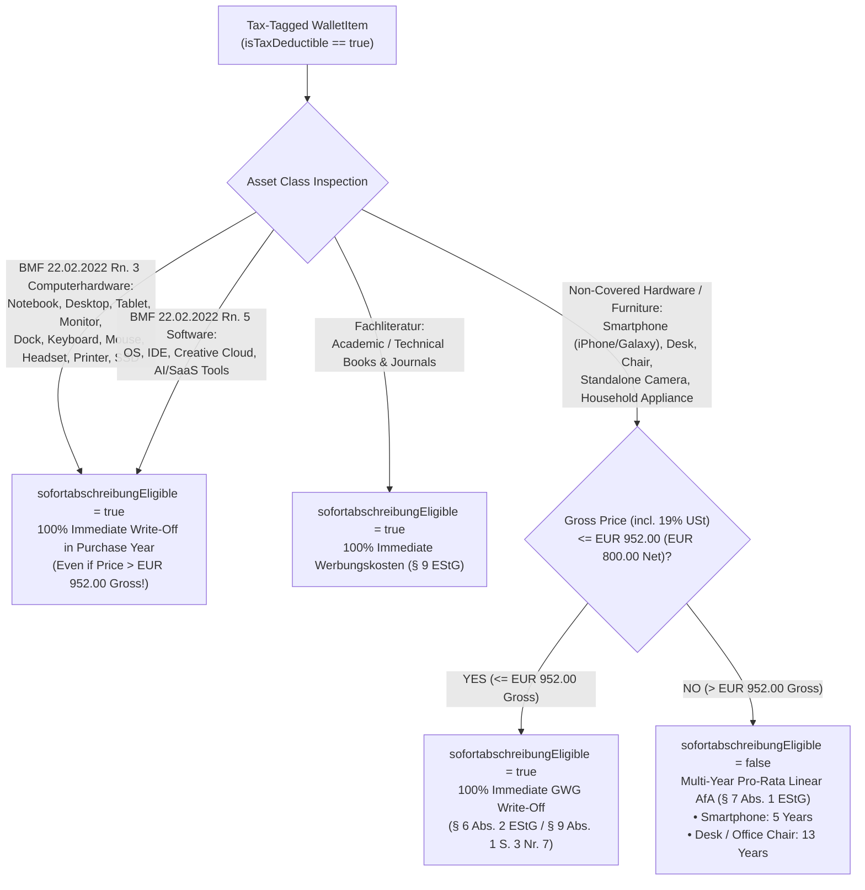

# 🧾 German Income Tax (*Werbungskosten*), BMF 2022 Write-Off & GoBD Compliance Brief

**Document Reference:** `DOC-PRD-04`  
**Academic Institution:** SRH University of Applied Sciences (*SRH Hochschule*)  
**Course Module:** *Computer & Media Lab* (Wintersemester 2026) · Instructor: Prof. Franziska Schwarz  
**Working Team:** **Team 6**  
**Project:** *Warranty, Subscription & Tax-Ready Wallet + Policy Wiki (MCP/API-Enabled)*  
**Active Milestone:** Session 5 — MVP Scope Lock Gate (`Deliverable D-4 #21` — **5. Done**) & Session 7 Export Spec (`US-08 #11`)  
**Primary Author:** **AmirHossein (`@ettefagh`) — Product / Research Lead (Member B)**  
**Cross-Functional Partners:** **Kyle** *(Development Lead — `WALLET_ITEM` Schema `DEV-02`)*, **Mojtaba** *(Quality / Media Lead — `SHA-256` GoBD Digest & CSV/PDF Exporter)*, **Jeetkumar** *(Project Manager — `Risk R-3 #15` & `D-4 #21` Sign-Off)*  
**Mapped GitHub Issues:** [**#1**](https://github.com/ettefagh/CM-LAB/issues/1), [**#4**](https://github.com/ettefagh/CM-LAB/issues/4), [**#5**](https://github.com/ettefagh/CM-LAB/issues/5), [**#11**](https://github.com/ettefagh/CM-LAB/issues/11), [**#15**](https://github.com/ettefagh/CM-LAB/issues/15), [**#21**](https://github.com/ettefagh/CM-LAB/issues/21), [**#25**](https://github.com/ettefagh/CM-LAB/issues/25)  

---

## 1. Empirical Motivation & Financial Impact for Students in Germany

### 1.1 Grounding in Discovery (Interview Person 4 & Walkthrough A `#25`)
Consumer Interview **Person 4** (24-year-old Master's student and part-time *Werkstudentin*) revealed a high-value synergy overlooked by traditional warranty trackers: the exact same receipts needed for a 24-month `BGB § 437` hardware defect claim—laptops, external monitors, noise-canceling headsets, USB-C docks, specialist textbooks, and developer/creative software subscriptions—are **deductible tax receipts** in the annual German income tax return (*Einkommensteuererklärung*).

Without immediate point-of-purchase capture and categorization:
1. Students lose thermal paper slips (*Kassenbons*) or forget mid-year software invoices by the time they file taxes 6–18 months later.
2. Students mistakenly assume a `€1,399` MacBook or ThinkPad must still be depreciated slowly over 3 years, unaware of the **BMF Guidance of 22.02.2022** permitting **100% immediate write-off (*Sofortabschreibung*)** in the year of purchase.
3. Master's students with zero or low income fail to preserve receipts for **tax loss carryforward (*Verlustvortrag gem. § 10d EStG*)**, forfeiting €500–€1,500+ in tax credits applied against their first post-graduation engineering salary.

In [**External Walkthrough A (`#25`)**](https://github.com/ettefagh/CM-LAB/issues/25), Participant Alpha logged a `€249.00` LG UltraWide 29" monitor purchased at MediaMarkt, enabled the *Werbungskosten* toggle, verified `BMF_2022_IMMEDIATE_1_YEAR` eligibility, and generated a `GoBD`-compliant `SHA-256` receipt hash completely offline in **`12.1s` (Run 1) / `10.9s` (Run 2)**.

---

## 2. Statutory Income Tax Framework: `§ 9 EStG` vs. `§ 10 EStG` & `§ 9a EStG`

### 2.1 *Werbungskosten* (`§ 9 Abs. 1 Satz 3 Nr. 6 EStG`)
Under **`§ 9 Abs. 1 Satz 1 EStG`** (*Einkommensteuergesetz*), *Werbungskosten* are expenses incurred to acquire, secure, and maintain taxable income (*Aufwendungen zur Erwerbung, Sicherung und Erhaltung der Einnahmen*). Specifically, **`§ 9 Abs. 1 Satz 3 Nr. 6 EStG`** classifies **work equipment (*Arbeitsmittel*)**—tools, computers, monitors, peripherals, specialist literature (*Fachliteratur*), and professional software—as deductible *Werbungskosten*.

> **Gross Price Rule for Students & Employees (*Bruttoprinzip*):** Because university students and salaried *Werkstudenten* are non-entrepreneurs without input-VAT deduction entitlement (*keine Vorsteuerabzugsberechtigung gem. § 15 UStG*), the **full gross purchase price including 19% (or 7% for books) German VAT (*Bruttokaufpreis inkl. Umsatzsteuer*)** constitutes the deductible acquisition cost (*Anschaffungskosten*)!

### 2.2 Crucial Student Status Distinction: *Erststudium* vs. *Zweitstudium* & *Werkstudent*

German tax law (`§ 9 Abs. 6 EStG` & `§ 10 Abs. 1 Nr. 7 EStG`, upheld by the Federal Constitutional Court in **BVerfG, Order of 19.11.2019 — 2 BvL 22/14 et al.**) treats academic expenses differently depending on degree stage and employment status:

| Student / Taxpayer Cohort | Governing Statute | Annual Cap | Loss Carryforward (`§ 10d EStG` *Verlustvortrag*)? | Tax-Return Form Target |
| :--- | :--- | :---: | :---: | :--- |
| **1. Master's Student / *Zweitstudium***<br>*(Any degree after completing a Bachelor's or recognized vocational training `Berufsausbildung`)* | **`§ 9 Abs. 1 & Abs. 6 EStG`**<br>*(Vorweggenommene / reguläre Werbungskosten)* | **Unlimited** | **YES!** Negative income carries forward indefinitely into future full-time employment years (`§ 10d Abs. 2 EStG`). | **Anlage N** (Zeilen 46–48 *Arbeitsmittel* / *Fortbildungskosten*) |
| **2. *Werkstudent* / *HiWi* / *Duales Studium***<br>*(Equipment used directly for taxable employment income)* | **`§ 9 Abs. 1 Satz 3 Nr. 6 EStG`**<br>*(Werbungskosten aus nichtselbständiger Arbeit)* | **Unlimited** | **YES!** Reduces current wage tax (*Lohnsteuer* refund) or creates carryforward loss if expenses exceed wages. | **Anlage N** (Zeilen 46–48 *Arbeitsmittel*) |
| **3. First-Degree Undergrad (*Erststudium*)**<br>*(First Bachelor's without prior vocational training & purely study-related, non-employment)* | **`§ 10 Abs. 1 Nr. 7 EStG`**<br>*(Sonderausgaben — Berufsausbildungskosten)* | **€6,000 / year** | **NO.** *Sonderausgaben* reduce tax only within the same calendar year if total income exceeds the basic tax-free allowance (*Grundfreibetrag*). | **Anlage Sonderausgaben** (Zeile 13 *Ausbildungskosten*) |

### 2.3 Crossing the €1,230 Employee Lump-Sum Threshold (`§ 9a Satz 1 Nr. 1a EStG`)
Every salaried employee and taxable *Werkstudent* automatically receives the statutory **Employee Lump-Sum Deduction (*Arbeitnehmer-Pauschbetrag*) of €1,230 per calendar year** (`§ 9a Satz 1 Nr. 1 Buchstabe a EStG`). Individual receipt tracking begins generating additional cash tax refunds the moment cumulative *Werbungskosten* (commuting allowance *Entfernungspauschale* + home-office *Tagespauschale* `§ 4 Abs. 5 Nr. 6c EStG` up to €1,260 + *Arbeitsmittel* logged in Warranty Wallet) exceed **€1,230.00**—or from **€0.01** upward for non-earning Master's students filing a *Verlustvortrag* (where the €1,230 lump sum cannot create a negative loss on its own without actual itemized receipts).

---

## 3. BMF Guidance of 22.02.2022 (`BStBl I 2022 S. 187`): 1-Year *Sofortabschreibung*

### 3.1 Regulatory Citation & Core Legal Rule
* **Official Decree:** *Schreiben des Bundesministeriums der Finanzen (BMF) vom 22. Februar 2022 — `IV C 3 - S 2190/21/10002 :025` (`BStBl I 2022 S. 187`), „Nutzungsdauer von Computerhardware und Software zur Dateneingabe und -verarbeitung“* (superseding the initial BMF decree of 26.02.2021).
* **Core Mechanism (`Rn. 1–2, 6`):** Taxpayers may apply a **standard useful economic life (*betriebsgewöhnliche Nutzungsdauer* under `§ 7 Abs. 1 EStG`) of 1 year** to eligible computer hardware and software. Further clarifying initial ambiguity from 2021, the revised **22.02.2022 decree (`Rn. 1 Satz 3` / practice note)** confirms that taxpayers may deduct **100% of the acquisition cost in full in the calendar year of purchase (*vollständige Abschreibung im Jahr der Anschaffung / Sofortabschreibung*)**—even if purchased in December, without month-precise *pro rata temporis* (`§ 7 Abs. 1 Satz 4 EStG`) slicing, and **completely independent of the €800 net / €952 gross GWG ceiling (`§ 6 Abs. 2 EStG`)**!

### 3.2 Complete Eligibility Taxonomy (`sofortabschreibungEligible` Rule Matrix)



| Asset / Subscription Example (Team 6 Personas) | `taxCategory` | Covered by `BMF 22.02.2022`? | Price Threshold Rule | Deductible Timing in Tax Return |
| :--- | :---: | :---: | :--- | :--- |
| **Apple MacBook Pro 14" (`€1,999` gross)** | `Arbeitsmittel` | **YES (`Rn. 3` Notebook)** | **No cap** (exceeds €952 GWG, still 100% eligible!) | **100% in Purchase Year** (`BMF 22.02.2022`) |
| **Lenovo ThinkPad T14 (`€1,199` gross)** | `Arbeitsmittel` | **YES (`Rn. 3` Notebook)** | **No cap** | **100% in Purchase Year** (`BMF 22.02.2022`) |
| **Apple iPad Air / Samsung Galaxy Tab (`€699`–`€1,299`)** | `Arbeitsmittel` | **YES (`Rn. 3` Tablet)** | **No cap** | **100% in Purchase Year** (`BMF 22.02.2022`) |
| **LG UltraWide 29" Monitor (`€249` — Walkthrough A `#25`)** | `Arbeitsmittel` | **YES (`Rn. 3` Peripherie — Monitor)** | **No cap** (also `<= €952` GWG) | **100% in Purchase Year** (`BMF 22.02.2022`) |
| **Sony WH-1000XM4 / Bose QC Headset / Anker USB-C Dock** | `Arbeitsmittel` | **YES (`Rn. 3` Peripherie — Audio/Dock)** | **No cap** | **100% in Purchase Year** (`BMF 22.02.2022`) |
| **Adobe CC / JetBrains / GitHub Copilot / ChatGPT Plus** | `Software` | **YES (`Rn. 5` Anwendersoftware)** | **No cap** (annual or cumulative monthly invoices) | **100% in Payment Year** (`§ 11 Abs. 2 EStG` *Abflussprinzip* + `BMF 2022`) |
| **Specialist CS / Law Textbooks (*Springer*, *Beck*)** | `Fachliteratur` | N/A (Direct `§ 9 EStG`) | `<= €952` per work | **100% in Payment Year** (`§ 9 Abs. 1 S. 3 Nr. 6 EStG`) |
| **Smartphone (`iPhone 16` at `€899` gross vs. `iPhone 16 Pro Max` at `€1,449` gross)** | `Arbeitsmittel` | **NO** *(Smartphones excluded from `Rn. 3` PC catalog!)* | **`<= €952.00` gross** (`€800` net) GWG (`§ 6 Abs. 2 EStG`) | `€899` $\rightarrow$ **100% GWG immediate**; `€1,449` $\rightarrow$ **5-year linear *AfA*** (`§ 7 Abs. 1 EStG`, month-pro-rated) |
| **Ergonomic Study Desk / Chair (`€450` vs. `€1,200` gross)** | `Arbeitsmittel` | **NO** *(Office furniture)* | **`<= €952.00` gross** GWG (`§ 6 Abs. 2 EStG`) | `€450` $\rightarrow$ **100% GWG immediate**; `€1,200` $\rightarrow$ **13-year linear *AfA*** |

---

## 4. Mixed-Use Allocation Mathematics (*Aufteilungsmaßstab*)

Students rarely use a personal laptop, monitor, or AI subscription 100.0% exclusively for work/university without ever watching a video or browsing privately. Following the landmark decision of the Grand Senate of the Federal Fiscal Court (**BFH, Order of 21.09.2009 — GrS 1/06, `BStBl II 2010 S. 672`**), mixed-use assets (*gemischt veranlasste Aufwendungen*) are **no longer disqualified** by the general split ban of `§ 12 Nr. 1 Satz 2 EStG`, provided an objective allocation ratio applies:

### 4.1 Three-Tier Statutory Allocation Formula

Let $P_{\text{gross}}$ be the gross acquisition price (`priceEur`) and $u \in [0, 100]$ be the documented professional/academic usage share (`workUsagePercent`, defaulting to `50` for general student devices or `100` for pure dev tools like `JetBrains` / `Fachliteratur`):

$$\text{Deductible Amount (€)} = \begin{cases} P_{\text{gross}} \times 1.00 & \text{if } u \ge 90\% \quad (\text{untergeordnete private Mitbenutzung } \le 10\%\text{ disregarded}) \\[6pt] \text{round}_2\!\left(P_{\text{gross}} \times \dfrac{u}{100}\right) & \text{if } 10\% \le u < 90\% \quad (\text{proportional mixed-use split; default } u = 50\%) \\[8pt] 0.00 & \text{if } u < 10\% \quad (\text{untergeordnete berufliche Nutzung } < 10\%\text{ non-deductible}) \end{cases}$$

* **Audit-Safe Default (`50% / 50%` Administrative Simplification):** Under established German *Finanzamt* assessment practice for privately purchased home PCs, notebooks, and tablets, claiming a **50% professional/study share (`u = 50%`)** is routinely accepted without requiring a 3-month usage diary.
* **Elevated CS / Engineering Student Share (`70%–100%`):** Where a Master's CS student or software *Werkstudent* purchases an external coding monitor (`Walkthrough A #25`), `JetBrains` IDE license, or a dedicated Linux ThinkPad alongside an existing private entertainment device, `70%`–`100%` academic/professional allocation is substantiable.

#### Worked Calculation Examples (Rendered in View 5 Preview):
1. **Lenovo ThinkPad T14 (`€1,200.00` gross, `u = 50%` mixed student/private use, purchased `2026-10-15`):**
   * `BMF 22.02.2022` 1-year write-off applies (`100%` in 2026, no Dec pro-rata reduction) $\rightarrow$ Deductible 2026 *Werbungskosten* = `€1,200.00 × 50% = €600.00`.
2. **LG UltraWide 29" External Study/Work Monitor (`€249.00` gross, `u = 90%` study/remote-work desk, `Walkthrough A #25`):**
   * Since $u = 90\% \ge 90\%$, private co-use $\le 10\%$ is legally negligible $\rightarrow$ Deductible 2026 *Werbungskosten* = **`€249.00` (`100%`)**.
3. **JetBrains All Products Pack (`€249.00` gross, `u = 100%` software engineering):**
   * Pure professional IDE software (`BMF 22.02.2022 Rn. 5`) $\rightarrow$ Deductible 2026 *Werbungskosten* = **`€249.00` (`100%`)**.

---

## 5. GoBD Digital Evidentiary Preservation & `SHA-256` Immutability (`Rn. 108–110`)

### 5.1 Legal Relationship Between *Belegvorhaltepflicht* and `GoBD`
Since the *Gesetz zur Modernisierung des Besteuerungsverfahrens* (effective 2017), income tax filers no longer mail paper receipts with their return (*Belegvorlagepflicht* abolished); instead, **`§ 97 AO` / *Belegvorhaltepflicht*** requires taxpayers to **retain authentic proofs of payment ready for inspection** whenever the *Finanzamt* flags an item for manual verification (which occurs routinely when *Arbeitsmittel* exceed €1,230 or *Verlustvortrag* is claimed). If the student's Saturn thermal receipt has faded white in a drawer (Interview Person 3), the *Finanzamt* disallows the deduction unless digital or bank proof is produced!

While the **GoBD** (*Grundsätze zur ordnungsmäßigen Führung und Aufbewahrung von Büchern, Aufzeichnungen und Unterlagen in elektronischer Form sowie zum Datenzugriff*, `BMF 28.11.2019, BStBl I 2019 S. 1269`, updated `11.03.2024`) strictly bind statutory bookkeeping entities (`§§ 140–148 AO`), designing our client Receipt Vault to satisfy **GoBD `Rn. 108–110` (*Unveränderbarkeit*)** and **`Rn. 130–136` (*Ersetzendes / Mobiles Scannen*)** provides **gold-standard evidentiary integrity** for both German tax audits and civil warranty disputes:

| GoBD Principle & Paragraph | Statutory / Administrative Requirement | Team 6 Engineering Implementation (`Mojtaba` + `Kyle`) |
| :--- | :--- | :--- |
| **1. Mobile Capture (*Mobiles Scannen*)**<br>`GoBD Rn. 130` | Smartphone camera capture of paper receipts (*Kassenbons*) at or promptly after purchase is explicitly recognized as valid digitization, provided legibility and completeness are preserved. | View 2 (`US-02`) captures receipt at purchase in `<500ms`, downsampling to `<=2048px` (`0.82` WebP/JPEG quality) preserving full line-item, VAT, and serial-number legibility. |
| **2. Immutability (*Unveränderbarkeit*)**<br>`GoBD Rn. 108–110` | Digital records and attachments must be protected against undetected subsequent alteration; where storage media allow overwrites, integrity must be verifiable via technical measures (e.g., cryptographic hashes, timestamps, audit logs). | **Mojtaba's** Web Worker computes a **64-character `SHA-256` cryptographic digest (`receiptSha256`)** via `crypto.subtle.digest('SHA-256', buffer)` **prior** to `AES-GCM-256` encryption. **Kyle's** Dexie store persists `receiptSha256`, `createdAt` (immutable), and `updatedAt`. Any single-bit image edit changes the hash completely. |
| **3. Traceability (*Nachvollziehbarkeit & Belegfunktion*)**<br>`GoBD Rn. 61–65, 133` | Every booking/deduction line must link unambiguously (`1:1` index) to its underlying digital receipt image. | `WALLET_ITEM.receiptBlobId` links `1:1` to `RECEIPT_VAULT_BLOB.id`; View 5 CSV and Audit PDF print both `itemId` and the full `receiptSha256` fingerprint beside each euro line item. |
| **4. Retention Advisory (*Aufbewahrungshinweis*)**<br>`GoBD Rn. 140` | Original paper receipts with special authenticity markers or pending civil disputes should be retained alongside scans until tax assessment becomes final (*Bestandskraft des Steuerbescheids*). | View 5 displays a clear practical tip advising users to retain surviving paper invoices until their annual *Einkommensteuerbescheid* becomes final (`1 month` post-issuance). |

---

## 6. Database Schema Alignment & Session 7 Export Specification (`US-08 #11`)

### 6.1 Exact Field Alignment with Kyle's `WalletItem` (`DEV-02`)
In `02_Offline_First_Local_Database_Architecture.md` (`lines 157–180, 274–297`), Kyle implemented the Session 5 baseline fields directly from `Deliverable D-4 (#21)`, supplemented by two optional calculation fields for Session 7 (`US-08 #11`):

| Field Name in `WalletItem` | Type | Session Gate | Statutory Purpose |
| :--- | :--- | :---: | :--- |
| `isTaxDeductible` | `boolean` | **S5 Locked (`D-4`)** | Master toggle indexing item into compound index `[isTaxDeductible+purchaseDate]`. |
| `taxCategory` | `'Arbeitsmittel' \| 'Fachliteratur' \| 'Software'` | **S5 Locked (`D-4`)** | Maps item to `§ 9 Abs. 1 S. 3 Nr. 6 EStG` / `BMF 22.02.2022 Rn. 3 & 5`. |
| `sofortabschreibungEligible` | `boolean` | **S5 Locked (`D-4`)** | `true` for 1-year `BMF 22.02.2022` items & `<= €952` gross GWG items. |
| `receiptSha256` | `string` *(64-char hex)* | **S5 Locked (`D-4`)** | `GoBD Rn. 108–110` cryptographic integrity proof of attached receipt. |
| `workUsagePercent` *(optional, default `100` or `50`)* | `number` (`0`–`100`) | **S7 Export (`US-08`)** | Mixed-use allocation percentage (`>=90%` $\rightarrow$ `100%` deductible per `BFH GrS 1/06`). |
| `studentTaxRegime` *(View 5 filter setting)* | `'WERBUNGSKOSTEN_N' \| 'SONDERAUSGABEN'` | **S7 Export (`US-08`)** | Switches summary header between *Zweitstudium/Werkstudent* (`§ 9 EStG`) and *Erststudium* (`§ 10 Abs. 1 Nr. 7 EStG`, €6,000 cap). |

---

### 6.2 WISO Steuer / Taxfix / Mein ELSTER Compatible CSV Export Contract (`US-08 #11`)
To ensure seamless compatibility with German tax software (**WISO Steuer**, **Taxfix**, **SteuerSparErklärung**) and German Excel/LibreOffice locales without umlaut corruption (`ä, ö, ü, ß, €`), Mojtaba's CSV exporter (`US-08`) adheres to:
* **Encoding:** `UTF-8 with BOM` (`\uFEFF`)
* **Field Delimiter:** Semicolon (`;`) — standard German CSV separator so comma decimal values (`249,00`) never split columns!
* **Filename Pattern:** `WarrantyWallet_Steuerexport_Werbungskosten_{{fiscal_year}}.csv`

#### Exact 12-Column CSV Header & Sample Output (`2026` Assessment Year):
```csv
Position;Kaufdatum;Bezeichnung_Arbeitsmittel;Haendler_Anbieter;Steuerkategorie_EStG;Bruttopreis_EUR;Beruflicher_Anteil_Prozent;Abzugsfaehiger_Betrag_EUR;Abschreibungsart;Rechtsgrundlage;Beleg_Vorhanden;GoBD_Receipt_SHA256
1;2026-03-15;"Sony WH-1000XM4 ANC Headset";Saturn;Arbeitsmittel;279,00;50;139,50;SOFORTABSCHREIBUNG_1_JAHR;"§ 9 Abs. 1 S. 3 Nr. 6 EStG i.V.m. BMF 22.02.2022 (BStBl I S. 187)";JA;8f4b2c9a71d3e04b55c82a1940f71b6e9d04c2a183f5e6b7c8d9e0f1a2b3c4d5
2;2026-10-24;"LG UltraWide 29 Monitor";MediaMarkt;Arbeitsmittel;249,00;90;249,00;SOFORTABSCHREIBUNG_1_JAHR;"§ 9 Abs. 1 S. 3 Nr. 6 EStG i.V.m. BMF 22.02.2022 (>=90% beruflich = 100%)";JA;4a7d88e63b65a918a28e83b4d1a03ef9281a8b12f679a941589d1b0386221c97
3;2026-10-01;"JetBrains All Products Pack (Jahreslizenz)";JetBrains;Software;249,00;100;249,00;SOFORTABSCHREIBUNG_1_JAHR;"§ 9 Abs. 1 S. 3 Nr. 6 EStG i.V.m. BMF 22.02.2022 Rn. 5 (Anwendersoftware)";JA;c19e04f2a8b731d56e9402c8f7a1b3d5e7f90123456789abcdef0123456789ab
```

### 6.3 Tax Audit Dossier PDF Summary Structure (View 5 Companion Export)
Alongside the CSV, View 5 generates a single-page **Belegverzeichnis zur Einkommensteuererklärung (`Anlage N — Arbeitsmittel`)** containing:
1. Assessment Year (`Veranlagungszeitraum 2026`), Regime Indicator (`§ 9 EStG Werbungskosten` vs. `§ 10 Abs. 1 Nr. 7 EStG Sonderausgaben`), and Cumulative Deductible Sum (`€637,50` vs. `€1.230,00` *Arbeitnehmer-Pauschbetrag* progress bar).
2. Itemized table with `GoBD Rn. 108–110` `SHA-256` receipt checksums and thumbnail appendix for immediate attachment if the *Finanzamt* issues a *Belegvorlageanforderung*.
3. Non-removable **`§§ 2, 3, 5 StBerG` Safe-Harbor Disclaimer Footer** (§7.2 below).

---

## 7. Tax-Tech Regulatory Safe Harbor: `§§ 2, 3, 5 StBerG` (`Risk R-3 #15`)

### 7.1 Boundary Between Unauthorized Tax Advice (`StBerG`) and Receipt Cataloging Software
Under **`§ 5 Abs. 1` and `§ 2 StBerG` (*Steuerberatungsgesetz*)**, commercial assistance in tax matters (*geschäftsmäßige Hilfeleistung in Steuersachen*) may only be performed by authorized persons and entities listed in **`§§ 3, 4 StBerG`** (*Steuerberater*, *Rechtsanwälte*, *Wirtschaftsprüfer*, *Lohnsteuerhilfevereine* within `§ 4 Nr. 11 StBerG`).

Established German tax-law jurisprudence (including *BFH* precedent on tax software and mechanical accounting utilities) distinguishes strictly between:
* **Prohibited *Hilfeleistung in Steuersachen* (`§§ 2, 5 StBerG`):** Advising an individual user whether their specific degree program legally qualifies as a *Zweitstudium*, auditing their personal income tax return, calculating their personal marginal tax liability, or transmitting tax declarations on their behalf without user review.
* **Permissible Technical Organization Tool (100% Compliant):** Providing local receipt archiving, user-controlled category tagging (`isTaxDeductible` toggled by the user), deterministic arithmetic (`price * percent`), publication of general statutory information (`BMF 22.02.2022`), and structured CSV/PDF export for the user's own import into certified tax software or review by a licensed *Steuerberater*.

### 7.2 Mandatory Verbatim `StBerG` Disclaimers (Enforced in View 2, View 5 & All Tax Exports)

#### Authoritative German Notice (`DE`):
> **Steuerrechtlicher Hinweis (§§ 2, 3, 5 StBerG):** *„Warranty & Subscription Wallet“ dient ausschließlich als technisches Organisations- und Belegarchivierungswerkzeug zur Vorbereitung Ihrer persönlichen Unterlagen. Die dargestellten Kategorisierungen (z. B. Werbungskosten nach § 9 EStG, Sonderausgaben nach § 10 Abs. 1 Nr. 7 EStG sowie Hinweise auf das BMF-Schreiben vom 22.02.2022, BStBl I 2022 S. 187) stellen allgemeine unverbindliche Gesetzesinformationen dar und begründen **keine geschäftsmäßige Hilfeleistung in Steuersachen oder individuelle Steuerberatung gemäß §§ 2, 3, 5 Steuerberatungsgesetz (StBerG)**. Für die verbindliche steuerliche Beurteilung Ihres Einzelfalls wenden Sie sich bitte an eine Steuerberaterin, einen Steuerberater oder einen Lohnsteuerhilfeverein.*

#### Companion English Notice (`EN`):
> **Tax Regulatory Notice (§§ 2, 3, 5 StBerG):** *"Warranty & Subscription Wallet" operates strictly as a technical receipt organization and archiving utility for personal record preparation. All category tags (e.g., § 9 EStG Werbungskosten, § 10(1) No. 7 EStG Sonderausgaben, and BMF Guidance of 22.02.2022) provide general statutory reference information only and **do not constitute individualized tax advice or commercial assistance in tax matters under §§ 2, 3, 5 of the German Tax Advisory Act (Steuerberatungsgesetz — StBerG)**. Please consult a certified German tax advisor (Steuerberater) or wage tax assistance association (Lohnsteuerhilfeverein) for binding assessment of your personal tax return.*
