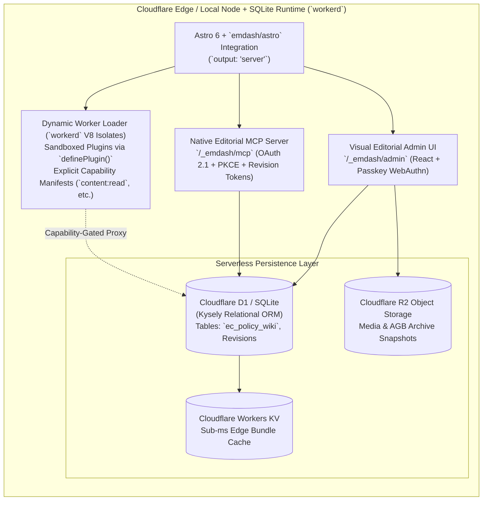
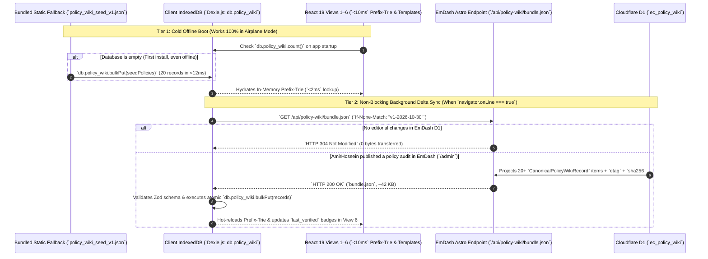
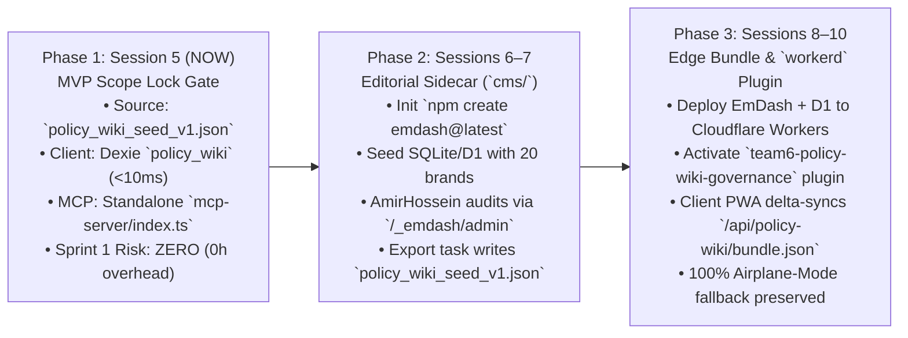

# 🏛️ Architectural Investigation: EmDash CMS (`emdashcms.dev`) as the Policy Wiki Knowledge Graph & MCP Engine

**Document ID:** `ARCH-EVAL-02`  
**Academic Institution:** SRH University of Applied Sciences (*SRH Hochschule*)  
**Course Module:** *Computer & Media Lab* (Wintersemester 2026) · Instructor: Prof. Franziska Schwarz  
**Working Team:** **Team 6** — *Warranty, Subscription & Tax-Ready Wallet + Policy Wiki (MCP/API-Enabled)*  
**Target Deliverables & Stories:** **Deliverable D-3** (*Policy Wiki Seed for 20 Brands*), **US-06** (*Policy Wiki & Cancellation Directory*), **US-07** (*MCP Server JSON-RPC 2.0 Interface*)  
**Mapped Risks & ADRs:** **ADR-02** (*IndexedDB Offline-First*), **ADR-03** (*Deterministic BGB Legal Templates vs. LLMs*), **Risk R-1** (*Offline/Online Sync*), **Risk R-2 (`#14`)** (*Shifting Cancellation Terms & Broken Endpoints*), **Risk R-3 (`#15`)** (*German RDG Legal Compliance*), **Risk R-4 (`#16`)** (*MCP Parameter Hallucinations*)  
**Cross-Role Stakeholders:**  
* **Kyle** *(Development Lead — Dexie.js Local Store `DEV-02` & MCP Server `DEV-03`)*  
* **AmirHossein (`@ettefagh`)** *(Product / Research Lead — Policy Wiki Curation `DOC-PRD-03` & Legal Governance)*  
* **Prushti** *(UI/UX Design Lead — View 2 `<10ms` Prefix-Trie Autocomplete & View 6 Policy Explorer)*  

---

## Executive Summary & Architectural Verdict

This technical investigation evaluates **EmDash CMS** (`emdashcms.dev` / `npm create emdash@latest`)—the open-source, TypeScript-native content management system launched by Cloudflare in April 2026 following its acquisition of **The Astro Technology Company**—as the editorial backend, structured storage layer, and Model Context Protocol (MCP) host for Team 6's **Policy Wiki (`US-06`, `D-3`)** and **MCP Interface (`US-07`)**.

> [!IMPORTANT]
> **Executive Verdict — Conditional / Phased Adoption (Sidecar CMS $\rightarrow$ Versioned Bundle Bridge):**
> 1. **Strong Domain Fit for Editorial Governance (`US-06`, `Risk R-2 #14`):** EmDash's combination of **Cloudflare D1 (SQLite)** relational collections, **Portable Text** structured JSON rich-text storage, **`workerd` V8 isolate sandboxed plugins** with capability manifests, and a **built-in MCP server (`/_emdash/mcp`)** directly solves the long-term maintenance bottleneck of a hardcoded `SEED_POLICIES` array as merchants alter `§ 312k BGB` cancellation flows.
> 2. **Strict Separation Between Native CMS MCP and Consumer Legal MCP (`US-07`, `Risk R-3`, `Risk R-4`):** EmDash's built-in `/_emdash/mcp` endpoint is designed for **editorial CRUD and schema administration**. It must **not** replace Team 6's custom `policy_lookup` and `claim_dossier_generate` MCP tools, which enforce strict **Zod `-32602` runtime validation** (`Risk R-4`) and **deterministic BGH VIII ZR 285/18 (*LexFox*)** statutory compilation (`Risk R-3`). Instead, EmDash should power the authoritative data layer while Team 6's custom MCP tool handlers execute inside a dedicated MCP route or sandboxed EmDash plugin.
> 3. **Preserving 100% Airplane-Mode Operation (`ADR-02`, `Risk R-1`):** To guarantee `<10ms` Prefix-Trie autocomplete in View 2 (`US-01`) and offline dispute generation in View 4 (`US-05`), the client React 19 PWA must **never** make blocking runtime network calls to EmDash/D1 during user flows. Instead, EmDash publishes an immutable, ETag-versioned `/api/policy-wiki/bundle.json` snapshot that non-blockingly hydrates the client's local **Dexie.js (`policy_wiki`)** store when online.
> 4. **Sprint 1 Budget Protection (`92h Total Capacity`):** Because EmDash is a 2026-era platform (introduced April 2026 at `v0.1.x` and matured through Fall 2026), introducing a full Astro + Cloudflare Workers server runtime into the critical path of **Session 5 (MVP Scope Lock)** poses unnecessary build-chain friction. Team 6 should execute a **3-Phase Rollout**: ship Session 5 using the zero-dependency dual-projection [`policy_wiki_seed_v1.json`](../../development-documents/product-research-lead/policy_wiki_seed_v1.json), deploy EmDash as an **Editorial Governance Sidecar** in Sessions 6–7, and wire live D1 delta-sync in Sessions 8–10.

---

## 1. What EmDash Is & Strategic Context (2026)

### 1.1 The Cloudflare + Astro Acquisition & Birth of EmDash
In **January 2026** (January 16, 2026), **Cloudflare acquired The Astro Technology Company**, uniting the web's leading content-driven TypeScript meta-framework with Cloudflare's global edge network (`workerd`, Workers, D1, R2, and KV) alongside the rollout of **Astro 6**.

On **April 1, 2026**, Cloudflare introduced **EmDash (`emdashcms.dev`)**—scaffolded via `npm create emdash@latest`—positioning it as a modern, serverless, TypeScript-all-the-way *"spiritual successor to WordPress."* In **August 2026**, acting as "Customer Zero," Cloudflare migrated the official high-traffic **Cloudflare Blog** onto EmDash running on Astro and Cloudflare Workers, followed by rapid stabilization releases through Fall 2026.

Unlike traditional monolithic PHP CMS platforms (WordPress, Drupal) or heavyweight enterprise headless platforms (Strapi, Directus, Payload), EmDash embeds directly into an Astro project via the `emdash/astro` integration (`astro.config.mjs`), mounting a passkey-first (WebAuthn) editorial admin UI at `/_emdash/admin` and a native Model Context Protocol endpoint at `/_emdash/mcp`.



### 1.2 Core Architectural Innovations Relevant to Team 6

| Architectural Pillar | Legacy CMS Pattern (e.g., WordPress / Raw Headless) | EmDash CMS Architecture (`2026`) | Direct Value for Team 6's Policy Wiki (`US-06` / `US-07`) |
| :--- | :--- | :--- | :--- |
| **1. Rich Content Representation** | Raw HTML strings or fragile Markdown blobs stored in database text columns; prone to XSS and coupled to web DOM styling. | **Portable Text (Structured JSON AST):** TipTap-powered editor outputs typed JSON arrays of `block`, `span`, and custom `markDef` nodes. | Enables AmirHossein to annotate legal summaries with structured `<StatutoryCitation code="BGB § 477 Abs. 1" />` marks that render as interactive badges in **View 3/6** and serialize to clean plain text in **MCP `policy_lookup`**. |
| **2. Plugin Security & Isolation** | In-process execution with ambient authority over the entire SQL database, filesystem, and `process.env` secrets. | **`workerd` V8 Isolate Sandboxing:** Plugins load via Cloudflare Dynamic Worker Loaders and must declare an explicit **Capability Manifest** (`capabilities: ["content:read"]`). | Allows Team 6 to run automated **`§ 312k BGB` Endpoint Health Checkers** and **MCP Legal Compilers** inside strict memory/permission sandboxes that can never corrupt core D1 tables. |
| **3. Database & Media Stack** | Requires dedicated VPS, MySQL/Postgres connection pooling, and third-party S3 buckets. | **Cloudflare D1 (SQLite via Kysely) + R2:** Zero-configuration serverless SQL at the edge with local `.db` SQLite parity during development. | Fits a student team's `$0.00` infrastructure budget while supporting relational queries, audit revision history, and instant JSON bundle generation. |
| **4. AI / Agent Native Protocol** | Custom REST/GraphQL wrappers required before AI agents can inspect schemas or draft content. | **Built-in MCP Server (`/_emdash/mcp`) + `npx emdash types`:** Native JSON-RPC 2.0 MCP endpoint with optimistic concurrency revision tokens and CLI TypeScript codegen. | Lets AmirHossein and Kyle use Claude/Cursor with EmDash's editorial MCP to batch-audit brand policies while generating strict `.d.ts` types for the client and MCP server. |

---

## 2. Architectural Fit: EmDash as the Editorial & Knowledge Engine for Team 6's Policy Wiki (`US-06`, `D-3`)

### 2.1 Why Static Hardcoded Arrays (`SEED_POLICIES`) Become an Operational Bottleneck
In Kyle's initial MCP reference specification ([`03_MCP_Server_and_JSON_RPC_Integration_Spec.md`](../../development-documents/development-lead/03_MCP_Server_and_JSON_RPC_Integration_Spec.md#L856-L1127)) and AmirHossein's seed dataset ([`03_Policy_Wiki_Knowledge_Graph_and_Brand_Dataset_Spec.md`](../../development-documents/product-research-lead/03_Policy_Wiki_Knowledge_Graph_and_Brand_Dataset_Spec.md)), the Top 20 student brands are stored as a static TypeScript array (`SEED_POLICIES`) or committed JSON file (`policy_wiki_seed_v1.json`).

While a static file is ideal for **Session 5 offline boot**, real-world consumer legal protection faces **Risk `R-2` (`#14` — Shifting Cancellation Terms & Broken Endpoints)**:
1. **Merchant URL Churn & A/B-Tested Dark Patterns:** Subscription providers (`spotify`, `amazon-prime`, `adobe`, `fitx`, `mcfit`, `chatgpt-plus`) frequently reorganize account sub-routes, insert new multi-step retention modals (*Confirmshaming*), or suffer temporary outages on their statutory `§ 312k BGB` cancellation pages (*Kündigungsbutton*).
2. **Dynamic `cancellation_button_compliant` Flipping:** Under `BGB § 312k Abs. 6`, if a merchant's online cancellation button violates the unobstructed 2-step statutory mandate (`§ 312k Abs. 2–4 BGB`), the consumer unlocks the right to **immediate termination without notice (*fristlose Kündigung jederzeit ohne Einhaltung einer Kündigungsfrist*)**. When AmirHossein detects a non-compliant flow during his 30-day audit, flipping `cancellation_button_compliant` from `true` to `false` should not require a developer to edit TypeScript source code, recompile `mcp-server/dist/index.js`, and redeploy the entire application.
3. **Bilingual Legal Summary & Audit Trail Management:** Maintaining parallel German (`termsSummaryDe`), English (`termsSummaryEn` / `remedy_summary`), and `dark_pattern_notes` strings inside a raw 1,100-line JSON file lacks side-by-side diffing, revision rollback, and staleness alerts (`last_verified > 30 days` for subscriptions / `> 90 days` for hardware).

### 2.2 How EmDash Empowers AmirHossein's Product/Research Governance Workflow
By adopting EmDash as the **Policy Wiki Editorial & Knowledge Engine**, AmirHossein (`Product / Research Lead`) gains a dedicated visual governance workspace at `/_emdash/admin` backed by Cloudflare D1:

```mermaid
sequenceDiagram
    autonumber
    actor AH as AmirHossein (Product/Research Lead)
    participant ADMIN as EmDash Admin UI (`/_emdash/admin`)
    participant PLUGIN as Sandboxed `workerd` Plugin (`policy-audit-guard`)
    participant D1 as Cloudflare D1 (`ec_policy_wiki`)
    participant KV as Edge Bundle Cache (`/api/policy-wiki/bundle.json`)

    AH->>ADMIN: Authenticates via WebAuthn Passkey & opens "Adobe (`adobe`)"
    ADMIN->>D1: Loads current revision + Portable Text bilingual summaries
    AH->>ADMIN: Updates `dark_pattern_notes` & flips `cancellation_button_compliant`
    ADMIN->>PLUGIN: Fires `content:beforeSave` hook in isolated `workerd` V8 sandbox
    PLUGIN->>PLUGIN: Validates BGB citations (`§ 309 Nr. 9`, `§ 312k Abs. 6`) & HTTP 200 check on URL
    PLUGIN-->>ADMIN: Validation passed; auto-stamps `last_verified` & `updatedAt` (ISO-8601)
    ADMIN->>D1: Commits new revision row with optimistic concurrency token
    PLUGIN->>KV: Fires `content:afterSave` hook -> Rebuilds signed `bundle.json` (v1.0.21)
```

* **30-Day / 90-Day Staleness Governance:** EmDash's admin list view sorts the 20 brand records by `last_verified` ascending, highlighting subscription services (`spotify`, `netflix`, `amazon-prime`, `adobe`, `fitx`, `mcfit`, `jetbrains`, `github-copilot`, `chatgpt-plus`, `icloud`) approaching their 30-day re-verification threshold and hardware brands (`apple`, `sony`, `samsung`, `mediamarkt`, `saturn`, `anker`, `lenovo`, `dyson`, `bose`, `nintendo`) approaching their 90-day RMA portal check.
* **Structured Portable Text for Statutory Citations:** Instead of plain strings where a typo like `"BGB § 477"` vs `"§ 477 Abs. 1 BGB"` can slip through, EmDash's Portable Text editor uses custom inline blocks for statutory citations (`BGB §§ 437, 438 Abs. 1 Nr. 3, 439, 475e Abs. 1, 477 Abs. 1, 309 Nr. 9, 312g, 312k Abs. 6`) and tax references (`§ 9 Abs. 1 S. 3 Nr. 6 EStG`, `BMF 22.02.2022`).
* **Revision Rollback & Legal Auditability:** Every change to a brand's policy record creates an immutable revision in EmDash's D1 revision table, recording *when* a merchant's `§ 312k BGB` button was verified compliant or non-compliant—providing verifiable academic evidence for **Deliverable D-3**.

---

## 3. Concrete Schema Mapping (`PolicyRecord` $\rightarrow$ EmDash Content Collection / D1 Schema)

### 3.1 Reconciling Dual Projections (`MCP snake_case` + `Dexie camelCase`) in EmDash
As established in [`03_Policy_Wiki_Knowledge_Graph_and_Brand_Dataset_Spec.md`](../../development-documents/product-research-lead/03_Policy_Wiki_Knowledge_Graph_and_Brand_Dataset_Spec.md#L38-L72), Team 6 has two runtime consumers:
1. **Kyle's MCP Server (`DEV-03`):** Consumes `PolicyRecord` (`snake_case`).
2. **Kyle's Dexie.js Local Store (`DEV-02`):** Consumes `PolicyWikiEntry` (`camelCase`).

In EmDash, we define a single canonical collection **`policy_wiki`** (stored in Cloudflare D1 table `ec_policy_wiki`) whose snake_case database columns map 1:1 to `PolicyRecord`, while a lightweight deterministic serializer projects the dual-key `CanonicalPolicyWikiRecord` for zero-transformation ingestion by both Dexie.js and the MCP server.

| # | EmDash D1 Column (`ec_policy_wiki`) | EmDash Field Type | Kyle's MCP `PolicyRecord` Field | Kyle's Dexie `PolicyWikiEntry` Field | Constraints & Statutory Default |
| :---: | :--- | :--- | :--- | :--- | :--- |
| **1** | `service_slug` | `slug` (Primary Key / Unique) | `service_slug` | `serviceSlug` (PK) | `^[a-z0-9-]+$` (`"spotify"` .. `"nintendo"`) |
| **2** | `brand_name` | `text` (Indexed) | `brand_name` | `brandName` (Index) | Display name (`"Apple"`, `"MediaMarkt"`, etc.) |
| **3** | `legal_entity_de` | `text` | *(Metadata)* | `legal_entity_de` | Contracting EU/DE GmbH / B.V. / S.à r.l. |
| **4** | `category` | `select` (`enum`) | `category` | `category` (Compound Index) | `"hardware" \| "subscription"` |
| **5** | `jurisdiction` | `select` (`enum`) | `jurisdiction` | `jurisdiction` | `"DE" \| "EU"` (Default `"DE"`) |
| **6** | `governing_code` | `select` (`enum`) | `governing_code` | `governing_code` | `"BGB" \| "EU_DIRECTIVE"` (Default `"BGB"`) |
| **7** | `statutory_basis` | `json` (`string[]`) | `statutory_basis` | `statutory_basis` | Array of exact BGB citations (`minItems: 1`) |
| **8** | `statutory_warranty_months` | `number` (`integer`) | `statutory_warranty_months` | `statutory_warranty_months` | `24` (`BGB § 438 Abs. 1 Nr. 3`, hardware) |
| **9** | `reversed_burden_months` | `number` (`integer`) | `reversed_burden_months` | `reversed_burden_months` | `12` (`BGB § 477 Abs. 1`, hardware) |
| **10** | `suspension_of_expiry_months` | `number` (`integer`) | `suspension_of_expiry_months` | `suspension_of_expiry_months` | `4` (`BGB § 475e Abs. 1` *Ablaufhemmung*) |
| **11** | `commercial_guarantee_months` | `number` (`integer`) | `commercial_guarantee_months` | `commercial_guarantee_months` | `0`–`36` (`0` for `mediamarkt`/`saturn`) |
| **12** | `statutory_notice_days` | `number` (`integer`) | *(Derived)* | `statutoryNoticeDays` | `0`–`30` (`30` = 1 month max per `§ 309 Nr. 9 BGB`) |
| **13** | `cancellation_notice_period` | `text` | `cancellation_notice_period` | `cancellation_notice_period` | Human-readable `§ 309 Nr. 9 BGB` rule |
| **14** | `cooling_off_days` | `number` (`integer`) | `cooling_off_days` | `cooling_off_days` | `14` (`BGB §§ 312g, 355`) |
| **15** | `cancellation_button_url` | `url` | `cancellation_button_url` | `cancellationButtonUrl` | Verified `§ 312k BGB` or withdrawal URI |
| **16** | `cancellation_button_compliant` | `boolean` | `cancellation_button_compliant` | `cancellation_button_compliant` | `false` unlocks Template 4 (`§ 312k Abs. 6 BGB`) |
| **17** | `escalation_rma_url` | `url` (nullable) | `escalation_rma_url` | `rmaPortalUrl` | Verified OEM / retailer RMA intake portal |
| **18** | `support_email` | `text` | *(Metadata)* | `supportEmail` | Verified DE legal/customer support email |
| **19** | `support_phone` | `text` | *(Metadata)* | `supportPhone` | Verified DE customer hotline |
| **20** | `remedy_summary_pt` | `portableText` (JSON) | `remedy_summary` *(plain)* | `termsSummaryEn` *(plain)* | Structured Portable Text AST (English) |
| **21** | `terms_summary_de_pt` | `portableText` (JSON) | *(Localized)* | `termsSummaryDe` *(plain)* | Structured Portable Text AST (German) |
| **22** | `dark_pattern_notes_pt` | `portableText` (JSON) | *(Audit)* | `dark_pattern_notes` | Documented dark patterns (`Risk R-2 #14`) |
| **23** | `default_tax_category` | `select` (nullable) | *(Tax D-4)* | `default_tax_category` | `"Arbeitsmittel" \| "Software" \| null` |
| **24** | `sofortabschreibung_default` | `boolean` | *(Tax D-4)* | `sofortabschreibung_default` | `true` for IT/software (`BMF 22.02.2022`) |
| **25** | `search_aliases` | `json` (`string[]`) | *(Search)* | `search_aliases` | Keywords (`"ps5"`, `"macbook"`, `"xm4"`) |
| **26** | `last_verified` | `datetime` (ISO 8601) | *(Audit)* | `last_verified` / `updatedAt` | Timestamp of last manual + HTTP 200 audit |

### 3.2 Concrete EmDash + Astro Configuration (`astro.config.mjs` & Collection Schema)

Below is the exact TypeScript configuration wiring EmDash (`emdash/astro`) to Cloudflare D1 (with local SQLite fallback for offline student laptops) and defining the **`policy_wiki`** collection:

```typescript
// cms/astro.config.mjs
import { defineConfig } from "astro/config";
import cloudflare from "@astrojs/cloudflare";
import react from "@astrojs/react";
import emdash from "emdash/astro";
import { d1, sqlite } from "emdash/db";

const isProd = process.env.NODE_ENV === "production";

export default defineConfig({
  output: "server",
  adapter: cloudflare({
    platformProxy: { enabled: true }, // Enables local workerd + D1 emulation
  }),
  integrations: [
    react(), // Powers EmDash Admin UI at /_emdash/admin
    emdash({
      database: isProd
        ? d1({ binding: "POLICY_WIKI_D1" })
        : sqlite({ file: "./.emdash/policy_wiki_local.db" }),
      storage: {
        provider: isProd ? "r2" : "local",
        bucketBinding: "POLICY_WIKI_R2", // Stores archived PDF AGB snapshots
      },
      mcp: {
        enabled: true,
        path: "/_emdash/mcp", // Native editorial MCP server (admin-scoped)
      },
    }),
  ],
});
```

And the corresponding **Astro / EmDash Content Collection Schema** (`cms/src/content.config.ts`) that validates every brand record at both editorial save time and build/bundle time:

```typescript
// cms/src/content.config.ts
import { defineCollection, z } from "astro:content";
import { emdashLoader } from "emdash/astro/loader";

// Portable Text Block AST Schema (used for rich bilingual legal summaries)
const PortableTextBlockSchema = z.object({
  _type: z.literal("block"),
  _key: z.string(),
  style: z.enum(["normal", "h3", "blockquote", "legalCallout"]).default("normal"),
  children: z.array(
    z.object({
      _type: z.literal("span"),
      _key: z.string(),
      text: z.string(),
      marks: z.array(z.string()).default([]),
    })
  ),
  markDefs: z
    .array(
      z.object({
        _key: z.string(),
        _type: z.enum(["statutoryCitation", "link", "taxRule"]),
        code: z.string().optional(), // e.g., "BGB § 477 Abs. 1"
        href: z.string().url().optional(),
      })
    )
    .default([]),
});

export const policyWikiCollection = defineCollection({
  loader: emdashLoader({ collection: "policy_wiki" }),
  schema: z.object({
    service_slug: z.string().regex(/^[a-z0-9-]+$/),
    brand_name: z.string().min(2),
    legal_entity_de: z.string().min(3),
    category: z.enum(["hardware", "subscription"]),
    jurisdiction: z.enum(["DE", "EU"]).default("DE"),
    governing_code: z.enum(["BGB", "EU_DIRECTIVE"]).default("BGB"),
    statutory_basis: z.array(z.string()).min(1),

    // Hardware Statutory & Commercial Windows (BGB §§ 437, 438, 443, 475e, 477)
    statutory_warranty_months: z.literal(24).optional(),
    reversed_burden_months: z.literal(12).optional(),
    suspension_of_expiry_months: z.literal(4).optional(),
    commercial_guarantee_months: z.number().int().min(0).max(60).optional(),

    // Subscription & Revocation Rules (BGB §§ 309 Nr. 9, 312g, 312k)
    statutory_notice_days: z.number().int().min(0).max(30),
    cancellation_notice_period: z.string().optional(),
    cooling_off_days: z.literal(14).default(14),
    cancellation_button_url: z.string().url(),
    cancellation_button_compliant: z.boolean().optional(),
    escalation_rma_url: z.string().url().optional(),

    // Verified Contact Channels
    support_email: z.string().min(3),
    support_phone: z.string().min(3),

    // Portable Text Rich Legal Summaries + Flattened Plain-Text Projections
    remedy_summary_pt: z.array(PortableTextBlockSchema),
    terms_summary_de_pt: z.array(PortableTextBlockSchema),
    dark_pattern_notes_pt: z.array(PortableTextBlockSchema),

    // German Student Tax Defaults (§ 9 EStG & BMF 22.02.2022)
    default_tax_category: z
      .enum(["Arbeitsmittel", "Fachliteratur", "Software"])
      .nullable()
      .default(null),
    sofortabschreibung_default: z.boolean().default(false),

    // Prefix-Trie Search Boosters & Governance Metadata
    search_aliases: z.array(z.string()).min(2),
    last_verified: z.string().datetime(),
    updated_at: z.string().datetime(),
  }),
});

export const collections = {
  policy_wiki: policyWikiCollection,
};
```

### 3.3 Portable Text to Plain-Text Serializer (`portableTextToPlainText`)
Because EmDash stores rich editorial content as **Portable Text JSON** rather than HTML, we can render interactive statutory callouts in **View 6 (Policy Wiki Explorer)** while deterministically flattening the exact same AST into plain text for **Kyle's `PolicyRecord.remedy_summary`** and **Dexie's `termsSummaryDe` / `termsSummaryEn`**:

```typescript
// cms/src/utils/portableTextProjector.ts
export interface PTBlock {
  _type: "block";
  children: Array<{ _type: "span"; text: string }>;
}

/**
 * Deterministically flattens EmDash Portable Text JSON blocks into
 * clean single-paragraph strings for MCP `remedy_summary` and Dexie `termsSummaryDe/En`.
 */
export function portableTextToPlainText(blocks: PTBlock[]): string {
  if (!Array.isArray(blocks) || blocks.length === 0) return "";
  return blocks
    .filter((b) => b._type === "block" && Array.isArray(b.children))
    .map((b) => b.children.map((span) => span.text).join(""))
    .join(" ")
    .replace(/\s+/g, " ")
    .trim();
}
```

#### Example: Portable Text Storage for `apple` (`hardware`) in EmDash D1
```json
[
  {
    "_type": "block",
    "_key": "blk-apple-de-01",
    "style": "legalCallout",
    "markDefs": [
      { "_key": "m1", "_type": "statutoryCitation", "code": "BGB §§ 437, 438 Abs. 1 Nr. 3" },
      { "_key": "m2", "_type": "statutoryCitation", "code": "BGB § 477 Abs. 1" }
    ],
    "children": [
      { "_type": "span", "_key": "s1", "text": "24 Monate gesetzliche Gewährleistung gegenüber dem Verkäufer (", "marks": [] },
      { "_type": "span", "_key": "s2", "text": "§§ 437, 438 BGB", "marks": ["m1"] },
      { "_type": "span", "_key": "s3", "text": ") mit 12 Monaten Beweislastumkehr (", "marks": [] },
      { "_type": "span", "_key": "s4", "text": "§ 477 Abs. 1 BGB", "marks": ["m2"] },
      { "_type": "span", "_key": "s5", "text": "). Apples freiwillige 1-Jahres-Herstellergarantie (§ 443 BGB) schränkt Ihre gesetzlichen Käuferrechte im 2. Jahr nicht ein.", "marks": [] }
    ]
  }
]
```

---

## 4. EmDash's Built-In MCP Server vs. Team 6's Custom MCP Tools (`US-07`, `Risk R-3`, `Risk R-4`)

### 4.1 Architectural Comparison: Why Native `/_emdash/mcp` Alone Is Insufficient for `US-07`
EmDash ships with a built-in Model Context Protocol server at `/_emdash/mcp`. However, its design purpose and security boundary differ fundamentally from Team 6's consumer-facing MCP contract specified in [`03_MCP_Server_and_JSON_RPC_Integration_Spec.md`](../../development-documents/development-lead/03_MCP_Server_and_JSON_RPC_Integration_Spec.md):

| Dimension | EmDash Built-In MCP Server (`/_emdash/mcp`) | Team 6 Authoritative MCP Server (`US-07` / `DEV-03`) |
| :--- | :--- | :--- |
| **Target Persona** | **CMS Editors & Developers** (AmirHossein / Kyle managing collections, drafting content, or migrating entries via Claude/Cursor). | **End Consumers & External AI Agents** querying verified warranty/cancellation ground truth and compiling statutory BGB claim notices. |
| **Exposed Tools** | Generic CMS CRUD primitives (`emdash_list_collections`, `emdash_get_entries`, `emdash_create_entry`, `emdash_update_entry`, `emdash_publish`). | Strictly **2 Domain-Fenced Tools** (`ADR-01`, `ADR-03`):<br>1. `policy_lookup`<br>2. `claim_dossier_generate` |
| **Authentication Model** | OAuth 2.1 + PKCE with editorial write permissions and optimistic concurrency revision tokens. | Read-only deterministic lookup + stateless template compilation over local `Stdio` (Claude Desktop) and loopback `SSE/HTTP` (View 6 Explorer). |
| **Hallucination Interception (`Risk R-4`)** | Validates CMS collection fields, but allows free-form LLM queries over arbitrary collection filters. | Strict **Zod `.strict()` runtime validation** returning structured JSON-RPC `-32602 Invalid params` with exact `ZodIssue` paths (`Scenario 7.4`). |
| **German Legal Compliance (`Risk R-3`, RDG)** | None — returns raw CMS documents; an external LLM would still synthesize legal letters probabilistically (violating `ADR-03`). | **Deterministic BGH VIII ZR 285/18 (*LexFox*) Engine:** Computes $\Delta t = \text{Date}_{\text{now}} - \text{Date}_{\text{purchase}}$ for `§ 477 Abs. 1 BGB` (12m) vs. `§ 438 BGB` (24m), injects `§ 286 ZPO` proof fallbacks, and appends mandatory `§§ 2, 3 RDG` disclaimers. |

> [!CAUTION]
> **Critical Architectural Boundary (`Risk R-3` & `Risk R-4`):**
> Exposing EmDash's native `/_emdash/mcp` directly to end-user AI assistants would violate **ADR-03** (because the external LLM would draft the legal letter itself rather than invoking a deterministic template compiler) and fail **Scenario 7.4** (which requires exact JSON-RPC `-32602` validation on `policy_lookup` and `claim_dossier_generate`).
> Therefore, Team 6 must use **EmDash's D1 database as the curated source of truth**, while exposing **Team 6's custom MCP tools** through a dedicated **Sandboxed EmDash Plugin + Custom MCP Route (`/api/mcp`)**.

### 4.2 Hybrid Architecture: Sandboxed `workerd` Plugin + Custom Deterministic MCP Endpoint

```mermaid
flowchart LR
    subgraph EDIT["1. Editorial & Governance Plane (AmirHossein)"]
        AH["AmirHossein\n(Product/Research Lead)"] --> ADMIN["/_emdash/admin\n& /_emdash/mcp (OAuth 2.1)"]
        ADMIN --> PLUGIN["Sandboxed `workerd` Plugin\n`definePlugin({ id: 'policy-wiki-governance' })`\nCapabilities: `['content:read', 'content:write']`"]
        PLUGIN --> D1[("Cloudflare D1\n`ec_policy_wiki`\n(20 Verified Brands)")]
    end

    subgraph RUNTIME["2. Consumer & Agent MCP Plane (Kyle — US-07)"]
        D1 --> CACHE["In-Memory / KV Registry\n`Map<slug:cat, PolicyRecord>`\n(0.08ms O(1) Lookup)"]
        EXT["Claude Desktop / View 6 Explorer\n(JSON-RPC 2.0 Request)"] --> ZOD["Strict Zod Gatekeeper\n(`PolicyLookupSchema` /\n`ClaimDossierGenerateSchema`)"]
        ZOD -- "Invalid -> JSON-RPC -32602\n(Risk R-4 Mitigated)" --> EXT
        ZOD -- "Valid" --> TOOLS["Custom MCP Tool Router\n1. `policy_lookup`\n2. `claim_dossier_generate`"]
        CACHE --> TOOLS
        TOOLS --> LEXFOX["Deterministic BGB Compiler\n(BGH VIII ZR 285/18 / RDG Safe)\nRisk R-3 Mitigated"]
        LEXFOX --> EXT
    end
```



### 4.3 Concrete Implementation: EmDash Sandboxed Governance Plugin (`definePlugin`)
Using EmDash's `workerd` Dynamic Worker Loader isolation model, this plugin enforces **Risk `R-2` (`#14`)** governance rules whenever AmirHossein updates a brand record in `/_emdash/admin`, without holding ambient access to the rest of the system:

```typescript
// cms/src/plugins/policy-wiki-governance/index.ts
import { definePlugin } from "emdash/plugin";
import { portableTextToPlainText } from "../../utils/portableTextProjector";

const MANDATORY_HARDWARE_CITATIONS = ["BGB § 437", "BGB § 477 Abs. 1"];
const MANDATORY_SUBSCRIPTION_CITATIONS = ["BGB § 309 Nr. 9"];

export default () =>
  definePlugin({
    id: "team6-policy-wiki-governance",
    // Explicit capability manifest enforced by workerd V8 isolate boundary:
    // No filesystem access, no email access, no arbitrary env secret access.
    capabilities: ["content:read", "content:write", "settings:read"],

    hooks: {
      /**
       * Runs inside a sandboxed workerd isolate BEFORE any Policy Wiki edit is saved to D1.
       * Enforces BGB statutory invariants and flattens Portable Text fields for MCP/Dexie parity.
       */
      "content:beforeSave": async (event, ctx) => {
        if (event.collection !== "policy_wiki") return;
        const data = event.content.data;

        // 1. Enforce statutory citation baselines by category
        const citations: string[] = Array.isArray(data.statutory_basis)
          ? data.statutory_basis
          : [];

        if (data.category === "hardware") {
          for (const req of MANDATORY_HARDWARE_CITATIONS) {
            if (!citations.some((c) => c.includes("437") || c.includes("477"))) {
              throw new Error(
                `[PolicyWikiGovernance] Hardware record '${data.service_slug}' must cite ${req}.`
              );
            }
          }
          data.statutory_warranty_months = 24;
          data.reversed_burden_months = 12;
          data.suspension_of_expiry_months = 4;
        }

        if (data.category === "subscription") {
          if (!citations.some((c) => c.includes("309 Nr. 9"))) {
            throw new Error(
              `[PolicyWikiGovernance] Subscription record '${data.service_slug}' must cite ${MANDATORY_SUBSCRIPTION_CITATIONS[0]}.`
            );
          }
          // If § 312k button is marked non-compliant, ensure § 312k Abs. 6 (immediate termination) is cited
          if (
            data.cancellation_button_compliant === false &&
            !citations.includes("BGB § 312k Abs. 6")
          ) {
            data.statutory_basis = [...citations, "BGB § 312k Abs. 6"];
          }
        }

        // 2. Deterministically project Portable Text AST into plain-text strings
        // for zero-transformation consumption by Kyle's MCP Server and Dexie.js
        data.remedy_summary = portableTextToPlainText(data.remedy_summary_pt);
        data.termsSummaryEn = data.remedy_summary;
        data.termsSummaryDe = portableTextToPlainText(data.terms_summary_de_pt);
        data.dark_pattern_notes = portableTextToPlainText(data.dark_pattern_notes_pt);

        // 3. Stamp ISO-8601 audit timestamps
        const nowIso = new Date().toISOString();
        data.updated_at = nowIso;
        if (event.content.status === "published") {
          data.last_verified = nowIso;
        }
      },
    },
  });
```

---

## 5. Offline-First Synchronization Bridge (`EmDash D1` $\rightarrow$ `Client Dexie.js`)

### 5.1 Preserving `<10ms` Autocomplete & 100% Airplane-Mode Operation (`ADR-02`, `Risk R-1`)
A core architectural invariant of Team 6's project (`ADR-02`, validated in `Iteration C-1 #22` where onboarding dropped from `38.0s` to `11.4s`) is that **all 6 React 19 views operate 100% offline in Airplane Mode**:
* **View 2 (Smart Onboarding):** Queries Dexie's `policy_wiki` store via a client-side Prefix-Trie in **`<10ms`** (`0ms` network latency).
* **View 3 (Unified BGB § 477 Tracker):** Reads `statutory_warranty_months`, `reversed_burden_months`, and `rmaPortalUrl` directly from IndexedDB.
* **View 4 (Legal Claim & Cancellation Generator):** Compiles German BGB templates (`Templates 1–4`) locally in `<50ms` even with Wi-Fi disabled.

If the React client queried EmDash's Cloudflare D1 database over the network on every keystroke or claim compilation, Airplane Mode would break and keystroke latency would degrade from `<2ms` to `50–200ms`.

### 5.2 Stale-While-Revalidate Versioned Snapshot Bridge (`/api/policy-wiki/bundle.json`)
To combine **EmDash's dynamic editorial updates** with **Dexie.js's 100% offline speed**, we implement a **3-Tier Offline-First Synchronization Bridge**:



### 5.3 Concrete TypeScript Implementation of the Sync Bridge

#### A. EmDash Astro Server Endpoint (`cms/src/pages/api/policy-wiki/bundle.json.ts`)
```typescript
// cms/src/pages/api/policy-wiki/bundle.json.ts
import type { APIRoute } from "astro";
import { getCollection } from "astro:content";
import { createHash } from "node:crypto";
import { portableTextToPlainText } from "../../../utils/portableTextProjector";

export const GET: APIRoute = async ({ request }) => {
  const entries = await getCollection("policy_wiki");

  // Project each EmDash D1 row into the exact Dual-Store CanonicalPolicyWikiRecord
  const records = entries.map(({ data }) => {
    const remedyEn = portableTextToPlainText(data.remedy_summary_pt);
    const summaryDe = portableTextToPlainText(data.terms_summary_de_pt);
    const darkNotes = portableTextToPlainText(data.dark_pattern_notes_pt);

    return {
      // Dual PK & Brand Name (MCP snake_case + Dexie camelCase)
      service_slug: data.service_slug,
      serviceSlug: data.service_slug,
      brand_name: data.brand_name,
      brandName: data.brand_name,
      legal_entity_de: data.legal_entity_de,
      category: data.category,
      jurisdiction: data.jurisdiction,
      statutory_basis: data.statutory_basis,
      governing_code: data.governing_code,

      // Hardware Warranty Windows
      ...(data.category === "hardware"
        ? {
            statutory_warranty_months: data.statutory_warranty_months ?? 24,
            reversed_burden_months: data.reversed_burden_months ?? 12,
            suspension_of_expiry_months: data.suspension_of_expiry_months ?? 4,
            commercial_guarantee_months: data.commercial_guarantee_months ?? 0,
          }
        : {}),

      // Subscription & Cancellation Windows
      statutoryNoticeDays: data.statutory_notice_days,
      ...(data.cancellation_notice_period
        ? { cancellation_notice_period: data.cancellation_notice_period }
        : {}),
      cooling_off_days: data.cooling_off_days,
      cancellation_button_url: data.cancellation_button_url,
      cancellationButtonUrl: data.cancellation_button_url,
      ...(typeof data.cancellation_button_compliant === "boolean"
        ? { cancellation_button_compliant: data.cancellation_button_compliant }
        : {}),
      ...(data.escalation_rma_url
        ? {
            escalation_rma_url: data.escalation_rma_url,
            rmaPortalUrl: data.escalation_rma_url,
          }
        : {}),

      // Contacts, Summaries & Tax Metadata
      supportEmail: data.support_email,
      supportPhone: data.support_phone,
      remedy_summary: remedyEn,
      termsSummaryEn: remedyEn,
      termsSummaryDe: summaryDe,
      dark_pattern_notes: darkNotes,
      default_tax_category: data.default_tax_category,
      sofortabschreibung_default: data.sofortabschreibung_default,
      search_aliases: data.search_aliases,
      last_verified: data.last_verified,
      updatedAt: data.updated_at,
    };
  });

  const payloadString = JSON.stringify(records);
  const sha256 = createHash("sha256").update(payloadString).digest("hex");
  const etag = `"emdash-pw-${sha256.slice(0, 16)}"`;

  if (request.headers.get("if-none-match") === etag) {
    return new Response(null, { status: 304, headers: { ETag: etag } });
  }

  return new Response(payloadString, {
    status: 200,
    headers: {
      "Content-Type": "application/json; charset=utf-8",
      "Cache-Control": "public, max-age=60, stale-while-revalidate=86400",
      ETag: etag,
      "X-Policy-Wiki-Sha256": sha256,
    },
  });
};
```

#### B. Client Dexie.js Offline-First Hydrator (`src/database/syncPolicyWikiFromEmDash.ts`)
```typescript
// src/database/syncPolicyWikiFromEmDash.ts
import seedPolicies from "../../development-documents/product-research-lead/policy_wiki_seed_v1.json";
import type { WalletDatabase } from "./WalletDatabase";
import type { PolicyWikiEntry } from "../types/database.types";

const ETAG_STORAGE_KEY = "ww_policy_wiki_emdash_etag";

/**
 * Guarantees 100% Airplane-Mode availability while opportunistically pulling
 * AmirHossein's latest verified brand policies from EmDash D1 when online.
 */
export async function initAndSyncPolicyWiki(
  db: WalletDatabase,
  emdashBundleUrl = "/api/policy-wiki/bundle.json"
): Promise<{ source: "seed" | "idb-cache" | "emdash-remote"; count: number }> {
  // Step 1: Immediate Offline Guarantee (<15ms)
  const existingCount = await db.policy_wiki.count();
  if (existingCount === 0) {
    await db.policy_wiki.bulkPut(seedPolicies as unknown as PolicyWikiEntry[]);
  }

  // Step 2: If offline (Airplane Mode), return immediately with zero network wait
  if (typeof navigator !== "undefined" && !navigator.onLine) {
    return {
      source: existingCount === 0 ? "seed" : "idb-cache",
      count: await db.policy_wiki.count(),
    };
  }

  // Step 3: Non-blocking background ETag revalidation against EmDash D1 bundle
  try {
    const cachedEtag = localStorage.getItem(ETAG_STORAGE_KEY);
    const response = await fetch(emdashBundleUrl, {
      headers: cachedEtag ? { "If-None-Match": cachedEtag } : {},
      signal: AbortSignal.timeout(2500), // Never stall client startup
    });

    if (response.status === 304) {
      return { source: "idb-cache", count: await db.policy_wiki.count() };
    }

    if (response.ok) {
      const remoteRecords = (await response.json()) as PolicyWikiEntry[];
      if (Array.isArray(remoteRecords) && remoteRecords.length >= 20) {
        await db.transaction("rw", db.policy_wiki, async () => {
          await db.policy_wiki.bulkPut(remoteRecords);
        });
        const newEtag = response.headers.get("ETag");
        if (newEtag) localStorage.setItem(ETAG_STORAGE_KEY, newEtag);
        return { source: "emdash-remote", count: remoteRecords.length };
      }
    }
  } catch {
    // Silent fallback: local IndexedDB seed remains 100% authoritative offline
  }

  return {
    source: existingCount === 0 ? "seed" : "idb-cache",
    count: await db.policy_wiki.count(),
  };
}
```

---

## 6. Maturity Risk Assessment & Engineering Recommendation (Session 5–10 Timeline)

### 6.1 Honest Assessment of EmDash's 2026 Maturity vs. Sprint 1 Capacity (`92h Budget`)
While EmDash represents a major architectural leap forward for TypeScript + Astro content systems and proved its production scalability via the August 2026 Cloudflare Blog migration, Team 6 must weigh four concrete engineering realities against our **92-hour Sprint 1 capacity** (`Kyle` 34h, `Prushti` 30h, `AmirHossein` 28h):

| Risk Dimension | Technical Reality in Late 2026 | Impact if Forced into Session 5 MVP Critical Path | Mitigation Strategy |
| :--- | :--- | :--- | :--- |
| **1. Early-Release Ecosystem Maturity (`v0.1.x` $\rightarrow$ Fall 2026)** | Launched April 1, 2026; plugin APIs (`definePlugin`), `emdash/db` Kysely adapters, and CLI codegen (`npx emdash types`) are young compared to battle-tested libraries like Dexie.js or `@modelcontextprotocol/sdk`. | **High (`6–10h` debugging risk):** Could consume a third of Kyle's 34h Sprint 1 budget resolving Astro SSR adapter or `workerd` local proxy quirks on Windows/macOS student laptops. | Decouple EmDash from the Session 5 core app build; use [`policy_wiki_seed_v1.json`](../../development-documents/product-research-lead/policy_wiki_seed_v1.json) as the deterministic build-time artifact. |
| **2. Frontend Stack Alignment (React 19 PWA vs. Astro 6 SSR)** | Team 6's core wallet (`Views 1–6`) is architected as a **100% client-side offline-first React 19 + Vite + Dexie.js PWA** (`ADR-02`). EmDash requires an **Astro `output: "server"`** host. | **Medium:** Attempting to rewrite the React 19 PWA into Astro pages mid-sprint would disrupt Prushti's 6-view UI component architecture and service-worker caching. | Run EmDash as a **headless / sidecar editorial workspace (`cms/`)** that exports `/api/policy-wiki/bundle.json` to the React 19 PWA. |
| **3. MCP Transport Requirements (`Stdio` + `SSE`)** | Grading of **US-07 (`#10`, `#16`)** requires a local Node.js `Stdio` server for Claude Desktop (`claude_desktop_config.json`) plus a loopback `SSE` bridge for View 6. EmDash runs inside `workerd` HTTP endpoints. | **High:** Replacing Kyle's standalone `mcp-server/index.ts` with an HTTP-only Worker would break local `Stdio` Claude Desktop integration during offline lab demos. | Keep Kyle's `mcp-server/index.ts` as the primary `Stdio`/`SSE` MCP runtime, hydrated from the EmDash-generated JSON seed/bundle. |
| **4. Editorial Governance Scalability (`Risk R-2 #14`)** | Hand-editing a 1,100-line JSON file for 20+ brands becomes error-prone once 30-day re-verification cycles and bilingual Portable Text edits scale beyond Sprint 1. | **Low in Session 5, High in Sessions 7–10:** Session 5 already has all 20 brands verified in `policy_wiki_seed_v1.json`. | Introduce EmDash in **Phase 2 (Sessions 6–7)** specifically for AmirHossein's ongoing 30-day `§ 312k BGB` audit workflow. |

### 6.2 Recommended Phased Adoption Roadmap (Sessions 5–10)



1. **Phase 1 — Session 5 (MVP Scope Lock & Working Core User Journey Gate):**
   * **Action:** Retain [`policy_wiki_seed_v1.json`](../../development-documents/product-research-lead/policy_wiki_seed_v1.json) (`DATA-PRD-03`) as the single canonical build-time artifact. Both Kyle's Dexie `policy_wiki` store and `mcp-server/index.ts` (`policy_lookup` / `claim_dossier_generate`) ingest it directly with zero transformation glue.
   * **Benefit:** Protects 100% of Kyle's 34h Sprint 1 engineering budget, guarantees offline `Stdio`/`SSE` demo reliability, and satisfies every acceptance criterion of **Deliverable D-3**, **US-06**, and **US-07**.
2. **Phase 2 — Sessions 6–7 (EmDash Editorial Sidecar for `Risk R-2 #14`):**
   * **Action:** Scaffold EmDash in a sidecar directory (`cms/` via `npm create emdash@latest`) using the local SQLite driver (`sqlite({ file: "./.emdash/policy_wiki_local.db" })`) and seed it from `policy_wiki_seed_v1.json`.
   * **Benefit:** Gives AmirHossein the visual `/_emdash/admin` interface, Portable Text bilingual editor, and `/_emdash/mcp` editorial assistant to conduct 30-day `§ 312k BGB` compliance audits and export updated snapshots back to `policy_wiki_seed_v1.json`.
3. **Phase 3 — Sessions 8–10 (Cloudflare D1 Edge Deployment & Live PWA Delta-Sync):**
   * **Action:** Deploy the EmDash sidecar to Cloudflare Workers + D1, activate the sandboxed `team6-policy-wiki-governance` `workerd` plugin, and enable `initAndSyncPolicyWiki()` in the React 19 client.
   * **Benefit:** Demonstrates a cutting-edge 2026 cloud-to-local architecture (Cloudflare D1 + EmDash Portable Text $\rightarrow$ ETag Edge Snapshot $\rightarrow$ Offline-First Dexie.js + Deterministic BGB MCP) for the final **Session 10 Jury & Investor Pitch**.
