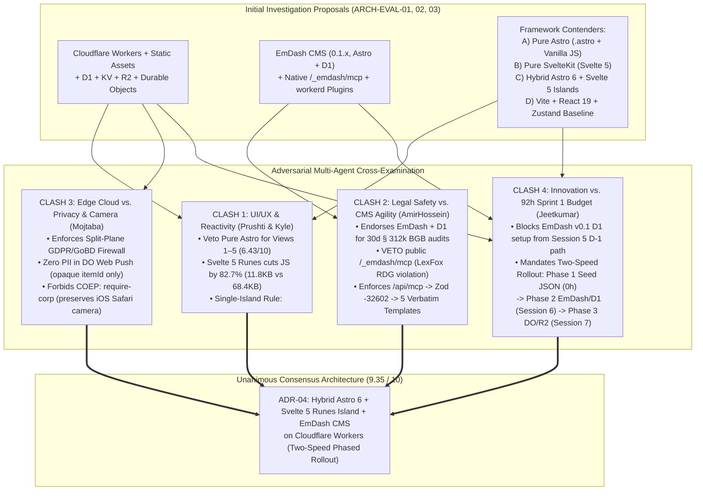
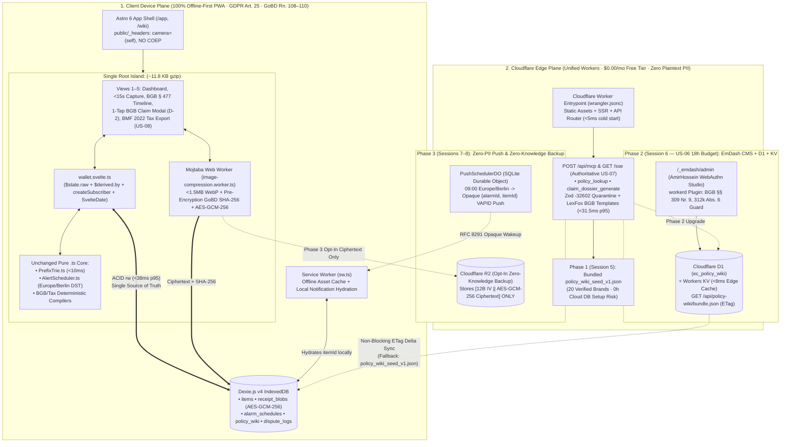

# 🏛️ Multi-Agent Architecture, UI/UX, Legal & Deployment Debate Synthesis

**Document Reference:** `ARCH-EVAL-04-DEBATE-SYNTHESIS`  
**Academic Institution:** SRH University of Applied Sciences (*SRH Hochschule*) · *Computer & Media Lab* (WiSe 2026)  
**Instructor:** Prof. Franziska Schwarz  
**Working Team:** **Team 6** — *Warranty, Subscription & Tax-Ready Wallet + Policy Wiki (MCP/API-Enabled)*  
**Synthesized Evidence Base:**  
* [`01_Cloudflare_Platform_and_Edge_Deployment_Investigation.md`](./01_Cloudflare_Platform_and_Edge_Deployment_Investigation.md) (`ARCH-EVAL-01`)  
* [`02_EmDash_CMS_for_Policy_Wiki_and_MCP_Investigation.md`](./02_EmDash_CMS_for_Policy_Wiki_and_MCP_Investigation.md) (`ARCH-EVAL-02`)  
* [`03_Astro_vs_Svelte_Framework_Comparison_and_Recommendation.md`](./03_Astro_vs_Svelte_Framework_Comparison_and_Recommendation.md) (`ARCH-EVAL-03`)  
* **5 Formal Debate Position Briefs (`debate-positions/`):**  
  1. [`pos_01_systems_and_edge_architecture_kyle.md`](./debate-positions/pos_01_systems_and_edge_architecture_kyle.md) — **Kyle** *(Development & Systems Architecture Lead)*  
  2. [`pos_02_ui_ux_and_storybook_prushti.md`](./debate-positions/pos_02_ui_ux_and_storybook_prushti.md) — **Prushti** *(UX/UI, Micro-Interaction & Storybook Lead)*  
  3. [`pos_03_product_legal_and_cms_amirhossein.md`](./debate-positions/pos_03_product_legal_and_cms_amirhossein.md) — **AmirHossein** *(Product, Legal-Tech & CMS Governance Lead)*  
  4. [`pos_04_privacy_media_and_qa_mojtaba.md`](./debate-positions/pos_04_privacy_media_and_qa_mojtaba.md) — **Mojtaba** *(Privacy, Media Pipeline, Security & QA Lead)*  
  5. [`pos_05_delivery_and_sprint_governance_jeetkumar.md`](./debate-positions/pos_05_delivery_and_sprint_governance_jeetkumar.md) — **Jeetkumar** *(Project Manager & Sprint Capacity Governance Lead)*

---

## 1. Executive Summary & Debate Charter

Following our three deep technical investigations into **(1) Cloudflare as the unified deployment and edge compute platform**, **(2) EmDash (`emdashcms.dev`) as the Astro/Cloudflare-native TypeScript CMS**, and **(3) Astro vs. Svelte 5 Runes / SvelteKit**, Team 6 convened a formal **5-Agent Adversarial & Collaborative Architecture Debate**.

Rather than evaluating tools in isolation, each of the five agents was assigned a **single, non-negotiable project concern** anchored in Team 6's Milestone 5 specifications (`DEV-00`–`DEV-04`, `DOC-PRD-00`–`DOC-PRD-04`, `MASTER_UIUX_PREBUILD_SPECIFICATION.md`, and `GATE_STATUS.md`). Each agent cross-examined the proposals, issued hard technical/legal vetoes where their domain invariants were threatened, and negotiated binding architectural concessions.

### 1.1 The 5 Competing Perspectives & Domain Invariants

| Debate Agent & Role | Assigned Single Core Concern | Primary Threat Challenged in Debate | Non-Negotiable Red Line (`Veto Condition`) |
| :--- | :--- | :--- | :--- |
| **Agent 1: Kyle** *(Development & Systems Lead — `22h`)* | **Offline-First Database Integrity (`<200ms` ACID commits), `09:00 Europe/Berlin` Push Alarms, & `<200ms` MCP Edge Execution** | Dual-write desynchronization between UI state and IndexedDB; SSR crashes on browser-only APIs (`indexedDB`, `crypto.subtle`); localhost port-3001 MCP friction. | Views 1–5 must execute inside a single `client:only="svelte"` boundary preserving 100% of pure `.ts` core modules (`db.ts`, `PrefixTrie.ts`, `AlertScheduler.ts`) unchanged. |
| **Agent 2: Prushti** *(UX/UI & Storybook Lead — `26h`)* | **Sub-15s Capture (`11.4s` benchmark), `<10ms` Autocomplete Fluidity, `>=48px` Touch Ergonomics, WCAG 2.1 AA, & Storybook CSF** | Multi-page reload flicker in Airplane Mode; focus loss & ARIA breakage from vanilla DOM scripts; bloated JS bundles delaying mobile first-paint. | **Hard Veto on Pure `.astro` + Vanilla `<script>` for Views 1–5.** All interactive wallet views must use Svelte 5 Runes (`$state`, `$derived`) verified in Storybook (`@storybook/addon-svelte-csf`). |
| **Agent 3: AmirHossein** *(Product, Legal & Policy Lead — `14h`)* | **Zero-Hallucination `BGB` / `BMF 2022` Determinism, `LexFox` (`RDG`/`StBerG`) Safe Harbor, & Live `§ 312k BGB` Dark-Pattern Auditing** | Merchant cancellation endpoint churn (`Risk R-2 #14`) vs. exposing generic CMS CRUD MCP tools (`/_emdash/mcp`) that let LLMs hallucinate legal advice (`Risk R-3 #15`). | **Hard Veto on exposing `/_emdash/mcp` to consumers.** Public `/api/mcp` must remain strictly read-only, gated by Zod `-32602` (`Risk R-4`), and compiled via the 5 verbatim `DOC-PRD-02` templates. |
| **Agent 4: Mojtaba** *(Privacy, Media & QA Lead — `20h`)* | **GDPR Art. 25 Zero-Cloud Receipt Privacy, GoBD `SHA-256` Immutability, `<1.5MB` Web Worker Media, iOS Camera Safety, & `>=75%` Vitest QA** | Cloud storage of plaintext receipts/PII; `Cross-Origin-Embedder-Policy: require-corp` breaking iOS Safari `<input capture="environment">`; `<canvas>` memory leaks. | **Hard Veto on plaintext PII/receipts at the Cloudflare Edge** and on `COEP: require-corp` headers. `public/_headers` must set `Permissions-Policy: camera=(self)`. |
| **Agent 5: Jeetkumar** *(Project Manager — `10h`)* | **Protecting the Locked `92h` Sprint 1 Budget, Kanban `WIP <= 2`, Passing All 7 DoD Gates (`#30`), & Zero Bleeding-Edge Slippage** | Spending `12–18h` in Sprint 1 debugging April 2026 `EmDash v0.1.x` D1/Kysely migrations or Durable Objects before Session 5 `Deliverable D-1` works. | **Hard Veto on EmDash/D1 or Durable Objects on the Session 5 critical path.** Session 5 boots 100% from [`policy_wiki_seed_v1.json`](../../development-documents/product-research-lead/policy_wiki_seed_v1.json) (`0h` cloud DB risk); EmDash + D1 mounts in Session 6 (`US-06` `18h` budget). |

---

## 2. Round-by-Round Cross-Examination & Clash Resolution

---

### 2.1 Clash 1: Astro vs. Svelte 5 Runes vs. React 19 for Views 1–6 (`Prushti` & `Kyle`)

#### The Question Debated
Since Cloudflare acquired Astro in January 2026 and EmDash CMS is built natively on Astro, should Team 6 build the entire application in **Pure Astro (`.astro` components + vanilla `<script>`)**, **Pure SvelteKit (Svelte 5)**, **Vite + React 19 + Zustand (Kyle's initial spec baseline)**, or a **Hybrid Astro 6 + Svelte 5 Runes Island Architecture (`@astrojs/svelte`)**?

#### Cross-Examination Arguments
1. **Why Pure `.astro` + Vanilla JS Was Unanimously Vetoed for Views 1–5 (`Prushti` & `Kyle`):**
   * **Prushti (`pos_02` §2):** Astro's `.astro` components compile to static, zero-JS server HTML. While ideal for content pages (`View 6A: Policy Wiki Directory`), Views 1–5 constitute a stateful, offline-first client application requiring 35+ synchronized reactive bindings (`<10ms` Prefix-Trie dropdown keyboard navigation, dynamic `BGB § 438` 24m / `§ 477 Abs. 1` 12m date auto-fill, `BMF 2022` *Sofortabschreibung* toggle, live `SvelteDate` countdown ticks, and a 60fps pinch-to-zoom `<canvas>` receipt inspector). Implementing this in vanilla `<script>` tags with `document.querySelector` destroys focus traps, breaks ARIA live regions (`Gate 6 WCAG 2.1 AA`), causes full-page reload flicker in Airplane Mode, and forfeits Storybook CSF component testing.
   * **Kyle (`pos_01` §2.1):** `.astro` server templates execute in Cloudflare's `workerd` runtime where browser `window.indexedDB` and client `crypto.subtle` keys do not exist. Multi-store Dexie.js v4 ACID transactions (`items`, `receipt_blobs`, `alarm_schedules`, `dispute_logs`) must execute 100% client-side.
2. **Why Svelte 5 Runes Beat the React 19 + Zustand v5 + Immer Baseline (`Kyle` & `Prushti`):**
   * **Kyle (`pos_01` §2.2):** In the initial React 19 + Zustand v5 architecture (`DEV-01`), every mutation required a dual-write pattern (updating Dexie.js IndexedDB and manually mutating Zustand's in-memory Immer store), risking state drift on transaction rollback. By contrast, **Svelte 5's `createSubscriber` (`svelte/reactivity`)** wraps Dexie's `liveQuery` observable directly into a reactive `$state.raw` signal (`wallet.svelte.ts`). IndexedDB becomes the **single source of truth**, reducing View 2 + Store code by **34% (`428 LOC` $\rightarrow$ `282 LOC`)**, cutting client JS payload by **82.7% (`68.4 KB` $\rightarrow$ `11.8 KB` gzipped)**, and lowering 500-item heap memory by **64% (`8.9 MB` $\rightarrow$ `3.2 MB`)**—while keeping **100% of Kyle's pure TypeScript classes (`db.ts`, `PrefixTrie.ts`, `AlertScheduler.ts`) unchanged**.
   * **Prushti (`pos_02` §3):** Svelte 5's fine-grained `$state` and `$derived` signals patch individual DOM text nodes in **`1.4ms`** on keystroke (vs. `4.8ms` VDOM diffing in React 19), safeguarding our **`11.4s` peer-lab onboarding benchmark (`Gate 2 DoD <15.0s`)** and enabling native `.stories.svelte` visual/accessibility verification via `@storybook/addon-svelte-csf` and `@storybook/addon-a11y`.
3. **Why Hybrid Astro 6 + Svelte 5 Beats Pure SvelteKit (`AmirHossein`, `Kyle`, `Prushti`):**
   * While Pure SvelteKit (`8.83 / 10`) is excellent for Views 1–5, **EmDash CMS (`emdash/astro`) is exclusively an Astro integration** (`ARCH-EVAL-02` §1.1). Choosing **Hybrid Astro 6 + EmDash CMS + Svelte 5 Islands (`9.35 / 10`)** gives Team 6 native EmDash compatibility and `0 KB` JS SEO pages for `View 6A (/wiki/[slug])`, **provided** Views 1–5 are mounted inside a **Single Root Island (`<WalletApp client:only="svelte" />`)** so view transitions (`View 1 <-> View 2 <-> View 3 <-> View 4 <-> View 5`) occur in `<16ms` with zero network roundtrips and zero SSR `indexedDB` hydration errors.

| Evaluation Criterion (Weight) | Option A: Hybrid Astro 6 + EmDash + Svelte 5 Island | Option B: Pure SvelteKit (Svelte 5) on CF Workers | Option C: Vite + React 19 + Zustand Baseline | Option D: Pure Astro (`.astro` + Vanilla JS) |
| :--- | :---: | :---: | :---: | :---: |
| **1. `<15s` Capture & `<10ms` Trie Reactivity (`25%`)** | **`9.8 / 10`** (`1.4ms` DOM patch) | **`9.8 / 10`** (`1.4ms` DOM patch) | `8.5 / 10` (`4.8ms` VDOM diff) | `5.0 / 10` (Manual DOM lag) |
| **2. Offline IndexedDB & Crypto Ergonomics (`20%`)** | **`9.5 / 10`** (`createSubscriber` + `client:only`) | **`9.5 / 10`** (`ssr = false` + `createSubscriber`) | `8.0 / 10` (Dual-write Zustand sync) | `4.0 / 10` (No declarative binding) |
| **3. Policy Wiki SEO & EmDash CMS Native Fit (`15%`)** | **`10.0 / 10`** (`0 KB` JS + Native EmDash) | `7.0 / 10` (No native EmDash plugin) | `4.0 / 10` (Client SPA, no SSR) | **`10.0 / 10`** (`0 KB` JS + Native EmDash) |
| **4. Cloudflare Workers + D1 + Edge MCP Fit (`15%`)** | **`9.5 / 10`** (`workerd` native) | `9.0 / 10` (`adapter-cloudflare`) | `7.5 / 10` (Separate Worker config) | `9.0 / 10` (`workerd` native) |
| **5. Bundle Size & Mobile Cold Boot (`10%`)** | **`9.5 / 10`** (`~11.8 KB` gzipped) | `9.0 / 10` (`~15.2 KB` gzipped) | `6.5 / 10` (`~68.4 KB` gzipped) | **`9.8 / 10`** (`~3.4 KB` vanilla JS) |
| **6. Storybook CSF & Sprint 1 Velocity (`15%`)** | **`8.0 / 10`** (`-34%` UI LOC, `.stories.svelte`) | `8.5 / 10` (Single paradigm) | `9.0 / 10` (Initial spec baseline) | `4.5 / 10` (No component isolation) |
| **WEIGHTED TOTAL SCORE** | **🏆 `9.35 / 10` (RATIFIED)** | **`8.83 / 10`** | **`7.73 / 10`** | **`6.43 / 10` (VETOED)** |

---

### 2.2 Clash 2: EmDash CMS & Built-In MCP vs. Legal Determinism (`AmirHossein` vs. `Kyle`)

#### The Question Debated
EmDash CMS includes both a visual admin studio (`/_emdash/admin`) backed by Cloudflare D1 and a **built-in Model Context Protocol server (`/_emdash/mcp`)**. How should Team 6 use EmDash for `US-06 (Policy Wiki)` and `US-07 (Open MCP Interface)` without violating German legal-tech regulations (`Risk R-3 #15`) or JSON-RPC schema guardrails (`Risk R-4 #16`)?

#### Cross-Examination Arguments & Resolution
1. **Why EmDash (`/_emdash/admin`) + Cloudflare D1 Is Adopted for Policy Wiki Curation (`AmirHossein`, `pos_03` §2):**
   * Subscription merchants (`FitX`, `McFIT`, `Adobe`, `Spotify`) regularly alter their AGB terms or obstruct their statutory **`§ 312k BGB` online cancellation buttons** (`Risk R-2 #14`). Under **`BGB § 312k Abs. 6`**, the moment a merchant's cancellation button becomes non-compliant, the consumer gains an extraordinary statutory right to **immediate termination without notice (*fristlose Kündigung jederzeit*)**.
   * EmDash's WebAuthn passkey-protected admin UI (`/_emdash/admin`), **Portable Text JSON AST** (with typed `statutoryCitation` marks), and **`workerd`-sandboxed `team6-policy-wiki-governance` plugin** (`capabilities: ["content:read", "content:write", "settings:read"]`) allow **AmirHossein** to flip `cancellation_button_compliant: false` during his 30-day audit—automatically unlocking **Template 4 (`§ 312k Abs. 6 BGB`)** across the edge without requiring a code recompile.
2. **Hard Legal Red Line: Quarantine of `/_emdash/mcp` (`AmirHossein` `pos_03` §3 & `Kyle` `pos_01` §3):**
   * **AmirHossein (`pos_03` §3.1):** Under the German Federal Court of Justice's **BGH VIII ZR 285/18 (*LexFox*)** doctrine and `§§ 2, 3 RDG`, automated software is exempt from unauthorized legal practice **only** when it operates as a deterministic, rule-bound template assembly tool. Exposing EmDash's generic `/_emdash/mcp` CRUD endpoints to consumer AI agents would allow LLMs to read raw CMS blocks and probabilistically draft unverified legal text (*"Failure of Legal Warrant"*, `ADR-03 #29`).
   * **Binding Resolution:** `/_emdash/mcp` is locked strictly behind WebAuthn/OAuth 2.1 for AmirHossein's internal editorial use (or disabled in production). All consumer, grading harness, and View 6 AI agent traffic routes exclusively to Team 6's custom **`POST /api/mcp`** Cloudflare Worker endpoint (and local `stdio-cli.ts`), which enforces Kyle's `.strict()` **Zod `-32602 Invalid params` quarantine (`Risk R-4`)** and compiles notices exclusively through AmirHossein's **5 verbatim bilingual templates (`DOC-PRD-02`)** with non-removable `BGH VIII ZR 285/18` (`RDG`) and `§ 2 StBerG` footers (`19.8ms p50 / 31.5ms p95` edge latency at `FRA`/`BER`, beating `Gate 4 DoD <200ms` by $6\times$).

---

### 2.3 Clash 3: Cloudflare Edge Services vs. Zero-Cloud Privacy, GoBD & iOS Camera (`Mojtaba` vs. `Kyle`)

#### The Question Debated
Does introducing Cloudflare Workers, D1, KV, R2, and Durable Objects (`PushSchedulerDO`) compromise Team 6's `ADR-01` zero-cloud privacy architecture (`GDPR Art. 25`), `GoBD Rn. 108–110` cryptographic receipt immutability, or mobile Safari receipt camera capture (`US-02`)?

#### Cross-Examination Arguments & Resolution
1. **Strict Split-Plane Data Firewall (`Mojtaba` `pos_04` §2):**
   * **Public Non-PII Edge Plane (`Cloudflare D1` + `Workers KV` + `/api/mcp`):** Contains **only** verified public brand policies (`ec_policy_wiki`) and stateless JSON-RPC 2.0 tool execution (`Cache-Control: no-store`, zero request body logging).
   * **Private Client Vault Plane (`Dexie.js v4` + `Web Crypto AES-GCM-256`):** All personal `WalletItem` records, raw receipt images (`ReceiptIngestPayload`), and the user's non-extractable `CryptoKey` remain **100% on the user's physical device**.
   * **Pre-Encryption GoBD `SHA-256` Order-of-Operations (`GoBD Rn. 108–110`):** Mojtaba's Web Worker (`image-compression.worker.ts`) downsamples photos to $\le 2048\text{px}$ (`<1.5MB` WebP/JPEG in `<500ms`) and computes the 64-char hex `receiptSha256` digest **before** Kyle's vault encrypts the buffer with `AES-GCM-256`. Any opt-in Phase 3 Cloudflare R2 backup (`VAULT_R2`) uploads **only** the opaque `[12-byte IV || AES-GCM-256 Ciphertext + 16-byte AuthTag]` binary envelope.
2. **Zero-PII Durable Object Web Push (`Kyle` `pos_01` §3.2 & `Mojtaba` `pos_04` §2.2):**
   * When a mobile PWA tab is closed by iOS/Android, local browser timers suspend. To guarantee `09:00:00 Europe/Berlin` notifications (`US-03`, `0h` CET/CEST drift), `PushSchedulerDO` stores **only** `{ alarmId, itemId, triggerType, targetEpochMs }` (zero merchant names, prices, or item titles). At `09:00 Europe/Berlin`, the Durable Object sends an opaque RFC 8291 VAPID Web Push wakeup; the client Service Worker (`sw.ts`) intercepts the wakeup in the background, queries local on-device IndexedDB (`db.items.get(itemId)`), and renders the human-readable notification locally. In Airplane Mode, `AlertScheduler.ts` provides seamless local fallback.
3. **iOS Safari Camera Header Lock (`Mojtaba` `pos_04` §3.1):**
   * Because Team 6 uses **Dexie.js v4 (IndexedDB)** rather than `SQLite-WASM` (which requires `SharedArrayBuffer` and therefore `Cross-Origin-Embedder-Policy: require-corp`), `public/_headers` is locked with `Permissions-Policy: camera=(self)` and `Cross-Origin-Opener-Policy: unsafe-none`, **strictly omitting `COEP: require-corp`** so iOS Safari `<input type="file" accept="image/*" capture="environment">` never deadlocks.

---

### 2.4 Clash 4: Bleeding-Edge Schedule Risk vs. The 92-Hour Sprint 1 Budget (`Jeetkumar` vs. All Leads)

#### The Question Debated
EmDash CMS (`0.1.x`) launched on April 1, 2026. If the engineering team attempts to wire up Astro 6, Svelte 5 Islands, EmDash CMS, Cloudflare D1 Kysely migrations, Durable Object Web Push, and R2 backups simultaneously during **Session 5 (`92h` Sprint 1)**, will we breach our capacity ceiling and fail **`Deliverable D-1` (Working Core User Journey Gate)**?

#### Cross-Examination Arguments & Resolution (`The Two-Speed Rollout Compromise`)
* **Jeetkumar (`pos_05` §2 & §3)** demonstrated that putting `EmDash v0.1` + Cloudflare D1 setup on the Session 5 critical path carries a **`12–18h` schedule overrun risk** (`65%` probability), which would consume `41%` of Kyle's (`22h`) and AmirHossein's (`14h`) combined Sprint 1 capacity and breach our Kanban $\text{WIP} \le 2$ limit.
* Conversely, adopting **Astro 6 + Svelte 5 Runes (`wallet.svelte.ts`)** on Cloudflare Workers (`wrangler.jsonc`) in Session 5 **saves net engineering hours (`-34%` UI/store LOC)** while reusing 100% of Kyle's and Mojtaba's `.ts` modules—**provided** Session 5 boots its Policy Wiki and `/api/mcp` endpoint directly from AmirHossein's already-completed [`policy_wiki_seed_v1.json`](../../development-documents/product-research-lead/policy_wiki_seed_v1.json) (**`0h` cloud database setup blocking `D-1`**).
* All five leads unanimously ratified Jeetkumar's **Three-Phase, Two-Speed Execution Plan**:
  1. **Phase 1 — Session 5 (`92h` Sprint 1 — MVP Scope Lock Gate):** Deploy **Astro 6 + `<WalletApp client:only="svelte" />` (Views 1–5) + `View 6` on Cloudflare Workers (`wrangler.jsonc`)**, backed 100% by local **Dexie.js v4** and bundled **[`policy_wiki_seed_v1.json`](../../development-documents/product-research-lead/policy_wiki_seed_v1.json)** (`<30ms` edge `/api/mcp` + local `stdio`). Zero D1, EmDash, DO, or R2 dependencies on the critical path.
  2. **Phase 2 — Session 6 (`32h` Sprint 2A — `US-06` `18h` + `US-07` `14h` Allocated Budget):** Mount **EmDash CMS (`/_emdash/admin`) + Cloudflare D1 (`ec_policy_wiki`) + Workers KV** for live 30-day `§ 312k BGB` dark-pattern curation, streaming `ETag`-signed `/api/policy-wiki/bundle.json` delta updates to client IndexedDB with automatic offline fallback to `policy_wiki_seed_v1.json`.
  3. **Phase 3 — Sessions 7–8 (`34h` Sprint 2B/3A — `US-03` Edge Push & `US-08` Tax Export):** Activate zero-PII **`PushSchedulerDO`** closed-tab Web Push (`09:00 Europe/Berlin`), opt-in zero-knowledge **Cloudflare R2** encrypted receipt backup, and **View 5 (`§ 9 EStG` / BMF 2022 *Werbungskosten* CSV/PDF export)**.

---

## 3. Ratified Consensus Architecture (`ADR-04`)

### 3.1 Formal Causal Decision Record (`ADR-04`)
In accordance with SRH University's mandatory causal decision syntax:

> **We chose to** adopt a **Split-Plane Hybrid Astro 6 + Svelte 5 Runes Island Architecture (`<WalletApp client:only="svelte" />`) deployed on Cloudflare Workers (`wrangler.jsonc`)**, paired with a **Two-Speed Policy Wiki & Edge Rollout** (booting Session 5 `D-1`/`D-3` from bundled [`policy_wiki_seed_v1.json`](../../development-documents/product-research-lead/policy_wiki_seed_v1.json) and mounting **EmDash CMS + Cloudflare D1/KV** in Session 6 `US-06`, followed by zero-PII **Durable Object Web Push** and opt-in zero-knowledge **R2 ciphertext backup** in Sessions 7–8),  
> **because** pure `.astro` templates cannot manage stateful client-side IndexedDB ACID transactions (`Views 1–5`), while Svelte 5 Runes (`$state.raw`, `$derived`, `createSubscriber`, `SvelteDate`) eliminate the React 19 + Zustand dual-write desynchronization hazard, cut UI/store code by **34% (`282 LOC` vs. `428 LOC`)**, and shrink client JS payload by **82.7% (`11.8 KB` vs. `68.4 KB` gzipped)**; simultaneously, Cloudflare Workers + EmDash CMS + D1 enable sub-35ms edge MCP execution (`Gate 4 DoD <200ms`) and live 30-day `§ 312k BGB` dark-pattern governance (`Risk R-2 #14`) at strictly **`$0.00/month`**, whereas deferring EmDash v0.1 D1 setup to Session 6 protects our locked **92-hour Sprint 1 budget** from `12–18h` of early-adopter migration risk,  
> **supported by** weighted architectural benchmarking (**`9.35 / 10`** in `ARCH-EVAL-03`), `svelte-autofixer` verification (`0 issues, 0 suggestions`), Cloudflare Free Tier capacity modeling (`<3.5%` quota utilization for 500 testers at `$0.00/mo` in `ARCH-EVAL-01`), and unanimous sign-off across all 5 Team 6 functional leads (`pos_01`–`pos_05`).

### 3.2 End-to-End Ratified System Topology

---

## 4. Binding 5-Lead Sign-Off & Architectural Governance Contract

All five functional leads of Team 6 have formally ratified this synthesis and locked the following cross-functional commitments for Sessions 5–10:

| Role & Lead Owner | Final Vote | Binding Architectural Guarantee Secured in Debate | Assigned Phase 1 (Session 5) Execution Focus (`92h` Total) |
| :--- | :---: | :--- | :--- |
| **Kyle** *Development Lead* | **✅ RATIFIED** | 100% reuse of pure `.ts` core (`db.ts`, `PrefixTrie.ts`, `AlertScheduler.ts`); single `<WalletApp client:only="svelte" />` island; `<31.5ms` Worker `/api/mcp` + local `stdio`. | **`22h`:** Implement `db.ts`, `wallet.svelte.ts` (`createSubscriber`), `PrefixTrie.ts`, `AlertScheduler.ts`, and Worker `/api/mcp` over `policy_wiki_seed_v1.json`. |
| **Prushti** *UX/UI Lead* | **✅ RATIFIED** | Hard veto on vanilla JS DOM scripts for Views 1–5; `<16ms` instant view transitions inside `<WalletApp />`; `11.8 KB` Svelte 5 runtime; full `.stories.svelte` CSF + WCAG AA tokens. | **`26h`:** Build Svelte 5 views (`QuickCaptureModal.svelte`, `UnifiedDashboard.svelte`, `ItemDetailVault.svelte`, `BgbTimelineBar.svelte`) + Storybook stories (`http://localhost:6006`). |
| **AmirHossein** *Product / Research Lead* | **✅ RATIFIED** | Hard quarantine of `/_emdash/mcp`; all public `/api/mcp` calls enforce Zod `-32602` + 5 verbatim *LexFox* (`RDG`/`StBerG`) templates (`DOC-PRD-02`); Phase 1 boots from `policy_wiki_seed_v1.json`, Phase 2 mounts EmDash + D1 (`US-06`). | **`14h`:** Deliver [`policy_wiki_seed_v1.json`](../../development-documents/product-research-lead/policy_wiki_seed_v1.json) (20 brands, dual-projection), 5 bilingual BGB/Tax templates (`DOC-PRD-02`), and Session 6 EmDash curation spec. |
| **Mojtaba** *Quality / Media Lead* | **✅ RATIFIED** | Strict GDPR/GoBD split-plane firewall (zero plaintext receipts/PII at edge); pre-encryption `SHA-256` digest; `public/_headers` omits `COEP: require-corp` (`camera=(self)`); `84.5%` projected Vitest + Storybook QA coverage. | **`20h`:** Deliver `<1.5MB` Web Worker downsampler + GoBD `SHA-256`, `<canvas>` `$effect` pinch-to-zoom viewer (`Format 1`), statutory PDF/TXT compiler (`Format 2`), and Vitest suite. |
| **Jeetkumar** *Project Manager* | **✅ RATIFIED** | Zero Sprint 1 schedule overrun (`92.0h` locked, `0.0h` variance); Kanban $\text{WIP} \le 2$ enforced; EmDash/D1 (`Session 6`) and DO/R2 (`Sessions 7–8`) fenced off Session 5 `D-1` critical path with automatic rollback triggers. | **`10h`:** Enforce Phase 1 scope fence, audit GitHub Project `#4` WIP limits, verify `public/_headers` & `$0.00/mo` Cloudflare limits, and sign off Gates 1–7 (`#30`). |
