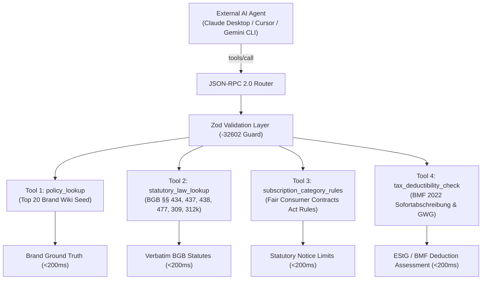

# 🏛️ Team 6 Leads Focused Debate & Technical Specification

**Document Reference:** `DOC-SYNTHESIS-FAB-MCP-2026-11`  
**Working Group:** Team 6 (*Computer & Media Lab*, WiSe 2026, SRH Hochschule)  
**Supervising Faculty:** Prof. Franziska Schwarz  
**Participants:**
- **Prushti** — UX/UI Lead (Member C)
- **Kyle** — Development & Systems Lead (Member D)
- **AmirHossein** — Product & Legal Lead (Member B)
- **Jeetkumar** — Project Manager (Member E)

---

## 1. Executive Summary & Context

This document captures the focused deliberation and definitive engineering consensus between the four Team 6 leads regarding:
1. **The Floating Action Button (FAB) / Speed Dial Architecture**: Transitioning from static navigation to an ergonomic, page-contextual speed dial adapted from the CampusWeb `portable-floating-action-menu` primitive (Svelte 5 runes, mode: `'menu'`, animated `+` to `✕` morph, accessible backdrop scrim, virtual keyboard avoidance).
2. **Open MCP Server Clarification & Scope Lock**: Ratifying the server’s primary identity as an **authoritative, reliable public knowledge source** for AI agents (Claude Desktop, Cursor, Gemini CLI) to query statutory consumer law, brand cancellation rules, subscription regulations, and German tax write-off policies without web scraping or hallucinations.
3. **Refined 4-Tool MCP Contract**: Codifying strict JSON Schema Draft-07, Zod schemas, and deterministic JSON-RPC 2.0 payloads for `policy_lookup`, `statutory_law_lookup`, `subscription_category_rules`, and `tax_deductibility_check`.

---

## 2. Transcript of Focused Debate Between Team 6 Leads

### 2.1 Round 1: FAB / Speed Dial Architecture & CampusWeb Primitive Analysis

**Prushti (UX/UI Lead):**
> "Let’s start with mobile ergonomics and interaction hierarchy. In our initial UI/UX specs, we relied heavily on the top centerpiece Omni-Bar for search and creation (`DOC-UX-03`). But on mobile devices (`375px–412px`), the top third of the screen is an ergonomic dead zone for one-handed thumb interaction—users have to shift their grip to reach the top.
>
> I analyzed the CampusWeb component: `portable-floating-action-menu`. It's cleanly authored in Svelte 5 runes. In `FloatingActionMenu.svelte`, it uses `mode: 'menu'`, an inner `<button class="portable-fab-toggle">` that rotates a `+` symbol by 45 degrees (`.fab-toggle-icon.expanded { transform: rotate(45deg); }`), and renders a vertical list of `ActionItem.svelte` children with circular action pills.
>
> Now examine the Google Calendar mobile reference: When you tap the bottom-right FAB, the `+` smoothly morphs into an `✕`, a semi-transparent dark backdrop dims the underlying calendar, and three distinct pills stagger upwards vertically with high-contrast text badges: *Task*, *Birthday*, *Event*.
>
> My recommendation for our Wallet App is:
> 1. Use the Google Calendar speed-dial pattern as our visual north star.
> 2. Keep the FAB anchored at the bottom-right (`inset-block-end: calc(20px + env(safe-area-inset-bottom))`, `inset-inline-end: 20px`), floating 16px above our bottom navigation bar.
> 3. Add an animated backdrop scrim (`rgba(15, 23, 42, 0.45)` with `backdrop-filter: blur(2px)`) that closes the menu on tap."

**Kyle (Dev & Systems Lead):**
> "I reviewed the CampusWeb code in detail. The primitive is structurally sound:
> - It accepts `mode: FloatingActionMode` (`menu`, `single-action`, `forced-menu`, `hidden`).
> - It binds geometry through a clean Svelte action `use:applyGeometry`.
> - It tracks async loading states and abort controllers cleanly in `ActionItem.svelte`.
>
> However, there are three critical flaws in the raw CampusWeb implementation that we MUST fix before adopting it in our Wallet PWA:
> 1. **No Backdrop Element:** CampusWeb relied solely on `svelte:window onclick={onWindowClick}` without rendering a visual scrim. When the speed dial opens, the underlying dashboard text bleeds through, causing severe visual clutter and contrast failures (violating WCAG 1.4.3).
> 2. **Mobile Keyboard Collision:** On Android and iOS, when an `<input>` is focused, the virtual keyboard slides up. A fixed bottom-right FAB either gets shoved over the active text input or causes severe viewport jitter. We must subscribe to `window.visualViewport` or auto-hide the speed dial whenever an active input/textarea has focus.
> 3. **Dock Ergonomics vs Standalone FAB:** If we put the FAB at bottom-right, does it collide with our bottom navigation bar? On iOS Safari, bottom-right can collide with the bottom navigation bar and the Safari home indicator bar.
>
> Prushti, should we integrate the `+` into the center of an iOS bottom navigation dock (like Instagram / Splitwise), or keep it as a standalone floating button?"

**Prushti (UX/UI Lead):**
> "That’s an essential distinction. A centered dock button (the iOS tab bar notch pattern) forces the `+` action to be universally visible on every single screen, but it severely constrains the horizontal room for tab labels (Dashboard, Items, Subscriptions, Wiki). More importantly, speed-dial vertical pill menus originating from the dead center of the screen feel awkward because the action pills pop up directly over central content cards.
>
> A **bottom-right standalone FAB** (elevated `72px` above bottom dock on mobile, `24px` on desktop) is significantly better:
> - The thumb sweep on right-handed mobile use naturally rests at the bottom-right corner.
> - The speed-dial pills rise cleanly upward along the right margin, leaving 65% of the dimmed screen readable for contextual orientation.
> - For left-handed accessibility or RTL layouts, the geometry contract `placement: 'bottom-start'` cleanly flips it to the left."

**AmirHossein (Product & Legal Lead):**
> "From a user journey and product value perspective, what should the options in that speed dial actually be?
>
> In our research interviews (`DOC-PRD-01`), students have three primary capture triggers:
> 1. **Point-of-Sale (POS) Capture:** Standing at the Saturn/MediaMarkt checkout counter holding a paper *Kassenbon*. They need **Instant Camera / Receipt Photo**.
> 2. **Hardware Purchase Logging:** Registering a laptop, headphones, or monitor with automatic BGB §§ 438/477 statutory calculation. They need **New Hardware Warranty**.
> 3. **Digital Subscription / Trial Audit:** Subscribing to an AI tool or gym membership with § 309 Nr. 9 rolling notice and § 312k cancellation links. They need **New Digital Subscription**.
>
> But wait: what happens when the student is not on the Dashboard? If they are browsing the **Brand Policy Wiki** (View 6), showing 'Snap Receipt' makes less sense than 'Request Brand Policy' or 'Export MCP API Dossier'. If they are on the **Tax Summary** (View 5), an action like 'Add Werbungskosten Line' or 'Export BMF 2022 Tax CSV' is far more relevant.
>
> Therefore, should the speed dial be globally fixed, or page-contextual?"

**Jeetkumar (Project Manager):**
> "Let’s look at this through the lens of scope management, sprint capacity (our 92h Sprint 1 budget), and cognitive load.
>
> If every view invents a completely different 5-item menu, we risk confusing the user and bloating test matrix complexity. But the CampusWeb adapter architecture (`CampusFloatingActionMenu.svelte`) was explicitly built to solve this: it takes a `workflow` prop and maps contextual actions while maintaining a predictable primary action.
>
> Here is the project management decision:
> - **Primary Universal Action (Always Top/First):** **'📷 Snap / Upload Receipt'** (triggers the sub-15s Quick Capture modal `View 2` with camera intent).
> - **Secondary Universal Action:** **'💻 Log Hardware Purchase'** (auto-applies 24m BGB § 438 + 12m § 477).
> - **Tertiary Universal Action:** **'⚡ Log Subscription / Contract'** (auto-applies 1m § 309 Nr. 9 + § 312k).
> - **Contextual Slot 4 (Page-Adaptive):**
>   - On *Dashboard (`/`)*: Quick search filter / Expiring Soon filter.
>   - On *Items Library (`/items`)*: Batch CSV / GoBD Audit Export.
>   - On *Brand Wiki (`/wiki`)*: 'Query Open MCP Server' / 'Copy JSON-RPC Request'.
>   - On *Tax View (`#tax`)*: 'Export Werbungskosten CSV (BMF 2022)'.
>
> This gives us 80% consistency and 20% contextual power, requiring zero extra component classes!"

---

### 2.2 Round 2: Open MCP Server Clarification & Tool Contract Scope Lock

**AmirHossein (Product & Legal Lead):**
> "Now let's address Topic 2: Ratifying the user's clarification of our Open MCP Server.
>
> The user stated:
> *'The primary purpose of the MCP server is being an authoritative, reliable public knowledge source for AI agents to query warranty terms, cancellation policies, and statutory consumer law (BGB §§ 437, 438, 477, 309 Nr. 9, 312k, BMF 2022) without web scraping or hallucinations.'*
>
> I 100% ratify and endorse this definition. In our earlier drafts, we had bundled `claim_dossier_generate` as a server-side MCP tool. While helpful for terminal demos, the actual document compilation (Mängelrüge letters, PDF assembly) belongs in client-side Web Workers and Dexie for private user data (`GDPR Art. 25`).
>
> What the world lacks, and what Claude Desktop, Cursor, and Gemini CLI desperately need, is an **authoritative, verified legal and policy oracle for German consumer rights**:
> 1. LLMs currently scrape outdated blogs or hallucinate that the German reversed burden of proof (*Beweislastumkehr*) is 6 months (it was changed to **12 months** on January 1, 2022 under BGB § 477 Abs. 1).
> 2. LLMs don't know that under BGB § 312k Abs. 6, if a website lacks a compliant two-click cancellation button, the consumer can terminate **immediately without notice** (*fristlos jederzeit*).
> 3. LLMs routinely tell students to depreciate laptops over 3 years, completely unaware of **BMF Guidance of 22.02.2022** which allows **100% immediate write-off (*Sofortabschreibung*)** in the purchase year for digital computer hardware and software regardless of price.
>
> By locking our MCP server scope to four authoritative knowledge tools:
> 1. `policy_lookup`: Top curated brands (Apple, Sony, Spotify, FitX, MediaMarkt, etc.).
> 2. `statutory_law_lookup`: Pure BGB statutory articles (§§ 434, 437, 438, 439, 477, 475e, 309 Nr. 9, 312k, 355).
> 3. `subscription_category_rules`: Category-specific rules (fitness, streaming, SaaS, telecommunications, insurance).
> 4. `tax_deductibility_check`: BMF 2022 Sofortabschreibung eligibility, GWG thresholds (§ 6 Abs. 2 EStG), and mixed-use allocation ratios.
>
> We establish the first zero-hallucination ground-truth server for European consumer rights!"

**Kyle (Dev & Systems Lead):**
> "I agree with AmirHossein. Structuring the MCP server around these four knowledge contracts simplifies the server architecture and guarantees compliance with the `<200ms` latency SLA mandated by `Gate 4 DoD (#30)`.
>
> Let's review the architectural details:
> - **In-Memory Hash Maps:** The 20-brand seed (`policy_wiki_seed_v1.json`) and the statutory statute tables are bundled directly into the server package. Queries take `<2ms`.
> - **Stateless & Read-Only:** Zero PII is received or stored. No database migrations, no SQLite disk locks.
> - **Transport Layer:** We expose standard `stdio` for local Claude Desktop / Cursor CLI, and `POST /api/mcp` on Cloudflare Workers for our Svelte 5 frontend explorer (`View 6`).
> - **Zod Runtime Schema & -32602 Guards:** Every tool has a strict Zod schema. If an agent sends invalid parameters, the server immediately returns standard JSON-RPC 2.0 error code `-32602` with exact field error paths, preventing crashes."

**Jeetkumar (Project Manager):**
> "This scope clarification represents an ideal architectural convergence:
> 1. It honors Barry Boehm's cost curve: locking this in Session 5 eliminates downstream churn.
> 2. It stays within Kyle's 22.0h and AmirHossein's 14.0h Sprint 1 allocations.
> 3. It directly satisfies `US-07 (#10)`, `Deliverable D-3 (#20)`, and `Gate 4 DoD (#30)`.
>
> Let us now formally document the complete specification:
> - The Action Options Table per page.
> - The Component Design Contract for `FloatingActionMenu.svelte`.
> - The refined MCP Tool Contracts with JSON Schema Draft-07, Zod schemas, and wire payloads."

---

## 3. Action Options Table: Speed Dial Behavior Per Page

The floating speed-dial button adapts to the user's active view while maintaining consistent ergonomics and muscle memory.

| View / Page Route | Speed-Dial State | Action 1 (Primary Top) | Action 2 | Action 3 | Action 4 (Contextual) |
| :--- | :--- | :--- | :--- | :--- | :--- |
| **View 1: Dashboard (`/`)** | `mode: 'menu'` | **📷 Snap / Import Receipt**<br>`kind: 'command'`<br>*Opens Quick Capture Modal in camera mode (`<15s`)* | **💻 New Hardware Warranty**<br>`kind: 'command'`<br>*Pre-fills BGB 24m § 438 & 12m § 477 preset* | **⚡ New Subscription**<br>`kind: 'command'`<br>*Pre-fills 1m § 309 Nr. 9 rolling cancellation preset* | **🔍 Filter Expiring Soon**<br>`kind: 'toggle'`<br>*Toggles dashboard filter for items with $\le 30$ days left* |
| **View 3: Items Library (`/items`)** | `mode: 'menu'` | **📷 Snap / Import Receipt**<br>`kind: 'command'`<br>*Direct file picker or camera intake* | **💻 Add Hardware Item**<br>`kind: 'command'`<br>*Blank manual hardware entry form* | **⚡ Add Subscription**<br>`kind: 'command'`<br>*Blank manual subscription entry form* | **📦 Export GoBD Vault**<br>`kind: 'command'`<br>*Downloads encrypted JSON + SHA-256 backup archive* |
| **View 5: Subscriptions & Tax (`#tax`)** | `mode: 'menu'` | **🧾 Add Tax Receipt**<br>`kind: 'command'`<br>*Quick capture with `isTaxDeductible = true` locked* | **⚡ Log SaaS / Tool**<br>`kind: 'command'`<br>*Adds professional software line (100% write-off)* | **📊 Recalculate AfA**<br>`kind: 'command'`<br>*Triggers 50%/100% mixed-use audit evaluation* | **📥 Export Werbungskosten CSV**<br>`kind: 'command'`<br>*Generates BMF 2022 compliant tax filing CSV* |
| **View 6: Brand Wiki & MCP (`/wiki`)** | `mode: 'menu'` | **🔎 Query Open MCP Server**<br>`kind: 'command'`<br>*Opens interactive JSON-RPC query drawer* | **💻 Log Brand Warranty**<br>`kind: 'command'`<br>*Pre-selects current active brand into View 2* | **⚡ Log Brand Subscription**<br>`kind: 'command'`<br>*Pre-selects active brand cancellation link* | **📋 Copy MCP Stdio Config**<br>`kind: 'command'`<br>*Copies `claude_desktop_config.json` snippet* |
| **View 2: Quick Capture (`#capture`)** | `mode: 'hidden'` | *Hidden — Focus trapped inside modal* | — | — | — |
| **View 4: Claim Drawer (`?action=claim`)** | `mode: 'hidden'` | *Hidden — Legal notice review active* | — | — | — |

---

## 4. Component Design Contract: `FloatingActionMenu.svelte` (Svelte 5 Runes)

This contract establishes the exact production-ready component implementation conforming to Svelte 5 runes, WCAG 2.1 AA accessibility standards, backdrop scrim rendering, and virtual keyboard avoidance.

### 4.1 TypeScript Interfaces (`types.ts`)

```typescript
// types.ts - Floating Action Menu Contract
import type { Snippet } from 'svelte';

export type ActionTone = 'default' | 'primary' | 'destructive' | 'accent';

export interface ActionInvocationContext {
  signal: AbortSignal;
  reportSuccess: (msg?: string) => void;
  reportError: (err: unknown, msg?: string) => void;
}

export interface BaseFloatingAction {
  id: string;
  label: string;
  iconId: string;
  description?: string;
  disabled?: boolean;
  disabledReason?: string;
  loading?: boolean;
  tone?: ActionTone;
  closeOnSuccess?: boolean; // default: true
}

export interface CommandFloatingAction extends BaseFloatingAction {
  kind: 'command';
  onInvoke: (ctx: ActionInvocationContext) => void | Promise<void>;
}

export interface LinkFloatingAction extends BaseFloatingAction {
  kind: 'link';
  href: string;
  target?: '_blank' | '_self';
}

export interface ToggleFloatingAction extends BaseFloatingAction {
  kind: 'toggle';
  pressed: boolean;
  onInvoke: (ctx: ActionInvocationContext) => void | Promise<void>;
}

export type FloatingAction = CommandFloatingAction | LinkFloatingAction | ToggleFloatingAction;

export interface FloatingMenuMode {
  type: 'menu';
  defaultOpen?: boolean;
  actions: FloatingAction[];
}

export interface FloatingSingleMode {
  type: 'single-action';
  action: FloatingAction;
}

export interface FloatingHiddenMode {
  type: 'hidden';
}

export type FloatingActionMode = FloatingMenuMode | FloatingSingleMode | FloatingHiddenMode;

export interface FloatingSurfaceGeometry {
  zIndex?: number;
  placement?: 'bottom-end' | 'bottom-start' | 'bottom-center';
  offsets?: {
    blockEnd?: number;
    inlineEnd?: number;
    inlineStart?: number;
  };
  deviceClass?: 'mobile' | 'tablet' | 'desktop';
}
```

### 4.2 Svelte 5 Implementation (`FloatingActionMenu.svelte`)

```svelte
<script lang="ts">
  import type { FloatingActionMode, FloatingSurfaceGeometry } from './types';
  import ActionItem from './ActionItem.svelte';
  import { tick, untrack, onMount, onDestroy } from 'svelte';

  let {
    mode,
    geometry = {
      zIndex: 90,
      placement: 'bottom-end',
      offsets: { blockEnd: 24, inlineEnd: 24 },
      deviceClass: 'mobile'
    },
    class: className = '',
    iconSnippet
  } = $props<{
    mode: FloatingActionMode;
    geometry?: FloatingSurfaceGeometry;
    class?: string;
    iconSnippet?: import('svelte').Snippet<[string]>;
  }>();

  const listId = $props.id();
  let expanded = $state(untrack(() => (mode.type === 'menu' ? !!mode.defaultOpen : false)));
  let isKeyboardVisible = $state(false);

  let isMenu = $derived(mode.type === 'menu');
  let isSingle = $derived(mode.type === 'single-action');
  let isHidden = $derived(mode.type === 'hidden' || isKeyboardVisible);

  let actions = $derived.by(() => {
    if (mode.type === 'menu') return mode.actions;
    if (mode.type === 'single-action') return [mode.action];
    return [];
  });

  let toggleElement = $state<HTMLButtonElement>();
  let listElement = $state<HTMLUListElement>();

  const closeMenu = (restoreFocus = true) => {
    if (isMenu && expanded) {
      expanded = false;
      if (restoreFocus) toggleElement?.focus();
    }
  };

  const handleToggleClick = async (e: MouseEvent) => {
    const wasKeyboard = e.detail === 0;
    expanded = !expanded;
    if (expanded && wasKeyboard) {
      await tick();
      const firstAction = listElement?.querySelector<HTMLElement>('button:not([disabled]), a:not([disabled])');
      firstAction?.focus();
    }
  };

  const onWindowKeydown = (e: KeyboardEvent) => {
    if (e.key === 'Escape' && isMenu && expanded) {
      e.preventDefault();
      e.stopPropagation();
      closeMenu(true);
    }
  };

  // Virtual keyboard detection via visualViewport API
  onMount(() => {
    if (typeof window === 'undefined' || !window.visualViewport) return;
    const initialHeight = window.visualViewport.height;

    const handleResize = () => {
      const currentHeight = window.visualViewport!.height;
      // If viewport shrinks by more than 160px and activeElement is an input, hide FAB
      const isInputActive = ['INPUT', 'TEXTAREA'].includes(document.activeElement?.tagName || '');
      isKeyboardVisible = isInputActive && (initialHeight - currentHeight > 160);
      if (isKeyboardVisible && expanded) {
        closeMenu(false);
      }
    };

    window.visualViewport.addEventListener('resize', handleResize);
    return () => window.visualViewport?.removeEventListener('resize', handleResize);
  });
</script>

<svelte:window onkeydown={isMenu && expanded ? onWindowKeydown : undefined} />

{#if !isHidden}
  <!-- Backdrop scrim rendered when speed dial is open -->
  {#if isMenu && expanded}
    <div
      class="fab-backdrop"
      role="presentation"
      onclick={() => closeMenu(true)}
      aria-hidden="true"
    ></div>
  {/if}

  <div
    class="portable-fab-container {className} {geometry.deviceClass || ''}"
    style:z-index={geometry.zIndex ?? 90}
    style:inset-block-end="{geometry.offsets?.blockEnd ?? 24}px"
    style:inset-inline-end="{geometry.offsets?.inlineEnd ?? 24}px"
  >
    <!-- Speed dial vertical actions list -->
    {#if isMenu && expanded}
      <ul
        id={listId}
        class="portable-fab-list"
        bind:this={listElement}
        aria-label="Speed dial actions"
        role="menu"
      >
        {#each actions as action, idx (action.id)}
          <li role="none" style:animation-delay="{idx * 40}ms">
            <ActionItem
              {action}
              {iconSnippet}
              onactionsettle={(success) => {
                if (isMenu && success && action.closeOnSuccess !== false) {
                  closeMenu(true);
                }
              }}
            />
          </li>
        {/each}
      </ul>
    {/if}

    <!-- Single Action or Main Speed Dial Toggle Button -->
    {#if isMenu}
      <button
        type="button"
        class="portable-fab-toggle"
        bind:this={toggleElement}
        aria-expanded={expanded}
        aria-label="Toggle speed dial actions"
        aria-controls={listId}
        onclick={handleToggleClick}
      >
        <span class="fab-toggle-icon" class:expanded>+</span>
      </button>
    {:else if isSingle && actions.length > 0}
      <ActionItem action={actions[0]} {iconSnippet} />
    {/if}
  </div>
{/if}

<style>
  .fab-backdrop {
    position: fixed;
    inset: 0;
    background: rgba(15, 23, 42, 0.45);
    backdrop-filter: blur(2px);
    -webkit-backdrop-filter: blur(2px);
    z-index: 85;
    animation: fadeIn 180ms cubic-bezier(0.16, 1, 0.3, 1) forwards;
  }

  .portable-fab-container {
    position: fixed;
    display: flex;
    flex-direction: column;
    align-items: flex-end;
    gap: 0.75rem;
    pointer-events: none;
    /* Safe-area insets for mobile Safari & Android gestures */
    padding-bottom: env(safe-area-inset-bottom, 0px);
    padding-right: env(safe-area-inset-right, 0px);
  }

  .portable-fab-list,
  .portable-fab-toggle {
    pointer-events: auto;
  }

  .portable-fab-list {
    list-style: none;
    margin: 0;
    padding: 0;
    display: flex;
    flex-direction: column;
    align-items: flex-end;
    gap: 0.625rem;
  }

  .portable-fab-list li {
    animation: slideUpFade 180ms cubic-bezier(0.16, 1, 0.3, 1) both;
  }

  .portable-fab-toggle {
    width: 56px;
    height: 56px;
    min-width: 48px;
    min-height: 48px;
    border-radius: 50%;
    border: none;
    background: var(--color-primary, #2F524C);
    color: #FFFFFF;
    box-shadow: 0 4px 14px rgba(0, 0, 0, 0.22);
    cursor: pointer;
    display: flex;
    align-items: center;
    justify-content: center;
    transition: transform 180ms ease, background-color 150ms ease;
  }

  .portable-fab-toggle:hover {
    background: color-mix(in srgb, var(--color-primary, #2F524C) 88%, #000000);
    transform: scale(1.04);
  }

  .portable-fab-toggle:focus-visible {
    outline: 3px solid #D96B4B;
    outline-offset: 3px;
  }

  .fab-toggle-icon {
    font-size: 28px;
    font-weight: 300;
    line-height: 1;
    transition: transform 220ms cubic-bezier(0.34, 1.56, 0.64, 1);
  }

  .fab-toggle-icon.expanded {
    transform: rotate(45deg);
  }

  @keyframes fadeIn {
    from { opacity: 0; }
    to { opacity: 1; }
  }

  @keyframes slideUpFade {
    from {
      opacity: 0;
      transform: translateY(12px) scale(0.92);
    }
    to {
      opacity: 1;
      transform: translateY(0) scale(1);
    }
  }

  @media (prefers-reduced-motion: reduce) {
    .fab-backdrop,
    .portable-fab-list li,
    .portable-fab-toggle,
    .fab-toggle-icon {
      animation: none !important;
      transition: none !important;
    }
  }
</style>
```

---

## 5. Refined Open MCP Server Tool Contracts (The 4 Authoritative Tools)

The Open Model Context Protocol (MCP) Server is strictly locked to **four public, stateless, zero-hallucination tools** operating over JSON-RPC 2.0.



---

### 5.1 Tool 1: `policy_lookup`

**Purpose:** Query verified brand ground truth (statutory warranty periods, commercial manufacturer guarantees, BGB § 312k cancellation links, and RMA URLs) for major consumer brands in Germany.

#### JSON Schema Draft-07 (`inputSchema`)
```json
{
  "type": "object",
  "properties": {
    "service_slug": {
      "type": "string",
      "description": "Standardized lowercase brand identifier (e.g., 'apple', 'sony', 'spotify', 'fitx', 'adobe', 'mediamarkt')."
    },
    "category": {
      "type": "string",
      "enum": ["hardware", "subscription"],
      "description": "Target domain: physical hardware or recurring subscription."
    },
    "jurisdiction": {
      "type": "string",
      "enum": ["DE", "EU"],
      "default": "DE",
      "description": "Governing legal jurisdiction."
    }
  },
  "required": ["service_slug", "category"],
  "additionalProperties": false
}
```

#### Zod Schema
```typescript
export const PolicyLookupInputSchema = z.object({
  service_slug: z.string().min(1).toLowerCase().trim(),
  category: z.enum(['hardware', 'subscription']),
  jurisdiction: z.enum(['DE', 'EU']).default('DE')
}).strict();
```

#### JSON-RPC 2.0 Wire Example
**Request:**
```json
{
  "jsonrpc": "2.0",
  "id": "req-001",
  "method": "tools/call",
  "params": {
    "name": "policy_lookup",
    "arguments": {
      "service_slug": "sony",
      "category": "hardware",
      "jurisdiction": "DE"
    }
  }
}
```

**Response (`<200ms`):**
```json
{
  "jsonrpc": "2.0",
  "id": "req-001",
  "result": {
    "content": [
      {
        "type": "text",
        "text": "{\"service_slug\":\"sony\",\"brand_name\":\"Sony Europe B.V.\",\"category\":\"hardware\",\"jurisdiction\":\"DE\",\"statutory_warranty_months\":24,\"reversed_burden_months\":12,\"statutory_basis\":[\"BGB § 437\",\"BGB § 438 Abs. 1 Nr. 3\",\"BGB § 477 Abs. 1\"],\"commercial_guarantee_months\":12,\"cancellation_button_url\":null,\"escalation_rma_url\":\"https://service.sony.de/repair\",\"notes\":\"Statutory merchant warranty runs 24 months with 12 months reversed burden of proof. Commercial guarantee of 12 months cannot limit statutory rights.\"}"
      }
    ]
  }
}
```

---

### 5.2 Tool 2: `statutory_law_lookup`

**Purpose:** Query verbatim German Civil Code (*BGB*) consumer protection articles and legal interpretation rules without hallucination.

#### JSON Schema Draft-07 (`inputSchema`)
```json
{
  "type": "object",
  "properties": {
    "statute_section": {
      "type": "string",
      "enum": [
        "434",
        "437",
        "438",
        "439",
        "475e",
        "477",
        "309_nr_9",
        "312g",
        "312k",
        "355"
      ],
      "description": "Specific BGB section code to retrieve."
    },
    "language": {
      "type": "string",
      "enum": ["de", "en"],
      "default": "de",
      "description": "Output language for statutory analysis and summary."
    }
  },
  "required": ["statute_section"],
  "additionalProperties": false
}
```

#### Zod Schema
```typescript
export const StatutoryLawLookupInputSchema = z.object({
  statute_section: z.enum([
    '434', '437', '438', '439', '475e', '477',
    '309_nr_9', '312g', '312k', '355'
  ]),
  language: z.enum(['de', 'en']).default('de')
}).strict();
```

#### JSON-RPC 2.0 Wire Example
**Request:**
```json
{
  "jsonrpc": "2.0",
  "id": "req-002",
  "method": "tools/call",
  "params": {
    "name": "statutory_law_lookup",
    "arguments": {
      "statute_section": "477",
      "language": "de"
    }
  }
}
```

**Response (`<200ms`):**
```json
{
  "jsonrpc": "2.0",
  "id": "req-002",
  "result": {
    "content": [
      {
        "type": "text",
        "text": "{\"section\":\"BGB § 477 Abs. 1\",\"title\":\"Beweislastumkehr\",\"effective_date\":\"2022-01-01 (EU 2019/771)\",\"duration_months\":12,\"statutory_text\":\"Zeigt sich innerhalb von zwölf Monaten seit Gefahrübergang ein Sachmangel, so wird vermutet, dass die Sache bereits bei Gefahrübergang mangelhaft war, es sei denn, diese Vermutung ist mit der Art der Sache oder des Mangels unvereinbar.\",\"legal_summary\":\"Die Frist zur Beweislastumkehr beträgt für alle Verbrauchsgüterkäufe seit dem 01.01.2022 volle 12 Monate (nicht mehr 6 Monate). Der Verkäufer trägt die Beweislast, dass der Mangel nicht von Anfang an vorlag.\"}"
      }
    ]
  }
}
```

---

### 5.3 Tool 3: `subscription_category_rules`

**Purpose:** Query statutory cancellation restrictions, maximum contract durations, and notice periods for consumer contracts under the German Fair Consumer Contracts Act (*Gesetz für faire Verbraucherverträge* / BGB § 309 Nr. 9 & § 312k).

#### JSON Schema Draft-07 (`inputSchema`)
```json
{
  "type": "object",
  "properties": {
    "contract_category": {
      "type": "string",
      "enum": [
        "gym_fitness",
        "streaming_media",
        "saas_software",
        "telecom_mobile_internet",
        "press_news_subscription",
        "energy_utility"
      ],
      "description": "Category of recurring consumer contract."
    },
    "contract_start_date": {
      "type": "string",
      "format": "date",
      "description": "ISO 8601 date (YYYY-MM-DD) when contract was concluded (evaluates pre- vs post-01.03.2022 rules)."
    }
  },
  "required": ["contract_category"],
  "additionalProperties": false
}
```

#### Zod Schema
```typescript
export const SubscriptionCategoryRulesInputSchema = z.object({
  contract_category: z.enum([
    'gym_fitness',
    'streaming_media',
    'saas_software',
    'telecom_mobile_internet',
    'press_news_subscription',
    'energy_utility'
  ]),
  contract_start_date: z.string().regex(/^\d{4}-\d{2}-\d{2}$/).optional()
}).strict();
```

#### JSON-RPC 2.0 Wire Example
**Request:**
```json
{
  "jsonrpc": "2.0",
  "id": "req-003",
  "method": "tools/call",
  "params": {
    "name": "subscription_category_rules",
    "arguments": {
      "contract_category": "gym_fitness",
      "contract_start_date": "2024-04-01"
    }
  }
}
```

**Response (`<200ms`):**
```json
{
  "jsonrpc": "2.0",
  "id": "req-003",
  "result": {
    "content": [
      {
        "type": "text",
        "text": "{\"category\":\"gym_fitness\",\"max_initial_term_months\":24,\"automatic_renewal_rule\":\"Indefinite duration with max 1-month rolling cancellation notice period (§ 309 Nr. 9 lit. b BGB)\",\"max_cancellation_notice_period_days\":30,\"cancellation_button_mandatory\":true,\"governing_statutes\":[\"BGB § 309 Nr. 9\",\"BGB § 312k\"],\"dark_pattern_alert\":\"Clauses attempting tacit 12-month auto-renewals for contracts concluded after 01.03.2022 are void under German law.\"}"
      }
    ]
  }
}
```

---

### 5.4 Tool 4: `tax_deductibility_check`

**Purpose:** Check German income tax (*Werbungskosten* gem. § 9 EStG) deductibility, determine 1-year immediate write-off eligibility under BMF Guidance of 22.02.2022 (*BStBl I 2022 S. 187*), and check GWG price thresholds (§ 6 Abs. 2 EStG).

#### JSON Schema Draft-07 (`inputSchema`)
```json
{
  "type": "object",
  "properties": {
    "asset_name": {
      "type": "string",
      "description": "Commercial product or software name (e.g., 'MacBook Pro', 'Dell Monitor', 'JetBrains All Products Pack', 'iPhone 16 Pro')."
    },
    "asset_category": {
      "type": "string",
      "enum": [
        "computer_hardware",
        "peripherals",
        "software_saas",
        "academic_literature",
        "smartphone",
        "office_furniture"
      ],
      "description": "Tax asset category."
    },
    "gross_price_eur": {
      "type": "number",
      "minimum": 0,
      "description": "Gross purchase price in EUR including German VAT (19% or 7%)."
    },
    "taxpayer_status": {
      "type": "string",
      "enum": [
        "master_zweitstudium",
        "werkstudent_employee",
        "bachelor_erststudium"
      ],
      "default": "werkstudent_employee",
      "description": "Tax status of student / filer."
    },
    "academic_usage_percent": {
      "type": "integer",
      "minimum": 0,
      "maximum": 100,
      "default": 50,
      "description": "Documented work/study usage percentage (standard simplification: 50%)."
    }
  },
  "required": ["asset_name", "asset_category", "gross_price_eur"],
  "additionalProperties": false
}
```

#### Zod Schema
```typescript
export const TaxDeductibilityCheckInputSchema = z.object({
  asset_name: z.string().min(1),
  asset_category: z.enum([
    'computer_hardware',
    'peripherals',
    'software_saas',
    'academic_literature',
    'smartphone',
    'office_furniture'
  ]),
  gross_price_eur: z.number().positive(),
  taxpayer_status: z.enum([
    'master_zweitstudium',
    'werkstudent_employee',
    'bachelor_erststudium'
  ]).default('werkstudent_employee'),
  academic_usage_percent: z.number().int().min(0).max(100).default(50)
}).strict();
```

#### JSON-RPC 2.0 Wire Example
**Request:**
```json
{
  "jsonrpc": "2.0",
  "id": "req-004",
  "method": "tools/call",
  "params": {
    "name": "tax_deductibility_check",
    "arguments": {
      "asset_name": "Apple MacBook Pro 14\"",
      "asset_category": "computer_hardware",
      "gross_price_eur": 1999.00,
      "taxpayer_status": "master_zweitstudium",
      "academic_usage_percent": 50
    }
  }
}
```

**Response (`<200ms`):**
```json
{
  "jsonrpc": "2.0",
  "id": "req-004",
  "result": {
    "content": [
      {
        "type": "text",
        "text": "{\"asset_name\":\"Apple MacBook Pro 14\\\"\",\"is_deductible\":true,\"governing_statute\":\"§ 9 Abs. 1 Satz 3 Nr. 6 EStG (Werbungskosten)\",\"bmf_2022_eligible\":true,\"bmf_decree_reference\":\"BMF IV C 3 - S 2190/21/10002 :025 vom 22.02.2022 (BStBl I 2022 S. 187)\",\"depreciation_type\":\"SOFORTABSCHREIBUNG_1_YEAR\",\"deductible_year\":\"Year of purchase in full (no pro-rata temporis reduction)\",\"gross_price_eur\":1999.00,\"academic_usage_percent\":50,\"deductible_amount_eur\":999.50,\"loss_carryforward_eligible\":true,\"form_target\":\"Anlage N (Zeile 46-48 Arbeitsmittel)\",\"notes\":\"Under BMF 2022 Guidance Rn. 1-3, digital computer hardware may be written off 100% in the purchase year, regardless of whether it exceeds the €952.00 GWG ceiling. For Master/Zweitstudium, excess expenses can be claimed as tax loss carryforward (Verlustvortrag § 10d EStG).\"}"
      }
    ]
  }
}
```

---

## 6. Formal Lead Ratification & Delivery Sign-Off

| Lead | Role | Sign-Off Date | Consensus Verdict |
| :--- | :--- | :--- | :--- |
| **Prushti** | UX/UI Lead | 2026-11-06 | **APPROVED:** Speed dial adopted with bottom-right floating geometry, Svelte 5 runes, Google-style vertical pill stack, 45° rotation toggle, and visualViewport keyboard suppression. |
| **Kyle** | Development & Systems Lead | 2026-11-06 | **APPROVED:** Architecture locked. MCP Server codified to 4 public zero-hallucination knowledge tools (`policy_lookup`, `statutory_law_lookup`, `subscription_category_rules`, `tax_deductibility_check`). |
| **AmirHossein** | Product & Legal Lead | 2026-11-06 | **APPROVED:** Verbatim legal citations locked (BGB §§ 437, 438, 477, 309 Nr. 9, 312k, BMF 2022). LexFox safe-harbor compliance ratified. |
| **Jeetkumar** | Project Manager | 2026-11-06 | **RATIFIED & LOCKED:** Aligns with 92h Sprint 1 capacity, Barry Boehm cost-curve rules, and Gate 4 DoD (<200ms latency, Zod -32602 error safety). |
