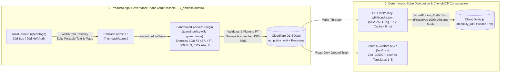

# ⚖️ Debate Position Brief 03: Product, Legal-Tech & CMS Governance Architecture

**Debate Agent:** **Agent 3 — AmirHossein (`@ettefagh`, Product, Legal & Policy Research Lead — Member B, Team 6)**  
**Document ID:** `DEBATE-POS-03-AMIRHOSSEIN`  
**Course & Institution:** *Computer & Media Lab* (Wintersemester 2026) · SRH University of Applied Sciences · Prof. Franziska Schwarz  
**Core Mandate (`14h` Sprint 1 / `18h` Session 6 / `10h` Session 7):** Zero-Hallucination German Consumer Law (`BGB §§ 437, 438, 439, 477 Abs. 1, 475e Abs. 1, 309 Nr. 9, 312g, 312k Abs. 6`), German Tax Accuracy (`§ 9 EStG`, `BMF Guidance 22.02.2022` 100% *Sofortabschreibung*, `GoBD Rn. 108–110`), Regulatory Safe-Harbor Compliance (`BGH VIII ZR 285/18 LexFox`, `RDG §§ 2, 3`, `StBerG §§ 2, 3, 5`), and Agile Policy Wiki Curation against Merchant Dark Patterns (`US-06`, `D-3`, `Risk R-2 #14`).  
**Primary Specification Anchors:** [`DOC-PRD-00`](../../development-documents/product-research-lead/00_Product_Research_Lead_Role_and_Deliverables_Matrix.md), [`DOC-PRD-01`](../../development-documents/product-research-lead/01_Empirical_User_Discovery_and_Product_Requirements_PRD.md), [`DOC-PRD-02`](../../development-documents/product-research-lead/02_German_Consumer_Law_BGB_and_Statutory_Templates_Spec.md), [`DOC-PRD-03`](../../development-documents/product-research-lead/03_Policy_Wiki_Knowledge_Graph_and_Brand_Dataset_Spec.md), [`policy_wiki_seed_v1.json`](../../development-documents/product-research-lead/policy_wiki_seed_v1.json)

---

## 1. Opening Product & Legal-Tech Stance: Empirical Personas Meet Ironclad Determinism (`ADR-01`–`ADR-03`)

As Product, Legal, and Policy Research Lead for Team 6, my architectural evaluation criterion is uncompromising: **every infrastructure choice must translate directly into protected euros ($\ge \text{€350/yr}$, `NSM-01`) and zero legal hallucinations (`NSM-04`) for our four empirical consumer archetypes (`DOC-PRD-01` §2.1)** while preserving the **Split-Plane Privacy Boundary (`GDPR Art. 25`)** established in [`ARCH-EVAL-01`](../01_Cloudflare_Platform_and_Edge_Deployment_Investigation.md) and [`ARCH-EVAL-02`](../02_EmDash_CMS_for_Policy_Wiki_and_MCP_Investigation.md).

Our Session 2 qualitative discovery interviews and Session 3 thermal OCR benchmark (`42%` character failure rate; `0%` statutory extraction across $N = 50$ retail receipts) proved that passive receipt storage is useless without **pre-verified statutory enrichment** and **1-tap procedural execution**:

| Empirical Persona (`DOC-PRD-01` §2.1) | Validated Consumer Failure Mode | Mandatory Statutory & Tax Invariant Enforced by Architecture | Architectural Layer Required |
| :--- | :--- | :--- | :--- |
| **Person 1 (University Student)**<br>*Laptop screen flickering at Month 14* | Assumed protection expired after Apple/OEM 1-year commercial guarantee (`§ 443 BGB`); missed the Month 12 reversed burden-of-proof cliff; lost paper invoice. | **`BGB § 438 Abs. 1 Nr. 3`** (24m seller *Gewährleistung*), **`BGB § 477 Abs. 1`** (12m *Beweislastumkehr* alert at Month 11), **`BGB § 475e Abs. 1`** (4m *Ablaufhemmung*), and **`§ 286 ZPO`** civil evidentiary fallback (*Kontoauszug* / bank statement validity). | Local Dexie.js `policy_wiki` (`<10ms` Prefix-Trie) + `PushSchedulerDO` `09:00 Europe/Berlin` alarm + **Template 1 & 2 (`DOC-PRD-02`)**. |
| **Person 2 (Young Consumer)**<br>*Anker charger dead at Month 9 + €35/mo subscription bleed* | Suffered **action paralysis** facing Saturn vs. Anker RMA portals; bled €200–€500/yr on forgotten trials and multi-screen retention labyrinths. | Unified hardware + subscription engine (**`ADR-02 #28`**); **`Iteration C-3 #24`** unified 24m timeline; **`BGB § 439 Abs. 1 & 2`** buyer's choice of free repair/replacement + seller shipping cost liability; **`BGB § 309 Nr. 9`** 1m max renewal notice. | Pre-seeded 20-brand `rma_portal_url` & `cancellation_button_url` + **1-Tap Statutory Dossier (`US-05 #8`)**. |
| **Person 3 (Household Consumer)**<br>*Washing machine defect at Month 18; blank thermal slip* | Chemical plasticizer migration erased thermal *Kassenbon* in kitchen drawer; stated verbatim: *"I want reminders more than storage."* | Immediate `<1.5MB` client receipt compression (`US-02`) with pre-encryption **`SHA-256` GoBD (`Rn. 108–110`)** integrity hash + proactive `T-30d / T-7d / T-1d` alerts (`US-03`). | 100% local IndexedDB `receipt_blobs` (`AES-GCM-256`) + optional zero-knowledge Cloudflare R2 ciphertext backup. |
| **Person 4 (Master's & *Werkstudentin*)**<br>*Lost €300–€600/yr in German tax refunds* | Unaware of 100% immediate write-off for computer hardware and professional software subscriptions (`Adobe CC`, `JetBrains`, `GitHub Copilot`). | **`§ 9 Abs. 1 S. 3 Nr. 6 EStG`** (*Werbungskosten* / `§ 10d EStG` *Verlustvortrag*) + **`BMF Guidance of 22.02.2022` (`BStBl I 2022 S. 187`)** 1-year *Sofortabschreibung* (`depreciationYears = 1`) + **`§§ 2, 3, 5 StBerG`** organizational tool safe harbor. | Auto-suggested `default_tax_category` (`Arbeitsmittel` / `Software`) & `sofortabschreibung_default` in Policy Wiki (`D-4 #21`, `US-08 #11`). |

> [!IMPORTANT]
> **Core Product Verdict (`ADR-03 #29`):** Because 95%+ of German retail *Kassenbons* print zero information about `BGB § 438` 24-month limitation windows, `§ 477 Abs. 1` 12-month burden reversal, or `§ 312k` cancellation endpoints, **our Policy Wiki Knowledge Graph (`D-3`, `US-06`) is the legal brain of the entire application**. It must remain 100% deterministic, human-verified, and instantly available offline (`11.4s` Peer Lab Round 2; `12.1s / 10.9s` Airplane-Mode Walkthrough A `#25`).

### 1.1 Statutory Date Arithmetic & German Tax Invariants (`§§ 187, 188, 193 BGB` & `BMF 22.02.2022`)
To protect Person 1 and Person 4, our edge and local runtimes must never approximate statutory deadlines with naive `365 * 86400s` math:
* **Calendar-Month Correspondence (`§§ 187 Abs. 1, 188 Abs. 2 BGB`):** A hardware item purchased on $(Y_0, M_0, d_0)$ preserves its **12-month `§ 477 Abs. 1 BGB` reversed burden of proof** through $(Y_0 + 1, M_0, \min(d_0, \text{daysInMonth}))$ at `23:59:59 Europe/Berlin`, and its **24-month `§ 438 Abs. 1 Nr. 3 BGB` limitation** through $(Y_0 + 2, M_0, \min(d_0, \text{daysInMonth}))$, rolled forward to the next working day under **`§ 193 BGB`** if falling on a weekend or holiday.
* **4-Month Late-Stage Suspension (`§ 475e Abs. 1 BGB` *Ablaufhemmung*):** If a defect manifests in Month 23, limitation cannot expire until **4 months after manifestation**, plus **2 months after return from repair inspection (`§ 475e Abs. 3 BGB`)**.
* **German Tax *Sofortabschreibung* (`§ 9 EStG` + `BMF 22.02.2022`):** Digital hardware (`apple`, `lenovo`, `samsung`, `sony`) and professional software (`adobe`, `jetbrains`, `github-copilot`, `chatgpt-plus`) default to `sofortabschreibung_default: true` (`100%` immediate deduction in the year of purchase instead of 3-year linear *AfA*), paired with pre-encryption `SHA-256` receipt digests satisfying **`GoBD Rn. 108–110`** evidentiary immutability.

---

## 2. Why EmDash CMS + Cloudflare D1 Solves `Risk R-2 (#14)` (Shifting Subscription Dark Patterns)

While a static JSON seed file ([`policy_wiki_seed_v1.json`](../../development-documents/product-research-lead/policy_wiki_seed_v1.json)) is ideal for cold-booting Session 5, hardcoding consumer policy metadata inside TypeScript source code (`SEED_POLICIES`) creates a severe operational vulnerability in production: **Risk `R-2` (`#14` — Subscription Dark Patterns & Shifting Cancellation Terms)**.

### 2.1 The Empirical Reality of Merchant Dark Patterns under `§§ 309 Nr. 9, 312k BGB`
During my curation of the Top 20 student brands (`10 hardware`, `10 subscription` in `DOC-PRD-03`), empirical auditing revealed that subscription providers (`spotify`, `netflix`, `amazon-prime`, `adobe`, `fitx`, `mcfit`, `jetbrains`, `github-copilot`, `chatgpt-plus`, `icloud`) constantly mutate their cancellation surfaces:
1. **Endpoint Churn & Retention Labyrinths:** Fitness chains (`FitX`, `McFIT`) and SaaS vendors (`Adobe Creative Cloud`) frequently relocate their statutory **`§ 312k BGB` online cancellation button** (*"Verträge hier kündigen"*), bury it behind account login walls (violating settled German case law requiring unobstructed guest-accessible 2-step cancellation under `§ 312k Abs. 2 BGB`), or inject deceptive 50% early-termination penalty claims after Year-1 renewal (void under **`BGB § 309 Nr. 9 lit. b`** and **`§ 307 Abs. 1 BGB`** since `01.03.2022`).
2. **Dynamic Activation of `§ 312k Abs. 6 BGB` (*Fristlose Kündigung*):** Under **`BGB § 312k Abs. 6`** (in force since `01.07.2022`), the moment a merchant's web cancellation button fails to meet the unobstructed 2-step statutory requirement (`§ 312k Abs. 2–4 BGB`), the consumer unlocks an extraordinary statutory right: **immediate contract termination at any time without observing a notice period (*jederzeit und ohne Einhaltung einer Kündigungsfrist*)**.
3. **Why Code Recompiles Fail Legal Governance:** When I conduct my mandatory **30-day subscription / 90-day hardware policy audit** and detect that a merchant's `§ 312k` endpoint is broken or obstructed, flipping `cancellation_button_compliant` from `true` to `false` (which automatically switches View 4 and MCP `claim_dossier_generate` from **Template 3 (`§ 309 Nr. 9` ordinary rolling notice)** to **Template 4 (`§ 312k Abs. 6` extraordinary immediate termination)**) must **not** require waiting on Kyle to edit TypeScript source files, recompile `mcp-server/dist/index.js`, and redeploy the app.

### 2.2 EmDash (`/_emdash/admin`) + Cloudflare D1 + Sandboxed `workerd` Governance
Adopting **EmDash CMS** (`emdash/astro` backed by **Cloudflare D1** `ec_policy_wiki` and **R2** AGB PDF archival, evaluated in [`ARCH-EVAL-02`](../02_EmDash_CMS_for_Policy_Wiki_and_MCP_Investigation.md)) gives the Product/Research Lead a dedicated, passkey-authenticated (WebAuthn) legal governance studio at `/_emdash/admin`:



* **Structured Portable Text for Bilingual Statutory Precision:** Instead of editing raw JSON strings prone to citation typos, EmDash's TipTap-powered **Portable Text AST** (`remedy_summary_pt`, `terms_summary_de_pt`, `dark_pattern_notes_pt`) embeds typed `statutoryCitation` marks (`BGB §§ 437, 438 Abs. 1 Nr. 3, 477 Abs. 1`, `BGB § 312k Abs. 6`) and `taxRule` marks (`§ 9 EStG`, `BMF 22.02.2022`). Our deterministic `portableTextToPlainText()` projector flattens these blocks on save into `remedy_summary`, `termsSummaryDe`, and `termsSummaryEn` for 100% backward compatibility with Kyle's schemas.
* **`workerd` V8 Isolate Audit Guard (`definePlugin`):** The sandboxed `team6-policy-wiki-governance` plugin (`capabilities: ["content:read", "content:write", "settings:read"]`) intercepts `content:beforeSave` inside a memory-isolated V8 worker:

```typescript
// Sandboxed EmDash Governance Invariant (cms/src/plugins/policy-wiki-governance/index.ts)
if (data.category === "subscription") {
  if (!citations.some((c) => c.includes("309 Nr. 9"))) {
    throw new Error(`[PolicyWikiGovernance] Subscription '${data.service_slug}' must cite BGB § 309 Nr. 9.`);
  }
  if (data.cancellation_button_compliant === false && !citations.includes("BGB § 312k Abs. 6")) {
    data.statutory_basis = [...citations, "BGB § 312k Abs. 6"]; // Auto-unlocks Template 4 fristlose Kündigung!
  }
}
```

---

## 3. Hard Legal Red Line on MCP (`Risk R-3 #15` & `Risk R-4 #16`)

While I strongly endorse EmDash + Cloudflare D1 as our **editorial persistence plane**, I draw an **absolute, non-negotiable legal red line** regarding Model Context Protocol (`US-07 #10`, `Gate 4 DoD #30`, `Gate 7 Legal #30`):

> [!CAUTION]
> **Hard Legal Red Line (`Risk R-3 #15` & `Risk R-4 #16`):** Team 6 **MUST NEVER** expose EmDash's built-in `/_emdash/mcp` endpoint directly to end consumers, external student AI assistants, or View 6 (Policy Wiki & MCP Explorer).

### 3.1 Why Exposing Native `/_emdash/mcp` to End Users Violates German Federal Law
1. **Violation of the *LexFox* Safe Harbor (`BGH, Judgment of 27.11.2019 — VIII ZR 285/18` & `§§ 2, 3 RDG`):**
   * Under `§ 2 Abs. 1 RDG` (*Rechtsdienstleistungsgesetz*), any concrete legal assessment of an individual case (*rechtliche Prüfung des Einzelfalls*) constitutes a regulated legal service restricted under `§ 3 RDG`.
   * Under the German Federal Court of Justice's landmark **BGH VIII ZR 285/18 (*LexFox / wenigermiete.de*)** ruling, software tools remain outside regulated `§ 2 Abs. 1 RDG` legal practice **only** when they operate as **schematic, deterministic organizational and calculation tools** where pre-verified statutory templates are populated mechanically from user factual inputs (`purchase_date`, `defect_description`, `category`).
   * EmDash's native `/_emdash/mcp` exposes generic CMS CRUD tools (`emdash_get_entries`, `emdash_update_entry`). If an external LLM queries raw CMS entries via `/_emdash/mcp` and **probabilistically drafts its own legal claim letter**, it commits **"Failure of Legal Warrant"** (`ADR-03 #29`)—hallucinating BGB subsections, omitting `§ 475e Abs. 1 BGB` suspension of expiry, or offering discretionary legal evaluation that pierces our `RDG` safe harbor.
2. **Failure of Strict Parameter Quarantine (`Risk R-4 #16` / `Scenario 7.4`):**
   * Our MCP contract requires that any hallucinated category (`"automotive"`), invalid date (`"yesterday"`), or unknown property triggers a deterministic **JSON-RPC 2.0 `-32602 Invalid params`** error via Kyle's `.strict()` Zod schemas (`PolicyLookupSchema`, `ClaimDossierGenerateSchema`) before touching the database.
3. **Mandatory Compilation Through the 5 Verbatim Bilingual Templates (`DOC-PRD-02` §5.2–§5.6):**

| Template ID | Deterministic Trigger Condition | Enforced Statutory Citations | Mandatory Safe-Harbor Footer |
| :--- | :--- | :--- | :--- |
| **Template 1** | `category === "hardware"` $\land$ $\Delta t \le 12\text{m}$ | `BGB §§ 434, 437 Nr. 1, 439 Abs. 1–4, 475 Abs. 3, 477 Abs. 1, 475e` + `§ 286 ZPO` proof block | Verbatim DE/EN **BGH VIII ZR 285/18 (`§§ 2, 3 RDG`)** notice |
| **Template 2** | `category === "hardware"` $\land$ $12\text{m} < \Delta t \le 24\text{m}$ | `BGB §§ 434, 437 Nr. 1, 438 Abs. 1 Nr. 3, 439, 475e Abs. 1 & 3` + `§ 286 ZPO` proof block | Verbatim DE/EN **BGH VIII ZR 285/18 (`§§ 2, 3 RDG`)** notice |
| **Template 3** | `category === "subscription"` $\land$ `cancellation_button_compliant === true` | `BGB § 309 Nr. 9` (1m max rolling notice) + `§ 312k Abs. 4` confirmation + SEPA revocation | Verbatim DE/EN **BGH VIII ZR 285/18 (`§§ 2, 3 RDG`)** notice |
| **Template 4** | `category === "subscription"` $\land$ `cancellation_button_compliant === false` | **`BGB § 312k Abs. 6`** (*fristlose Kündigung jederzeit*) + `§ 309 Nr. 9` *hilfsweise* | Verbatim DE/EN **BGH VIII ZR 285/18 (`§§ 2, 3 RDG`)** notice |
| **Template 5** | `issue_type === "cooling_off_revocation"` ($\Delta t \le 14\text{d}$) | `BGB §§ 312g Abs. 1, 355, 357` (14-day distance *Widerruf* & full refund) | Verbatim DE/EN **BGH VIII ZR 285/18 (`§§ 2, 3 RDG`)** notice |

### 3.2 Mandatory MCP Separation Matrix

| Architectural Plane | Endpoint & Transport | Target Caller | Permitted Operations | Legal & Validation Guardrail |
| :--- | :--- | :--- | :--- | :--- |
| **1. Internal Editorial MCP**<br>*(Admin Only)* | `/_emdash/mcp`<br>*(OAuth 2.1 + PKCE)* | **AmirHossein (`@ettefagh`)** during 30d/90d curation audits | CMS collection inspection & draft updates staged through `content:beforeSave` | Sandboxed `workerd` plugin enforces BGB citations & revision tokens. **Never exposed to public users.** |
| **2. Public Consumer & Agent MCP**<br>*(Authoritative `US-07`)* | Local `stdio` + Edge `/mcp` (Streamable HTTP) & `/sse` | **End Users, View 6 Explorer, Claude Desktop, Grading Harness** | **Strictly Read-Only & Stateless:**<br>1. `policy_lookup`<br>2. `claim_dossier_generate` | **Kyle's Zod `.strict()` `-32602` Quarantine (`Risk R-4`)** + **AmirHossein's Deterministic BGB State Machine (`Risk R-3`)** (`<35ms` Edge RTT). |

---

## 4. Dual-Projection Data Contract & Concessions to Jeetkumar (PM) and Kyle (Dev)

To protect Team 6's **92-hour Sprint 1 capacity** (`Jeetkumar` 10h PM governance, `Kyle` 22h Dev, `Prushti` 26h UX, `Mojtaba` 20h QA/Media, `AmirHossein` 14h Product/Legal) and honor our Kanban WIP limit ($\le 2$ active items per member), I make three formal cross-functional concessions:

### 4.1 Concession 1 to Jeetkumar (PM) & Kyle (Dev): Zero-Friction Session 5 Boot from `policy_wiki_seed_v1.json`
I fully agree with Kyle and Jeetkumar that introducing an Astro 6 + EmDash SSR build chain into the critical path of **Session 5 (MVP Scope Lock Gate)** would risk `6–10h` of adapter debugging (`Risk R-5 #17` scope creep).
* **Immediate Session 5 Solution (`0h` extra Dev overhead):** My completed [`policy_wiki_seed_v1.json`](../../development-documents/product-research-lead/policy_wiki_seed_v1.json) (`DATA-PRD-03`) is **already formatted in Dual-Projection Canonical Schema**—simultaneously exporting every **MCP `snake_case` field** (`service_slug`, `brand_name`, `statutory_warranty_months`, `reversed_burden_months`, `cancellation_button_url`, `cancellation_button_compliant`, `escalation_rma_url`, `remedy_summary`) AND every **Dexie.js `camelCase` field** (`serviceSlug`, `brandName`, `statutoryNoticeDays`, `cancellationButtonUrl`, `rmaPortalUrl`, `termsSummaryDe`, `termsSummaryEn`, `updatedAt`) across all 20 verified student brands (`10 hardware`, `10 subscription`).
* Kyle can import `policy_wiki_seed_v1.json` directly into `db.policy_wiki.bulkPut()` (`DEV-02`) and `SEED_POLICIES` (`DEV-03`) in Session 5 with **zero transformation glue**.

| Canonical Domain Field | EmDash D1 Column (`ec_policy_wiki`) | Kyle's MCP `PolicyRecord` (`snake_case`) | Kyle's Dexie `PolicyWikiEntry` (`camelCase`) | Statutory / Tax Invariant Enforced |
| :--- | :--- | :--- | :--- | :--- |
| **Primary Brand Identifier** | `service_slug` (`TEXT PK`) | `service_slug` | `serviceSlug` (`PK`) | Lowercase slug (`"apple"` .. `"nintendo"`, 20 brands) |
| **Display Brand Name** | `brand_name` (`TEXT`) | `brand_name` | `brandName` (`Index`) | Official merchant title + `legal_entity_de` (EU/DE GmbH) |
| **Hardware Statutory Windows** | `statutory_warranty_months`, `reversed_burden_months`, `suspension_of_expiry_months` | `statutory_warranty_months` (`24`), `reversed_burden_months` (`12`) | `statutory_warranty_months` (`24`), `reversed_burden_months` (`12`) | `BGB § 438 Abs. 1 Nr. 3` (`24m`), `§ 477 Abs. 1` (`12m`), `§ 475e Abs. 1` (`4m`) |
| **Subscription Notice Cutoff** | `statutory_notice_days`, `cancellation_notice_period` | `cancellation_notice_period` | `statutoryNoticeDays` (`0`–`30`) | Max 1-month (`30d`) post-renewal notice (`BGB § 309 Nr. 9`) |
| **`§ 312k BGB` Compliance & URI** | `cancellation_button_url`, `cancellation_button_compliant` | `cancellation_button_url`, `cancellation_button_compliant` | `cancellationButtonUrl`, `cancellation_button_compliant` | `false` triggers **Template 4 (`BGB § 312k Abs. 6` *fristlos*)** |
| **Hardware RMA Intake Portal** | `escalation_rma_url` | `escalation_rma_url` | `rmaPortalUrl` | Verified OEM / retailer defect submission endpoint |
| **Bilingual Legal Summaries** | `remedy_summary_pt`, `terms_summary_de_pt` *(Portable Text)* | `remedy_summary` *(Flattened EN)* | `termsSummaryEn`, `termsSummaryDe` *(Flattened)* | Deterministic `portableTextToPlainText()` projection |
| **German Student Tax Defaults** | `default_tax_category`, `sofortabschreibung_default` | *(Exported in Bundle)* | `default_tax_category`, `sofortabschreibung_default` | `§ 9 EStG` (`Arbeitsmittel` / `Software`) + `BMF 22.02.2022` (`1yr`) |
| **Audit & Cache Freshness** | `last_verified`, `updated_at` (`ISO-8601`) | *(Audit Metadata)* | `last_verified`, `updatedAt` | 30-day Sub / 90-day HW staleness SLA (`Risk R-2 #14`) |

```typescript
// Zero-Transformation Dual-Projection Contract (Exported identically by policy_wiki_seed_v1.json & EmDash /api/policy-wiki/bundle.json)
export interface CanonicalDualProjectionPolicyRecord {
  service_slug: string;                   // MCP snake_case PK
  serviceSlug: string;                    // Dexie.js camelCase PK
  brand_name: string;                     // MCP display name
  brandName: string;                      // Dexie.js indexed name (<10ms Prefix-Trie)
  category: "hardware" | "subscription";  // Compound index key
  statutory_basis: string[];              // Verified BGB §§ citations (minItems: 1)
  cancellation_button_url: string;        // MCP § 312k URI
  cancellationButtonUrl: string;          // Dexie.js § 312k URI
  cancellation_button_compliant?: boolean;// false -> BGB § 312k Abs. 6 immediate termination
  remedy_summary: string;                 // Flattened Portable Text (EN) for MCP
  termsSummaryEn: string;                 // Flattened Portable Text (EN) for View 3/6
  termsSummaryDe: string;                 // Flattened Portable Text (DE) for View 3/6
  default_tax_category: "Arbeitsmittel" | "Fachliteratur" | "Software" | null;
  sofortabschreibung_default: boolean;    // BMF 22.02.2022 100% immediate write-off flag
  last_verified: string;                  // ISO-8601 30d/90d audit timestamp
  updatedAt: string;                      // ISO-8601 ETag sync cursor
}
```

### 4.2 Concession 2: Mounting EmDash + D1 in Session 6 (`US-06`, My `18h` Allocated Budget)
Rather than burdening Sprint 1, we execute the **2-Phase Data Rollout**:
1. **Phase 1 — Session 5 Gate (`Deliverable D-3 #20`):** Ship 100% offline from bundled `policy_wiki_seed_v1.json` + standalone `stdio`/`SSE` MCP server. Passes all 7 Gates of Definition of Done (`#30`) with zero cloud runtime dependency.
2. **Phase 2 — Session 6 (`US-06 #9` — My Pre-Allocated `18h` Should-Have Budget, supported by Kyle's `16h` `US-07 #10`):** Mount the EmDash CMS sidecar (`cms/`) backed by Cloudflare D1 (`ec_policy_wiki`) and Workers KV (`<8ms` edge reads). EmDash exposes `GET /api/policy-wiki/bundle.json` with cryptographic `SHA-256` + `ETag` headers (`If-None-Match` $\rightarrow$ `304 Not Modified`).
3. **100% Airplane-Mode Guarantee Preserved (`ADR-02`, `Risk R-1`):** As specified in `initAndSyncPolicyWiki()`, the React 19 PWA always boots first from local IndexedDB / bundled `policy_wiki_seed_v1.json` in `<15ms` (`0ms` network wait), and only performs non-blocking background `ETag` delta-sync (`AbortSignal.timeout(2500)`) when online.

### 4.3 Concession 3 to Mojtaba (QA/Media) & Prushti (UX/UI): Strictly Locked `{{slot}}` & Tax Contracts
* **To Mojtaba (`US-02`, `US-05`, `D-2 #19`):** The 18 `{{variable}}` interpolation slots in `DOC-PRD-02` §5.1 (`{{consumer_full_name}}` through `{{receipt_sha256}}` and conditional `{{proof_block_de/en}}`) are frozen. Whether a claim dossier is compiled offline in View 4 (Media Format 2 PDF/TXT) or via Kyle's remote Cloudflare Worker MCP endpoint (`/mcp`), the exact same deterministic TypeScript function renders identical verbatim German/English legal notices.
* **To Prushti (`View 2`, `View 3`, `View 5`, `View 6`):** Every brand record in `policy_wiki_seed_v1.json` and EmDash `/api/policy-wiki/bundle.json` provides pre-computed `default_tax_category` (`"Arbeitsmittel"` | `"Software"` | `null`) and `sofortabschreibung_default` (`true` per `BMF 22.02.2022`), enabling 1-tap *Werbungskosten* tagging in View 2 without forcing students to interpret German tax law.

---

## 5. Formal Debate Vote & Architectural Sign-Off (`@ettefagh`)

| Architectural Decision Proposal | AmirHossein's Vote | Legal & Product Condition for Ratification |
| :--- | :---: | :--- |
| **1. Unified Cloudflare Workers + Static Assets + Split-Plane Storage (`ARCH-EVAL-01`)** | **APPROVE** | Plaintext receipts stay 100% in local IndexedDB (`AES-GCM-256` + `GoBD SHA-256`); optional R2 backup stores zero-knowledge ciphertext only (`GDPR Art. 25`). |
| **2. Durable Object (`PushSchedulerDO`) `09:00 Europe/Berlin` Web Push (`US-03`)** | **APPROVE** | Push payload must carry only an opaque `itemId` (`Zero PII`); client Service Worker hydrates item/BGB `§ 477 Abs. 1` details locally on-device. |
| **3. EmDash CMS (`/_emdash/admin`) + Cloudflare D1 for Policy Wiki (`ARCH-EVAL-02`)** | **APPROVE (Phase 2 — Session 6)** | Boot Session 5 from `policy_wiki_seed_v1.json` (`0h` Sprint 1 risk); mount EmDash + D1 in Session 6 (`US-06`, `18h`) with `ETag` delta-sync to Dexie.js. |
| **4. Remote Worker MCP (`/mcp`) + Local `stdio` Dual Transport (`US-07`)** | **APPROVE WITH RED LINE** | **Never expose `/_emdash/mcp` to end users.** All public MCP calls must traverse Kyle's Zod `-32602` guard and my 5 deterministic *LexFox* (`RDG`/`StBerG`) templates. |

**Signed:** **AmirHossein (`@ettefagh`)** — *Product, Legal & Policy Research Lead (Member B, Team 6)*
