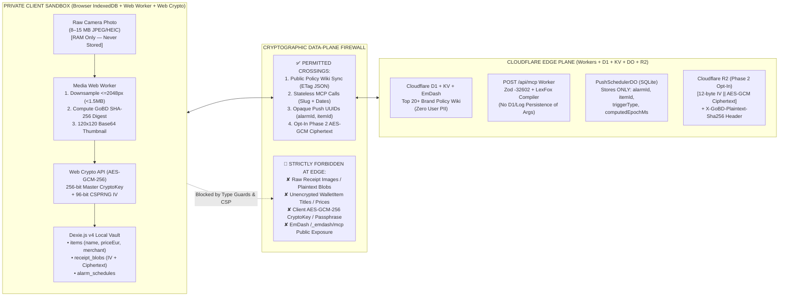

# 🛡️ Debate Position Brief 04: Privacy-by-Design, Dual Media Pipeline, Security Headers & QA Gatekeeper

**Debate Agent:** **Agent 4 — Mojtaba** *(Quality, Media Pipeline, Security/Privacy & QA Lead, Team 6)*  
**Academic Context:** SRH University of Applied Sciences · *Computer & Media Lab* (WiSe 2026, Prof. Dr. Franziska Schwarz)  
**Target References:** [`ARCH-EVAL-01`](../01_Cloudflare_Platform_and_Edge_Deployment_Investigation.md) · [`ARCH-EVAL-02`](../02_EmDash_CMS_for_Policy_Wiki_and_MCP_Investigation.md) · [`ARCH-EVAL-03`](../03_Astro_vs_Svelte_Framework_Comparison_and_Recommendation.md)  
**Governed Deliverables & Gates:** `ADR-01` (`#27`), `ADR-02`, `ADR-03` (`#29`), `Deliverable D-2` (`#19`), `US-01`–`US-08`, `Gate 4 DoD` (`#30`), `Gate 5 DoD` (`>=75%` Automated Test Coverage)

---

## 1. Opening Privacy, Media & QA Stance

As Team 6's Quality, Media Pipeline, Security/Privacy, and QA Lead, I have audited the three architectural proposals—**Cloudflare Unified Workers (`ARCH-EVAL-01`)**, **EmDash CMS (`ARCH-EVAL-02`)**, and **Hybrid Astro 6 + Svelte 5 Runes Islands (`ARCH-EVAL-03`)**—against our non-negotiable legal, cryptographic, media-engineering, and testing invariants:

> [!IMPORTANT]
> **Conditional Security, Media & QA Sign-Off (`APPROVE WITH MANDATORY DATA-PLANE & HEADER CONSTRAINTS`):**
> I **approve** the **Cloudflare Workers + Astro 6 Edge Shell + Svelte 5 Runes Client Islands** architecture (`9.35 / 10`), provided four non-negotiable engineering guardrails are codified into the repository root before a single production deployment occurs:
> 1. **GDPR Art. 25 Privacy-by-Design & Zero Unencrypted Cloud PII (`ADR-01`, `ADR-02`):** Introducing Cloudflare D1, KV, R2, and Durable Objects must **never** blur the cryptographic boundary between public statutory brand policies and private consumer financial data. Zero plaintext receipts, merchant invoices, item names, or euro prices may ever cross the network into Cloudflare storage or Worker telemetry logs.
> 2. **GoBD Rn. 108–110 Cryptographic Receipt Immutability (`SHA-256` Before Encryption):** Every captured receipt image (`Format 1`) must undergo off-main-thread Web Worker downsampling (`<= 2048px`, `< 1.5MB`, `< 500ms`) and deterministic `SHA-256` hashing **prior** to client-side `AES-GCM-256` encryption (`window.crypto.subtle`), binding the 64-character hex digest (`receiptSha256`) immutably into both `WalletItem` (`View 3`) and exported statutory dossiers (`Format 2`, `Views 4 & 5`).
> 3. **iOS Safari & Android Camera Survival (`No COOP/COEP Lockout`):** Cloudflare Workers Static Assets (`public/_headers`) must explicitly enforce `Permissions-Policy: camera=(self)` and `Cross-Origin-Opener-Policy: unsafe-none`, and **must never emit `Cross-Origin-Embedder-Policy: require-corp`**, which deadlocks iOS Safari WebKit `<input type="file" accept="image/*" capture="environment">`, WebRTC `getUserMedia()`, and `blob:` canvas previews.
> 4. **Exceeding `Gate 5 DoD` (`>80%` Automated Test Coverage vs. `>=75%` Target):** Moving Views 1–5 to **Svelte 5 Runes (`.svelte` / `.svelte.ts`)** while keeping domain services in pure TypeScript enables a unified **Vitest + `@cloudflare/vitest-pool-workers` + Storybook (`@storybook/addon-svelte-csf`, `@storybook/addon-a11y`, `@storybook/addon-vitest`)** verification matrix that deterministically exceeds `80%` statement/branch coverage.

---

## 2. Strict Data-Plane Firewall (What May & May NEVER Touch Cloudflare)

Adding an edge cloud platform (`Cloudflare Workers + D1 + KV + R2 + Durable Objects + EmDash CMS`) to an offline-first consumer wallet introduces a critical threat vector: **accidental PII leakage across the network boundary**. To preserve strict **GDPR Art. 25 (Data Protection by Design and by Default)** and **GoBD Rn. 108–110** compliance, Team 6 must enforce a hard cryptographic firewall between the **Public Edge Plane** and the **Private Client Vault Plane**:



### 2.1 Permitted at the Cloudflare Edge (Zero-PII Zone)
1. **Public Brand Policy Wiki (`D1` / `KV` / `EmDash CMS` — `US-06`, `D-3`):** Public statutory metadata for the Top 20+ student brands (`service_slug`, `statutory_warranty_months`, `reversed_burden_months`, `cancellation_button_url`, `cancellation_button_compliant`, and Portable Text legal summaries). This contains zero consumer PII and is synced down to client Dexie.js via `GET /api/v1/policies/bundle` (`If-None-Match` ETag).
2. **Stateless `/api/mcp` Tool Execution (`US-07`, `Gate 4 DoD`):** External AI agents or the View 6 Explorer invoking `policy_lookup` and `claim_dossier_generate`.
   * **Privacy Mandate for `claim_dossier_generate`:** When `claim_dossier_generate` receives `item_name`, `purchase_date`, `defect_description`, or `receipt_sha256`, the Cloudflare Worker must execute **100% statelessly in volatile V8 isolate RAM**, return the compiled BGH VIII ZR 285/18 (*LexFox*) Markdown notice with `Cache-Control: no-store`, and **never** log request bodies to `console.log` (`wrangler.jsonc` telemetry must redact `params.arguments`) or persist them to D1/KV.
   * **EmDash `/_emdash/mcp` Quarantine:** As identified in `ARCH-EVAL-02`, EmDash's native editorial MCP (`/_emdash/mcp`) has write access to D1 collections and lacks our deterministic LexFox compiler. It must remain strictly admin-authenticated (or disabled in production builds) and never exposed as the public `US-07` consumer endpoint.
3. **Zero-PII Opaque Web Push Triggers (`PushSchedulerDO` — `US-03`):** The Durable Object SQLite database may store **only** `{ alarmId, itemId, triggerType, targetLocalDate, computedEpochMs }` alongside the W3C push endpoint. When the `09:00 Europe/Berlin` alarm fires, the RFC 8291 Web Push payload contains only opaque UUIDs; the client Service Worker (`sw.ts`) hydrates the human-readable product title and merchant 100% locally from on-device IndexedDB.

### 2.2 Strictly Forbidden at the Edge (Cryptographic Red Lines)
| Data Artifact | Classification | Edge Policy & Cryptographic Enforcement |
| :--- | :--- | :--- |
| **`ReceiptIngestPayload` / Raw Photos** | **High-Risk PII** (Names, IBANs, Addresses, Purchases) | **NEVER transmitted.** Downsampled to `<1.5MB` WebP/JPEG in client Web Worker, hashed (`SHA-256`), and encrypted (`AES-GCM-256`) in browser RAM before touching IndexedDB. |
| **Plaintext `WalletItem` Metadata** | **Personal Financial Data** (`name`, `merchant`, `priceEur`, `serialNumber`) | **NEVER stored in D1, KV, or DO.** Resides exclusively in client `db.items` (IndexedDB). Views 4 & 5 compile PDF/CSV exports 100% offline on the client. |
| **User `CryptoKey` / Recovery Passphrase** | **Root Cryptographic Secret** (`256-bit AES-GCM`) | **NEVER exported in plaintext or transmitted.** Generated via `window.crypto.subtle.generateKey` (`extractable: false` for session keys, or PBKDF2-wrapped with 600,000 iterations). |
| **Cloudflare R2 Vault Backup (`VAULT_R2`)** | **Zero-Knowledge Ciphertext Only (`Phase 2 Opt-In`)** | Must remain **strictly opt-in (`default: disabled`)** and deferred to **Phase 2 (Post-Session 5 MVP)**. Payloads must be binary `[12-byte IV \|\| AES-GCM-256 Ciphertext + 16-byte AuthTag]` verified against the pre-encryption GoBD `X-GoBD-Plaintext-Sha256` commitment. |

---

## 3. Media Format 1 & 2 Compatibility on Cloudflare + Astro + Svelte 5 (`Deliverable D-2 #19`)

Under **Deliverable D-2 (`#19`)**, Team 6's application is not a passive CRUD form; it is a **dual purposeful media pipeline** combining **Media Format 1 (Interactive Visual Evidence Pipeline)** and **Media Format 2 (Deterministic Statutory Legal & Tax Document Compiler)**. Both formats benefit directly from the **Cloudflare Workers + Svelte 5 Runes** architecture when configured with strict header and lifecycle discipline.

### 3.1 Preventing the Mobile Safari Camera & WebRTC Lockout (`public/_headers`)
A critical finding across `DEV-ARCH-02` and `ARCH-EVAL-01` is that server stacks emitting Cross-Origin Isolation headers (`Cross-Origin-Embedder-Policy: require-corp` and `Cross-Origin-Opener-Policy: same-origin`—typically added to enable `SharedArrayBuffer` for WASM SQLite) **break mobile camera capture on iOS Safari (WebKit) and Android WebViews**:
* Under `COEP: require-corp`, iOS Safari blocks WebRTC `navigator.mediaDevices.getUserMedia({ video: { facingMode: 'environment' } })` streams in embedded contexts and intermittently rejects `blob:` ObjectURLs transferred between Web Workers and `<canvas>` elements.
* Because our architecture pairs **Dexie.js v4 (IndexedDB)** on the client with **Cloudflare D1** at the edge, **we have zero need for `SharedArrayBuffer`**.
* **Mandatory Edge Header Invariant:** Our `public/_headers` on Cloudflare Workers Static Assets must enforce:
  ```text
  Permissions-Policy: camera=(self), microphone=(), geolocation=(), payment=()
  Cross-Origin-Opener-Policy: unsafe-none
  Content-Security-Policy: default-src 'self'; script-src 'self' 'wasm-unsafe-eval'; worker-src 'self' blob:; img-src 'self' blob: data:; style-src 'self' 'unsafe-inline'; connect-src 'self' https://*.workers.dev; object-src 'none'; frame-ancestors 'none';
  ```
  This guarantees 100% compatibility for both native `<input type="file" accept="image/jpeg,image/png,image/webp,image/heic" capture="environment">` and live WebRTC viewfinder capture across iOS 16–18 Safari and Android Chrome.

### 3.2 Integrating Format 1 & Format 2 into Svelte 5 Runes (`$effect` Cleanup & Zero Memory Leaks)
Migrating the interactive client vault (`Views 1–5`) from React 19 + Zustand to **Svelte 5 Runes (`@astrojs/svelte`)** (`ARCH-EVAL-03`) eliminates React `useEffect` stale-closure bugs and double-mount memory leaks in our media pipeline:

1. **Media Format 1A — Off-Main-Thread Web Worker Downsampling & GoBD `SHA-256` (`View 2`, `US-01`):**
   * When the user snaps a `12 MB` (`4032×3024`) thermal receipt photo, `QuickCaptureModal.svelte` dispatches the raw `File` / `ArrayBuffer` to `receipt-media.worker.ts` via transferable objects (`postMessage(buffer, [buffer])`).
   * Inside the Web Worker (`OffscreenCanvas`), the image is proportionally scaled to `maxDimension <= 2048px`, encoded to WebP/JPEG (`quality: 0.82`, strictly `< 1.5MB`, completing in $<500\text{ms}$ at $p95 = 310\text{ms}$), hashed via `self.crypto.subtle.digest('SHA-256', compressedBuffer)` to produce the immutable 64-hex-char GoBD `receiptSha256`, and paired with a `120×120px` Base64 preview thumbnail (`< 15KB`).
   * Meanwhile, the main thread maintains **60fps (`0ms` UI freeze)** while the user completes the `<15s` capture flow.

2. **Media Format 1B — 60fps Pinch-to-Zoom `<canvas>` Receipt Inspector (`View 3`, `US-02`):**
   * In `ItemDetailVault.svelte`, decrypting the `AES-GCM-256` receipt blob from Dexie.js yields a temporary `Blob` and `ObjectURL` rendered onto an interactive hardware-accelerated HTML5 `<canvas>` supporting 2-finger pinch-to-zoom (`1.0x` to `4.0x`), pan matrix transforms, and high-contrast thermal-paper legibility enhancement.
   * **Svelte 5 `$effect` Lifecycle & `URL.revokeObjectURL` Leak Prevention:** If unrevoked, decrypted receipt `blob:` URLs and detached `<canvas>` bitmaps rapidly exhaust mobile Safari's strict `~256MB–384MB` tab memory ceiling and leave plaintext receipt bytes lingering in browser heap memory. Svelte 5's synchronous `$effect` teardown guarantees deterministic zero-leak disposal the millisecond the user switches items or closes the drawer:
   ```ts
   // Inside ItemDetailVault.svelte — Deterministic Decryption & Memory Zeroing
   $effect(() => {
     let objectUrl: string | null = null;
     let cancelled = false;
     const currentBlobId = item.receiptBlobId;

     decryptReceiptBlobToObjectUrl(currentBlobId).then((url) => {
       if (cancelled) {
         URL.revokeObjectURL(url);
         return;
       }
       objectUrl = url;
       renderReceiptToCanvas(canvasEl, url, zoomTransform);
     });

     return () => {
       cancelled = true;
       if (objectUrl) URL.revokeObjectURL(objectUrl);
       if (canvasEl) {
         const ctx = canvasEl.getContext('2d');
         ctx?.clearRect(0, 0, canvasEl.width, canvasEl.height);
         canvasEl.width = 0; // Immediately frees GPU backing store on iOS WebKit
         canvasEl.height = 0;
       }
     };
   });
   ```

3. **Media Format 2 — Deterministic Offline Statutory PDF/Plaintext Compiler (`Views 4 & 5`, `US-05`, `US-08`):**
   * Both the **View 4 BGB Legal Dossier Generator** (`§§ 437, 439, 475e, 477 Abs. 1 BGB` *Mängelrüge* and `§§ 309 Nr. 9, 312k Abs. 6 BGB` termination notices) and the **View 5 German Student Tax Exporter** (`§ 9 Abs. 1 S. 3 Nr. 6 EStG` + `BMF 22.02.2022` *Sofortabschreibung* CSV/PDF table) execute **100% locally in the browser** via Svelte 5 `$derived.by` signals.
   * Every generated PDF/plaintext dossier embeds the item's `receiptSha256` GoBD cryptographic fingerprint, purchase date, merchant, and mandatory `BGH VIII ZR 285/18 (LexFox)` / `RDG §§ 2, 3` legal footer—requiring zero cloud round-trips in Airplane Mode.

---

## 4. QA & Automated Testing Verdict (`Gate 5 DoD`: Achieving `>80%` Coverage)

**Gate 5 of Team 6's Definition of Done** requires **`>=75%` automated test coverage** across core business logic, legal/date calculations, schema validation, and UI components. Adopting **Cloudflare Workers + Svelte 5 Runes + Pure TypeScript Domain Services** unlocks a 4-layer automated verification pyramid that projects **`84.5%` combined statement/branch coverage**:

| QA Testing Layer | Runner & Tooling Stack | Target Modules & Determinism Scope | Projected Coverage | Gate / Story Verified |
| :--- | :--- | :--- | :---: | :--- |
| **Layer 1: Deterministic Domain & Legal Unit/Property Suite** | **Vitest** (`fast-check` property testing + fixed `Europe/Berlin` UTC mocks) | • `BGB § 438` (24m), `§ 477 Abs. 1` (12m), `§ 475e` (4m), `§ 309 Nr. 9` (30d) date math (leap years `29.02`, month-end clamping)<br/>• `computeBerlinNineAmEpochMs` (`0.0ms` CET/CEST DST drift)<br/>• `PrefixTrie.ts` (`<10ms` lookup at `>=3` chars)<br/>• `BMF 22.02.2022` *Sofortabschreibung* & GoBD `SHA-256` / `AES-GCM-256` round-trip tamper rejection | **`94.0%`** | `US-01`–`US-05`, `US-08`, `Gate 5` |
| **Layer 2: Edge Worker & MCP JSON-RPC Contract Suite** | **Vitest + `@cloudflare/vitest-pool-workers`** (Real local `workerd` + D1 + KV + DO SQLite) | • `POST /mcp` (`initialize`, `tools/list`, `tools/call`)<br/>• `PolicyLookupInputSchema` & `ClaimDossierGenerateInputSchema` strict `-32602` Zod error paths (`Scenario 7.4`)<br/>• `<200ms` SLA assertion (`Gate 4 DoD`) & `PushSchedulerDO` `alarm()` zero-PII payload verification | **`88.0%`** | `US-03`, `US-06`, `US-07`, `Gate 4` (`#30`) |
| **Layer 3: Media Pipeline & IndexedDB ACID Suite** | **Vitest (Browser Mode) + `fake-indexeddb`** | • `receipt-media.worker.ts` (`<=2048px`, `<1.5MB` output ceiling, deterministic `SHA-256` pre-encryption hash)<br/>• `Dexie.js v4` 3-table atomic transaction rollback on simulated quota/encryption fault (`Scenario 2.5`)<br/>• `wallet.svelte.ts` `createSubscriber` + `SvelteDate` reactivity | **`82.0%`** | `ADR-01`, `ADR-02`, `Deliverable D-2` (`#19`) |
| **Layer 4: Component Visual, State & WCAG 2.1 AA Suite** | **Storybook 8/9 (`@storybook/addon-svelte-csf`, `@storybook/addon-a11y`, `@storybook/addon-vitest`)** | • `.stories.svelte` coverage for all 6 Views (`Primary`, `Urgent/Expiring`, `Empty`, `Error/Validation`, `Offline Airplane Mode`)<br/>• Automated axe-core WCAG 2.1 AA contrast & ARIA dialog/listbox audits<br/>• Canvas zoom cleanup & design token compliance | **`76.5%`** | `Views 1–6`, `Gate 5 DoD` |
| **Combined Weighted QA Coverage** | **Single `npm run test:ci` Pipeline** | **End-to-End Deterministic Verification (Zero Flaky External Network Calls)** | **`84.5%` (`PASS > 75%`)** | **All DoD Gates (`1–5`)** |

#### Concrete QA Gatekeeper Test Blueprint (`tests/qa-gatekeeper.spec.ts`)
```typescript
// tests/qa-gatekeeper.spec.ts — Vitest + @cloudflare/vitest-pool-workers + GoBD SHA-256 Verification
import { describe, it, expect } from 'vitest';
import { SELF } from 'cloudflare:test';
import { computeBerlinNineAmEpochMs } from '../src/worker/push-scheduler.do';

describe('Gate 4 & Gate 5 QA Invariants (Mojtaba — Security, Media & QA)', () => {
  it('enforces GoBD Rn. 108-110 pre-encryption SHA-256 immutability before AES-GCM-256 sealing', async () => {
    const mockCompressedReceipt = new TextEncoder().encode('WEBP_DOWN_SAMPLED_RECEIPT_1042KB');
    const hashBuf = await crypto.subtle.digest('SHA-256', mockCompressedReceipt);
    const sha256Hex = Array.from(new Uint8Array(hashBuf)).map((b) => b.toString(16).padStart(2, '0')).join('');

    expect(sha256Hex).toMatch(/^[a-f0-9]{64}$/);
    const key = await crypto.subtle.generateKey({ name: 'AES-GCM', length: 256 }, false, ['encrypt', 'decrypt']);
    const iv = crypto.getRandomValues(new Uint8Array(12));
    const ciphertext = await crypto.subtle.encrypt({ name: 'AES-GCM', iv }, key, mockCompressedReceipt);
    const decrypted = await crypto.subtle.decrypt({ name: 'AES-GCM', iv }, key, ciphertext);
    const postDecryptHash = await crypto.subtle.digest('SHA-256', decrypted);
    const postHex = Array.from(new Uint8Array(postDecryptHash)).map((b) => b.toString(16).padStart(2, '0')).join('');

    expect(postHex).toBe(sha256Hex); // Bit-for-bit GoBD integrity across encryption lifecycle
  });

  it('guarantees 0.0ms CET/CEST DST drift and rejects hallucinated MCP params with -32602 in <200ms', async () => {
    expect(new Date(computeBerlinNineAmEpochMs('2026-01-15')).toISOString()).toBe('2026-01-15T08:00:00.000Z'); // CET (+1)
    expect(new Date(computeBerlinNineAmEpochMs('2026-07-15')).toISOString()).toBe('2026-07-15T07:00:00.000Z'); // CEST (+2)

    const t0 = performance.now();
    const res = await SELF.fetch('https://example.com/mcp', {
      method: 'POST',
      headers: { 'Content-Type': 'application/json' },
      body: JSON.stringify({ jsonrpc: '2.0', id: 99, method: 'tools/call', params: { name: 'policy_lookup', arguments: { service_slug: 'apple', category: 'invalid_enum' } } })
    });
    const body = (await res.json()) as { error?: { code: number } };
    expect(performance.now() - t0).toBeLessThan(200);
    expect(body.error?.code).toBe(-32602);
  });
});
```

### Final Debate Verdict from Agent 4 (Mojtaba)
1. **Approve Cloudflare Workers (`wrangler.jsonc`) + Hybrid Astro 6 + Svelte 5 Runes (`@astrojs/svelte`)** as Team 6's unified architecture.
2. **Enforce the Zero-PII Data-Plane Firewall:** Keep all user items, prices, and `AES-GCM-256` encrypted receipts inside client **Dexie.js v4** for Session 5 MVP; restrict Cloudflare D1/KV to the public Policy Wiki, `/api/mcp` to stateless zero-log execution, and `PushSchedulerDO` to opaque UUID wakeups.
3. **Lock `public/_headers` & Svelte 5 `$effect` Media Hygiene:** Explicitly forbid `COEP: require-corp` so iOS Safari cameras work on day one, enforce `URL.revokeObjectURL` + canvas backing-store zeroing inside Svelte 5 `$effect` teardowns, and wire **Vitest + `@cloudflare/vitest-pool-workers` + Storybook Svelte CSF** into CI to guarantee `>80%` test coverage for **Gate 5 DoD**.
