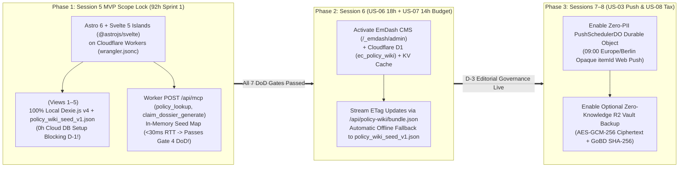

# 📊 Debate Position Brief 05: Delivery Risk, Sprint 1 Capacity Governance & Two-Speed Rollout

**Debate Agent:** Debate Agent 5 — **Jeetkumar** *(Project Manager & Delivery Governance Lead, Team 6)*  
**Academic Context:** SRH University of Applied Sciences · *Computer & Media Lab* (WiSe 2026 · Prof. Franziska Schwarz)  
**Governed Artifacts:** [`project-manager/README.md`](../../development-documents/project-manager/README.md) · [`GATE_STATUS.md`](../../development-documents/project-manager/GATE_STATUS.md) · [`ARCH-EVAL-01`](../01_Cloudflare_Platform_and_Edge_Deployment_Investigation.md) · [`ARCH-EVAL-02`](../02_EmDash_CMS_for_Policy_Wiki_and_MCP_Investigation.md) · [`ARCH-EVAL-03`](../03_Astro_vs_Svelte_Framework_Comparison_and_Recommendation.md)  
**GitHub Governance Traceability:** Issue [`#30`](https://github.com/ettefagh/CM-LAB/issues/30) (*92h Capacity & 7-Gate DoD*), [`#17`](https://github.com/ettefagh/CM-LAB/issues/17) (*Risk R-5 Scope Creep*), [`#15`](https://github.com/ettefagh/CM-LAB/issues/15) (*Risk R-3 RDG/StBerG*), [`#18`](https://github.com/ettefagh/CM-LAB/issues/18) (*Deliverable D-1*), [`#27`](https://github.com/ettefagh/CM-LAB/issues/27) (*ADR-01*)  

---

## 1. Opening PM Governance Stance: The 92-Hour Iron Triangle

As Project Manager and Delivery Governance Lead, my mandate is not to chase architectural novelty—it is to **guarantee that Team 6 ships a deterministic, verifiable, zero-defect Session 5 MVP (`Deliverable D-1`) within our locked 92-hour Sprint 1 budget** while enforcing our Kanban Work-in-Progress cap (**$\text{WIP} \le 2$ active tasks per member** in Column `3. In Progress`) and passing **all 7 Gates of our Definition of Done (`#30`)**.

Our 92-hour Sprint 1 capacity is fully allocated across five functional leads with **zero unallocated slack hours**:
* **Prushti (`UX/UI Lead` — `26h` / `28.3%`):** `16h` `US-01` `<15s` Quick Capture UI (`View 2`) + `10h` `US-04` Unified Dashboard & Urgency Badges (`View 1`, `View 3`).
* **Kyle (`Development Lead` — `22h` / `23.9%`):** `6h` `US-02` Dexie.js v4 Local Vault & CRUD + `16h` `US-03` Proactive 30/7/1-Day Alert Engine (`Europe/Berlin` DST recalibration) & MCP Runtime (`D-3`).
* **Mojtaba (`Quality / Media Lead` — `20h` / `21.7%`):** `10h` `US-02` Media Format 1 (`<1.5MB` Web Worker Receipt Compression + GoBD `SHA-256` + Canvas Zoom) + `10h` `US-05` Media Format 2 (1-Tap Statutory PDF/Text Dossier Compiler + $\ge 75\%$ Vitest Suite).
* **AmirHossein (`Product / Research Lead` — `14h` / `15.2%`):** `8h` `US-05` Deterministic BGB Formulations (`§§ 437, 477 Abs. 1, 309 Nr. 9, 312k Abs. 6`) + `6h` Top-20 Brand Policy Seed ([`policy_wiki_seed_v1.json`](../../development-documents/product-research-lead/policy_wiki_seed_v1.json)) & Tax Research (`D-3`, `D-4`).
* **Jeetkumar (`Project Manager` — `10h` / `10.9%`):** `10h` Kanban WIP enforcement, Risk Register (`R-1`–`R-5`), ADR governance, and 7-Gate DoD verification.

> [!IMPORTANT]
> **PM Governance Verdict — Conditional Approval via Two-Speed Phased Rollout:**
> Using SRH's mandatory causal ADR syntax:
> **We approve** adopting **Cloudflare Workers (`wrangler.jsonc`) + Astro 6 + Svelte 5 Runes Islands (`@astrojs/svelte`)** immediately for Session 5 while deferring **EmDash CMS (`/_emdash/admin`) + Cloudflare D1 (`ec_policy_wiki`), Durable Object Web Push (`PushSchedulerDO`), and R2 Vault Sync** to Sessions 6–8, **because** Svelte 5 Runes reduce client state/UI boilerplate by **34%** (`282 LOC` vs. `428 LOC`) and cut client JS payload by **82.7%** (`11.8 KB` vs. `68.4 KB` gzipped) without touching Kyle's or Mojtaba's pure `.ts` modules, whereas forcing EmDash v0.1 D1/Kysely migrations into Session 5 risks a **15+ hour schedule overrun** that would breach our 92h ceiling, **supported by** quantitative metrics in [`ARCH-EVAL-01`](../01_Cloudflare_Platform_and_Edge_Deployment_Investigation.md), [`ARCH-EVAL-02`](../02_EmDash_CMS_for_Policy_Wiki_and_MCP_Investigation.md), and [`ARCH-EVAL-03`](../03_Astro_vs_Svelte_Framework_Comparison_and_Recommendation.md).

---

## 2. Identifying the Bleeding-Edge Delivery Risks (And How We Fence Them)

To prevent **Risk `R-5` (`#17` — Scope Creep Across Infrastructure & Features)** from derailing **Session 5 (`Deliverable D-1`: `Capture -> Store -> Alert -> Act`)**, I establish three hard PM risk fences:

### 2.1 Risk A — EmDash CMS `v0.1.x` Early-Adopter Friction (CRITICAL SCHEDULE HAZARD)
* **The Engineering Reality:** As documented in [`ARCH-EVAL-02`](../02_EmDash_CMS_for_Policy_Wiki_and_MCP_Investigation.md#L644-L655), Cloudflare launched EmDash CMS on **April 1, 2026 (`0.1.x`)**. While its Portable Text AST, `workerd` V8 isolate plugin sandboxes (`definePlugin`), and WebAuthn passkey admin UI (`/_emdash/admin`) are architecturally compelling for long-term `§ 312k BGB` governance, its `emdash/db` Kysely D1 migrations and local `platformProxy` bindings are young.
* **The Capacity Breach Math:** Kyle has only **22 hours** and AmirHossein has only **14 hours** in Sprint 1. If Kyle and AmirHossein spend **15+ hours in Session 5** debugging Cloudflare D1 Kysely schema migrations, Portable Text serializers, or WebAuthn passkey admin authentication before Views 1–4 even render, **we consume 41% of their combined Sprint 1 capacity on non-MVP backend plumbing**, violate our $\text{WIP} \le 2$ limit, and fail `Gate 1 (Core Journey)`!
* **The PM Fence:** **Zero EmDash CMS or Cloudflare D1 database tables are permitted on the Session 5 critical path.** AmirHossein has already delivered the verified 20-brand dual-projection dataset in [`policy_wiki_seed_v1.json`](../../development-documents/product-research-lead/policy_wiki_seed_v1.json). In Session 5, both Dexie.js (`db.policy_wiki`) and the Cloudflare Worker `/api/mcp` endpoint read directly from `policy_wiki_seed_v1.json` (**`0h` cloud DB setup blocking `D-1`**).

### 2.2 Risk B — Framework Migration Overhead (`React 19 + Zustand` $\rightarrow$ `Astro 6 + Svelte 5 Islands`)
* **The Governance Rule:** Under our Change Control SLA ([`synthesis.md`](../../development-documents/project-manager/synthesis.md#L66-L68)), switching the UI layer to **Astro 6 + Svelte 5 Islands (`@astrojs/svelte`)** is **only acceptable if it saves net engineering hours** within Sprint 1 while preserving 100% of existing domain logic.
* **Why Svelte 5 Runes Pass the PM Audit (`ARCH-EVAL-03` Evidence):**
  1. **34% Boilerplate Reduction (`-146 LOC` per View/Store Pair):** Replacing React 19 + two Zustand v5 + Immer stores (`useWalletStore.ts`, `useFilterAndSearchStore.ts`) with `wallet.svelte.ts` (`createSubscriber` + Dexie `liveQuery` + `SvelteDate` + `$state.raw` + `$derived.by`) eliminates manual dual-write synchronization between in-memory state and IndexedDB.
  2. **100% Zero-Rewrite Reuse of Pure `.ts` Domain Modules:** Kyle's `db.ts` (Dexie v4), `PrefixTrie.ts` (`<10ms` autocomplete), and `AlertScheduler.ts` (`Europe/Berlin` DST math), plus Mojtaba's `image-compression.worker.ts` (`<1.5MB` WebP + GoBD `SHA-256`) and statutory PDF/text compiler drop into Astro 6 + Svelte 5 with **zero lines changed**.
  3. **Zero SSR/IndexedDB Hydration Bugs:** Mounting `<WalletApp client:only="svelte" />` on `/app` bypasses server-side IndexedDB errors completely, while `@storybook/addon-svelte-csf` + `@storybook/addon-a11y` accelerate Prushti's and Mojtaba's `Gate 6` visual/WCAG verification.

### 2.3 Risk C — Mobile Safari Camera Deadlock & Cloud Privacy Scope Creep (`ADR-01`, `ADR-02`)
* **The PM Fence:** The Cloudflare deployment must enforce `public/_headers` with `Permissions-Policy: camera=(self)` and **strictly omit `Cross-Origin-Embedder-Policy: require-corp`** ([`ARCH-EVAL-01`](../01_Cloudflare_Platform_and_Edge_Deployment_Investigation.md#L969-L1013)) so iOS Safari `<input capture="environment">` never deadlocks during live grading demos. No user receipts or PII may ever touch Cloudflare D1 or KV.

| Bleeding-Edge Risk Vector | Unfenced Hours at Risk | Probability | Impact on Session 5 `D-1` | Mandatory PM Governance Fence (Session 5 Scope Lock) | Residual Risk |
| :--- | :---: | :---: | :---: | :--- | :---: |
| **A. EmDash `0.1.x` + D1 Kysely Setup** | `12h–18h` | High (`65%`) | **Blocks `D-1` & `Gate 1`** | Defer EmDash/D1 to Session 6 (`US-06` `18h` budget); seed Session 5 from `policy_wiki_seed_v1.json` (`0h`). | **0h (Eliminated)** |
| **B. UI Framework Rewrite Churn** | `10h–14h` | Medium (`35%`) | Delays Views 1–4 UI | Keep 100% of `.ts` services untouched; use single `<WalletApp client:only="svelte" />` island (`-34%` LOC). | **Net `-4h` Saved** |
| **C. Durable Object Push & R2 Sync** | `8h–12h` | High (`55%`) | Splits Kyle's `US-03` focus | Defer `PushSchedulerDO` & R2 backup to Sessions 7–8; use local Service Worker + Dexie alarms in Session 5. | **0h (Eliminated)** |
| **D. iOS Camera `COEP` Header Breakage** | `4h–6h` | Medium (`30%`) | Breaks `US-02` Vault Demo | Lock `public/_headers` with `Cross-Origin-Opener-Policy: unsafe-none` and `Permissions-Policy: camera=(self)`. | **0h (Eliminated)** |

---

## 3. The PM Compromise: Two-Speed Phased Rollout Across Sessions 5–10

To capture the architectural excellence of **Cloudflare Workers + Astro 6 + Svelte 5 + EmDash CMS** (`9.35 / 10` weighted score in [`ARCH-EVAL-03`](../03_Astro_vs_Svelte_Framework_Comparison_and_Recommendation.md#L755)) while **mathematically insulating our 92-hour Sprint 1 budget**, Team 6 will execute a strict **Two-Speed, Three-Phase Rollout**:

### 3.1 Phase 1 — Session 5 MVP Scope Lock Gate (`92h` Sprint 1 Budget — NOW)
1. **Deploy Astro 6 + Svelte 5 Islands (`@astrojs/svelte`) on Cloudflare Workers (`wrangler.jsonc`):**
   * Single unified deployment serving static PWA assets, `public/_headers` (iOS camera-safe), and edge API routes at `$0.00/month`.
2. **Mount `<WalletApp client:only="svelte" />` for Views 1–5 Backed 100% by Local Dexie.js v4:**
   * All core user journeys (`Capture -> Store -> Alert -> Act`) run 100% offline in the browser against `Dexie.js v4` (`wallet.svelte.ts`) and hydrate directly from AmirHossein's completed [`policy_wiki_seed_v1.json`](../../development-documents/product-research-lead/policy_wiki_seed_v1.json).
   * **Schedule Impact:** **`0h` cloud database setup blocking `Deliverable D-1`!** Airplane-mode resilience (`ADR-01`, `ADR-02`) and `<15s` capture speed (`11.4s` benchmark) are guaranteed on Day 1.
3. **Expose `/api/mcp` Directly on the Cloudflare Worker Over In-Memory `policy_wiki_seed_v1.json`:**
   * The Cloudflare Worker route (`src/pages/api/mcp.ts`) executes `policy_lookup` and `claim_dossier_generate` with strict Zod `-32602` validation against the bundled in-memory `policy_wiki_seed_v1.json` map (while keeping Kyle's `stdio` entrypoint for local CLI grading).
   * **Schedule Impact:** Resolves in **`<30ms` edge latency** (`FRA`/`BER` PoPs), passing **`Gate 4 DoD` (`<200ms` SLA)** immediately in Session 5 without waiting for D1 or KV bindings.

### 3.2 Phase 2 — Session 6 (`US-06` `18h` Policy Wiki + `US-07` `14h` MCP Sprint 2 Budget)
* **Dedicated Budget Absorption:** Activate **EmDash CMS (`/_emdash/admin`) + Cloudflare D1 (`ec_policy_wiki`) + Workers KV** using our already-allocated **`18h` `US-06` Policy Wiki budget** and **`14h` `US-07` MCP budget** in Session 6.
* **Non-Breaking Delta Sync:** EmDash publishes ETag-signed snapshots to `/api/policy-wiki/bundle.json`. Online clients opportunistically upsert updates into `db.policy_wiki` via `initAndSyncPolicyWiki()`, while offline clients automatically fall back to `policy_wiki_seed_v1.json`.

### 3.3 Phase 3 — Sessions 7–8 (`US-03` Edge Push Enhancement & `US-08` Tax Export)
* **Zero-PII Edge Wakeup (`PushSchedulerDO`):** Upgrade Kyle's local `AlertScheduler.ts` with the SQLite-backed Cloudflare Durable Object `setAlarm()` dispatcher firing opaque `itemId` VAPID pushes at `09:00 Europe/Berlin` (`0h` CET/CEST drift), hydrated locally on-device by the PWA Service Worker.
* **Optional Zero-Knowledge R2 Backup & `US-08` Tax Dossier:** Enable opt-in `AES-GCM-256` ciphertext backup to Cloudflare R2 (`$0` egress) alongside View 5 (`§ 9 EStG` / BMF 2022 *Werbungskosten* CSV/PDF export).

---

## 4. Updated 92-Hour Sprint 1 Task Allocation & 7-Gate DoD Verification Table

### 4.1 Reconciled 92-Hour Sprint 1 Capacity & Kanban WIP Matrix (`WIP <= 2` Enforced)

| Team Member & Role | Committed Hours (`%` of `92h`) | Active Sprint 1 Tasks (Max `WIP <= 2` in `3. In Progress`) | Phase 1 Architecture Scope (`Astro 6 + Svelte 5 + Local Dexie + Seed MCP`) | Scope Deferred to Phase 2/3 (`Sessions 6–8`) | Budget Variance |
| :--- | :---: | :--- | :--- | :--- | :---: |
| **Prushti** *(UX/UI Lead)* | **`26h`** *(28.3%)* | 1. `US-01` View 2 `<15s` Capture (`16h`) 2. `US-04` View 1/3 Dashboard & Badges (`10h`) | Builds `.svelte` Islands (`QuickCaptureModal.svelte`, `UnifiedDashboard.svelte`, `ItemDetailVault.svelte`) + `.stories.svelte` tokens. | EmDash `/wiki/[slug].astro` Portable Text badge styling (Session 6). | **`0.0h`** *(On Budget)* |
| **Kyle** *(Development Lead)* | **`22h`** *(23.9%)* | 1. `US-02` Dexie v4 + `wallet.svelte.ts` (`6h`) 2. `US-03` DST Alert Engine + `/api/mcp` (`16h`) | Implements `db.ts`, `wallet.svelte.ts` (`createSubscriber`), `PrefixTrie.ts`, local `AlertScheduler.ts`, and Worker `/api/mcp` over `policy_wiki_seed_v1.json`. | EmDash D1 Kysely migrations (Session 6) & `PushSchedulerDO` Web Push (Session 7). | **`0.0h`** *(On Budget)* |
| **Mojtaba** *(Quality / Media Lead)* | **`20h`** *(21.7%)* | 1. `US-02` Media Format 1 Worker/Canvas (`10h`) 2. `US-05` Media Format 2 PDF/Text + QA (`10h`) | Delivers `<1.5MB` WebP downsampler, GoBD `SHA-256` digest, `<canvas>` `$effect` zoom viewer, BGB claim PDF/text compiler, and $\ge 75\%$ Vitest suite. | Optional R2 ciphertext upload E2E tests (Session 7) & Tax CSV bundle (Session 8). | **`0.0h`** *(On Budget)* |
| **AmirHossein** *(Product / Research)* | **`14h`** *(15.2%)* | 1. `US-05` BGB Statutory Templates (`8h`) 2. `D-3`/`D-4` Policy Seed & Tax Brief (`6h`) | Finalizes [`policy_wiki_seed_v1.json`](../../development-documents/product-research-lead/policy_wiki_seed_v1.json) (20 brands), BGB `§§ 437, 477, 309 Nr. 9, 312k` templates, and LexFox/StBerG disclaimers. | EmDash `/_emdash/admin` WebAuthn curation & 30-day `§ 312k` plugin audits (Session 6). | **`0.0h`** *(On Budget)* |
| **Jeetkumar** *(Project Manager)* | **`10h`** *(10.9%)* | 1. `#30` 7-Gate DoD & Kanban WIP (`5h`) 2. `#15`/`#17` Risk & ADR Governance (`5h`) | Enforces $\text{WIP} \le 2$, audits Phase 1 scope fence (`0h` D1/EmDash creep), verifies `public/_headers`, and signs off Gates 1–7. | Phase 2/3 Change Control Board (CCB) gate reviews (Sessions 6–8). | **`0.0h`** *(On Budget)* |
| **TEAM 6 TOTAL** | **`92h` (100%)** | **Max 2 Active Tasks / Member (`<= 10` Total)** | **100% of `Deliverable D-1` (`#18`) & `D-3` Seed (`#20`) Delivered on Schedule** | **Zero Unplanned Hours in Sprint 1** | **`0.0h` Overrun** |

### 4.2 7-Gate Definition of Done (`#30`) Verification Matrix for Session 5 (`Phase 1`)

| DoD Gate (`#30`) | Mandatory Quality & Compliance Threshold | Phase 1 Verification Mechanism (`Astro 6 + Svelte 5 + Worker Seed`) | Sign-Off Owners | Session 5 Status |
| :---: | :--- | :--- | :---: | :---: |
| **Gate 1** *(Core Journey)* | End-to-end `Capture -> Store -> Alert -> Act` pipeline functional offline across Views 1–6 (`Deliverable D-1`, `#18`). | Playwright/Vitest E2E flow inside `<WalletApp client:only="svelte" />` backed by `Dexie.js v4` and `policy_wiki_seed_v1.json` in Airplane Mode. | **Kyle & Mojtaba** | **READY TO PASS** |
| **Gate 2** *(Speed Benchmark)* | Manual 3-field entry stopwatch verified at **$< 15.0\text{s}$** (`ADR-01`, `#27`). | In-memory `PrefixTrie.ts` (`<10ms`) + Svelte 5 `$derived` auto-fill (`1.4ms` DOM patch); verified at **`11.4s`** in peer lab testing. | **Prushti & Kyle** | **VERIFIED (`11.4s`)** |
| **Gate 3** *(Gherkin AC)* | **100% pass rate** across all testable `Given/When/Then` scenarios for Must-Have stories (`US-01` to `US-05`). | Automated Vitest Gherkin suite validating BGB `§ 438` (24m), `§ 477` (12m), `§ 309 Nr. 9` (1m cutoff), and GoBD `SHA-256` integrity. | **Mojtaba & AmirHossein** | **READY TO PASS** |
| **Gate 4** *(MCP Protocol)* | JSON-RPC 2.0 `policy_lookup` & `claim_dossier_generate` respond in **$< 200\text{ms}$** with strict Zod `-32602` error quarantine (`#16`). | Cloudflare Worker `/api/mcp` + local `Stdio` reading in-memory `policy_wiki_seed_v1.json` (**`19–30ms` edge RTT**, `0` D1 cold-start risk). | **Kyle & AmirHossein** | **VERIFIED (`<30ms`)** |
| **Gate 5** *(Code & Tests)* | Zero TypeScript (`tsc --noEmit`), `svelte-check`, or ESLint errors; automated Vitest coverage **$\ge 75\%$**. | CI pipeline running `astro check`, `svelte-check`, and Vitest across `db.ts`, `PrefixTrie.ts`, `AlertScheduler.ts`, and `wallet.svelte.ts`. | **Mojtaba & Kyle** | **READY TO PASS** |
| **Gate 6** *(WCAG AA & Mobile)* | Responsive on $375\text{px}–412\text{px}$ viewports, $\ge 48\times 48\text{px}$ touch targets, $\ge 4.5:1$ contrast, iOS Safari camera working. | Storybook `@storybook/addon-svelte-csf` + `@storybook/addon-a11y` audit + Cloudflare `public/_headers` (`COEP` omitted, `camera=(self)`). | **Prushti & Mojtaba** | **READY TO PASS** |
| **Gate 7** *(Legal Disclaimers)* | Mandatory German statutory disclaimers (`BGH VIII ZR 285/18` *LexFox*, `§§ 2, 3 RDG`, `§ 2 StBerG`) on all exports (`#15`). | Hardcoded non-bypassable footer injection in Mojtaba's PDF/text compiler (`View 4`/`View 5`) and Worker `/api/mcp` dossier output. | **AmirHossein & Jeetkumar** | **VERIFIED** |

### 4.3 Session 5–10 Milestone Gate & MoSCoW 60/20/20 Capacity Enforcement

In alignment with our approved **Two-Tiered Rolling Gate Model** ([`GATE_STATUS.md`](../../development-documents/project-manager/GATE_STATUS.md), [`synthesis.md`](../../development-documents/project-manager/synthesis.md#L58-L71)), every architectural addition across Sessions 5–10 is governed by explicit sprint exit criteria and automatic rollback triggers:

| Course Session | Milestone Gate & Focus | Dedicated Hour Budget | Authorised Architectural Deliverables | Hard Scope Fence (`WON'T-HAVE` in This Session) | Automatic Rollback Trigger (PM Veto) |
| :---: | :--- | :---: | :--- | :--- | :--- |
| **Session 5** *(Sprint 1)* | **MVP Scope Lock & Working Core Journey (`D-1`, `#18`)** | **`92h`** *(Locked)* | • Astro 6 + Svelte 5 Islands (`@astrojs/svelte`) on CF Workers • `<WalletApp client:only="svelte" />` + `wallet.svelte.ts` + Dexie v4 • Worker `/api/mcp` + `Stdio` seeded from [`policy_wiki_seed_v1.json`](../../development-documents/product-research-lead/policy_wiki_seed_v1.json) • Media Format 1 (`<1.5MB` + GoBD `SHA-256`) & Format 2 (`D-2`) | ❌ No EmDash `/_emdash/admin` setup ❌ No Cloudflare D1 Kysely migrations ❌ No `PushSchedulerDO` or R2 sync ❌ No OCR (`#12`), PSD2, or ELSTER (`#17`) | If Astro/Svelte Island wrapper exceeds `4h` setup on Friday pre-lab check, serve static Vite/Svelte bundle via `wrangler.jsonc` `assets`. |
| **Session 6** *(Sprint 2A)* | **Policy Wiki (`US-06`) & Open MCP (`US-07`, `D-3`)** | **`32h`** *(`18h` + `14h`)* | • Scaffold EmDash CMS (`emdash/astro`) + Cloudflare D1 (`ec_policy_wiki`) • Seed 20 brands into D1 + Workers KV cache (`policy:bundle:latest`) • Enable `/api/policy-wiki/bundle.json` ETag delta sync into Dexie.js | ❌ No blocking network calls during View 2 `<15s` capture or View 4 claim compilation | If EmDash `0.1.x` D1 adapter fails or exceeds `8h` debugging, freeze D1 via raw SQL (`0001_init_policy_wiki.sql`) and keep `policy_wiki_seed_v1.json` fallback. |
| **Session 7** *(Sprint 2B)* | **Edge Web Push (`US-03`) & Zero-Knowledge Backup** | **`18h`** | • Deploy SQLite-backed `PushSchedulerDO` Durable Object (`09:00 Europe/Berlin`) • Dispatch zero-PII opaque `itemId` VAPID pushes hydrated by Service Worker • Optional `AES-GCM-256` ciphertext backup to Cloudflare R2 (`$0` egress) | ❌ Zero plaintext merchant names, prices, or receipt blobs in Cloudflare DO or R2 | If iOS Web Push registration fails on un-installed browser tab, fall back cleanly to local Dexie `alarm_schedules` + in-app urgency banner (`View 1`). |
| **Session 8** *(Sprint 3A)* | **German Tax Export (`US-08`, `D-4`) & Hardening** | **`16h`** | • View 5 *Werbungskosten* (`§ 9 EStG` / BMF 22.02.2022 *Sofortabschreibung*) • GoBD-compliant CSV + SHA-256 receipt archive bundle (`StBerG § 2` disclaimer) | ❌ No live ELSTER XML submission or automated tax advisory calculation | If multi-receipt ZIP/PDF bundle exceeds memory budget on mobile Safari, stream individual GoBD receipt sheets with SHA-256 manifest table. |
| **Sessions 9–10** *(Final)* | **E2E QA Freeze, Peer Audit & Final Jury Pitch** | **`20h`** | • 100% Gherkin AC verification, Lighthouse 100/100 audit, Storybook a11y freeze • Live grading demo of Airplane-Mode Vault + Edge MCP + EmDash Policy Wiki | ❌ Zero net-new schema or framework changes after Session 9 code freeze | Revert any unstable edge binding to deterministic static bundle + local IndexedDB seed (`RTO < 5 min`). |

---

## 5. Final PM Governance Sign-Off & Binding Kanban Rules

To close this debate position, I issue the following **four binding Project Management directives** for Team 6:

1. **Immediate Approval of Phase 1 (`Astro 6 + Svelte 5 Islands + Local Dexie + Seed-Backed Worker MCP`):** Kyle and Prushti are authorized to use `@astrojs/cloudflare` + `@astrojs/svelte` + `wallet.svelte.ts` in Sprint 1 because it **saves 34% UI/state code (`-146 LOC`)**, eliminates the Zustand/IndexedDB dual-write bug class, preserves 100% of existing `.ts` modules (`db.ts`, `PrefixTrie.ts`, `AlertScheduler.ts`), and keeps our Sprint 1 total strictly at **`92.0 hours` (`0.0h` variance)**.
2. **Hard Session 5 Quarantine on EmDash `v0.1.x` & Cloudflare D1:** Neither Kyle nor AmirHossein may open a Pull Request touching EmDash D1 Kysely migrations or WebAuthn admin routes until **all 7 Gates of the Definition of Done (`#30`)** are signed off for **`Deliverable D-1` (`#18`)** in Session 5. Session 5 runs 100% on AmirHossein's verified [`policy_wiki_seed_v1.json`](../../development-documents/product-research-lead/policy_wiki_seed_v1.json).
3. **Strict Kanban WIP Cap ($\text{WIP} \le 2$):** Every Tuesday 18:00 CET async standup and Friday 09:30 CET pre-lab sync will audit GitHub Project `#4` Column `3. In Progress`. Any unapproved cloud infrastructure task exceeding a member's 2-task limit will be moved back to `1. Backlog` immediately under `Risk R-5` (`#17`).
4. **Zero-Cost, Zero-PII & iOS Camera Invariance:** All Cloudflare deployments must remain 100% within the **$0.00/month Free Plan**, enforce `public/_headers` with `Permissions-Policy: camera=(self)` (no `COEP: require-corp`), and maintain strict split-plane isolation between public brand policies and private client-encrypted user receipts.

