# 🛡️ 7-Gate Definition of Done & Pre-Build Gate Audit Ledger (`GATE_STATUS.md`)

**Document ID:** `CM-LAB-PM-GATE-STATUS-V1` · **Authoritative Version:** `1.1.0 (Session 5 MVP Scope Lock)`  
**Academic Module:** *Computer & Media Lab* (WiSe 2026, SRH Hochschule Heidelberg / Berlin) · **Instructor:** Prof. Franziska Schwarz  
**Gate Keepers:** **Jeetkumar (Project Manager — Member E)** & **Mojtaba (Quality / Media Lead — Member A)**  
**Target Repository:** [`https://github.com/ettefagh/CM-LAB`](https://github.com/ettefagh/CM-LAB) · **Master Issue:** [Issue #30](https://github.com/ettefagh/CM-LAB/issues/30)  
**Governing Contract:** [`BLUEPRINT.md`](../../BLUEPRINT.md) · [`GOAL.md`](../../GOAL.md)

---

## 1. Executive Gate Governance Model

Team 6 enforces a **Two-Tiered Rolling Gate Model** to prevent mid-sprint scope creep and protect the locked **92-hour Sprint 1 capacity budget**:
1. **Tier 1: Foundational Gate 0 (Pre-Build Architectural Lock):** Verifies that all 5 functional lead specifications, competitive research, and architectural decision records (`ADR-01` through `ADR-05`) are reconciled into the single canonical engineering contract ([`BLUEPRINT.md`](../../BLUEPRINT.md)) before production feature branches merge.
2. **Tier 2: Sprint 1 Delivery Gates (7 Quality Gates under Issue #30):** Every pull request or milestone deliverable must pass all seven gates verified by Jeetkumar (PM) and Mojtaba (QA) before transitioning to `5. Done`.

---

## 2. Gate 0: Foundational Pre-Build Architectural Lock Audit

| Gate 0 Dimension | Required Pre-Condition | Verified Artifact & Ground Truth | Lead Sign-Off | Status |
| :--- | :--- | :--- | :---: | :---: |
| **ADR-01 (Capture Velocity)** | Manual-first Omni-Bar & Prefix-Trie replaces OCR on faded thermal paper ($42\%$ failure rate bypassed). | [`research/architecture-evaluation/04_Multi_Agent_Architecture_and_Deployment_Debate_Synthesis.md`](../../research/architecture-evaluation/04_Multi_Agent_Architecture_and_Deployment_Debate_Synthesis.md); Team 7 Peer Lab ($11.4\text{s}$). | Jeetkumar / Kyle | **PASSED** |
| **ADR-02 (Scope Unification)** | Warranties + Subscriptions united on identical 4-stage engine (`Capture → Store → Alert → Act`). | [`GOAL.md`](../../GOAL.md); [`DOC-PRD-01`](../product-research-lead/01_Empirical_User_Discovery_and_Product_Requirements_PRD.md). | AmirHossein / Prushti | **PASSED** |
| **ADR-03 (Deterministic Legal)** | Deterministic BGB templates & Zod schema validation; zero probabilistic LLM hallucinations; LexFox safe harbor. | [`DOC-PRD-02`](../product-research-lead/02_German_Consumer_Law_BGB_and_Statutory_Templates_Spec.md); `bgbNoticeCompiler.ts`. | AmirHossein / Kyle | **PASSED** |
| **ADR-04 (Hybrid Astro 6 + Svelte 5)** | Astro 6 shell with Single Root Svelte 5 Island (`client:only="svelte"`) + Cloudflare Workers `/api/mcp` endpoint. | [`BLUEPRINT.md`](../../BLUEPRINT.md) §1.3; `wallet.svelte.ts` (`createSubscriber` over Dexie v4). | Kyle / Prushti | **PASSED** |
| **ADR-05 (Dual-Domain Topology)** | Public Showcase (`[Project].pages.dev`) decoupled from Modern Wallet PWA (`app.[Project].pages.dev`). | [`BLUEPRINT.md`](../../BLUEPRINT.md) §1.1; Unified Search/Activity/Request Omni-Bar. | Prushti / Kyle | **PASSED** |
| **Privacy & GoBD Cryptography** | Client-side IndexedDB AES-GCM-256 vault; pre-encryption Web Worker SHA-256 hash stamp; camera header safety. | [`DEV-ARCH-02`](../development-lead/02_Offline_First_Local_Database_Architecture.md); `public/_headers` (no COEP). | Mojtaba / Kyle | **PASSED** |
| **Sprint Capacity Allocation** | Exactly 92h committed across 5 members (76h direct stories + 16h governance/research); WIP $\le 2$. | [`README.md`](./README.md); [Issue #30](https://github.com/ettefagh/CM-LAB/issues/30). | Jeetkumar | **PASSED** |

**Gate 0 Overall Result:** **PASS (100% Unanimous Consensus across 5 Leads)**

---

## 3. Sprint 1 Definition of Done (7 Quality Gates — Issue #30)

No user story or pull request may move to Column 5 (`5. Done`) without explicit verification against this checklist:

```mermaid
flowchart LR
    G1["Gate 1: Core Journey\n(Capture->Store->Alert->Act)"] --> G2["Gate 2: Stopwatch Velocity\n(<15s Entry / <10ms Omni-Bar)"]
    G2 --> G3["Gate 3: Gherkin AC\n(100% US-01..US-05 Pass)"]
    G3 --> G4["Gate 4: MCP Compliance\n(<200ms / Zod -32602)"]
    G4 --> G5["Gate 5: Code Quality\n(0 TS Errors / >=75% Vitest)"]
    G5 --> G6["Gate 6: A11y & Mobile\n(WCAG 2.1 AA / >=48px Tap)"]
    G6 --> G7["Gate 7: Statutory Safe Harbor\n(LexFox RDG / § 2 StBerG)"]
    G7 --> PASS["STATUS: 5. DONE"]
```

| Gate # | Quality Gate Title | Verification Mechanism | Acceptance Threshold | Verifying Owner |
| :---: | :--- | :--- | :--- | :---: |
| **Gate 1** | **Core Journey & Dual-Domain** | End-to-end user journey test in offline/airplane mode across both `[Project].pages.dev` and `app.[Project].pages.dev`. | Complete transition through `Omni-Bar / Capture → Store → Alert → Act` with 0 server roundtrips. | Kyle / Prushti |
| **Gate 2** | **Speed Benchmark** | Stopwatch usability test on mobile viewport ($375\text{px}–412\text{px}$) + Omni-Bar keystroke profiling. | Uninstructed manual entry completes in **$< 15.0\text{s}$** (`11.4\text{s}` benchmark); Omni-Bar resolves in **$< 10\text{ms}$**. | Prushti / Mojtaba |
| **Gate 3** | **Gherkin Acceptance Criteria** | Automated Vitest test suite executing feature acceptance criteria across Must-Have stories (`US-01` to `US-05`). | **100% pass rate** across all specified `Given-When-Then` test scenarios. | Mojtaba |
| **Gate 4** | **MCP Protocol & Error SLA** | Automated JSON-RPC 2.0 test runner hitting `POST /api/mcp` and `stdio`. | `tools/list`, `policy_lookup`, `claim_dossier_generate` respond in **$< 200\text{ms}$**; malformed inputs return **`-32602`**. | Kyle / Mojtaba |
| **Gate 5** | **Code Quality & Test Coverage** | CI pipeline execution: `npm run check` (`svelte-check` + `tsc --noEmit`) and `npm run test:coverage`. | **0 type errors**, 0 linter errors, test coverage **$\ge 75\%$** across core domain logic. | Mojtaba / Kyle |
| **Gate 6** | **Accessibility & Mobile WebKit** | Storybook `@storybook/addon-a11y` (axe-core) + touch geometry inspect + mobile Safari camera check. | **Zero WCAG 2.1 AA violations**, touch targets **$\ge 48\times 48\text{px}$**, `public/_headers` has no `COEP: require-corp`. | Prushti |
| **Gate 7** | **Legal & Tax Safe Harbor** | Automated regex assertions on generated PDFs, clipboard text, and CSV exports. | Mandatory non-removable **`BGH VIII ZR 285/18` / `RDG §§ 2, 3`** and **`§ 2 StBerG`** disclaimers present. | AmirHossein / Jeetkumar |

---

## 4. Current Milestone Status Tracker

* **Milestones S1–S4:** Closed (Team agreement, user discovery, pitch deck, paper prototype & Team 7 peer lab).
* **Milestone S5 (Session 5 MVP Scope Lock Gate):** **ACTIVE**.
  - Deliverable `D-1` (Core Journey): In Progress (`Kyle` + `Prushti`).
  - Deliverable `D-2` (Dual Media Formats): In Progress (`Mojtaba` + `AmirHossein`).
  - Deliverable `D-3` (Policy Wiki Seed & MCP Spec): In Review (`AmirHossein` + `Kyle`).
  - Deliverable `D-4` (German Tax Brief): Done (`AmirHossein` + `Jeetkumar`).
  - Sprint Capacity: Exactly 92.0 hours allocated, WIP limits strictly maintained at $\le 2$ items per member.
