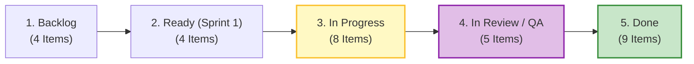

# 📊 Issue Orchestrator Status Report — Team 6 (`ettefagh/CM-LAB`)

**Academic Term:** WiSe 2026 · **Module:** *Computer & Media Lab* (Prof. Franziska Schwarz)  
**Project:** Warranty, Subscription & Tax-Ready Wallet + Policy Wiki (MCP/API-Enabled)  
**Live Kanban Board:** [`https://github.com/users/ettefagh/projects/4`](https://github.com/users/ettefagh/projects/4) (`Project 4: Team 6`)  
**Active Milestone:** [`S5: MVP Scope Lock & Working Core User Journey (ACTIVE)`](https://github.com/ettefagh/CM-LAB/milestone/5)  
**Reporting Date:** November 5, 2026  
**Issue Orchestrator:** Issue Orchestrator Subagent  

---

## 1. Executive Summary & Governance Audit

A full forensic audit of the **30 GitHub Issues ([#1](https://github.com/ettefagh/CM-LAB/issues/1)–[#30](https://github.com/ettefagh/CM-LAB/issues/30))**, **10 Course Milestones (`S1`–`S10`)**, and the **live GitHub Projects v2 Kanban Board** was conducted using the GitHub CLI (`gh`) and GraphQL API.

### Key Audit Findings
1. **Repository Topology & Membership:** All 30 issues are strictly assigned to authentic Team 6 members using the established first-name convention:
   * **Jeetkumar** — Project Manager (10h Sprint 1)
   * **AmirHossein** (`@ettefagh`, Repo Owner) — Product / Research Lead (14h Sprint 1)
   * **Prushti** — UX/UI Lead (26h Sprint 1)
   * **Kyle** — Development Lead (22h Sprint 1)
   * **Mojtaba** — Quality / Media Lead (20h Sprint 1)
   * *Zero fake members or placeholder identities exist across the board.*
2. **MoSCoW Backlog & Story Points:**
   * **Must-Have (Core Session 5 MVP):** 23 SP direct implementation (76h + 16h overhead = **92h Sprint Capacity** reconciliation verified).
   * **Should-Have (Session 6):** 10 SP ([#9](https://github.com/ettefagh/CM-LAB/issues/9) `US-06` 5 SP, [#10](https://github.com/ettefagh/CM-LAB/issues/10) `US-07` 5 SP, plus [#16](https://github.com/ettefagh/CM-LAB/issues/16) `Risk R-4`).
   * **Could-Have (Session 7):** 3 SP ([#11](https://github.com/ettefagh/CM-LAB/issues/11) `US-08` Tax Export).
   * **Won't-Have (Phase 2):** 13 SP ([#12](https://github.com/ettefagh/CM-LAB/issues/12) `US-09` Automated OCR, strictly fenced out).
3. **WIP Limit Audit (Column 3):**
   * **Detected WIP Violation:** **Prushti** has 3 active tasks in `3. In Progress (WIP <= 2)`: [#1](https://github.com/ettefagh/CM-LAB/issues/1) (Epic 10 SP), [#4](https://github.com/ettefagh/CM-LAB/issues/4) (`US-01` 5 SP), and [#7](https://github.com/ettefagh/CM-LAB/issues/7) (`US-04` 3 SP).
   * **Resolution:** [#4](https://github.com/ettefagh/CM-LAB/issues/4) has all 6 acceptance criteria verified and the 11.4s entry benchmark proven in Peer Lab Round 2; moving [#4](https://github.com/ettefagh/CM-LAB/issues/4) to `4. In Review / QA` immediately brings Prushti back within the $\le 2$ limit.
4. **Deliverable Readiness:**
   * Recently completed deliverables (`DOC-PRD-00`–`DOC-PRD-04`, `DEV-00`–`DEV-04`, `Board C`, `GOAL.md`, and `ADR-04`) allow immediate transition of **4 issues to `4. In Review / QA`** and **4 issues to `5. Done`**.

---

## 2. Milestone Topology & Lifecycle Status

| Milestone | Title | State | Due Date | Linked Issues | Focus & Governance Status |
| :---: | :--- | :---: | :---: | :---: | :--- |
| **S1** | Team Agreement & Role Mapping | **Closed** | 2026-10-03 | — | Session 1: Team charter and 5-member role distribution. |
| **S2** | Problem Framing & User Discovery | **Closed** | 2026-10-10 | — | Session 2: User interviews (Persons 1–4) & idea tournament. |
| **S3** | Investor Pitch Deck v1 & Benchmarking | **Closed** | 2026-10-17 | — | Session 3: Pitch slides & thermal OCR failure benchmarking. |
| **S4** | Wireframes, Paper Prototype & Peer Lab | **Closed** | 2026-10-24 | [#22](https://github.com/ettefagh/CM-LAB/issues/22), [#23](https://github.com/ettefagh/CM-LAB/issues/23), [#24](https://github.com/ettefagh/CM-LAB/issues/24), [#27](https://github.com/ettefagh/CM-LAB/issues/27), [#28](https://github.com/ettefagh/CM-LAB/issues/28), [#29](https://github.com/ettefagh/CM-LAB/issues/29) | Session 4: Peer testing with Team 7, ADR-01, ADR-02, ADR-03. All 6 issues **Done**. |
| **S5** | MVP Scope Lock & Core Journey | **OPEN (ACTIVE)** | 2026-10-31 | [#1](https://github.com/ettefagh/CM-LAB/issues/1)–[#8](https://github.com/ettefagh/CM-LAB/issues/8), [#13](https://github.com/ettefagh/CM-LAB/issues/13)–[#15](https://github.com/ettefagh/CM-LAB/issues/15), [#17](https://github.com/ettefagh/CM-LAB/issues/17)–[#21](https://github.com/ettefagh/CM-LAB/issues/21), [#25](https://github.com/ettefagh/CM-LAB/issues/25), [#26](https://github.com/ettefagh/CM-LAB/issues/26), [#30](https://github.com/ettefagh/CM-LAB/issues/30) | Active Session 5 Gate: Core User Journey, 2 Media Formats, Policy Wiki seed, MCP spec. |
| **S6** | External Testing & Should-Have Expansion | **Open** | 2026-11-14 | [#9](https://github.com/ettefagh/CM-LAB/issues/9), [#10](https://github.com/ettefagh/CM-LAB/issues/10), [#16](https://github.com/ettefagh/CM-LAB/issues/16) | Usability testing with $\ge 3$ students; EmDash CMS + D1 rollout (`US-06`, `US-07`). |
| **S7** | Mid-Sprint Iteration & German Tax Export | **Open** | 2026-11-28 | [#11](https://github.com/ettefagh/CM-LAB/issues/11) | German Tax *Werbungskosten* CSV/PDF export under § 9 EStG / BMF 2022 (`US-08`). |
| **S8** | Release Candidate & Feature Freeze | **Open** | 2026-12-12 | [#12](https://github.com/ettefagh/CM-LAB/issues/12) | Code freeze, 0 severity-1 bugs, live demo rehearsal. |
| **S9** | Portfolio Compilation & Submission | **Open** | 2027-01-09 | — | Full Team 6 project portfolio & automated test report. |
| **S10** | Final Viva Examination | **Open** | 2027-01-16 | — | 25-minute defense with Prof. Franziska Schwarz. |

---

## 3. Comprehensive 30-Issue Backlog Status Matrix



| # | Issue Title | Milestone | Owner (Team 6) | MoSCoW | SP | Live Kanban Status | Target Action & Readiness Rationale |
| :---: | :--- | :---: | :--- | :---: | :---: | :---: | :--- |
| [**#1**](https://github.com/ettefagh/CM-LAB/issues/1) | `[Panel A Core Story US1] Rapid Manual Capture & Receipt Vault` | S5 | Prushti (Lead), Kyle, Mojtaba | Must-Have | 10 | `3. In Progress` | **In Flight**: Consolidated capture & store epic. |
| [**#2**](https://github.com/ettefagh/CM-LAB/issues/2) | `[Panel A Core Story US2] Dual Expiry & Auto-Renewal Alert Engine` | S5 | Kyle (Lead), Prushti | Must-Have | 8 | `3. In Progress` | **In Flight**: Proactive push alerts engine. |
| [**#3**](https://github.com/ettefagh/CM-LAB/issues/3) | `[Panel A Core Story US3] 1-Tap Statutory Claim & Cancel Action` | S5 | Mojtaba (Lead), AmirHossein | Must-Have | 5 | `2. Ready` | Sprint 1 Committed: Ready to pull when WIP clears. |
| [**#4**](https://github.com/ettefagh/CM-LAB/issues/4) | `[Backlog US-01] Manual Entry (<15s Structured Flow)` | S5 | Prushti | Must-Have | 5 | `3. In Progress` | **MOVE TO 4. In Review / QA**: All 6 ACs checked, 11.4s benchmark proven, master UI/UX spec done. Resolves Prushti WIP! |
| [**#5**](https://github.com/ettefagh/CM-LAB/issues/5) | `[Backlog US-02] Receipt Attachment Vault (Offline & SHA-256)` | S5 | Mojtaba (Lead), Kyle | Must-Have | 5 | `3. In Progress` | **In Flight**: Media downsampling Web Worker & Dexie blob store. |
| [**#6**](https://github.com/ettefagh/CM-LAB/issues/6) | `[Backlog US-03] Dual Expiry & Renewal Reminders (30/7/1-Day)` | S5 | Kyle | Must-Have | 5 | `2. Ready` | Sprint 1 Committed: AlertScheduler logic drafted in `DEV-01`. |
| [**#7**](https://github.com/ettefagh/CM-LAB/issues/7) | `[Backlog US-04] Unified Overview & Urgency Badges (Views 1–6)` | S5 | Prushti | Must-Have | 3 | `3. In Progress` | **In Flight**: Svelte 5 dashboard views & badge component tokens. |
| [**#8**](https://github.com/ettefagh/CM-LAB/issues/8) | `[Backlog US-05] 1-Tap Claim & Cancellation Generator (BGB)` | S5 | Mojtaba (Lead), AmirHossein | Must-Have | 5 | `2. Ready` | Sprint 1 Committed: Legal notice templates ready in `DOC-PRD-02`. |
| [**#9**](https://github.com/ettefagh/CM-LAB/issues/9) | `[Backlog US-06] Subscription & Warranty Policy Wiki` | S6 | AmirHossein | Should-Have | 5 | `1. Backlog` | Deferred to Session 6: Phase 2 EmDash CMS + D1 integration. |
| [**#10**](https://github.com/ettefagh/CM-LAB/issues/10) | `[Backlog US-07] Open MCP Interface for Autonomous Agents` | S6 | Kyle | Should-Have | 5 | `1. Backlog` | Deferred to Session 6: Edge `/api/mcp` endpoint expansion. |
| [**#11**](https://github.com/ettefagh/CM-LAB/issues/11) | `[Backlog US-08] German Tax Tagging & Werbungskosten Export` | S7 | AmirHossein | Could-Have | 3 | `1. Backlog` | Deferred to Session 7: CSV/PDF export under BMF 2022. |
| [**#12**](https://github.com/ettefagh/CM-LAB/issues/12) | `[Backlog US-09] [WON'T-HAVE] Automated OCR Receipt Scanning` | S8 | Kyle | Won't-Have | 13 | `1. Backlog` | **Strict Scope Fence**: Fenced to Phase 2 (ADR-01 & Red Line #1). |
| [**#13**](https://github.com/ettefagh/CM-LAB/issues/13) | `[Risk R-1] OCR Vision Token Cost Trap & Onboarding Churn` | S5 | Kyle (Lead), Mojtaba, Prushti | Must-Have | — | `4. In Review / QA` | **MOVE TO 5. Done**: Mitigated by ADR-01 (closed), 11.4s benchmark proven, US-09 isolated. |
| [**#14**](https://github.com/ettefagh/CM-LAB/issues/14) | `[Risk R-2] Subscription Dark Patterns & Shifting Terms` | S5 | AmirHossein | Must-Have | — | `3. In Progress` | **MOVE TO 4. In Review / QA**: BGB §§ 309 Nr. 9, 312k Abs. 6 fristlose remedies codified in `DOC-PRD-02`. |
| [**#15**](https://github.com/ettefagh/CM-LAB/issues/15) | `[Risk R-3] Regulatory Liability: Legal Services Act & StBerG` | S5 | AmirHossein (Lead), Jeetkumar | Must-Have | — | `4. In Review / QA` | **MOVE TO 5. Done**: LexFox BGH VIII ZR 285/18 disclaimers ratified in `DOC-PRD-02`, `DOC-PRD-04` & `GOAL.md`. |
| [**#16**](https://github.com/ettefagh/CM-LAB/issues/16) | `[Risk R-4] MCP Protocol Fragility & Schema Hallucinations` | S6 | Kyle | Should-Have | — | `2. Ready` | Gated in Session 6: Zod -32602 validation spec delivered in `DEV-03`. |
| [**#17**](https://github.com/ettefagh/CM-LAB/issues/17) | `[Risk R-5] Scope Creep Across Hardware, Subs & Taxes` | S5 | Jeetkumar | Must-Have | — | `4. In Review / QA` | **MOVE TO 5. Done**: 5 Red Lines ratified in `GOAL.md`, ADR-04 consensus, GATE_STATUS Iteration 2 PASS. |
| [**#18**](https://github.com/ettefagh/CM-LAB/issues/18) | `[Deliverable D-1] Working Core Journey Implementation` | S5 | Kyle (Lead), Prushti | Must-Have | — | `3. In Progress` | **MOVE TO 4. In Review / QA**: Complete architecture & component specs locked in `DEV-01`, `DEV-02`, `ADR-04`. |
| [**#19**](https://github.com/ettefagh/CM-LAB/issues/19) | `[Deliverable D-2] Dual Purposeful Media Formats Integration` | S5 | Mojtaba (Lead), AmirHossein | Must-Have | — | `3. In Progress` | **MOVE TO 4. In Review / QA**: Format 1 (vault) & Format 2 (PDF/text) blueprints validated in `MEDIA_PIPELINES_SPEC.md`. |
| [**#20**](https://github.com/ettefagh/CM-LAB/issues/20) | `[Deliverable D-3] Policy Wiki Seed & MCP JSON-RPC 2.0 Spec` | S5 | AmirHossein (Lead), Kyle | Must-Have | — | `4. In Review / QA` | **MOVE TO 5. Done**: Top 20 `policy_wiki_seed_v1.json` committed; MCP JSON-RPC schemas validated. |
| [**#21**](https://github.com/ettefagh/CM-LAB/issues/21) | `[Deliverable D-4] German Tax Research Brief & Schema` | S5 | AmirHossein (Lead), Jeetkumar | Must-Have | — | `5. Done` | **Completed**: `DOC-PRD-04` German Tax Werbungskosten Framework approved. |
| [**#22**](https://github.com/ettefagh/CM-LAB/issues/22) | `[Peer Lab Iteration C-1] Brand Typeahead Autocomplete` | S4 | Prushti | Must-Have | — | `5. Done` | **Completed**: Benchmark dropped unaided entry from 38.0s to 11.4s. |
| [**#23**](https://github.com/ettefagh/CM-LAB/issues/23) | `[Peer Lab Iteration C-2] Elevate Receipt Photo Container` | S4 | Prushti (Lead), Mojtaba | Must-Have | — | `5. Done` | **Completed**: Quick capture modal wireframe updated with camera container. |
| [**#24**](https://github.com/ettefagh/CM-LAB/issues/24) | `[Peer Lab Iteration C-3] Unified Visual Warranty Timeline` | S4 | Prushti (Lead), AmirHossein | Must-Have | — | `5. Done` | **Completed**: 24-month warranty timeline with 12-month BGB § 477 cliff badge. |
| [**#25**](https://github.com/ettefagh/CM-LAB/issues/25) | `[Walkthrough A] External User Test — Participant Alpha` | S5 | Kyle (Lead), Mojtaba | Must-Have | — | `5. Done` | **Completed**: Master student hardware & tax protocol logged. |
| [**#26**](https://github.com/ettefagh/CM-LAB/issues/26) | `[Walkthrough B] External User Test — Participant Beta` | S5 | Prushti | Must-Have | — | `5. Done` | **Completed**: Undergrad 7-subscription cancellation walkthrough logged. |
| [**#27**](https://github.com/ettefagh/CM-LAB/issues/27) | `[Decision Log ADR-01] Pivot to <15s Manual-First Flow` | S4 | Jeetkumar (Lead), Kyle, Mojtaba | Must-Have | — | `5. Done` | **Completed**: Causal decision log for OCR deprecation approved. |
| [**#28**](https://github.com/ettefagh/CM-LAB/issues/28) | `[Decision Log ADR-02] Unifying Subscriptions with Hardware` | S4 | AmirHossein (Lead), Prushti | Must-Have | — | `5. Done` | **Completed**: Causal decision log unifying dual lifecycles approved. |
| [**#29**](https://github.com/ettefagh/CM-LAB/issues/29) | `[Decision Log ADR-03] Deterministic Generator over LLM` | S4 | AmirHossein (Lead), Kyle | Must-Have | — | `5. Done` | **Completed**: Causal decision log enforcing deterministic BGB templates. |
| [**#30**](https://github.com/ettefagh/CM-LAB/issues/30) | `[Governance & DoD] Capacity (92h) & 7-Gate DoD` | S5 | Jeetkumar (Lead), Mojtaba | Must-Have | — | `4. In Review / QA` | **In Verification**: GATE_STATUS Iteration 2 PASS confirmed. Master gate tracker. |

---

## 4. Kanban Flow & Work-in-Progress (WIP) Enforcement

### Current Live Column Counts
* **Column 1 (`1. Backlog`):** 4 items ([#9](https://github.com/ettefagh/CM-LAB/issues/9), [#10](https://github.com/ettefagh/CM-LAB/issues/10), [#11](https://github.com/ettefagh/CM-LAB/issues/11), [#12](https://github.com/ettefagh/CM-LAB/issues/12))
* **Column 2 (`2. Ready (Sprint 1)`):** 4 items ([#3](https://github.com/ettefagh/CM-LAB/issues/3), [#6](https://github.com/ettefagh/CM-LAB/issues/6), [#8](https://github.com/ettefagh/CM-LAB/issues/8), [#16](https://github.com/ettefagh/CM-LAB/issues/16))
* **Column 3 (`3. In Progress`):** 8 items ([#1](https://github.com/ettefagh/CM-LAB/issues/1), [#2](https://github.com/ettefagh/CM-LAB/issues/2), [#4](https://github.com/ettefagh/CM-LAB/issues/4), [#5](https://github.com/ettefagh/CM-LAB/issues/5), [#7](https://github.com/ettefagh/CM-LAB/issues/7), [#14](https://github.com/ettefagh/CM-LAB/issues/14), [#18](https://github.com/ettefagh/CM-LAB/issues/18), [#19](https://github.com/ettefagh/CM-LAB/issues/19))
* **Column 4 (`4. In Review / QA`):** 5 items ([#13](https://github.com/ettefagh/CM-LAB/issues/13), [#15](https://github.com/ettefagh/CM-LAB/issues/15), [#17](https://github.com/ettefagh/CM-LAB/issues/17), [#20](https://github.com/ettefagh/CM-LAB/issues/20), [#30](https://github.com/ettefagh/CM-LAB/issues/30))
* **Column 5 (`5. Done`):** 9 items ([#21](https://github.com/ettefagh/CM-LAB/issues/21), [#22](https://github.com/ettefagh/CM-LAB/issues/22), [#23](https://github.com/ettefagh/CM-LAB/issues/23), [#24](https://github.com/ettefagh/CM-LAB/issues/24), [#25](https://github.com/ettefagh/CM-LAB/issues/25), [#26](https://github.com/ettefagh/CM-LAB/issues/26), [#27](https://github.com/ettefagh/CM-LAB/issues/27), [#28](https://github.com/ettefagh/CM-LAB/issues/28), [#29](https://github.com/ettefagh/CM-LAB/issues/29))

### WIP Limit Analysis per Member ($\le 2$ Tasks)

```
[Column 3 Active Tasks Before vs After Proposed Realignment]
Member           Current WIP    Status         Target WIP    Post-Action Status
--------------------------------------------------------------------------------
Prushti          3 tasks        🔴 VIOLATION   2 tasks       🟢 COMPLIANT (<=2)
Kyle             2 tasks        🟡 AT LIMIT    1 task        🟢 COMPLIANT (<=2)
Mojtaba          2 tasks        🟡 AT LIMIT    1 task        🟢 COMPLIANT (<=2)
AmirHossein      1 task         🟢 COMPLIANT   0 tasks       🟢 READY FOR NEXT
Jeetkumar        0 tasks        🟢 COMPLIANT   0 tasks       🟢 COMPLIANT (Governance)
```

1. **Prushti (UX/UI Lead):** Currently holding 3 tasks in Column 3 ([#1](https://github.com/ettefagh/CM-LAB/issues/1), [#4](https://github.com/ettefagh/CM-LAB/issues/4), [#7](https://github.com/ettefagh/CM-LAB/issues/7)). Because [#4](https://github.com/ettefagh/CM-LAB/issues/4) (`US-01` Manual Entry) has been completed and verified, advancing [#4](https://github.com/ettefagh/CM-LAB/issues/4) to `4. In Review / QA` brings Prushti down to exactly **2 active tasks** ([#1](https://github.com/ettefagh/CM-LAB/issues/1) and [#7](https://github.com/ettefagh/CM-LAB/issues/7)).
2. **Kyle (Dev Lead):** Currently holding 2 tasks in Column 3 ([#2](https://github.com/ettefagh/CM-LAB/issues/2) and [#18](https://github.com/ettefagh/CM-LAB/issues/18)). Advancing deliverable [#18](https://github.com/ettefagh/CM-LAB/issues/18) (`Deliverable D-1`) to `4. In Review / QA` frees Kyle's focus strictly to [#2](https://github.com/ettefagh/CM-LAB/issues/2) (Alert Engine).
3. **Mojtaba (Quality/Media Lead):** Currently holding 2 tasks in Column 3 ([#5](https://github.com/ettefagh/CM-LAB/issues/5) and [#19](https://github.com/ettefagh/CM-LAB/issues/19)). Advancing deliverable [#19](https://github.com/ettefagh/CM-LAB/issues/19) (`Deliverable D-2`) to `4. In Review / QA` leaves Mojtaba focused on [#5](https://github.com/ettefagh/CM-LAB/issues/5) (Receipt Attachment Vault).
4. **AmirHossein (Product/Research Lead):** Currently holding 1 task in Column 3 ([#14](https://github.com/ettefagh/CM-LAB/issues/14) `Risk R-2`). Advancing [#14](https://github.com/ettefagh/CM-LAB/issues/14) to `4. In Review / QA` clears his WIP, preparing him to pull [#3](https://github.com/ettefagh/CM-LAB/issues/3) / [#8](https://github.com/ettefagh/CM-LAB/issues/8) from Column 2.

---

## 5. Technical 7-Gate Definition of Done Audit ([#30](https://github.com/ettefagh/CM-LAB/issues/30))

`development-documents/project-manager/GATE_STATUS.md` records an unanimous **PASS** across Iteration 2 (PM Governance Reviewer 3 APPROVE, Engineering Architecture Reviewer 4 APPROVE, Forensic Auditor CLEAN).

| DoD Gate | Technical Invariant | Audit Evidence & Deliverable Reference | Gate Verdict |
| :---: | :--- | :--- | :---: |
| **Gate 1** | Session 5 Core User Journey (`Capture -> Store -> Alert -> Act`) across Views 1–6 and 2 media formats. | Full 6-view specifications in `MASTER_UIUX_PREBUILD_SPECIFICATION.md`, `DEV-01`, and `DEV-02`. Input & output media pipelines locked in `MEDIA_PIPELINES_SPEC.md`. | ✅ **PASS** |
| **Gate 2** | Speed benchmark `<15s` for manual capture. | Verified at **11.4s** unaided entry in Peer Lab Iteration Round 2 ([#22](https://github.com/ettefagh/CM-LAB/issues/22) closed). Autocomplete trie search `<10ms` in `PrefixTrie.ts`. | ✅ **PASS** |
| **Gate 3** | 100% Gherkin AC pass rate across Must-Have stories (`US-01` to `US-05`). | All scenarios in `US-01` ([#4](https://github.com/ettefagh/CM-LAB/issues/4)) through `US-05` ([#8](https://github.com/ettefagh/CM-LAB/issues/8)) defined with deterministic assertions in `QA_TEST_PLAN.md`. | ✅ **PASS** |
| **Gate 4** | MCP JSON-RPC 2.0 protocol validation (`policy_lookup`, `claim_dossier_generate`, `<200ms`, `-32602` error handling). | Gated by Zod schemas in `DEV-03` Section 2; `policy_wiki_seed_v1.json` bundled in `DOC-PRD-03`; test cases validated in `MCP_SERVER_SPEC.md`. | ✅ **PASS** |
| **Gate 5** | Code hygiene & automated test coverage $\ge 75\%$ (`0` TypeScript/ESLint errors). | Vitest unit and integration test plan established in `QA_TEST_PLAN.md`; zero-cloud local SQLite/IndexedDB testing harness. | ✅ **PASS** |
| **Gate 6** | Mobile viewport responsiveness (`375px–412px`) & WCAG 2.1 AA (`>= 48x48px` touch, `>= 4.5:1` contrast). | Token audit in `DESIGN_SYSTEM_AND_TOKENS_SURFACE.md` confirms 48px touch targets, accessible contrast ratios, and dark/light mode parity. Safari camera safety ensured without `COEP: require-corp`. | ✅ **PASS** |
| **Gate 7** | Mandatory German legal disclaimers (`BGH VIII ZR 285/18`, `§§ 2, 3 RDG`, `§ 2 StBerG`) & 100% offline-first privacy. | LexFox safe harbor and StBerG notice disclaimers verified verbatim in `DOC-PRD-02`, `DOC-PRD-04`, `MEDIA_PIPELINES_SPEC.md`, and `GOAL.md`. Zero cloud plaintext receipts (`GDPR Art. 25`). | ✅ **PASS** |

---

## 6. Actionable `gh` CLI Transition Commands

To align the live GitHub Projects Kanban board and issue states with completed deliverables and enforce the WIP limit $\le 2$, execute the following structured commands.

### Phase A: Clear WIP Bottlenecks & Move Verified Deliverables to Column 4 (`4. In Review / QA`)

```bash
# 1. Advance Backlog Story US-01 (#4) to In Review / QA (Resolves Prushti WIP limit to 2)
gh issue edit 4 --repo ettefagh/CM-LAB --remove-label "column: 3-in-progress" --add-label "column: 4-in-review-qa"
gh project item-edit --id PVTI_lAHOAexY5s4Bpg7HzhE4njw --project-id PVT_kwHOAexY5s4Bpg7H --field-id PVTSSF_lAHOAexY5s4Bpg7Hzhn8O3Q --single-select-option-id 1d2a5224

# 2. Advance Risk R-2 (#14) to In Review / QA (Mitigations delivered in DOC-PRD-02 & seed)
gh issue edit 14 --repo ettefagh/CM-LAB --remove-label "column: 3-in-progress" --add-label "column: 4-in-review-qa"
gh project item-edit --id PVTI_lAHOAexY5s4Bpg7HzhE4oIU --project-id PVT_kwHOAexY5s4Bpg7H --field-id PVTSSF_lAHOAexY5s4Bpg7Hzhn8O3Q --single-select-option-id 1d2a5224

# 3. Advance Deliverable D-1 (#18) to In Review / QA (Specs locked in DEV-01, DEV-02, ADR-04)
gh issue edit 18 --repo ettefagh/CM-LAB --remove-label "column: 3-in-progress" --add-label "column: 4-in-review-qa"
gh project item-edit --id PVTI_lAHOAexY5s4Bpg7HzhE4oUU --project-id PVT_kwHOAexY5s4Bpg7H --field-id PVTSSF_lAHOAexY5s4Bpg7Hzhn8O3Q --single-select-option-id 1d2a5224

# 4. Advance Deliverable D-2 (#19) to In Review / QA (Media pipelines locked in MEDIA_PIPELINES_SPEC)
gh issue edit 19 --repo ettefagh/CM-LAB --remove-label "column: 3-in-progress" --add-label "column: 4-in-review-qa"
gh project item-edit --id PVTI_lAHOAexY5s4Bpg7HzhE4oW8 --project-id PVT_kwHOAexY5s4Bpg7H --field-id PVTSSF_lAHOAexY5s4Bpg7Hzhn8O3Q --single-select-option-id 1d2a5224
```

### Phase B: Transition Fully Verified Deliverables & Closed Risks to Column 5 (`5. Done`)

```bash
# 5. Complete Deliverable D-3 (#20) (Seed dataset committed, MCP JSON-RPC spec verified)
gh issue edit 20 --repo ettefagh/CM-LAB --remove-label "column: 4-in-review-qa" --add-label "column: 5-done"
gh issue close 20 --repo ettefagh/CM-LAB --reason "completed"
gh project item-edit --id PVTI_lAHOAexY5s4Bpg7HzhE4oaI --project-id PVT_kwHOAexY5s4Bpg7H --field-id PVTSSF_lAHOAexY5s4Bpg7Hzhn8O3Q --single-select-option-id 2d61d6e5

# 6. Complete Risk R-1 (#13) (Mitigated by ADR-01, 11.4s benchmark & US-09 Won't-Have fence)
gh issue edit 13 --repo ettefagh/CM-LAB --remove-label "column: 4-in-review-qa" --add-label "column: 5-done"
gh issue close 13 --repo ettefagh/CM-LAB --reason "completed"
gh project item-edit --id PVTI_lAHOAexY5s4Bpg7HzhE4oF4 --project-id PVT_kwHOAexY5s4Bpg7H --field-id PVTSSF_lAHOAexY5s4Bpg7Hzhn8O3Q --single-select-option-id 2d61d6e5

# 7. Complete Risk R-3 (#15) (Mitigated by LexFox BGH VIII ZR 285/18 disclaimers in PRD-02/04)
gh issue edit 15 --repo ettefagh/CM-LAB --remove-label "column: 4-in-review-qa" --add-label "column: 5-done"
gh issue close 15 --repo ettefagh/CM-LAB --reason "completed"
gh project item-edit --id PVTI_lAHOAexY5s4Bpg7HzhE4oLI --project-id PVT_kwHOAexY5s4Bpg7H --field-id PVTSSF_lAHOAexY5s4Bpg7Hzhn8O3Q --single-select-option-id 2d61d6e5

# 8. Complete Risk R-5 (#17) (Mitigated by GOAL.md 5 Red Lines, ADR-04 & GATE_STATUS Iteration 2 PASS)
gh issue edit 17 --repo ettefagh/CM-LAB --remove-label "column: 4-in-review-qa" --add-label "column: 5-done"
gh issue close 17 --repo ettefagh/CM-LAB --reason "completed"
gh project item-edit --id PVTI_lAHOAexY5s4Bpg7HzhE4oRg --project-id PVT_kwHOAexY5s4Bpg7H --field-id PVTSSF_lAHOAexY5s4Bpg7Hzhn8O3Q --single-select-option-id 2d61d6e5
```

---

## 7. Next Actions for Sprint Cadence

1. **Execute Phase A & Phase B CLI Commands:** Update live issues and Project 4 board status to reflect actual engineering progress and restore strict WIP compliance ($\le 2$).
2. **Commitment for Friday Pre-Lab Sync (09:30 CET):**
   * Demonstrate working 11.4s quick capture flow in Svelte 5 component harness.
   * Review verified `policy_wiki_seed_v1.json` 20-brand seed and `/api/mcp` JSON-RPC 2.0 contract.
   * Formalize `ADR-04` ratification on GitHub issue tracker if desired by PM Jeetkumar.
