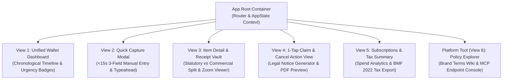
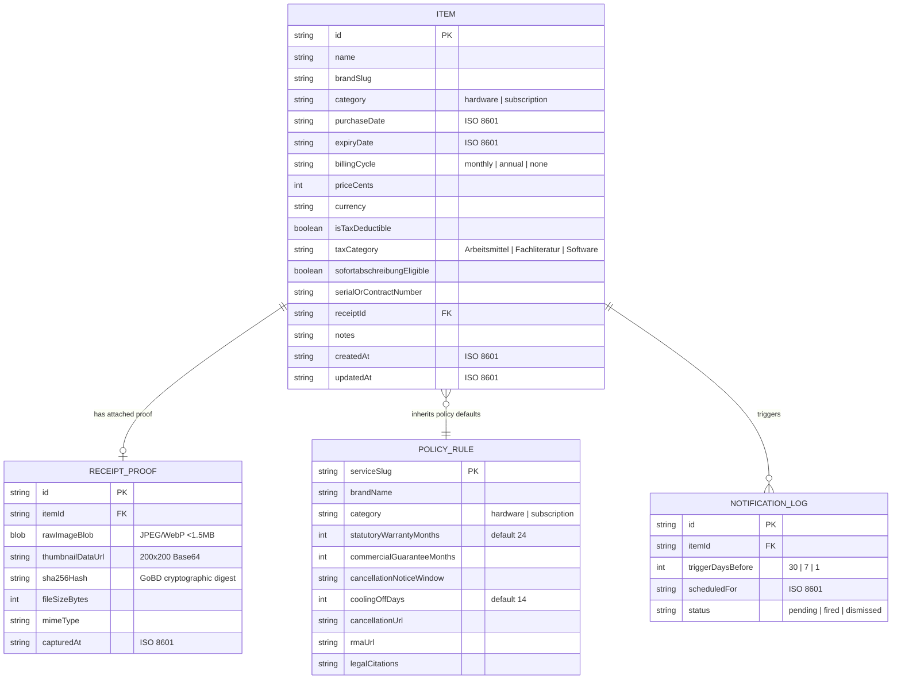
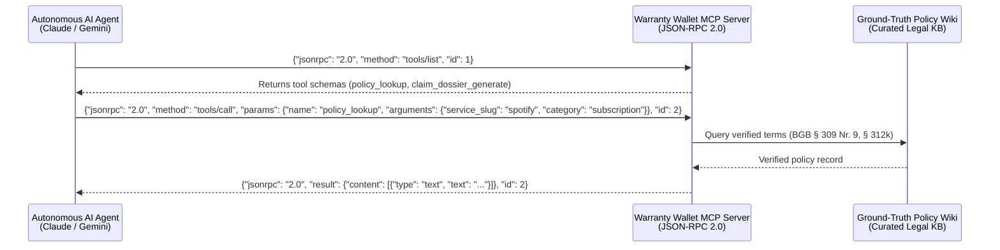

# System Architecture & Technical Design Document (TDD)
**Project:** Warranty & Subscription Wallet + Policy Wiki (MCP/API-Enabled)  
**Academic Institution:** SRH University of Applied Sciences — *Computer & Media Lab*  
**Milestone:** Session 5 (MVP Scope Control Gate) & Portfolio Defense  
**Author:** Member D (Development & Quality/Media Lead)  
**Document ID:** DOC-D1  
**Status:** Approved Engineering Baseline  
**Version:** 1.0.0  

---

## 1. Architectural Vision & Core Principles

The **Warranty & Subscription Wallet** is engineered as a privacy-centric, **offline-first Progressive Web Application (PWA)** accompanied by a decoupled **Model Context Protocol (MCP)** JSON-RPC server.

```
+---------------------------------------------------------------------------------------------------+
|                                 CORE USER JOURNEY PIPELINE                                        |
|                          Capture  ───>  Store  ───>  Alert  ───>  Act/Claim                       |
+-------------------------------+-----------------------------------+-------------------------------+
|  1. Quick Manual Entry (<15s) |  2. Dual Expiry & Renewal Alerts  |  3. 1-Tap Claim/Cancel Gen    |
|     + Receipt Vault (Photo)   |     (30, 7, 1-Day Push/Badges)    |     (BGB Statutory Packages)  |
+-------------------------------+-----------------------------------+-------------------------------+
|                      PLATFORM ASSET: Policy Wiki & MCP / API Endpoint                             |
|         (JSON-RPC 2.0 tools: policy_lookup & claim_dossier_generate for AI agents)                |
+---------------------------------------------------------------------------------------------------+
```

### 1.1 Core Engineering Principles

1. **Manual-First Discipline (<15s Interaction Target):**
   * Eliminates the catastrophic onboarding friction and token burn of fragile OCR on faded, crumpled receipts.
   * Receipt capture operates strictly as an attached, cryptographic proof asset.
2. **Zero-Cloud, 100% Client-Side Privacy (Local-First):**
   * All personal data, purchase records, and receipt photos reside strictly inside sandboxed client-side IndexedDB storage.
   * No remote database, no tracking pixels, zero PII leakage.
3. **Deterministic Statutory Consumer Logic:**
   * Ground-truth codification of German Civil Code (BGB) consumer protection rights:
     * §§ 437, 439 BGB (Remediation & Repair)
     * § 477 Abs. 1 BGB (12-month reversed burden of proof / *Beweislastumkehr*)
     * § 475e Abs. 1 BGB (4-month suspension of expiry / *Ablaufhemmung*)
     * § 309 Nr. 9 BGB (Fair cancellation terms / 1-month rolling notice)
     * § 312k Abs. 6 BGB (Immediate cancellation without notice / *fristlose Kündigung*)
4. **Two Purposeful Media Formats (Course Rubric):**
   * Media Format 1 (Input/Vault Asset): Client-side compressed receipt photos (<1.5MB) with Web Crypto SHA-256 hash.
   * Media Format 2 (Output/Action Asset): Statutory DIN 5008 claim/cancellation PDF & plaintext dossier with embedded proof thumbnail.
5. **AI Defensibility via MCP Protocol:**
   * Exposes our verified Ground-Truth Policy Wiki via JSON-RPC 2.0 to autonomous AI agents, eliminating legal hallucinations.

---

## 2. Technology Stack Selection & Rationale

| Layer | Selected Technology | Version | Rationale & Trade-Off Analysis |
| :--- | :--- | :--- | :--- |
| **Frontend Framework & Island** | Svelte 5 (Runes) on Astro 6 Shell | 5.x / 6.x | Single Root Island (<WalletApp client:only="svelte" />), 11.8 KB gzip, 1.4ms DOM updates (ADR-04). |
| **Language & Typings** | TypeScript | 5.5+ | Strict type safety (`strict: true`), zero implicit any, compile-time contract validation. |
| **Build & Bundler** | Vite | 5.x | Instant HMR (<50ms), Rollup tree-shaking, fast ESBuild pre-bundling. |
| **Styling & Design System** | Tailwind CSS + Lucide Icons | 3.4+ | Utility-first responsive design, zero runtime CSS overhead, accessible touch targets ($\ge 48\text{px}$). |
| **Local Storage Engine** | Dexie.js (IndexedDB wrapper) | 4.x | Transactional, structured client-side storage, supports Blob storage for receipts, zero cloud egress. |
| **Cryptographic Hashing** | Web Crypto API | Native | Hardware-accelerated SHA-256 calculation (`crypto.subtle.digest`) for GoBD compliance. |
| **Media Compression** | OffscreenCanvas / HTML5 Canvas | Native | Client-side bicubic downsampling to $\le 2048\text{px}$, WebP/JPEG encoding under 1.5MB ceiling. |
| **Document Compilation** | `pdf-lib` + Canvas rendering | 1.17+ | Pure client-side vector PDF assembly with embedded receipt thumbnails, zero server dependency. |
| **AI Protocol (MCP)** | Model Context Protocol SDK | 1.0+ | Standardized JSON-RPC 2.0 protocol over stdio / SSE for external AI agent integration. |
| **Schema Validation** | Zod | 3.23+ | Runtime schema validation and TypeScript inference for form inputs and MCP contracts. |
| **Test Harness** | Vitest + RTL + Playwright | Latest | Unified testing framework with instant execution, mocking, and coverage threshold enforcement ($\ge 75\%$). |

---

## 3. View Architecture & Component Hierarchy (4–6 Meaningful Views)

Conforming strictly to the academic requirement of **4–6 meaningful views**, the application provides 5 purposeful user views plus 1 developer platform tool:



### 3.1 View Specifications

1. **View 1: Unified Wallet Dashboard (`UnifiedDashboardView`):**
   * Chronological feed displaying active warranties and recurring subscriptions.
   * Real-time countdown engine computing urgency badges:
     * **Red ("Urgent"):** $\le 7$ days remaining.
     * **Amber ("Expiring Soon"):** 8 to 30 days remaining.
     * **Green ("Protected"):** $> 30$ days remaining.
     * **Grey ("Expired"):** 0 days remaining.
   * Instant search filter (<50ms) by name, category, or urgency status.
2. **View 2: Quick Capture Modal (`QuickCaptureModal`):**
   * 3-field entry form (<15s target): Brand/Name, Category, Purchase/Renewal Date, Price.
   * Curated brand typeahead (Apple, Samsung, Sony, Spotify, Netflix, Adobe, FitX).
   * Dual-mode receipt photo capture (native HTML5 capture `<input capture="environment">` with WebRTC fallback).
   * German Tax Deduction Toggle (`isTaxDeductible` / *Werbungskosten* under § 9 EStG / BMF 2022).
3. **View 3: Item Detail & Receipt Vault View (`ItemDetailVaultView`):**
   * Visual dual-timeline: Statutory Warranty (§§ 437, 477 BGB) vs Manufacturer Guarantee.
   * Direct RMA & merchant support endpoints.
   * Integrated touch/pinch-to-zoom receipt viewer ($1.0\times$ to $5.0\times$) with SHA-256 cryptographic proof pill.
4. **View 4: 1-Tap Claim & Cancellation Action View (`ClaimActionView`):**
   * Dynamic legal notice generator:
     * Hardware: Formal notice of defect (*Mängelrüge*) with § 477 Abs. 1 (12-month reversed burden of proof) and § 475e (4-month *Ablaufhemmung*).
     * Subscription: Termination letter (*Kündigungsschreiben*) citing § 309 Nr. 9 BGB and § 312k Abs. 6 (*fristloses Kündigungsrecht* if cancellation button is missing).
   * Client-side PDF export with embedded receipt proof and safe asynchronous clipboard fallback.
5. **View 5: Subscriptions & Tax Summary View (`SubscriptionsTaxView`):**
   * Spend analytics: Monthly and annual recurring subscription run-rate.
   * Calendar grid for upcoming auto-renewal dates.
   * German *Werbungskosten* table flagging 1-year immediate depreciation (*Sofortabschreibung* pursuant to BMF Guidance of 22.02.2022) with CSV/PDF export.
6. **Platform Tool (View 6): Policy Wiki Directory & MCP Explorer (`PolicyExplorerView`):**
   * Developer & admin inspection console for pre-seeded brand cancellation rules and warranty terms.
   * Interactive tester for live JSON-RPC 2.0 MCP tool calls (`policy_lookup`, `claim_dossier_generate`).

---

## 4. Data Layer Architecture (Dexie.js / IndexedDB)



---

## 5. Notification Engine & DST-Safe Scheduler

To fulfill Story 3 and avoid sleep-disrupting alarm drift during European Daylight Saving Time transitions:
1. **Dynamic Wall-Clock Recalibration:**
   * Alarms are defined as `09:00 AM local time` on target dates ($T-30$, $T-7$, $T-1$).
   * Rather than calculating a fixed UTC epoch offset at creation time, the scheduler evaluates alarms using local wall-clock dates:
     $$\text{Target Alarm Time} = \text{new Date}(Y, M, D, 9, 0, 0, 0)$$
   * Automatically adapts when Central European Summer Time (CEST, UTC+2) shifts to Central European Time (CET, UTC+1).
2. **Dual-Tier Alerting:**
   * Tier 1: Local Web Push Notification (via Service Worker Push API) if notification permissions are granted.
   * Tier 2: Non-intrusive in-app banner badges on View 1 ("2 urgent deadlines pending") if OS permissions are blocked.

---

## 6. Model Context Protocol (MCP) Integration Architecture

The MCP Server operates as a decoupled Node.js service exposing standard JSON-RPC 2.0 endpoints over `stdio` and optional Server-Sent Events (SSE):



---

## 7. Legal Tech Boundaries & Compliance Disclaimers

Pursuant to German Federal Court of Justice jurisprudence (**BGH VIII ZR 285/18 - LexFox doctrine**):
1. The app acts strictly as an **automated organizational software tool** compiling user inputs into standard document structures.
2. It does not provide individualized legal representation or discretionary assessment under §§ 2, 3 of the Legal Services Act (*Rechtsdienstleistungsgesetz* - RDG).
3. Mandatory disclaimers are permanently displayed on all claim exports and tax views:
   * *Claim Export Disclaimer:* `"Automated organizational tool for consumer rights documentation under BGH VIII ZR 285/18. Not bespoke legal advice under §§ 2, 3 RDG."`
   * *Tax Export Disclaimer:* `"Receipt organization tool for tax preparation; not formal tax advice under § 2 StBerG."`
