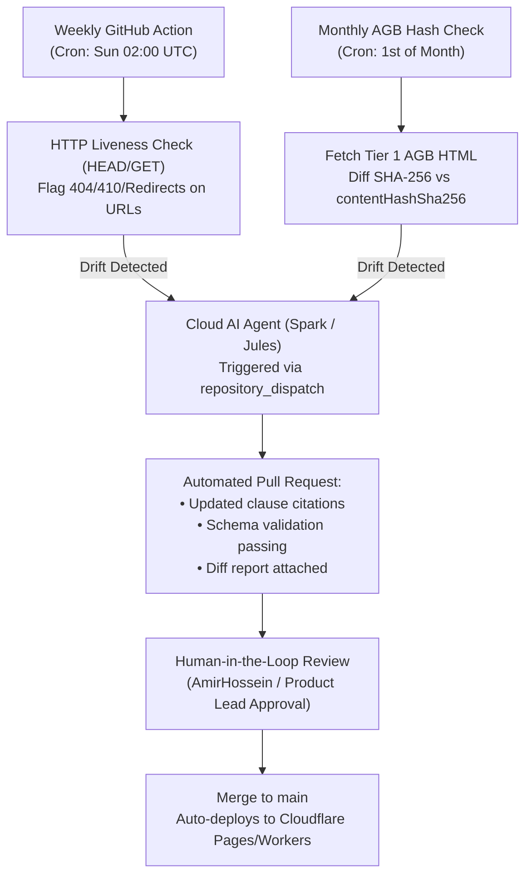

# 🔄 Policy Wiki Maintenance & Cloud AI Update Pipeline

**Document ID:** `DOC-QA-05-UPDATE-PIPELINE` · **Status:** Operational SSOT  
**Primary Maintainers:** Mojtaba (QA/Automation) & AmirHossein (Legal Lead) · **Target:** GitHub Actions & Autonomous Cloud Agents (Spark / Jules)

---

## 1. Multi-Tier Update Cadence

To balance freshness, bandwidth, and zero API costs, policy records follow a three-tier update schedule:



| Cadence | Trigger Mechanism | Scope & Execution | Action on Failure / Change |
| :--- | :--- | :--- | :--- |
| **Weekly** | GitHub Actions Cron (`0 2 * * 0`) | Fast HTTP `HEAD` / `GET` check on all Tier 1–4 URLs in `policy_wiki_seed_v1.json`. | Generates GitHub Issue if any link returns non-2xx/3xx status. |
| **Monthly** | GitHub Actions Cron (`0 3 1 * *`) | Computes SHA-256 hash of text content at Tier 1 AGB links; compares with `contentHashSha256`. | Dispatches event to Cloud AI Agent (Spark / Jules) for clause analysis. |
| **Event-Driven** | In-App Feedback Button | User flags broken button or changed policy via client form. | Submits structured GitHub Issue tagged `policy-update-needed`. |
| **Quarterly** | Sprint Planning Review | Manual legal sanity audit of BGB statute changes and consumer watchdog precedents. | Bulk version bump to `policy_wiki_seed_vX.json`. |

---

## 2. GitHub Actions Automation Workflow (`.github/workflows/policy-audit.yml`)

```yaml
name: "Policy Wiki Liveness & Drift Audit"

on:
  schedule:
    - cron: "0 2 * * 0"  # Every Sunday at 02:00 UTC
  workflow_dispatch:      # Manual trigger

jobs:
  audit-links:
    runs-on: ubuntu-latest
    steps:
      - name: Checkout Repository
        uses: actions/checkout@v4

      - name: Setup Node.js
        uses: actions/setup-node@v4
        with:
          node-version: 22

      - name: Validate Schema & Audit URL Liveness
        run: |
          node scripts/audit-policy-urls.mjs
        env:
          GITHUB_TOKEN: ${{ secrets.GITHUB_TOKEN }}

      - name: Notify Cloud AI Agent on Drift
        if: failure()
        uses: peter-evans/repository-dispatch@v3
        with:
          token: ${{ secrets.PAT_AI_AGENT }}
          event-type: trigger-spark-policy-repair
          client-payload: '{"drift_report": "audit-report.json"}'
```

---

## 3. Cloud AI Agent (Spark / Jules) Autonomous Workflow

When the GitHub Action flags an altered AGB page or a 404 cancellation link:

1. **Ingest Drift Payload:** The Cloud AI Agent reads the failing URL and previous citation snippet.
2. **Fetch & Parse:** The agent retrieves the updated page, strips boilerplate, and identifies the updated cancellation clause or RMA instruction.
3. **Draft Semantic Diff:** The agent extracts:
   - New notice window (e.g., changed from 14 days to 30 days).
   - New cancellation link (e.g., revised BGB § 312k button anchor).
   - Updated verbatim section quote and new `contentHashSha256`.
4. **Automated PR Generation:**
   - The agent updates `packages/core/data/policy_wiki_seed_v1.json`.
   - Runs local test suite (`pnpm test:contracts`).
   - Opens a GitHub Pull Request with format:  
     `fix(policy): update [Brand] terms following AGB revision`
5. **Safety Gate (Human-in-the-Loop):** Merging strictly requires human approval (**AmirHossein**, Legal Lead) to prevent malicious or hallucinated edits from reaching production.
