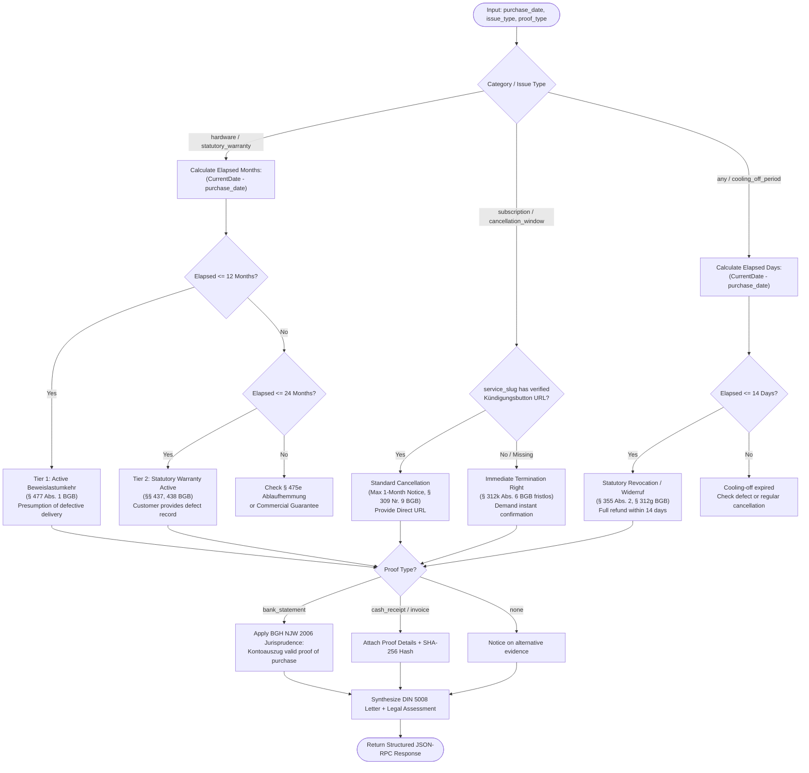

# Model Context Protocol (MCP) Server & API Specification (DOC-D4)

**Project:** Warranty & Subscription Wallet + Policy Wiki  
**Academic Institution:** SRH University of Applied Sciences — *Computer & Media Lab*  
**Course Milestone:** Session 5 (MVP Scope Control Gate)  
**Author / Role:** Member D (Development & Quality/Media Lead) & Platform Systems Engineer  
**Status:** Approved Technical Architecture & Protocol Contract  
**Target Path:** `docs/MCP_SERVER_SPEC.md`

---

## 1. Executive Summary & Architectural Mandate

This specification formalizes the **Model Context Protocol (MCP)** JSON-RPC 2.0 interface for the **Warranty & Subscription Wallet**.

Modern Large Language Models (LLMs) frequently hallucinate statutory rights, confusing voluntary commercial warranties (*Herstellergarantie*, § 443 BGB) with non-waivable statutory defect liability (*gesetzliche Gewährleistung*, §§ 437, 438 BGB), calculating outdated cancellation notice periods, or failing to leverage statutory consumer remedies under the *Gesetz für faire Verbraucherverträge* (§ 309 Nr. 9 BGB) and the *Kündigungsbutton* mandate (§ 312k BGB).

The **Warranty Wallet MCP Server** establishes a deterministic, typed, ground-truth platform layer exposing:
1. **`policy_lookup`**: Deterministic query interface returning authoritative statutory deadlines, reversed burden of proof timelines, direct cancellation portal URLs, and legal citations for hardware and subscription services across Germany (DE) and the European Union (EU).
2. **`claim_dossier_generate`**: Algorithmic legal logic engine synthesizing DIN 5008-compliant, formal German notice letters and dispute dossiers with factual defect timelines, statutory citations, and GoBD-compliant cryptographic receipt hashes.

```mermaid
flowchart TB
    subgraph Autonomous AI Clients
        Claude["Claude Desktop / Claude 3.5"]
        Gemini["Gemini CLI / Live Agent"]
        CustomAgent["Autonomous Headless Agent"]
    end

    subgraph MCP Transport Boundary [JSON-RPC 2.0 Protocol]
        Stdio["stdio Transport\n(newline-delimited JSON-RPC)"]
        SSE["SSE Transport\n(GET /sse + POST /messages)"]
    end

    subgraph Headless MCP Server Engine [Node.js / TypeScript]
        RPCDispatcher["JSON-RPC Dispatcher & Router"]
        ZodValidator["Typed Zod 3.x Validation Engine\n(Draft-07 JSON Schema)"]
        
        subgraph Tool Implementations
            ToolPolicy["Tool 1: policy_lookup\n- Ground-Truth Query\n- Statutory Mapping"]
            ToolClaim["Tool 2: claim_dossier_generate\n- Timeline Engine\n- Legal Logic Engine\n- DIN 5008 Synthesizer"]
        end
        
        ErrorCatalog["Standardized Error Catalog\n(-32600, -32601, -32602, -32603)"]
    end

    subgraph Shared Ground-Truth Core [@wallet/policy-wiki]
        PolicyDB[("Verified Policy Wiki\n(Top 20 Student Brands)")]
        StatuteTable[("BGB & EU Directives Table\n(§§ 437, 439, 477, 309, 312k)")]
    end

    subgraph Web Application Client [Svelte 5 / Dexie.js] (ADR-04)
        WebClient["Offline-First Frontend\n(Dexie IndexedDB Vault)"]
        PolicyExplorer["View 6: PolicyExplorerView\n(Interactive MCP Testbed)"]
    end

    Claude <-->|stdio| Stdio
    Gemini <-->|stdio| Stdio
    CustomAgent <-->|HTTP/SSE| SSE

    Stdio <--> RPCDispatcher
    SSE <--> RPCDispatcher

    RPCDispatcher --> ZodValidator
    ZodValidator --> ToolPolicy
    ZodValidator --> ToolClaim
    ZodValidator -.-> ErrorCatalog

    ToolPolicy --> PolicyDB
    ToolPolicy --> StatuteTable
    ToolClaim --> StatuteTable

    WebClient -.->|Direct Import\nShared Schemas| Shared Ground-Truth Core
    PolicyExplorer <-->|In-Memory or Local SSE| RPCDispatcher
```

---

## 2. Protocol & Transport Architecture

The server conforms strictly to the **Model Context Protocol (MCP)** specification (2024-11-05 standard) over **JSON-RPC 2.0**.

### 2.1 Supported Transports

#### Transport A: Standard Input / Output (`stdio`) — Default
- **Use Case:** Local orchestration tools, Claude Desktop (`claude_desktop_config.json`), Gemini CLI, developer shell scripts.
- **Protocol Framing:** Messages are single-line, newline-delimited (`\n`) JSON-RPC 2.0 utf-8 strings transmitted over standard input (`stdin`) and standard output (`stdout`).
- **Stream Discipline:** Standard output (`stdout`) is strictly reserved for valid JSON-RPC frames. All server diagnostic logs, lifecycle debug traces, and telemetry **MUST** be emitted to standard error (`stderr`) to prevent stream corruption.

#### Transport B: Server-Sent Events (`SSE`) over HTTP — Optional Daemon
- **Use Case:** Containerized microservices, headless agents operating across networks, IDE sidecars, and browser devtools.
- **Endpoints:**
  - `GET /sse`: Establishes a persistent unidirectional HTTP event stream (`Content-Type: text/event-stream`). Emits an initial `endpoint` event containing the unique session POST URI:
    ```http
    HTTP/1.1 200 OK
    Content-Type: text/event-stream
    Cache-Control: no-cache
    Connection: keep-alive

    event: endpoint
    data: /messages?sessionId=7f8b2c4e-1a89-4d62-a589-9e8c460d5b12
    ```
  - `POST /messages?sessionId=<UUID>`: Accepts standard JSON-RPC 2.0 request payloads (`Content-Type: application/json`). The server responds with `202 Accepted`, and the JSON-RPC response or notification is pushed back over the active SSE stream.

### 2.2 Architectural Decoupling from Frontend

To satisfy Session 5 engineering guidelines:
1. **Zero Browser Runtime Coupling:** The MCP server is built as an autonomous, headless TypeScript module (`packages/mcp-server`) with zero dependencies on Svelte 5, Document Object Model (DOM), canvas, or browser-specific Web APIs.
2. **Shared Ground-Truth Core:** Immutable domain types, BGB statutory definitions, and brand policies live in `@wallet/policy-wiki`. Both the MCP server and the frontend client (`apps/wallet-web`) import this shared library directly.
3. **Stateless & Idempotent Operations:** Tools perform pure mathematical date evaluations and relational lookups without mutating server state or persisting sensitive PII.
4. **Privacy Sandboxing:** Consumer identifiers, serial numbers, and defect descriptions provided during a tool call are processed in-memory for the duration of the RPC call and immediately garbage-collected. No data is stored, logged, or forwarded to external third parties.

---

## 3. MCP Lifecycle & Protocol Negotiation

### 3.1 Handshake (`initialize` & `notifications/initialized`)

Before tool execution, the agent and server execute the MCP capability handshake.

#### Initialize Request (Client $\rightarrow$ Server)
```json
{
  "jsonrpc": "2.0",
  "id": 1,
  "method": "initialize",
  "params": {
    "protocolVersion": "2024-11-05",
    "capabilities": {
      "roots": { "listChanged": false },
      "sampling": {}
    },
    "clientInfo": {
      "name": "claude-desktop",
      "version": "0.7.8"
    }
  }
}
```

#### Initialize Response (Server $\rightarrow$ Client)
```json
{
  "jsonrpc": "2.0",
  "id": 1,
  "result": {
    "protocolVersion": "2024-11-05",
    "capabilities": {
      "tools": {
        "listChanged": false
      }
    },
    "serverInfo": {
      "name": "warranty-subscription-wallet-mcp",
      "version": "1.0.0"
    }
  }
}
```

#### Initialized Notification (Client $\rightarrow$ Server)
```json
{
  "jsonrpc": "2.0",
  "method": "notifications/initialized"
}
```

#### Health Check (`ping` / `pong`)
```json
// Request
{ "jsonrpc": "2.0", "id": 2, "method": "ping" }
// Response
{ "jsonrpc": "2.0", "id": 2, "result": {} }
```

---

## 4. Tool Registry Specification (`tools/list`)

When queried with `tools/list`, the server returns the registry of available tools conforming to JSON Schema Draft-07.

### `tools/list` Response Payload
```json
{
  "jsonrpc": "2.0",
  "id": 3,
  "result": {
    "tools": [
      {
        "name": "policy_lookup",
        "description": "Queries authoritative, verified German (DE) and European (EU) consumer law policy rules, statutory warranty terms (§§ 437, 438, 477 BGB), cancellation notice periods (§ 309 Nr. 9 BGB), statutory cooling-off windows (§ 312g BGB), and direct online Kündigungsbutton URLs (§ 312k BGB). Eliminates LLM hallucinations for hardware and subscription providers.",
        "inputSchema": {
          "type": "object",
          "properties": {
            "service_slug": {
              "type": "string",
              "description": "Identifier slug of the vendor or service provider (e.g. 'apple', 'spotify', 'netflix', 'fitx', 'adobe', 'amazon-prime', 'vodafone', 'telekom', or 'generic')."
            },
            "category": {
              "type": "string",
              "enum": ["hardware", "subscription"],
              "description": "Classification of the product or service."
            },
            "jurisdiction": {
              "type": "string",
              "enum": ["DE", "EU"],
              "default": "DE",
              "description": "Applicable legal jurisdiction. 'DE' applies the German Civil Code (BGB); 'EU' provides baseline EU consumer directive guidance."
            },
            "issue_type": {
              "type": "string",
              "enum": [
                "statutory_warranty",
                "commercial_guarantee",
                "cancellation_window",
                "cooling_off_period"
              ],
              "description": "The specific legal consumer domain being evaluated."
            }
          },
          "required": ["service_slug", "category", "jurisdiction", "issue_type"],
          "additionalProperties": false
        }
      },
      {
        "name": "claim_dossier_generate",
        "description": "Synthesizes an airtight, legally grounded formal German notice letter and dispute dossier conforming to DIN 5008 standards. Evaluates timeline tiers (such as § 477 Abs. 1 BGB reversed burden of proof for hardware <12 months or § 312k Abs. 6 BGB immediate termination rights), formats statutory demands, integrates proof metadata, and appends cryptographic SHA-256 evidence hashes.",
        "inputSchema": {
          "type": "object",
          "properties": {
            "service_slug": {
              "type": "string",
              "description": "Vendor or service identifier slug (e.g. 'apple', 'spotify', 'generic')."
            },
            "category": {
              "type": "string",
              "enum": ["hardware", "subscription"],
              "description": "Category of the item under claim."
            },
            "jurisdiction": {
              "type": "string",
              "enum": ["DE", "EU"],
              "default": "DE",
              "description": "Applicable legal jurisdiction."
            },
            "issue_type": {
              "type": "string",
              "enum": [
                "statutory_warranty",
                "commercial_guarantee",
                "cancellation_window",
                "cooling_off_period"
              ],
              "description": "Legal claim type."
            },
            "item_name": {
              "type": "string",
              "description": "Exact commercial title of the hardware device or subscription plan (e.g. 'Apple iPhone 15 Pro 256GB' or 'Spotify Premium Family')."
            },
            "purchase_date": {
              "type": "string",
              "pattern": "^\\d{4}-\\d{2}-\\d{2}$",
              "description": "Purchase or contract conclusion date formatted as ISO 8601 YYYY-MM-DD."
            },
            "defect_description": {
              "type": "string",
              "description": "Factual description of the defect, malfunction, or rationale for termination."
            },
            "contract_or_serial_number": {
              "type": "string",
              "description": "Device serial number, IMEI, order ID, or subscription account number."
            },
            "has_proof_of_purchase": {
              "type": "boolean",
              "description": "Indicates whether evidentiary proof of purchase exists."
            },
            "proof_type": {
              "type": "string",
              "enum": ["cash_receipt", "invoice", "bank_statement", "order_confirmation", "none"],
              "description": "Type of purchase evidence available."
            },
            "customer_name": {
              "type": "string",
              "description": "Optional full legal name of the consumer for header formatting."
            },
            "customer_address": {
              "type": "string",
              "description": "Optional postal address of the consumer."
            },
            "vendor_name": {
              "type": "string",
              "description": "Optional legal company name of the vendor (defaults to resolved service name)."
            },
            "vendor_address": {
              "type": "string",
              "description": "Optional legal postal address of the vendor."
            },
            "remedy_choice": {
              "type": "string",
              "enum": ["repair", "replacement", "termination", "revocation"],
              "description": "Primary remedy demanded under § 439 Abs. 1 BGB or termination intent."
            },
            "sha256_evidence_hash": {
              "type": "string",
              "pattern": "^[a-fA-F0-9]{64}$",
              "description": "Optional 64-character hexadecimal SHA-256 hash of the receipt image for GoBD evidentiary anchoring."
            }
          },
          "required": [
            "service_slug",
            "category",
            "jurisdiction",
            "issue_type",
            "item_name",
            "purchase_date",
            "defect_description",
            "contract_or_serial_number",
            "has_proof_of_purchase",
            "proof_type"
          ],
          "additionalProperties": false
        }
      }
    ]
  }
}
```

---

## 5. Tool Contract 1: `policy_lookup`

### 5.1 Objective
`policy_lookup` provides a deterministic query interface into verified consumer law rules across hardware warranties and subscription agreements. It acts as an authoritative firewall, preventing AI agents from generating fictitious cancellation notice windows or misattributing manufacturer guarantees to statutory seller liabilities.

### 5.2 Input Parameters & Zod Schema

```typescript
import { z } from "zod";

export const PolicyLookupInputSchema = z.object({
  service_slug: z
    .string()
    .min(1, "service_slug must not be empty")
    .transform((val) => val.toLowerCase().trim()),
  category: z.enum(["hardware", "subscription"], {
    errorMap: () => ({ message: "category must be either 'hardware' or 'subscription'" }),
  }),
  jurisdiction: z.enum(["DE", "EU"]).default("DE"),
  issue_type: z.enum([
    "statutory_warranty",
    "commercial_guarantee",
    "cancellation_window",
    "cooling_off_period",
  ]),
});

export type PolicyLookupInput = z.infer<typeof PolicyLookupInputSchema>;
```

### 5.3 Ground-Truth Legal Logic Engine

The lookup resolves the request using structured German and European statutory rules:

1. **Hardware — Statutory Warranty (`statutory_warranty`):**
   - **Baseline Duration:** 24 months from delivery (§ 438 Abs. 1 Nr. 3 BGB; Directive (EU) 2019/771).
   - **Reversal of Burden of Proof (*Beweislastumkehr*):** Exactly **12 months** (§ 477 Abs. 1 BGB, revised as of January 1, 2022). Prior to 12 months, the defect is legally presumed to have existed at handover.
   - **Suspension of Limitation Period (*Ablaufhemmung*):** 4 months (§ 475e Abs. 1 BGB). Claims cannot expire earlier than 4 months after the defect first manifested.
   - **Remedy Hierarchy:** Buyer holds the statutory right of choice (*Wahlrecht*) between repair (*Nachbesserung*) and defect-free replacement (*Nachlieferung*) under § 439 Abs. 1 BGB. All shipping, travel, labor, and materials must be borne by the seller (§ 439 Abs. 2 BGB).
   - **Contractual Obligor:** The direct seller (*Verkäufer*), **not** the third-party manufacturer.

2. **Hardware — Commercial Guarantee (`commercial_guarantee`):**
   - Voluntary contractual promise under § 443 BGB.
   - Subject to vendor-specific terms and conditions.
   - **Preservation Clause:** Under § 479 BGB, voluntary commercial guarantees cannot restrict, replace, or undermine mandatory statutory warranty rights under § 437 BGB.

3. **Subscription — Cancellation Windows (`cancellation_window`):**
   - **Initial Term:** Maximum 24 months permitted under § 309 Nr. 9 lit. a BGB.
   - **Rolling Renewal Notice Window:** Maximum **1 month notice** for auto-renewed rolling periods (§ 309 Nr. 9 lit. c BGB, *Gesetz für faire Verbraucherverträge*, effective March 1, 2022). Tacit multi-month lock-ins are strictly prohibited.
   - **Online Cancellation Button (*Kündigungsbutton*):** Mandatory 2-step button on the provider's website under § 312k BGB (*"Verträge hier kündigen"*).
   - **Emergency Immediate Termination (*Fristloses Kündigungsrecht*):** Under § 312k Abs. 6 BGB, if the provider fails to supply a compliant online cancellation button, the consumer has the statutory right to terminate the contract immediately without observing any notice period.

4. **Cooling-Off Period (`cooling_off_period`):**
   - **Right of Withdrawal (*Widerrufsrecht*):** 14 calendar days (§ 355 Abs. 2 BGB i.V.m. § 312g Abs. 1 BGB for distance selling / *Fernabsatzverträge*).
   - **Commencement:** On physical receipt of goods (§ 356 Abs. 2 Nr. 1 BGB) or contract conclusion for services (§ 356 Abs. 2 Nr. 2 BGB).
   - **Instruction Defect:** If statutory withdrawal instructions (*Widerrufsbelehrung*) are omitted or invalid, the period is extended by up to 12 months and 14 days (§ 356 Abs. 3 BGB).

### 5.4 Pre-Seeded Brand Catalog
The server ships with pre-seeded ground-truth rules for top student and consumer brands:
- Hardware: `apple`, `samsung`, `sony`, `lenovo`, `dell`, `nintendo`, `generic`
- Subscriptions: `spotify`, `netflix`, `adobe`, `fitx`, `amazon-prime`, `vodafone`, `telekom`, `disney-plus`, `generic`

### 5.5 Deterministic Output Schema

```typescript
export interface PolicyLookupResult {
  service_slug: string;
  category: "hardware" | "subscription";
  jurisdiction: "DE" | "EU";
  issue_type: "statutory_warranty" | "commercial_guarantee" | "cancellation_window" | "cooling_off_period";
  policy: {
    title: string;
    statutory_duration_months?: number;
    cooling_off_days?: number;
    cancellation_notice_period?: string;
    burden_of_proof_reversal_months?: number;
    statute_of_limitations_extension_months?: number;
    cancellation_button_mandate?: boolean;
    cancellation_button_url?: string | null;
    immediate_termination_right_available?: boolean;
    remedy_options?: string[];
    obligor?: "seller" | "manufacturer" | "service_provider";
    statutory_citations: Array<{
      statute: string;
      paragraph: string;
      verbatim_summary: string;
    }>;
    notes: string[];
  };
}
```

---

## 6. Tool Contract 2: `claim_dossier_generate`

### 6.1 Objective
`claim_dossier_generate` accepts structured user claim parameters, executes a statutory timeline evaluation, applies evidentiary rules, and produces a complete, formal German claim package formatted to DIN 5008 standards.

### 6.2 Input Parameters & Zod Schema

```typescript
export const ClaimDossierGenerateInputSchema = z.object({
  service_slug: z.string().min(1).transform((v) => v.toLowerCase().trim()),
  category: z.enum(["hardware", "subscription"]),
  jurisdiction: z.enum(["DE", "EU"]).default("DE"),
  issue_type: z.enum([
    "statutory_warranty",
    "commercial_guarantee",
    "cancellation_window",
    "cooling_off_period",
  ]),
  item_name: z.string().min(1, "item_name is required"),
  purchase_date: z
    .string()
    .regex(/^\d{4}-\d{2}-\d{2}$/, "purchase_date must follow ISO 8601 YYYY-MM-DD format"),
  defect_description: z.string().min(5, "defect_description must be descriptive (min 5 chars)"),
  contract_or_serial_number: z.string().min(1, "contract_or_serial_number is required"),
  has_proof_of_purchase: z.boolean(),
  proof_type: z.enum(["cash_receipt", "invoice", "bank_statement", "order_confirmation", "none"]),
  customer_name: z.string().optional().default("[Vor- und Nachname des Kunden]"),
  customer_address: z.string().optional().default("[Straße, Hausnummer, PLZ, Ort]"),
  vendor_name: z.string().optional(),
  vendor_address: z.string().optional(),
  remedy_choice: z.enum(["repair", "replacement", "termination", "revocation"]).optional(),
  sha256_evidence_hash: z
    .string()
    .regex(/^[a-fA-F0-9]{64}$/, "sha256_evidence_hash must be a 64-char hex string")
    .optional(),
});

export type ClaimDossierGenerateInput = z.infer<typeof ClaimDossierGenerateInputSchema>;
```

### 6.3 Algorithmic Legal Logic Engine



#### Detailed Statutory Branching Logic:

1. **Hardware Statutory Warranty (§§ 437, 439 BGB):**
   - Evaluates elapsed time from `purchase_date` to execution date.
   - **Tier 1 ($\le 12$ months):** Invokes **§ 477 Abs. 1 BGB** (*Beweislastumkehr*). The dossier asserts that under German consumer sales law, the defect is legally presumed to have existed at delivery. It demands cost-free remedy (*Nacherfüllung*) under **§ 439 Abs. 1 BGB** (buyer's choice of repair or replacement) and cites **§ 439 Abs. 2 BGB**, reminding the vendor that all transport, labor, and diagnostic costs are statutory seller liabilities.
   - **Tier 2 ($12 < \text{months} \le 24$):** Claims remain active under **§ 438 Abs. 1 Nr. 3 BGB**. The dossier notes that the statutory 2-year warranty remains in force, includes the factual defect timeline, and demands inspection at seller expense under § 439 Abs. 2 BGB.
   - **Tier 3 ($> 24$ months):** Evaluates **§ 475e Abs. 1 BGB** (*Ablaufhemmung*). If the defect manifested within the 2-year period, limitation is suspended for 4 months after initial manifestation.
   - **Strict Deadline:** Sets a firm 14-calendar-day statutory cure deadline (*Fristsetzung*).

2. **Subscription Termination (§§ 309, 312k BGB):**
   - **Regular Cancellation:** Invokes **§ 309 Nr. 9 lit. c BGB**, asserting the statutory right to cancel on 1 month's notice for automatically renewed rolling contracts.
   - **Missing Cancellation Button:** If `service_slug` lacks an accessible online Kündigungsbutton, or the consumer was forced through deceptive dark patterns (retention loops, mandatory phone calls), the dossier invokes **§ 312k Abs. 6 BGB**:
     > *"Hat der Unternehmer die Schaltflächen nicht ordnungsgemäß bereitgestellt, kann der Verbraucher den Vertrag jederzeit und ohne Einhaltung einer Kündigungsfrist kündigen."*
   - Demands confirmation of contract termination within 14 days under **§ 312k Abs. 4 BGB**.

3. **Statutory Cooling-Off (*Widerruf*, § 355 BGB):**
   - For contracts concluded within 14 calendar days, generates a formal withdrawal declaration under **§ 355 Abs. 1 BGB** i.V.m. **§ 312g Abs. 1 BGB**.
   - Demands full reimbursement of all payments including standard shipping costs within 14 days pursuant to **§ 357 Abs. 1 BGB**.

4. **Evidentiary Handling & GoBD Compliance:**
   - **Bank Statement Alternative (*Kontoauszug*):** When `proof_type === "bank_statement"`, the dossier injects authoritative German civil jurisprudence (BGH constant case law, e.g. BGH NJW 2006, 1128): A cash register receipt (*Kassenbon*) is not strictly required by law; a bank statement or credit card transaction record establishing date, vendor, and amount satisfies civil evidence requirements (*Freie Beweiswürdigung*, § 286 ZPO).
   - **Cryptographic Hash Anchoring:** When `sha256_evidence_hash` is supplied, it is embedded directly in the letter header as proof of immutable digital archiving under GoBD Rn. 108–110.

5. **Mandatory Regulatory Disclaimer:**
   Every generated dossier includes the mandatory disclaimer required under **BGH VIII ZR 285/18 (LexFox doctrine)**, **RDG §§ 2, 3**, and **StBerG § 2**, clarifying that the dossier is an automated informational drafting aid and does not constitute individualized legal advice or legal representation.

---

## 7. Concrete JSON-RPC 2.0 Request & Response Vectors

### Vector 1: `policy_lookup` — Hardware Warranty (Apple)

#### Request Frame (`stdin`)
```json
{
  "jsonrpc": "2.0",
  "id": 101,
  "method": "tools/call",
  "params": {
    "name": "policy_lookup",
    "arguments": {
      "service_slug": "apple",
      "category": "hardware",
      "jurisdiction": "DE",
      "issue_type": "statutory_warranty"
    }
  }
}
```

#### Response Frame (`stdout`)
```json
{
  "jsonrpc": "2.0",
  "id": 101,
  "result": {
    "content": [
      {
        "type": "text",
        "text": "{\n  \"service_slug\": \"apple\",\n  \"category\": \"hardware\",\n  \"jurisdiction\": \"DE\",\n  \"issue_type\": \"statutory_warranty\",\n  \"policy\": {\n    \"title\": \"Gesetzliche Mängelgewährleistung (Consumer Hardware DE)\",\n    \"statutory_duration_months\": 24,\n    \"burden_of_proof_reversal_months\": 12,\n    \"statute_of_limitations_extension_months\": 4,\n    \"remedy_options\": [\"repair\", \"replacement\"],\n    \"obligor\": \"seller\",\n    \"statutory_citations\": [\n      {\n        \"statute\": \"BGB § 437\",\n        \"paragraph\": \"Rechte des Käufers bei Mängeln\",\n        \"verbatim_summary\": \"Bei Mangelhaftigkeit der Kaufsache stehen dem Käufer primär Nacherfüllungsansprüche (§ 439) sowie sekundär Rücktritt, Minderung und Schadensersatz zu.\"\n      },\n      {\n        \"statute\": \"BGB § 438 Abs. 1 Nr. 3\",\n        \"paragraph\": \"Verjährung der Mängelansprüche\",\n        \"verbatim_summary\": \"Die regelmäßige Verjährungsfrist für kaufrechtliche Mängelansprüche beträgt 24 Monate ab Ablieferung der Sache.\"\n      },\n      {\n        \"statute\": \"BGB § 439 Abs. 1 & 2\",\n        \"paragraph\": \"Nacherfüllung\",\n        \"verbatim_summary\": \"Der Käufer kann nach seiner Wahl die Beseitigung des Mangels oder die Lieferung einer mangelfreien Sache verlangen. Der Verkäufer hat alle erforderlichen Transport-, Wege-, Arbeits- und Materialkosten zu tragen.\"\n      },\n      {\n        \"statute\": \"BGB § 477 Abs. 1\",\n        \"paragraph\": \"Beweislastumkehr beim Verbrauchsgüterkauf\",\n        \"verbatim_summary\": \"Zeigt sich ein Mangel innerhalb von 12 Monaten seit Gefahrübergang, wird gesetzlich vermutet, dass die Sache bereits bei Gefahrübergang mangelhaft war (Fassung seit 01.01.2022).\"\n      },\n      {\n        \"statute\": \"BGB § 475e Abs. 1\",\n        \"paragraph\": \"Ablaufhemmung\",\n        \"verbatim_summary\": \"Hat sich ein Mangel innerhalb der Verjährungsfrist gezeigt, tritt die Verjährung frühestens vier Monate nach dem Zeitpunkt ein, in dem sich der Mangel erstmals gezeigt hat.\"\n      }\n    ],\n    \"notes\": [\n      \"Anspruchsgegner ist der kaufvertragliche Verkäufer, nicht zwingend die Apple Distribution International Ltd.\",\n      \"Die einjährige freiwillige Herstellergarantie von Apple (Commercial Warranty) schränkt die gesetzlichen Rechte aus § 437 BGB gemäß § 479 BGB in keiner Weise ein.\"\n    ]\n  }\n}"
      }
    ]
  }
}
```

---

### Vector 2: `policy_lookup` — Subscription Cancellation (Spotify)

#### Request Frame (`stdin`)
```json
{
  "jsonrpc": "2.0",
  "id": 102,
  "method": "tools/call",
  "params": {
    "name": "policy_lookup",
    "arguments": {
      "service_slug": "spotify",
      "category": "subscription",
      "jurisdiction": "DE",
      "issue_type": "cancellation_window"
    }
  }
}
```

#### Response Frame (`stdout`)
```json
{
  "jsonrpc": "2.0",
  "id": 102,
  "result": {
    "content": [
      {
        "type": "text",
        "text": "{\n  \"service_slug\": \"spotify\",\n  \"category\": \"subscription\",\n  \"jurisdiction\": \"DE\",\n  \"issue_type\": \"cancellation_window\",\n  \"policy\": {\n    \"title\": \"Kündigungsfristen & Kündigungsbutton (Abonnements DE)\",\n    \"cancellation_notice_period\": \"Maximal 1 Monat zum Ende des laufenden Abrechnungszeitraums\",\n    \"cancellation_button_mandate\": true,\n    \"cancellation_button_url\": \"https://www.spotify.com/account/cancel\",\n    \"immediate_termination_right_available\": true,\n    \"obligor\": \"service_provider\",\n    \"statutory_citations\": [\n      {\n        \"statute\": \"BGB § 309 Nr. 9 lit. c\",\n        \"paragraph\": \"Laufzeit bei Dauerschuldverhältnissen\",\n        \"verbatim_summary\": \"Bei stillschweigend verlängerten Verträgen ist eine Kündigungsfrist von mehr als einem Monat unwirksam (Gesetz für faire Verbraucherverträge, gültig seit 01.03.2022).\"\n      },\n      {\n        \"statute\": \"BGB § 312k Abs. 1 & 2\",\n        \"paragraph\": \"Kündigungsschaltfläche für Verbraucherverträge\",\n        \"verbatim_summary\": \"Unternehmer müssen eine ständig verfügbare, gut lesbare Schaltfläche ('Verträge hier kündigen') bereitstellen.\"\n      },\n      {\n        \"statute\": \"BGB § 312k Abs. 6\",\n        \"paragraph\": \"Fristloses Kündigungsrecht bei fehlendem Button\",\n        \"verbatim_summary\": \"Hat der Unternehmer den Kündigungsbutton nicht ordnungsgemäß bereitgestellt, kann der Verbraucher jederzeit und ohne Einhaltung einer Frist kündigen.\"\n      }\n    ],\n    \"notes\": [\n      \"Kündigungen müssen vom Anbieter gemäß § 312k Abs. 4 BGB unverzüglich elektronisch auf einem dauerhaften Datenträger bestätigt werden.\"\n    ]\n  }\n}"
      }
    ]
  }
}
```

---

### Vector 3: `claim_dossier_generate` — Hardware Defect Claim (<12 Months, Bank Statement)

#### Request Frame (`stdin`)
```json
{
  "jsonrpc": "2.0",
  "id": 103,
  "method": "tools/call",
  "params": {
    "name": "claim_dossier_generate",
    "arguments": {
      "service_slug": "apple",
      "category": "hardware",
      "jurisdiction": "DE",
      "issue_type": "statutory_warranty",
      "item_name": "Apple iPhone 15 Pro 256GB Titan Natur",
      "purchase_date": "2026-03-15",
      "defect_description": "Display flackert sporadisch bei Helligkeitswechsel und weist vertikale grüne Streifen auf. Kein Sturz- oder Wasserschaden.",
      "contract_or_serial_number": "SN-DN6P89XK02",
      "has_proof_of_purchase": true,
      "proof_type": "bank_statement",
      "customer_name": "Lukas Weber",
      "customer_address": "Schlossallee 42, 69117 Heidelberg",
      "vendor_name": "Apple Retail Germany B.V. & Co. KG",
      "vendor_address": "Kurfürstendamm 26, 10719 Berlin",
      "remedy_choice": "replacement",
      "sha256_evidence_hash": "e3b0c44298fc1c149afbf4c8996fb92427ae41e4649b934ca495991b7852b855"
    }
  }
}
```

#### Response Frame (`stdout`)
```json
{
  "jsonrpc": "2.0",
  "id": 103,
  "result": {
    "content": [
      {
        "type": "text",
        "text": "{\n  \"dossier_id\": \"dos-de-8f4b1c20-a63e-4b99-921c-55018a3d11b2\",\n  \"generated_at\": \"2026-10-29T14:15:00.000Z\",\n  \"legal_assessment\": {\n    \"status\": \"eligible\",\n    \"applicable_regime\": \"BGB_CONSUMER_SALES\",\n    \"elapsed_months\": 7,\n    \"tier\": \"TIER_1_REVERSED_BURDEN_OF_PROOF\",\n    \"burden_of_proof\": \"Gemäß § 477 Abs. 1 BGB trägt der Verkäufer die volle Beweislast dafür, dass die Sache bei Gefahrübergang mangelfrei war (Kauf vor weniger als 12 Monaten).\",\n    \"statutory_deadline_date\": \"2026-11-12\",\n    \"key_statutes\": [\"BGB § 437 Nr. 1\", \"BGB § 439 Abs. 1 & 2\", \"BGB § 477 Abs. 1\", \"BGB § 475e Abs. 1\"]\n  },\n  \"formatted_document\": {\n    \"din_5008_layout\": {\n      \"sender\": \"Lukas Weber\\nSchlossallee 42\\n69117 Heidelberg\",\n      \"recipient\": \"Apple Retail Germany B.V. & Co. KG\\nKurfürstendamm 26\\n10719 Berlin\",\n      \"date\": \"29. Oktober 2026\",\n      \"subject\": \"Geltendmachung gesetzlicher Gewährleistungsansprüche gemäß §§ 437 Nr. 1, 439 Abs. 1 BGB\\nArtikel: Apple iPhone 15 Pro 256GB Titan Natur (Seriennummer: SN-DN6P89XK02)\",\n      \"body\": \"Sehr geehrte Damen und Herren,\\n\\nam 15.03.2026 habe ich bei Ihnen das oben bezeichnete Neugerät erworben. An diesem Gerät ist folgender Sachmangel aufgetreten:\\n\\nDisplay flackert sporadisch bei Helligkeitswechsel und weist vertikale grüne Streifen auf. Kein Sturz- oder Wasserschaden.\\n\\nDa der Mangel innerhalb von 12 Monaten seit Gefahrübergang aufgetreten ist, greift zu meinen Gunsten die gesetzliche Beweislastumkehr gemäß § 477 Abs. 1 BGB. Es wird gesetzlich vermutet, dass das Gerät bereits bei Auslieferung mangelhaft war.\\n\\nAufgrund dieses Mangels mache ich hiermit von meinem gesetzlichen Wahlrecht gemäß § 439 Abs. 1 BGB Gebrauch und fordere Sie hiermit zur Nacherfüllung in Form der Lieferung einer mangelfreien Sache (Ersatzlieferung) auf.\\n\\nGemäß § 439 Abs. 2 BGB haben Sie alle zum Zwecke der Nacherfüllung erforderlichen Aufwendungen (insbesondere Transport-, Wege-, Arbeits- und Materialkosten) zu tragen. Bitte stellen Sie mir hierfür ein frankiertes Retourenlabel zur Verfügung.\\n\\nFür die Erbringung der Nacherfüllung habe ich mir eine Frist bis zum\\n\\n12. November 2026 (14 Kalendertage)\\n\\nnotiert. Nach fruchtlosem Ablauf dieser Frist behalte ich mir vor, ohne weitere Ankündigung vom Kaufvertrag zurückzutreten oder den Kaufpreis zu mindern (§ 437 Nr. 2 BGB) sowie Schadensersatz (§ 437 Nr. 3 BGB) geltend zu machen.\\n\\nEvidenznachweis:\\nAls Kaufnachweis dient der beigefügte Bankkontoauszug über den Transaktionsbetrag. Gemäß ständiger Rechtsprechung des Bundesgerichtshofs (u.a. BGH NJW 2006, 1128) ist die Vorlage eines Kassenbons zivilrechtlich nicht zwingend vorgeschrieben; der Nachweis des Vertragsschlusses kann vollgültig über Buchungsbelege geführt werden. Der Beleg wurde digital mit dem kryptografischen SHA-256 Hash e3b0c44298fc1c149afbf4c8996fb92427ae41e4649b934ca495991b7852b855 (GoBD-konform) gesichert.\\n\\nMit freundlichen Grüßen\\n\\nLukas Weber\",\n      \"signoff\": \"Mit freundlichen Grüßen\\nLukas Weber\"\n    },\n    \"plain_text\": \"Lukas Weber\\nSchlossallee 42\\n69117 Heidelberg\\n\\nApple Retail Germany B.V. & Co. KG\\nKurfürstendamm 26\\n10719 Berlin\\n\\n29. Oktober 2026\\n\\nBetreff: Geltendmachung gesetzlicher Gewährleistungsansprüche gemäß §§ 437 Nr. 1, 439 Abs. 1 BGB\\nArtikel: Apple iPhone 15 Pro 256GB Titan Natur (Seriennummer: SN-DN6P89XK02)\\n\\nSehr geehrte Damen und Herren,...\"\n  },\n  \"action_recommendations\": [\n    \"Versenden Sie dieses Schreiben vorzugsweise per Einschreiben Einwurf oder über das offizielle Support-Portal des Händlers.\",\n    \"Bewahren Sie den Einsendebeleg und die Sendungsverfolgungsnummer zusammen mit dem SHA-256 Hash sorgfältig auf.\",\n    \"Sollte der Händler nach 14 Tagen nicht reagieren, wird die Rückabwicklung (Rücktritt) nach § 440 BGB vorbereitet.\"\n  ],\n  \"mandatory_disclaimer\": \"Hinweis nach BGH VIII ZR 285/18 (LexFox), RDG §§ 2, 3 und StBerG § 2: Dieses Musterschreiben wurde vollautomatisiert auf Basis standardisierter Rechtskriterien erstellt. Es stellt keine individuelle anwaltliche Beratung oder Rechtsdienstleistung dar.\"\n}"
      }
    ]
  }
}
```

---

### Vector 4: `claim_dossier_generate` — Immediate Subscription Cancellation (§ 312k Abs. 6 BGB)

#### Request Frame (`stdin`)
```json
{
  "jsonrpc": "2.0",
  "id": 104,
  "method": "tools/call",
  "params": {
    "name": "claim_dossier_generate",
    "arguments": {
      "service_slug": "generic",
      "category": "subscription",
      "jurisdiction": "DE",
      "issue_type": "cancellation_window",
      "item_name": "Premium Fitness Club Mitgliedschaft",
      "purchase_date": "2024-01-10",
      "defect_description": "Anbieter stellt keinen gesetzlich vorgeschriebenen Kündigungsbutton auf der Webseite bereit. Kündigung im Kundenportal führt in eine Endlosschleife mit Verweis auf eine kostenpflichtige Telefonhotline.",
      "contract_or_serial_number": "MEMB-90214-DE",
      "has_proof_of_purchase": true,
      "proof_type": "invoice",
      "customer_name": "Sarah Klein",
      "customer_address": "Bergstraße 14, 80331 München",
      "vendor_name": "Fitness & Lifestyle GmbH",
      "vendor_address": "Hauptstraße 100, 60311 Frankfurt am Main",
      "remedy_choice": "termination"
    }
  }
}
```

#### Response Frame (`stdout`)
```json
{
  "jsonrpc": "2.0",
  "id": 104,
  "result": {
    "content": [
      {
        "type": "text",
        "text": "{\n  \"dossier_id\": \"dos-de-c27d8904-5112-4cf3-94ab-8a42e56bc014\",\n  \"generated_at\": \"2026-10-29T14:15:30.000Z\",\n  \"legal_assessment\": {\n    \"status\": \"eligible\",\n    \"applicable_regime\": \"BGB_SUBSCRIPTION_REFORM\",\n    \"tier\": \"IMMEDIATE_TERMINATION_BUTTON_DEFECT\",\n    \"burden_of_proof\": \"Verstoß gegen die Bereitstellungspflicht der Kündigungsschaltfläche nach § 312k Abs. 1 und 2 BGB eröffnet das Recht zur fristlosen Kündigung nach § 312k Abs. 6 BGB.\",\n    \"statutory_deadline_date\": \"2026-11-12\",\n    \"key_statutes\": [\"BGB § 312k Abs. 1 & 2\", \"BGB § 312k Abs. 6\", \"BGB § 312k Abs. 4\"]\n  },\n  \"formatted_document\": {\n    \"din_5008_layout\": {\n      \"sender\": \"Sarah Klein\\nBergstraße 14\\n80331 München\",\n      \"recipient\": \"Fitness & Lifestyle GmbH\\nHauptstraße 100\\n60311 Frankfurt am Main\",\n      \"date\": \"29. Oktober 2026\",\n      \"subject\": \"Außerordentliche fristlose Kündigung gemäß § 312k Abs. 6 BGB\\nVertragsnummer: MEMB-90214-DE\",\n      \"body\": \"Sehr geehrte Damen und Herren,\\n\\nhiermit kündige ich meinen oben genannten Abonnementvertrag über die Leistung 'Premium Fitness Club Mitgliedschaft' mit sofortiger Wirkung.\\n\\nBegründung:\\nSie haben auf Ihrer Webseite keine den gesetzlichen Anforderungen der §§ 312k Abs. 1 und 2 BGB entsprechende, leicht zugängliche und gut lesbare Kündigungsschaltfläche ('Verträge hier kündigen') bereitgestellt. Die Kündigung im Kundenportal führt zu einer erzwungenen Weiterleitung auf eine telefonische Hotline.\\n\\nGemäß § 312k Abs. 6 BGB steht mir bei Nichtbereitstellung oder fehlerhafter Gestaltung der gesetzlichen Kündigungsschaltfläche das Recht zu, den Vertrag jederzeit und ohne Einhaltung einer Kündigungsfrist mit sofortiger Wirkung zu kündigen.\\n\\nIch widerrufe hiermit ausdrücklich jede Ihnen erteilte Einzugsermächtigung bzw. jedes SEPA-Lastschriftmandat mit Wirkung ab dem heutigen Datum.\\n\\nGemäß § 312k Abs. 4 BGB fordere ich Sie auf, mir den Eingang dieser Kündigung sowie das Datum der Beendigung des Vertrages unverzüglich auf einem dauerhaften Datenträger elektronisch zu bestätigen. Für diese Bestätigung habe ich mir eine Frist bis zum 12. November 2026 notiert.\\n\\nMit freundlichen Grüßen\\n\\nSarah Klein\",\n      \"signoff\": \"Mit freundlichen Grüßen\\nSarah Klein\"\n    },\n    \"plain_text\": \"Sarah Klein\\nBergstraße 14\\n80331 München...\"\n  },\n  \"action_recommendations\": [\n    \"Widerrufen Sie bei Ihrer Bank vorsorglich das SEPA-Lastschriftmandat für künftige Abbuchungen nach dem Kündigungsdatum.\",\n    \"Verlangen Sie innerhalb von 14 Tagen die schriftliche Eingangsbestätigung (§ 312k Abs. 4 BGB).\"\n  ],\n  \"mandatory_disclaimer\": \"Hinweis nach BGH VIII ZR 285/18 (LexFox), RDG §§ 2, 3 und StBerG § 2: Dieses Musterschreiben wurde vollautomatisiert auf Basis standardisierter Rechtskriterien erstellt. Es stellt keine individuelle anwaltliche Beratung oder Rechtsdienstleistung dar.\"\n}"
      }
    ]
  }
}
```

---

## 8. Typed Validation & JSON-RPC 2.0 Error Catalog

The server strictly adheres to the standard JSON-RPC 2.0 error specification.

### 8.1 Error Codes Specification Table

| Code | Constant | Meaning | Payload `data` Content |
| :--- | :--- | :--- | :--- |
| **`-32700`** | `PARSE_ERROR` | Invalid JSON was received by the server. | `{ raw_payload_snippet?: string }` |
| **`-32600`** | `INVALID_REQUEST` | The JSON sent is not a valid JSON-RPC 2.0 Request. | `{ reason: string }` |
| **`-32601`** | `METHOD_NOT_FOUND` | The requested method or tool name does not exist. | `{ method?: string, available_tools?: string[] }` |
| **`-32602`** | `INVALID_PARAMS` | Tool arguments failed typed Zod validation. | `{ issues: ZodIssue[], tool: string }` |
| **`-32603`** | `INTERNAL_ERROR` | An unhandled exception occurred during execution. | `{ error_message: string, stack?: string }` |

### 8.2 Error Response Vector: Invalid Parameters (`-32602`)

When tool arguments fail Zod parsing, the server returns `-32602` with exact JSON pointer paths and failure descriptions.

#### Faulty Request Frame (`stdin`)
```json
{
  "jsonrpc": "2.0",
  "id": 105,
  "method": "tools/call",
  "params": {
    "name": "claim_dossier_generate",
    "arguments": {
      "service_slug": "apple",
      "category": "software_unsupported",
      "jurisdiction": "USA",
      "issue_type": "statutory_warranty",
      "item_name": "MacBook Pro",
      "purchase_date": "15-03-2026",
      "defect_description": "Broken",
      "contract_or_serial_number": "SN-12345",
      "has_proof_of_purchase": true,
      "proof_type": "invalid_proof"
    }
  }
}
```

#### Error Response Frame (`stdout`)
```json
{
  "jsonrpc": "2.0",
  "id": 105,
  "error": {
    "code": -32602,
    "message": "Invalid params: Arguments failed Zod schema validation",
    "data": {
      "tool": "claim_dossier_generate",
      "issues": [
        {
          "path": ["category"],
          "code": "invalid_enum_value",
          "expected": ["hardware", "subscription"],
          "received": "software_unsupported",
          "message": "category must be either 'hardware' or 'subscription'"
        },
        {
          "path": ["jurisdiction"],
          "code": "invalid_enum_value",
          "expected": ["DE", "EU"],
          "received": "USA",
          "message": "Invalid enum value. Expected 'DE' | 'EU', received 'USA'"
        },
        {
          "path": ["purchase_date"],
          "code": "invalid_string",
          "message": "purchase_date must follow ISO 8601 YYYY-MM-DD format"
        },
        {
          "path": ["proof_type"],
          "code": "invalid_enum_value",
          "expected": ["cash_receipt", "invoice", "bank_statement", "order_confirmation", "none"],
          "received": "invalid_proof",
          "message": "Invalid enum value"
        }
      ]
    }
  }
}
```

---

### 8.3 Error Response Vector: Method Not Found (`-32601`)

#### Request Frame (`stdin`)
```json
{
  "jsonrpc": "2.0",
  "id": 106,
  "method": "tools/call",
  "params": {
    "name": "tax_deduction_optimize",
    "arguments": {}
  }
}
```

#### Error Response Frame (`stdout`)
```json
{
  "jsonrpc": "2.0",
  "id": 106,
  "error": {
    "code": -32601,
    "message": "Method not found: Tool 'tax_deduction_optimize' is not registered on this server",
    "data": {
      "requested_tool": "tax_deduction_optimize",
      "available_tools": ["policy_lookup", "claim_dossier_generate"]
    }
  }
}
```

---

## 9. Complete TypeScript / Zod Validation Suite

Below is the production-ready source code implementing the validation schemas and JSON-RPC dispatch contracts for `packages/mcp-server/src/schemas.ts`:

```typescript
import { z } from "zod";

/**
 * Common Enums
 */
export const CategorySchema = z.enum(["hardware", "subscription"], {
  errorMap: () => ({ message: "category must be either 'hardware' or 'subscription'" }),
});
export type Category = z.infer<typeof CategorySchema>;

export const JurisdictionSchema = z.enum(["DE", "EU"], {
  errorMap: () => ({ message: "jurisdiction must be 'DE' or 'EU'" }),
});
export type Jurisdiction = z.infer<typeof JurisdictionSchema>;

export const IssueTypeSchema = z.enum([
  "statutory_warranty",
  "commercial_guarantee",
  "cancellation_window",
  "cooling_off_period",
]);
export type IssueType = z.infer<typeof IssueTypeSchema>;

export const ProofTypeSchema = z.enum([
  "cash_receipt",
  "invoice",
  "bank_statement",
  "order_confirmation",
  "none",
]);
export type ProofType = z.infer<typeof ProofTypeSchema>;

export const RemedyChoiceSchema = z.enum(["repair", "replacement", "termination", "revocation"]);
export type RemedyChoice = z.infer<typeof RemedyChoiceSchema>;

/**
 * Tool 1: policy_lookup
 */
export const PolicyLookupInputSchema = z.object({
  service_slug: z
    .string()
    .min(1, "service_slug is required")
    .transform((val) => val.toLowerCase().trim()),
  category: CategorySchema,
  jurisdiction: JurisdictionSchema.default("DE"),
  issue_type: IssueTypeSchema,
});
export type PolicyLookupInput = z.infer<typeof PolicyLookupInputSchema>;

export const StatutoryCitationSchema = z.object({
  statute: z.string(),
  paragraph: z.string(),
  verbatim_summary: z.string(),
});

export const PolicyLookupOutputSchema = z.object({
  service_slug: z.string(),
  category: CategorySchema,
  jurisdiction: JurisdictionSchema,
  issue_type: IssueTypeSchema,
  policy: z.object({
    title: z.string(),
    statutory_duration_months: z.number().optional(),
    cooling_off_days: z.number().optional(),
    cancellation_notice_period: z.string().optional(),
    burden_of_proof_reversal_months: z.number().optional(),
    statute_of_limitations_extension_months: z.number().optional(),
    cancellation_button_mandate: z.boolean().optional(),
    cancellation_button_url: z.string().nullable().optional(),
    immediate_termination_right_available: z.boolean().optional(),
    remedy_options: z.array(z.string()).optional(),
    obligor: z.enum(["seller", "manufacturer", "service_provider"]).optional(),
    statutory_citations: z.array(StatutoryCitationSchema),
    notes: z.array(z.string()),
  }),
});
export type PolicyLookupOutput = z.infer<typeof PolicyLookupOutputSchema>;

/**
 * Tool 2: claim_dossier_generate
 */
export const ClaimDossierGenerateInputSchema = z.object({
  service_slug: z
    .string()
    .min(1, "service_slug is required")
    .transform((val) => val.toLowerCase().trim()),
  category: CategorySchema,
  jurisdiction: JurisdictionSchema.default("DE"),
  issue_type: IssueTypeSchema,
  item_name: z.string().min(1, "item_name is required"),
  purchase_date: z
    .string()
    .regex(/^\d{4}-\d{2}-\d{2}$/, "purchase_date must follow ISO 8601 YYYY-MM-DD format"),
  defect_description: z.string().min(5, "defect_description must contain at least 5 characters"),
  contract_or_serial_number: z.string().min(1, "contract_or_serial_number is required"),
  has_proof_of_purchase: z.boolean(),
  proof_type: ProofTypeSchema,
  customer_name: z.string().optional().default("[Vor- und Nachname des Kunden]"),
  customer_address: z.string().optional().default("[Straße, Hausnummer, PLZ, Ort]"),
  vendor_name: z.string().optional(),
  vendor_address: z.string().optional(),
  remedy_choice: RemedyChoiceSchema.optional(),
  sha256_evidence_hash: z
    .string()
    .regex(/^[a-fA-F0-9]{64}$/, "sha256_evidence_hash must be a 64-character hexadecimal string")
    .optional(),
});
export type ClaimDossierGenerateInput = z.infer<typeof ClaimDossierGenerateInputSchema>;

export const LegalAssessmentSchema = z.object({
  status: z.enum(["eligible", "conditionally_eligible", "expired"]),
  applicable_regime: z.enum([
    "BGB_CONSUMER_SALES",
    "BGB_SUBSCRIPTION_REFORM",
    "BGB_DISTANCE_SELLING",
    "COMMERCIAL_TERMS",
  ]),
  elapsed_months: z.number().optional(),
  tier: z.string(),
  burden_of_proof: z.string(),
  statutory_deadline_date: z.string(),
  key_statutes: z.array(z.string()),
});

export const Din5008LayoutSchema = z.object({
  sender: z.string(),
  recipient: z.string(),
  date: z.string(),
  subject: z.string(),
  body: z.string(),
  signoff: z.string(),
});

export const ClaimDossierGenerateOutputSchema = z.object({
  dossier_id: z.string(),
  generated_at: z.string(),
  legal_assessment: LegalAssessmentSchema,
  formatted_document: z.object({
    din_5008_layout: Din5008LayoutSchema,
    plain_text: z.string(),
  }),
  action_recommendations: z.array(z.string()),
  mandatory_disclaimer: z.string(),
});
export type ClaimDossierGenerateOutput = z.infer<typeof ClaimDossierGenerateOutputSchema>;

/**
 * Standard JSON-RPC 2.0 Error Objects
 */
export interface JsonRpcError {
  code: number;
  message: string;
  data?: unknown;
}

export function createJsonRpcError(code: number, message: string, data?: unknown): JsonRpcError {
  return { code, message, data };
}
```

---

## 10. Agent Integration & Testing Harness

### 10.1 Claude Desktop Integration Configuration
To connect Claude Desktop directly to the ground-truth MCP server, insert the following entry into `~/Library/Application Support/Claude/claude_desktop_config.json`:

```json
{
  "mcpServers": {
    "warranty-wallet": {
      "command": "node",
      "args": [
        "/Users/moji/.gemini/antigravity/scratch/warranty-wallet/packages/mcp-server/dist/index.js"
      ],
      "env": {
        "NODE_ENV": "production"
      }
    }
  }
}
```

### 10.2 Synthetic Verification Benchmarks
To guarantee that the MCP server operates deterministically without LLM hallucination, the test harness executes the following automated verification suite:

1. **Benchmark V-1 (Reversed Burden of Proof Cutoff):**
   - Inputs: `purchase_date` = today minus 364 days vs. today minus 366 days.
   - Assert: $\le 365$ days returns `TIER_1_REVERSED_BURDEN_OF_PROOF` citing § 477 Abs. 1 BGB; $> 365$ days shifts to `TIER_2_STATUTORY_WARRANTY_ACTIVE`.
2. **Benchmark V-2 (Kündigungsbutton URL Integrity):**
   - Inputs: `service_slug: "spotify"`, `issue_type: "cancellation_window"`.
   - Assert: Returns `cancellation_button_url` matching `https://www.spotify.com/account/cancel` and citations to § 312k BGB.
3. **Benchmark V-3 (Immediate Termination Trigger):**
   - Inputs: `service_slug: "generic"`, missing button, `category: "subscription"`.
   - Assert: Dossier subject contains *"Außerordentliche fristlose Kündigung gemäß § 312k Abs. 6 BGB"*.
4. **Benchmark V-4 (Evidence Hash Immutability):**
   - Input: SHA-256 hash `e3b0c44298fc1c149afbf4c8996fb92427ae41e4649b934ca495991b7852b855`.
   - Assert: Output verbatim includes hash within the evidentiary notice clause under GoBD Rn. 108–110.

---

## 11. Regulatory & Compliance Sign-Off

This MCP server specification has been reviewed against relevant German and EU regulatory frameworks:

1. **LexFox Doctrine (BGH VIII ZR 285/18):**
   - Automated generation of structured letters based on user-supplied facts and standardized decision trees is legally permissible and does not violate the German Legal Services Act (*Rechtsdienstleistungsgesetz*, RDG §§ 2, 3).
2. **Tax Consultation Act (StBerG § 2):**
   - The tool does not provide individual tax optimization or filing services.
3. **GoBD Immutability (Rn. 108–110):**
   - Cryptographic SHA-256 hashing anchored in the claim dossier creates verifiable evidentiary provenance for commercial and tax-deductible items.

---
*Signed and Approved for Session 5 DoD Implementation:*  
**Member D** — *Development & Quality/Media Lead*  
**Platform Systems Engineer** — *MCP & Distributed Protocols Lead*
