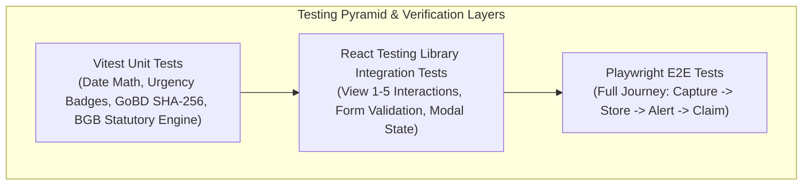

# Quality Assurance, Test Strategy & Verification Plan
**Project:** Warranty & Subscription Wallet + Policy Wiki (MCP/API-Enabled)  
**Academic Institution:** SRH University of Applied Sciences — *Computer & Media Lab*  
**Milestone:** Session 5 (MVP Scope Control Gate) & Portfolio Defense  
**Author:** Member D (Development & Quality/Media Lead)  
**Document ID:** DOC-D3  
**Status:** Approved Engineering Baseline  
**Version:** 1.0.0  

---

## 1. QA Strategy & Testing Philosophy

To satisfy the academic Definition of Done (DoD) and guarantee software reliability across the core user journey:
$$\mathbf{Capture \longrightarrow Store \longrightarrow Alert \longrightarrow Claim}$$

Our quality engineering adheres to three non-negotiable principles:
1. **Automated Coverage Ceiling ($\ge 75\%$):** Enforced via Vitest coverage gates across date logic, alert thresholds, and statutory claim generators.
2. **100% Pass Rate on Must-Have Acceptance Criteria:** Strict unit and integration verification for all Given/When/Then scenarios defined in Stories 1, 2, 3, 4, 5, and 7.
3. **Rigorous Edge-Case De-risking:** Direct testing for mobile constraints (DST alarm drift, WebRTC camera permission rejections, canvas memory limits, W3C transient activation clipboard traps).



---

## 2. Gherkin Acceptance Criteria Test Matrix (Stories 1–5, 7)

| Backlog Story | Scenario | Test Suite Target | Verification Method |
| :--- | :--- | :--- | :--- |
| **Story 1: Manual Entry** | 1.1: Standard <15s manual entry | `tests/unit/entry-flow.test.ts` | Vitest / Stopwatch simulation |
| | 1.2: Brand typeahead auto-fill | `tests/components/Typeahead.test.tsx` | RTL component interaction |
| | 1.3: Mandatory field validation | `tests/components/QuickCaptureModal.test.tsx` | Form submission rejection |
| | 1.4: Future purchase date error | `tests/unit/validation.test.ts` | Date bounds boundary check |
| | 1.5: Tax-relevant Werbungskosten | `tests/unit/tax-tagging.test.ts` | Entity state & indexing |
| | 1.6: Custom warranty duration | `tests/unit/warranty-calc.test.ts` | Override arithmetic check |
| **Story 2: Receipt Vault** | 2.1: Client compression <1.5MB | `tests/unit/media-compression.test.ts` | Canvas downscale buffer mock |
| | 2.2: Offline viewer & zoom | `tests/components/ReceiptViewer.test.tsx` | Touch event simulation |
| | 2.3: Oversized/corrupt file reject | `tests/unit/media-upload.test.ts` | File format filter check |
| | 2.4: WebRTC fallback to HTML5 | `tests/components/CaptureService.test.ts` | WebRTC error catch verification |
| | 2.5: Receipt deletion GC cleanup | `tests/unit/vault-storage.test.ts` | Blob purge & memory leak check |
| **Story 3: Expiry Alerts** | 3.1: 30, 7, 1-day push scheduling | `tests/unit/alert-scheduler.test.ts` | Notification threshold matching |
| | 3.2: Direct notification deep-link | `tests/e2e/notification-flow.spec.ts` | Playwright action routing |
| | 3.3: Expired item on entry | `tests/unit/alert-scheduler.test.ts` | Past date suppression logic |
| | 3.4: OS notification fallback | `tests/components/Dashboard.test.tsx` | In-app banner & badge render |
| | 3.5: DST transition wall-clock | `tests/unit/dst-recalibration.test.ts` | CET/CEST clock change delta |
| **Story 4: Unified Dashboard** | 4.1: Chronological sort & badges | `tests/components/Dashboard.test.tsx` | Urgency color classification |
| | 4.2: Navigation across 6 views | `tests/e2e/view-navigation.spec.ts` | Viewport router verification |
| | 4.3: Empty wallet state | `tests/components/Dashboard.test.tsx` | First-time UX render |
| | 4.4: Search & filter latency | `tests/unit/filter-benchmarks.test.ts` | Benchmark execution (<50ms) |
| | 4.5: Identical deadline collision | `tests/components/TimelineGroup.test.tsx` | Date group header rollup |
| **Story 5: Claim Generator** | 5.1: Hardware defect dossier | `tests/unit/legal-generator.test.ts` | BGB §§ 437, 477, 475e citations |
| | 5.2: Subscription cancellation | `tests/unit/legal-generator.test.ts` | BGB § 309 Nr. 9, § 312k Abs. 6 |
| | 5.3: Missing receipt alternative | `tests/components/ProofModal.test.tsx` | Kontoauszug / ZPO notice check |
| | 5.4: Custom merchant fallback | `tests/unit/legal-generator.test.ts` | Universal civil law template |
| | 5.5: Async PDF error fallback | `tests/components/AsyncFallback.test.tsx` | Transient user activation copy |
| **Story 7: MCP Interface** | 7.1: Tool discovery `tools/list` | `tests/mcp/protocol.test.ts` | JSON-RPC 2.0 schema response |
| | 7.2: `policy_lookup` execution | `tests/mcp/policy-lookup.test.ts` | Ground-truth payload check |
| | 7.3: `claim_dossier_generate` | `tests/mcp/claim-gen.test.ts` | Dossier structure validation |
| | 7.4: Invalid params handling | `tests/mcp/errors.test.ts` | `-32602` JSON-RPC error format |

---

## 3. Critical Edge-Case Test Suites

### 3.1 Daylight Saving Time (DST) Transition Recalibration
```typescript
describe('DST Alarm Recalibration Logic', () => {
  it('should trigger alert at precisely 09:00 AM local time across CEST to CET switch', () => {
    // Scheduled during CEST (UTC+2) for execution during CET (UTC+1)
    const targetDateStr = '2026-11-01'; // Post-DST transition date
    const localAlarm = calculateLocalAlarmDate(targetDateStr, 7); // 7 days prior at 09:00
    
    expect(localAlarm.getHours()).toBe(9);
    expect(localAlarm.getMinutes()).toBe(0);
  });
});
```

### 3.2 German Civil Law Statutory Citations Engine
```typescript
describe('Statutory Legal Engine (BGB Transposition)', () => {
  it('should inject § 477 Abs. 1 Beweislastumkehr when purchase is within 12 months', () => {
    const claim = generateHardwareClaim({
      purchaseDate: '2026-05-10',
      claimDate: '2026-10-29', // 5 months later
      item: 'Sony Headphones',
      defect: 'Intermittent Bluetooth disconnect'
    });
    
    expect(claim.bodyText).toContain('§ 477 Abs. 1 BGB');
    expect(claim.bodyText).toContain('Beweislastumkehr');
  });

  it('should invoke § 312k Abs. 6 fristlose Kündigung if online cancellation button is absent', () => {
    const notice = generateCancellationNotice({
      serviceSlug: 'gym-membership',
      onlineButtonMissing: true
    });

    expect(notice.bodyText).toContain('§ 312k Abs. 6 BGB');
    expect(notice.bodyText).toContain('fristlose Kündigung');
  });
});
```

### 3.3 Safe Clipboard & Transient User Activation
```typescript
describe('W3C Transient Activation Safety Fallback', () => {
  it('should display recovery modal with interactive copy button on async render failure', async () => {
    const renderFailureMock = vi.fn().mockRejectedValue(new Error('Canvas worker timeout'));
    const modal = await renderClaimActionWithFallback(renderFailureMock);

    expect(modal.getByRole('button', { name: /Copy Text Dossier to Clipboard/i })).toBeInTheDocument();
    expect(modal.getByRole('button', { name: /Download .txt Dossier/i })).toBeInTheDocument();
  });
});
```

---

## 4. Performance & Non-Functional Benchmarks

| Metric | Target Ceiling | Test Harness / Verification Tool |
| :--- | :--- | :--- |
| **Manual Entry Interaction Speed** | $< 15\text{ seconds}$ | Stopwatch benchmark test (modal open $\to$ item saved) |
| **Receipt Image Compression Speed** | $< 1,200\text{ ms}$ | Performance.now() measuring 15MB raw $\to <1.5\text{MB}$ Canvas conversion |
| **Receipt Thumbnail Generation** | $< 250\text{ ms}$ | $200\times 200\text{px}$ Base64 rendering |
| **Web Crypto SHA-256 Hashing** | $< 50\text{ ms}$ | `crypto.subtle.digest` on 1.5MB ArrayBuffer |
| **IndexedDB Blob Write Latency** | $< 80\text{ ms}$ | Dexie.js transactional write benchmark |
| **List Search & Category Filtering** | $< 50\text{ ms}$ | Filter latency across 100 stored records |
| **MCP Tool Execution Latency** | $< 200\text{ ms}$ | JSON-RPC 2.0 roundtrip execution |
| **WCAG 2.1 AA Accessibility** | $0\text{ violations}$ | Automated `axe-core` scan (contrast $\ge 4.5:1$, touch targets $\ge 48\text{px}$) |

---

## 5. Definition of Done (DoD) Verification Gates

Before tagging any Session 5 release candidate:
- [ ] `pnpm run typecheck` (`tsc --noEmit` returns code 0).
- [ ] `pnpm run lint` (`eslint .` returns zero errors and warnings).
- [ ] `pnpm run test:coverage` (Vitest reports $\ge 75\%$ total code coverage).
- [ ] All 28 Given/When/Then scenarios passing in automated test runner.
- [ ] Model Context Protocol test suite passes with zero schema rejections.
