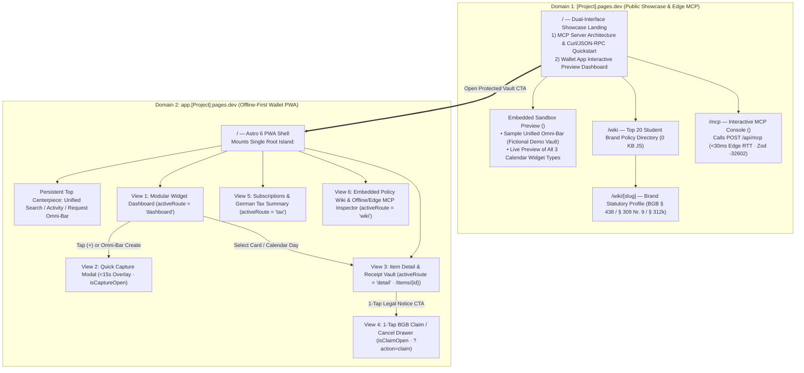
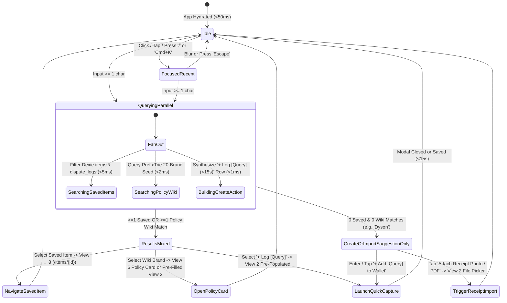

# 🗺️ Information Architecture, Dual-Domain Routing & Interaction Specification (`DOC-UX-03`)

**Document Reference:** `DOC-UX-03`  
**Academic Institution:** SRH University of Applied Sciences (*SRH Hochschule*)  
**Course Module:** *Computer & Media Lab* (Wintersemester 2026) · **Instructor:** Prof. Franziska Schwarz  
**Working Team:** **Team 6**  
**Project:** *Warranty, Subscription & Tax-Ready Wallet + Policy Wiki (MCP/API-Enabled)*  
**Active Milestone:** Session 5 — MVP Scope Lock & Working Core User Journey Gate  
**Role Owner & Author:** **Prushti** — *UX/UI Lead (Member C)* · *Reviewed by **Kyle** (Development Lead)*

---

## 1. Dual-Domain Information Architecture & Sitemap

In accordance with `ADR-04` and the ratified Dual-Domain Widget Dashboard Architecture, CM-LAB separates **public zero-friction discovery & MCP documentation (`[Project].pages.dev`)** from the **100% offline-first personal consumer vault (`app.[Project].pages.dev`)**.

### Responsive wallet and showcase navigation

The English wallet opens on **Deadlines**. At wider widths, a selected deadline opens its details beside the list. At narrow widths, details follow the list. The floating **Deadlines**, **Vault**, and **Wiki** pill is paired with a separate quick-action button. The **Vault** destination keeps the existing wallet and calendar tools available. **Wiki** opens the public reference directory.

The English showcase stacks the introduction and sample demo on mobile and places them side by side on desktop. The sample is labeled as fictional. **Open wallet** opens the personal app. The **Policy Wiki** and **MCP Playground** are public entry points.

### 1.1 Sitemap & Execution Boundary Matrix

| Domain | Route / State | Astro / Svelte Boundary | Network & Data Dependency | Primary User Task |
| :--- | :--- | :--- | :--- | :--- |
| **`[Project].pages.dev`** | `/` | `.astro` Static HTML + `<ShowcasePreviewIsland client:visible />` | Zero PII; static fictional seed (`Sony XM4`, `Spotify`, `MacBook`) | Understand CM-LAB's **MCP Server** + **Wallet App** value proposition; test interactive widget & Omni-Bar preview. |
| **`[Project].pages.dev`** | `/wiki` & `/wiki/[slug]` | `.astro` Static / Edge SSR (`0 KB` client JS) | Bundled `policy_wiki_seed_v1.json` (Phase 2: EmDash + D1) | Read SEO-indexed statutory vs. commercial warranty and `§ 312k BGB` cancellation profiles for Top 20 brands. |
| **`[Project].pages.dev`** | `/mcp` & `POST /api/mcp` | `<McpExplorerIsland client:load />` + Worker Route | Stateless Cloudflare Worker (`Cache-Control: no-store`) | Execute live JSON-RPC 2.0 `policy_lookup` and `claim_dossier_generate` calls; inspect `-32602` validation. |
| **`app.[Project].pages.dev`** | `/` (`dashboard`) | `<WalletApp client:only="svelte" />` | **100% Offline** (`Dexie.js v4` + `sw.ts` asset cache) | Triage expirations via modular calendar widgets and query/act through the **Unified Omni-Bar**. |
| **`app.[Project].pages.dev`** | `#capture` (Modal) | In-memory modal inside `<WalletApp />` (`0ms` mount) | **100% Offline** (`PrefixTrie.ts` + Web Worker SHA-256) | Log hardware or subscription + snap encrypted receipt + toggle `§ 9 EStG` tax status in **`<15s` (`11.4s`)**. |
| **`app.[Project].pages.dev`** | `/items/{id}` (`detail`) | Sub-view inside `<WalletApp />` (`<16ms` switch) | **100% Offline** (`AES-GCM-256` local decrypt to `<canvas>`) | Inspect `24m/12m BGB § 477` timeline bar and pinch-to-zoom receipt proof (`1x–4x`). |
| **`app.[Project].pages.dev`** | `/items/{id}?action=claim` | Contextual drawer inside `<WalletApp />` (`<16ms`) | **100% Offline** (5 deterministic `DOC-PRD-02` templates) | Deep-link directly from `09:00 Europe/Berlin` push notification (`Scenario 3.2`) into 1-tap PDF/text notice export. |
| **`app.[Project].pages.dev`** | `#tax` (`tax`) | Sub-view inside `<WalletApp />` (`<16ms` switch) | **100% Offline** (`BMF 22.02.2022` calculator + CSV blob) | Audit monthly subscription burn and export German *Werbungskosten* CSV (`§ 2 StBerG` compliant). |

---

## 2. The Single-Island UX Routing Rule (`<WalletApp client:only="svelte" />`)

Splitting Views 1–5 across separate server-rendered `.astro` documents would fail in Airplane Mode (`navigator.onLine === false`), trigger `indexedDB is not defined` SSR crashes, evict decrypted receipt `<canvas>` bitmaps from memory, and break keyboard focus traps. Therefore:

1. **Single Hydration Root:** `app.[Project].pages.dev` mounts a single `<WalletApp client:only="svelte" />` component (`~11.8 KB` gzipped) backed by `wallet.svelte.ts` (`$state.raw` + `createSubscriber` wrapping Dexie `liveQuery`).
2. **Sub-16ms View Transitions:** Navigating between Dashboard (`View 1`), Quick Capture (`View 2`), Item Vault (`View 3`), Claim Compiler (`View 4`), Tax Summary (`View 5`), and Offline Policy Wiki (`View 6`) mutates `$state` route signals in memory (`<16ms` single frame, `CLS = 0`).
3. **URL Deep-Link Synchronization:** `history.replaceState` / `popstate` listeners synchronize `/items/{id}?action=claim` so tapping an OS push notification at `09:00 Europe/Berlin` opens the exact item's statutory claim drawer immediately without a server roundtrip.

---

## 3. Unified Search / Activity / Request Omni-Bar: State Machine & Keyboard Spec

The **Unified Omni-Bar (`OmniBar.svelte`)** sits persistently at the top of `app.[Project].pages.dev` (and in sandboxed demo mode on `[Project].pages.dev`), unifying **Local Vault Search**, **Recent Activity Lookup**, **Policy Wiki Brand Querying**, and **`<15s` Item Creation / Receipt Import**.

### 3.1 Deterministic Omni-Bar State Machine

### 3.2 State Definitions & Latency Budgets

| Omni-Bar State | Entry Condition | Visual UI Presentation | Latency SLA |
| :--- | :--- | :--- | :---: |
| **`1. Idle`** | Default resting state (`query === ""`, unfocused) | High-contrast input (`#FFFFFF` card, `2px` `#2F524C` Teal border on hover/focus), leading magnifying-glass icon, placeholder `"Search saved vault, Policy Wiki, or log a purchase..."`, trailing `⌘K` / `/` hint badge and `[+ Capture]` pill (`48x48px`). | `0ms` |
| **`2. Focused / Recent Activity`** | User focuses Omni-Bar with empty query | Displays up to 3 recent vault activities (e.g., *"Generated Saturn Mängelrüge · 2h ago"*, *"Upcoming Spotify renewal · 3d"*) + quick brand starter chips (`[Sony]`, `[Apple]`, `[Spotify]`, `[FitX]`). | `<5ms` |
| **`3. Searching Saved Items`** | `query.trim().length >= 1` | **Group 1 (`Saved in Local Vault`):** Matching `WalletItem` rows showing item title, urgency badge (`Urgent` / `Expiring Soon` / `Protected`), countdown (`"16m BGB left"` or `"Renews in 3d"`), and 1-tap `Claim / Cancel` shortcut. | `<5ms` (`Dexie` in-memory `$state.raw` filter) |
| **`4. Searching Policy Wiki`** | `query.trim().length >= 2` | **Group 2 (`Policy Wiki Statutory Rules`):** Matching `PrefixTrie.ts` brand entries from `policy_wiki_seed_v1.json` displaying statutory defaults (`24m BGB § 438`, `12m § 477 Cliff`, `1m § 309 Nr. 9`, or `§ 312k Abs. 6 Non-Compliant Warning`). | `<2ms` (`PrefixTrie.ts`) |
| **`5. Create / Import New Item Suggestion`** | Always appended when `query.trim().length >= 1`; promoted to **primary hero action** when Groups 1 & 2 return `0` matches | **Group 3 (`Quick Capture & Receipt Import`):** Highlighted Coral-accented (`#D96B4B`) action row: **`+ Log "[Query]" in <15s`** (with auto-matched brand preset if available) plus secondary action **`📷 Snap / Import Receipt Photo`**, preventing zero-match dead ends (`Board C Screen 06`). | `<1ms` (`$derived`) |

### 3.3 Keyboard Navigation & Pointer Ergonomics Matrix

| Key / Gesture | Context | Deterministic Interaction Behavior |
| :--- | :--- | :--- |
| **`/`** or **`Ctrl/Cmd + K`** | Global (`app.[Project].pages.dev` when outside text inputs) | Moves focus immediately into `#omnibar-input` and selects existing text for instant overwrite. |
| **`ArrowDown` / `ArrowUp`** | Omni-Bar input focused | Cycles `activeIndex` cyclically (`0 .. visibleItems.length - 1`), updating `aria-activedescendant` without moving DOM focus out of `<input>`. |
| **`Tab` / `Shift + Tab`** | Omni-Bar dropdown open | Jumps `activeIndex` across result section headers (`Saved Items` $\rightarrow$ `Policy Wiki` $\rightarrow$ `Create / Import New Item`) or exits cleanly when at boundary. |
| **`Enter`** | Option highlighted (`activeIndex >= 0`) | Executes primary route for highlighted option: opens View 3 (`saved`), opens pre-populated View 2 / Wiki drawer (`wiki`), or launches View 2 with `name = query` (`create`). |
| **`Shift + Enter`** | Any non-empty `query` | Shortcut: immediately opens **View 2 (`QuickCaptureModal`)** pre-filled with `query` and matched `PrefixTrie` statutory defaults, bypassing list scrolling (`<15s` power path). |
| **`Escape`** | Dropdown open or query non-empty | First press closes listbox (`isOpen = false`); second press clears `query = ""` and restores full dashboard feed. |
| **Mobile Touch (`onpointerdown`)** | `375px–412px` smartphone | Every suggestion row enforces `min-height: 48px` (`>=48x48px` target) and fires before input `blur` so virtual keyboard dismissal never swallows taps. |

---

## 4. Distinct Calendar Widget Interaction Contracts

### 4.1 Calendar Widget 1: Monthly Renewal & Expiry Grid (`MonthlyCalendarGrid.svelte`)
* **Grid Structure:** 7-column ISO week calendar (`Mo, Di, Mi, Do, Fr, Sa, So`) with `< Prev Month` / `Next Month >` (`48x48px` buttons) and `[Today]` jump pill.
* **Cell Indicators:** Dates with events display semantic urgency dots paired with distinct shapes (`▲` Triangle = `<=7d` Urgent `#DC2626`, `◆` Diamond = `8–30d` Amber `#D97706`, `●` Circle = `>30d` Protected `#059669`) to satisfy WCAG 1.4.1 non-color redundancy.
* **Same-Day Collision Popover (`Scenario 4.5`):** Tapping or pressing `Enter` on a multi-event date cell (e.g., `Nov 1` with 3 subscriptions) expands an inline summary tray (`"Nov 1 — 3 Renewals · €34.97 cumulative"`) listing each contract with direct 1-tap cancellation links.
* **Keyboard Navigation:** Roving `tabindex` (`0` on active date, `-1` on inactive dates) with `ArrowLeft/Right` ($\pm 1$ day), `ArrowUp/Down` ($\pm 7$ days), and `PageUp/PageDown` ($\pm 1$ month).

### 4.2 Calendar Widget 2: `24m / 12m BGB § 477 Abs. 1` Cliff Timeline Bar (`BgbCliffTimelineWidget.svelte`)
* **Dual-Segment Geometry:**
  * **Segment A (`0m – 12m`):** Solid Protected Green (`#059669`) / Primary Teal (`#2F524C`) track labeled **`Beweislastumkehr Active (BGB § 477 Abs. 1)`** — defect presumed present at delivery.
  * **Vertical Cliff Marker (`Month 12`):** High-visibility milestone pin displaying exact calendar date (`beweislastumkehrDate`); switches to Warning Amber (`#D97706`) during Month 11 (`T-30d`) and Urgent Red (`#DC2626`) in final 7 days.
  * **Segment B (`12m – 24m`):** Stippled Teal track labeled **`Statutory Seller Liability (BGB § 438 Abs. 1 Nr. 3)`** + conditional `+4m BGB § 475e Abs. 1` *Ablaufhemmung* extension tail if a defect arises in Months `21–24`.
* **Interactive Inspection:** Hovering, focusing, or tapping any segment reveals a plain-language German/English consumer rights tooltip and a 1-tap `[Generate § 437 Claim Dossier]` button.

### 4.3 Calendar Widget 3: `30 / 7 / 1-Day` Expiration Countdown Stack (`UrgencyCountdownWidget.svelte`)
* **Wall-Clock Precision:** Subscribes to reactive `SvelteDate` (`Europe/Berlin` IANA timezone), matching `AlertScheduler.ts` `09:00:00` local triggers with **`0h` CET $\leftrightarrow$ CEST DST drift** (`Scenario 3.5`).
* **Triage Grouping:** Buckets items into collapsible priority bands:
  1. **Immediate Action (`<= 7 Days` · Urgent Red `#DC2626`):** Top-pinned with prominent Coral/Red action button (`Cancel Under § 312k` or `File § 437 Claim`).
  2. **Inspection Window (`8 – 30 Days` · Warning Amber `#D97706`):** Includes **Month 11 Hardware Checkup** prompts before the `12m BGB § 477` reversal expires.
  3. **Active Coverage (`> 30 Days` · Protected Green `#059669`):** Compact summary cards confirming GoBD `SHA-256` vault integrity.
