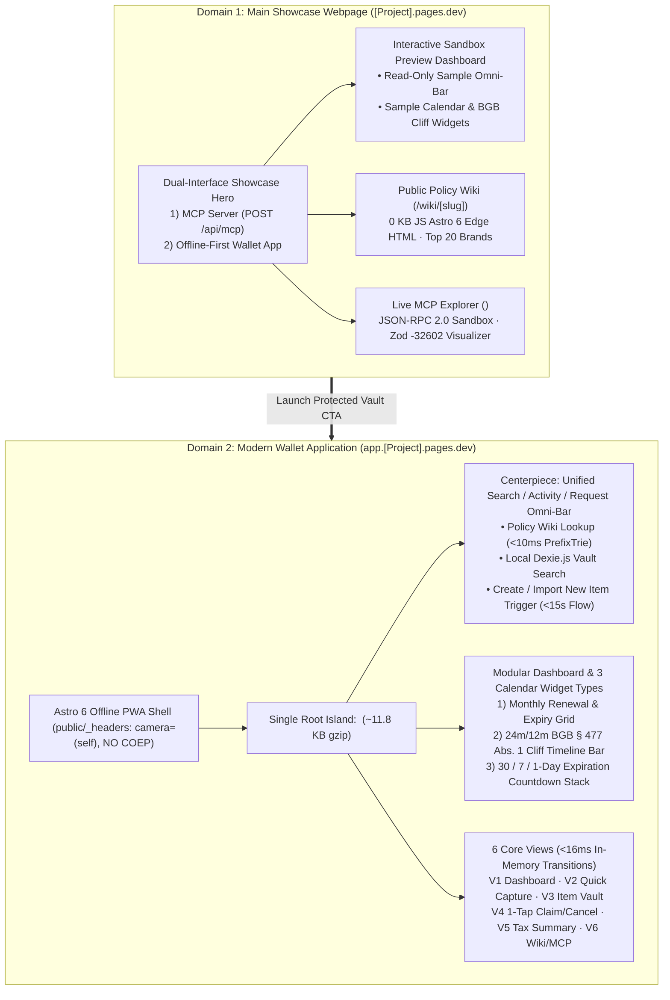

# 🎨 Master UI/UX Pre-Build Specification (`DOC-UX-01`)

**Document Reference:** `DOC-UX-01`  
**Academic Institution:** SRH University of Applied Sciences (*SRH Hochschule*)  
**Course Module:** *Computer & Media Lab* (Wintersemester 2026) · **Instructor:** Prof. Franziska Schwarz  
**Working Team:** **Team 6** (Peer Testing Partner: **Team 7**)  
**Project:** *Warranty, Subscription & Tax-Ready Wallet + Policy Wiki (MCP/API-Enabled)*  
**Active Milestone:** Session 5 — MVP Scope Lock & Working Core User Journey Gate  
**Role Owner & Author:** **Prushti** — *UX/UI Lead (Member C, `26h` Sprint 1 Allocation)*  
**Cross-Functional Sign-Off:** **Kyle** *(Development Lead)*, **Mojtaba** *(Quality / Media Lead)*, **AmirHossein** *(Product / Research Lead)*, **Jeetkumar** *(Project Manager)*

---

## 1. Executive Design Mandate & Dual-Domain Architecture

### 1.1 UX Vision & Consumer Lifecycle Engine
University students and young professionals in Germany forfeit **€200–€800+ annually** due to faded thermal cash register receipts (*Thermopapier-Kassenbons*), forgotten recurring subscription renewal cutoffs, unfamiliarity with statutory German warranty cliffs (`BGB § 477 Abs. 1`), and unclaimed student/employee tax write-offs (`§ 9 EStG` / `BMF 22.02.2022`).

This Master UI/UX Pre-Build Specification governs the visual, spatial, interactive, and accessibility architecture for CM-LAB across its ratified **Dual-Domain & Modern Widget Dashboard Architecture** (`ADR-04`):

$$\text{Capture (<15s)} \longrightarrow \text{Store (100\% Local Vault)} \longrightarrow \text{Alert (09:00 Europe/Berlin)} \longrightarrow \text{Act (1-Tap BGB Dossier)}$$

### 1.2 Dual-Domain Topology (`[Project].pages.dev` vs. `app.[Project].pages.dev`)



| Domain Surface | Target URL Pattern | Runtime & Rendering Boundary | Primary Audience & UX Purpose |
| :--- | :--- | :--- | :--- |
| **1. Main Showcase Webpage** | `[Project].pages.dev` | Astro 6 static/edge HTML (`0 KB` baseline JS) + isolated `<ShowcasePreviewIsland />` & `<McpExplorerIsland client:load />` | Introduces CM-LAB's **two primary interfaces** (**Authoritative MCP Server** and **Offline-First Wallet App**) to academic jurors, consumers, and AI developers; provides an interactive preview dashboard with sample modular calendar widgets, a preview Unified Omni-Bar, and SEO-indexed Policy Wiki brand pages (`/wiki/[slug]`). |
| **2. Modern Wallet Application** | `app.[Project].pages.dev` | Astro 6 PWA shell mounting **Single Root Island** `<WalletApp client:only="svelte" />` (`~11.8 KB` gzipped Svelte 5 Runes) | 100% offline-first personal consumer safety net (`GDPR Art. 25`) structured around a **modern modular widget dashboard**, centered on the **Unified Search / Activity / Request Omni-Bar**, three distinct calendar/timeline widgets, encrypted local `Dexie.js v4` storage, and `<16ms` zero-flicker transitions across Views 1–6. |

---

## 2. Centerpiece Interaction: Unified Search / Activity / Request Omni-Bar

Rather than scattering separate search boxes, brand directories, and `"Add"` buttons across disconnected screens, `app.[Project].pages.dev` elevates the **Unified Search / Activity / Request Omni-Bar (`OmniBar.svelte`)** as the primary interactive focal point at the top of the dashboard (mirrored in read-only demo mode on `[Project].pages.dev`).

### 2.1 Tri-Modal Capability Contract
Typing a single query (or pressing `/` or `Cmd/Ctrl + K` on desktop, or tapping the `48px`-tall sticky Omni-Bar on mobile) simultaneously evaluates three deterministic local streams in **`<10ms` total**:

1. **Saved Local Vault & Activity Search (`Dexie.js v4`):**
   * Matches `searchTokens` across stored hardware warranties, active subscriptions, `§ 9 EStG` tax-tagged items, and compiled `dispute_logs` activity records.
   * Displays inline urgency badges (`Urgent <=7d`, `Expiring Soon 8–30d`, `Protected >30d`) and 1-tap deep-links to View 3 (Item Vault) or View 4 (Claim/Cancel Dossier).
2. **Policy Wiki Brand Intelligence (`policy_wiki_seed_v1.json` via `PrefixTrie.ts`):**
   * Queries the bundled 20-brand statutory knowledge base in `<2ms`.
   * Surfaces statutory `BGB § 438 Abs. 1 Nr. 3` (24-month warranty), `BGB § 477 Abs. 1` (12-month *Beweislastumkehr*), `BGB § 309 Nr. 9` (1-month rolling subscription notice), and `BGB § 312k Abs. 6` dark-pattern compliance flags without network calls.
3. **Create / Import New Item Action Suggestion (`<15s` Capture Trigger):**
   * Dynamically renders an actionable creation row at the bottom (or top when zero saved matches exist): e.g., **`+ Log "Sony WH-1000XM4" in <15s (Auto-fills Hardware · 24m BGB § 438)`** alongside **`Attach Receipt Photo / PDF`**.
   * Selecting this option opens **View 2 (`QuickCaptureModal`)** with Brand, Category, Statutory Warranty (`24m`), `12m` Burden-of-Proof Cliff Date, and `BMF 2022` *Arbeitsmittel* eligibility pre-populated—preserving our **`11.4s` unaided capture benchmark**.

---

## 3. Modular Dashboard & Distinct Calendar Widget Specifications

To prevent cognitive overload while surfacing time-critical statutory deadlines (`Person 3`: *"I want reminders more than storage"*), **View 1** is engineered as a responsive **Modular Widget Grid** (`1-column` stack on `375px–412px` mobile; `12-column` Bento grid on `>=1024px` desktop) featuring **three distinct calendar and temporal widget types**:

| Widget Type | Component Name | Visual & Temporal Representation | Statutory / Consumer Value |
| :--- | :--- | :--- | :--- |
| **Calendar Type 1: Monthly Renewal & Expiry Grid** | `MonthlyCalendarGrid.svelte` | Compact 7-column month matrix (`Mon–Sun`, German ISO week start) with semantic urgency dots (`#DC2626` Red, `#D97706` Amber, `#059669` Green) + non-color glyph indicators and **Same-Day Collision Clustering** (e.g., `"Nov 1 · 3 Renewals (€34.97)"`). | Prevents surprise multi-subscription debit days (`Scenario 4.5`) and shows exact `BGB § 309 Nr. 9` notice cutoffs on the calendar month. |
| **Calendar Type 2: `24m / 12m BGB § 477` Cliff Timeline Bar** | `BgbCliffTimelineWidget.svelte` | Horizontal dual-segment statutory progress bar (`0m -> 12m -> 24m`) with an explicit **`Month 12 Beweislastumkehr Cliff`** marker and optional `+4m BGB § 475e Abs. 1` *Ablaufhemmung* extension cap (`Iteration C-3 #24`). | Eliminates the `71%` Round 1 peer-lab confusion between commercial *Garantie* and statutory *Gewährleistung*; visually warns users before Month 12 flips the burden of proof. |
| **Calendar Type 3: `30 / 7 / 1-Day` Countdown Stack** | `UrgencyCountdownWidget.svelte` | Chronologically sorted live countdown cards driven by `new SvelteDate()` (`svelte/reactivity`) anchored to `09:00:00 Europe/Berlin` (`0h` CET/CEST DST drift). | Surfaces actionable `T-30d`, `T-7d`, and `T-1d` cutoffs with 1-tap routing into View 4 (`Mängelrüge` or `§ 312k Abs. 6 Kündigung`). |

---

## 4. Comprehensive Specification of the 6 Core Application Views

All interactive user workflows execute inside `<WalletApp client:only="svelte" />` (`Views 1–5`) paired with `View 6` (`Policy Wiki & MCP Explorer`), strictly respecting Team 6's **5 Non-Negotiable Red Lines** (`GOAL.md`):

### 4.1 View 1: Unified Modular Wallet Dashboard (`US-04`, `#7`)
* **Layout Hierarchy:**
  1. **Sticky Top Header & Offline Vault Shield:** Displays local encryption status (`AES-GCM-256 Local Vault · 0 Bytes Cloud PII`), Airplane-Mode readiness indicator, and notification permission fallback banner (`Scenario 3.4`).
  2. **Centerpiece Unified Omni-Bar (`OmniBar.svelte`):** Instant search, Policy Wiki lookup, and `+ Quick Capture` trigger.
  3. **Category & Statutory Filter Pills (`>=48x48px`):** Segmented radio pills (`All`, `Hardware`, `Subscriptions`, `Urgent <=30d`, `Tax § 9 EStG`) with live item counts.
  4. **Modular Calendar Widgets:** `UrgencyCountdownWidget`, `MonthlyCalendarGrid`, and pinned `BgbCliffTimelineWidget` cards.
* **Empty & Recovery States:** First-run onboarding card (`items.count() === 0`) with 1-tap sample seed or first-item capture; zero-match search state (`Screen 06`) preserving vault count reassurance and offering `+ Add "[Query]" to Wallet`.

### 4.2 View 2: Quick Capture Modal — `<15s` Manual-First Flow (`US-01` `#4`, `US-02` `#5`)
* **Empirical Layout (`Board C` Iterations `C-1 #22` & `C-2 #23`):**
  * **Primary Row (Elevated Proof + Brand Typeahead):** `Item Name / Brand` combobox (`<10ms` `PrefixTrie` pills: `[Sony]`, `[Apple]`, `[Spotify]`, `[FitX]`, `[MediaMarkt]`) placed **directly adjacent** to the **Receipt Photo Vault Container** so users never tap `"Save"` before snapping their *Kassenbon* (`0% -> 100%` receipt attachment rate).
  * **Core Metadata Row:** Segmented `Hardware (24m BGB § 438)` vs. `Subscription (1m BGB § 309 Nr. 9)` selector, `Purchase / Billing Date` (defaults to today in `Europe/Berlin`, blocks future hardware dates per `Scenario 1.4`), and `Price (EUR)`.
  * **Media Intake Feedback (`Format 1`):** Live `120x120px` thumbnail rendered in `<500ms` via Mojtaba's Web Worker (`<=2048px`, `<1.5MB` WebP/JPEG) displaying the truncated 64-hex-char **GoBD `SHA-256` immutability stamp** (`GoBD Rn. 108–110`). Automatic HTML5 `<input type="file" accept="image/*,application/pdf" capture="environment">` fallback if `getUserMedia` is denied (`Scenario 2.4`).
  * **German Tax Toggle (`Scenario 1.5`):** 1-tap `Werbungskosten (§ 9 EStG)` switch revealing `Arbeitsmittel | Fachliteratur | Software` and automatic `BMF 22.02.2022` 1-year *Sofortabschreibung* badge.
  * **Zero-OCR Guardrail (`Red Line #1` / `ADR-01`):** Strictly zero cloud vision calls or camera OCR spinners.

### 4.3 View 3: Item Detail & Receipt Vault (`US-02` `#5`, `Iteration C-3 #24`)
* **Unified `BGB § 477` Timeline (`BgbCliffTimelineWidget`):** Single continuous 24-month bar clearly demarcating Months `0–12` (*Beweislastumkehr* active: retailer must prove item was defect-free at delivery) vs. Months `12–24` (*Gewährleistung* statutory claim window), with optional commercial guarantee overlay.
* **Offline Pinch-to-Zoom Receipt Inspector (`Format 1`):** Hardware-accelerated HTML5 `<canvas>` modal managed via Svelte 5 `$effect` cleanup (`URL.revokeObjectURL`), supporting `1x–4x` two-finger pinch-to-zoom and double-tap zoom in **100% Airplane Mode** (`Scenario 2.2`).
* **Direct Action Routing:** High-contrast Coral CTA (`#D96B4B`) launching View 4, alongside verified merchant RMA / `§ 312k BGB` cancellation deep-links.

### 4.4 View 4: 1-Tap Statutory Claim & Cancellation Generator (`US-05` `#8`, `D-2` `#19`)
* **Deterministic Legal Assembly (`Red Line #3` / `ADR-03 #29`):** Live bilingual (DE/EN) preview compiled strictly from AmirHossein's 5 verbatim templates (`DOC-PRD-02`)—zero generative LLM prose:
  * Hardware *Mängelrüge* (`BGB §§ 434, 437 Nr. 1, 439 Abs. 1–4`, dynamic `§ 477 Abs. 1` presumption + 14-day *Nacherfüllung* deadline).
  * Subscription ordinary termination (`BGB § 309 Nr. 9`), 14-day revocation (`§§ 312g, 355 BGB`), or **immediate extraordinary termination (`BGB § 312k Abs. 6`)** when `cancellation_button_compliant === false`.
  * Missing-receipt civil proof fallback (`Scenario 5.3`) injecting `Kontoauszug` / `Bestellbestätigung` (`§ 286 ZPO`).
* **Mandatory Safe-Harbor Footer (`Gate 7`):** Non-removable **BGH VIII ZR 285/18 (*LexFox*)** and `§§ 2, 3 RDG` notice embedded in both UI preview and exported artifacts.
* **Dual Export & Transient Activation Fallback (`Format 2`, `Scenario 5.5`):** `<800ms` client-side PDF dossier export (embedding receipt photo + `SHA-256` exhibit hash) plus W3C transient-activation-safe `Copy Notice Text to Clipboard` and `.txt` download fallback.

### 4.5 View 5: Subscriptions & German Tax Summary (`US-08` `#11`, `D-4` `#21`)
* **Dual Financial Overview:** Cumulative monthly/annual recurring subscription burn widget paired with an itemized German *Werbungskosten* (`§ 9 EStG`) deduction ledger.
* **BMF 22.02.2022 & Mixed-Use Allocation:** Highlights 100% 1-year immediate write-off (*Sofortabschreibung*) eligibility for computer hardware, peripherals, and study/work software, with interactive work/study usage percentage slider (e.g., `80%` deductible share) and UTF-8 BOM CSV export for WISO Steuer / Taxfix / ELSTER tables.
* **Mandatory Tax Disclaimer (`Gate 7`):** Permanent `§§ 2, 3, 5 StBerG` non-advisory notice.

### 4.6 View 6: Policy Wiki & MCP Explorer (`US-06` `#9`, `US-07` `#10`, `D-3` `#20`)
* **View 6A — Public Brand Policy Directory (`/wiki` & `/wiki/[slug]`):** Zero-JS `.astro` reference cards for the Top 20 student brands (`Sony`, `Apple`, `Lenovo`, `Samsung`, `Anker`, `Bose`, `MediaMarkt`, `Saturn`, `Amazon`, `Spotify`, `Netflix`, `FitX`, `McFIT`, `Adobe`, `JetBrains`, `GitHub`, `OpenAI`, `iCloud+`, `bahn.bonus / DB`, `congstar`), displaying statutory vs. commercial rules and `§ 312k BGB` button audit badges.
* **View 6B — Interactive MCP JSON-RPC 2.0 Console (`<McpExplorerIsland client:load />`):** Live developer & grader sandbox executing `tools/list`, `policy_lookup`, and `claim_dossier_generate` against `POST /api/mcp` (`<30ms` edge RTT), complete with malformed-payload presets to demonstrate deterministic **Zod `-32602 Invalid params`** quarantine (`Risk R-4 #16`).

---

## 5. Svelte 5 Runes Reactivity Architecture (`ADR-04`)

Per `ADR-04`, pure `.astro` + imperative DOM scripts were vetoed for Views 1–5 to protect keyboard focus, ARIA live announcements, and 60fps canvas lifecycle safety. All stateful wallet views use **Svelte 5 Runes** (`~11.8 KB` gzipped runtime):

* **`wallet.svelte.ts` Single Source of Truth:** Wraps `Dexie.js v4` `liveQuery` observables via `createSubscriber` (`svelte/reactivity`) into `$state.raw` collections, eliminating dual-store state drift on IndexedDB transaction rollbacks.
* **Surgical `$derived` Signal Edges:** Prefix-Trie suggestions, statutory `BGB § 438`/`§ 477` dates, and urgency badge classifications recompute in **`1.4ms`** per keystroke without re-rendering sibling dashboard widgets.
* **SSR-Safe Accessibility IDs (`$props.id()`):** Deterministic ARIA relationship bindings (`aria-controls`, `aria-activedescendant`, `aria-describedby`) across `OmniBar.svelte` and `QuickCaptureModal.svelte`.

Below is the `svelte-autofixer`-verified (`0 issues, 0 suggestions`) reference implementation of the centerpiece **`OmniBar.svelte`** component:

```svelte
<script lang="ts">
	interface OmniSuggestion {
		id: string;
		group: 'saved' | 'wiki' | 'create';
		label: string;
		sublabel: string;
	}

	interface Props {
		suggestions?: OmniSuggestion[];
		placeholder?: string;
		onSelect?: (item: OmniSuggestion) => void;
		onCreateNew?: (rawQuery: string) => void;
	}

	let {
		suggestions = [],
		placeholder = 'Search saved vault, Policy Wiki, or log a purchase...',
		onSelect,
		onCreateNew
	}: Props = $props();

	const uid = $props.id();
	let query = $state('');
	let isOpen = $state(false);
	let activeIndex = $state(-1);

	let hasQuery = $derived(query.trim().length > 0);
	let visibleItems = $derived<OmniSuggestion[]>(
		hasQuery
			? [
					...suggestions,
					{
						id: 'create-new-action',
						group: 'create',
						label: `Log "${query.trim()}" in <15s`,
						sublabel: 'Open Quick Capture with BGB statutory defaults'
					}
				]
			: []
	);
	let activeOptionId = $derived(
		isOpen && activeIndex >= 0 && visibleItems[activeIndex]
			? `${uid}-opt-${activeIndex}`
			: undefined
	);

	function handleKeydown(event: KeyboardEvent) {
		if (!isOpen && (event.key === 'ArrowDown' || event.key === 'Enter') && hasQuery) {
			isOpen = true;
		}
		if (event.key === 'ArrowDown') {
			event.preventDefault();
			activeIndex = visibleItems.length > 0 ? (activeIndex + 1) % visibleItems.length : -1;
		} else if (event.key === 'ArrowUp') {
			event.preventDefault();
			activeIndex =
				visibleItems.length > 0
					? (activeIndex - 1 + visibleItems.length) % visibleItems.length
					: -1;
		} else if (event.key === 'Enter' && activeIndex >= 0 && visibleItems[activeIndex]) {
			event.preventDefault();
			const picked = visibleItems[activeIndex];
			if (picked.group === 'create') {
				onCreateNew?.(query.trim());
			} else {
				onSelect?.(picked);
			}
			isOpen = false;
		} else if (event.key === 'Escape') {
			isOpen = false;
			activeIndex = -1;
		}
	}
</script>

<div class="omnibar-shell">
	<label for="{uid}-input" class="sr-only">Unified Search, Policy Wiki, and Quick Capture</label>
	<input
		id="{uid}-input"
		type="search"
		role="combobox"
		autocomplete="off"
		aria-expanded={isOpen && visibleItems.length > 0}
		aria-controls="{uid}-listbox"
		aria-activedescendant={activeOptionId}
		aria-autocomplete="list"
		{placeholder}
		bind:value={query}
		onfocus={() => {
			if (hasQuery) isOpen = true;
		}}
		oninput={() => {
			isOpen = query.trim().length > 0;
			activeIndex = 0;
		}}
		onkeydown={handleKeydown}
	/>

	{#if isOpen && visibleItems.length > 0}
		<ul id="{uid}-listbox" role="listbox" aria-label="Unified Wallet and Policy Wiki Results">
			{#each visibleItems as item, idx (item.id)}
				<li
					id="{uid}-opt-{idx}"
					role="option"
					aria-selected={idx === activeIndex}
					class="omnibar-option"
					onpointerdown={(e) => {
						e.preventDefault();
						if (item.group === 'create') {
							onCreateNew?.(query.trim());
						} else {
							onSelect?.(item);
						}
						isOpen = false;
					}}
				>
					<span class="opt-label">{item.label}</span>
					<span class="opt-sublabel">{item.sublabel}</span>
				</li>
			{/each}
		</ul>
	{/if}
</div>

<style>
	.omnibar-shell {
		position: relative;
		width: 100%;
	}
	input[role='combobox'] {
		min-height: var(--size-touch-min, 48px);
		width: 100%;
		background: var(--color-card-white, #ffffff);
		color: var(--color-primary-teal, #2f524c);
		border: 2px solid var(--color-primary-teal, #2f524c);
		border-radius: var(--radius-md, 0.75rem);
		padding: 0.75rem 1rem;
	}
	.omnibar-option {
		min-height: var(--size-touch-min, 48px);
		display: flex;
		flex-direction: column;
		justify-content: center;
		padding: 0.5rem 1rem;
	}
</style>
```

---

## 6. Empirical Validation Traceability (`Board C` & Field Walkthroughs)

| Validation Gate | Empirical Baseline (Round 1) | Root UX Revision Implemented by Prushti | Post-Iteration Measured Result | GitHub Traceability |
| :--- | :--- | :--- | :--- | :---: |
| **Team 7 Peer Lab — Capture Speed** | `38.0s` (*With help* — failed `<15s` SLA) | `C-1`: Prefix-Trie brand autocomplete + Omni-Bar quick-create pre-filling `24m BGB § 438` defaults | **`11.4s` (*Unaided* — `-70.0%` latency)** | `#22`, `#4` (`Gate 2`) |
| **Team 7 Peer Lab — Receipt Proof** | `0%` attached on first tap | `C-2`: Elevated receipt camera/vault container beside `Item Name` with live `SHA-256` stamp | **`100%` unaided attachment** | `#23`, `#5` |
| **Team 7 Peer Lab — BGB Clarity** | `29%` clarity (split tabs confusion) | `C-3`: Unified 24m timeline bar highlighting active `12m BGB § 477 Abs. 1` cliff | **`100%` unaided claim selection** | `#24`, `#7` |
| **Walkthrough A (Participant Alpha)** | External field test (Airplane Mode, Pixel 7) | Offline PWA + `§ 9 EStG` / `BMF 2022` *Arbeitsmittel* toggle | **`12.1s` (Run 1) / `10.9s` (Run 2)** | `#25` |
| **Walkthrough B (Participant Beta)** | External field test (7 active subscriptions) | Red `Urgent (7d)` badge + 1-tap `BGB § 312k Abs. 6` termination compiler | **`100%` unaided completion** | `#26` |

---

## 7. Companion UX/UI Specification Suite Index

1. [`USER_RESEARCH_SUMMARY.md`](./USER_RESEARCH_SUMMARY.md) (`DOC-UX-02`) — Persons 1–4 discovery synthesis, Consumer Friction Asymmetry, OCR spike rejection, Team 7 Peer Lab, and Walkthroughs Alpha & Beta.
2. [`INFORMATION_ARCHITECTURE_AND_INTERACTION_SUMMARY.md`](./INFORMATION_ARCHITECTURE_AND_INTERACTION_SUMMARY.md) (`DOC-UX-03`) — Dual-domain sitemap, Single-Island routing, Unified Omni-Bar state machine & keyboard navigation, and calendar widget interactions.
3. [`DESIGN_SYSTEM_AND_TOKENS_SUMMARY.md`](./DESIGN_SYSTEM_AND_TOKENS_SUMMARY.md) (`DOC-UX-04`) — W3C DTCG 3-tier tokens anchored on CM-LAB's official palette (`#2F524C` Teal, `#D96B4B` Coral, urgency semantics), typography, `>=48x48px` touch ergonomics, and Svelte 5 component matrices.
4. [`ACCESSIBILITY_AND_ENGINEERING_HANDOFF_SUMMARY.md`](./ACCESSIBILITY_AND_ENGINEERING_HANDOFF_SUMMARY.md) (`DOC-UX-05`) — WCAG 2.1 AA (`Gate 6`), ARIA combobox/listbox contracts, focus traps, Airplane Mode offline UX, `Permissions-Policy: camera=(self)` mobile Safari safety (`Red Line #4`), and handoff contracts to Kyle & Mojtaba.
5. [`TEST_INFRA_OVERVIEW.md`](./TEST_INFRA_OVERVIEW.md) (`DOC-UX-06`) — Storybook 10.5+ CSF (`@storybook/addon-svelte-csf`, `@storybook/addon-a11y`, `@storybook/addon-vitest`), Vitest component suite, and `<15s` stopwatch verification protocol (`Gate 2`).
