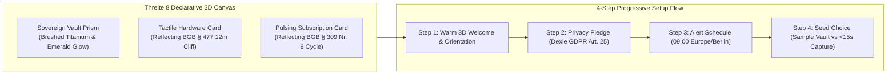

# 🪄 Onboarding Wizard & Threlte 3D Experience Specification (`DOC-UX-05`)

**Document ID:** `CM-LAB-UX-ONBOARDING-3D-V1` · **Status:** Ratified Technical Specification  
**Academic Module:** *Computer & Media Lab* (WiSe 2026, SRH University of Applied Sciences) · **Instructor:** Prof. Franziska Schwarz  
**Role Ownership:** **Prushti** *(UX/UI Lead)* in collaboration with **Kyle** *(Development Lead)*  
**Governing Documents:** [`GOAL.md`](../../GOAL.md) · [`BLUEPRINT.md`](../../BLUEPRINT.md) · [`AGENT.md`](../../AGENT.md) · [`design-taste-frontend`](file:///C:/Users/admin/.gemini/config/skills/design-taste-frontend/SKILL.md)

---

## 1. Executive Summary & Aesthetic Vision

The CM-LAB platform introduces a warm, tactile, and visually unforgettable first impression through a **4-Step Progressive Onboarding Wizard** and an **Interactive 3D Tactile Vault Experience** powered by **Threlte 8** (declarative Three.js for Svelte 5 Runes).

Rather than greeting users with a cold empty database table or a generic AI welcome modal, the application uses 3D spatial cues to communicate its core value proposition: **transforming ephemeral paper receipts and recurring digital subscriptions into an impenetrable, offline-encrypted personal vault**.



---

## 2. 3D Architectural Scene: The Sovereign Vault & Dynamic Cards

### 2.1 Visual Metaphor & Materiality
Following the [`design-taste-frontend`](file:///C:/Users/admin/.gemini/config/skills/design-taste-frontend/SKILL.md) framework (`DESIGN_VARIANCE: 6`, `MOTION_INTENSITY: 4`, `VISUAL_DENSITY: 5`), the 3D scene rejects futuristic neon gamer clichés. Instead, it utilizes realistic physical lighting, industrial European design language, and tactile haptic feedback:

* **The Hardware Card:**
  - Material: Brushed gunmetal titanium (`metalness: 0.85`, `roughness: 0.22`).
  - Visual Elements: Precision laser-etched BGB legal badge (*"BGB § 438 / 24M"*), embossed purchase date, and an amber hazard line marking the Month 12 *Beweislastumkehr* boundary.
* **The Subscription Card:**
  - Material: Deep matte forest teal with a fine frosted acrylic edge (`roughness: 0.4`, `transmission: 0.6`).
  - Visual Elements: Pulsing circular progress orbit representing active billing cycle, termination cutoff pill (*"§ 312k Ready"*).
* **Lighting & Environment:**
  - Warm key light (`#FFF5EB`, intensity `1.8`) paired with an ambient soft fill (`#E2E8F0`, intensity `0.6`).
  - Subtle mouse/gyro parallax: tilting the device or moving the cursor applies a damped rotation ($\pm 12^\circ$), creating realistic specular highlights across the titanium texture.

### 2.2 Dual-Surface Deployment

| Surface | Host Page / Domain | Threlte Mounting Strategy | Interactive Capabilities |
| :--- | :--- | :--- | :--- |
| **Showcase Hero** | `apps/showcase/src/pages/index.astro` (`[Project].pages.dev`) | `<ShowcaseVaultScene client:visible />` | Free rotation via pointer drag, interactive card flip revealing legal clauses, toggle between hardware and subscription modes. |
| **Onboarding Wizard** | `apps/app/src/components/onboarding/OnboardingModal.svelte` (`app.[Project].pages.dev`) | `<OnboardingVaultCanvas client:idle />` | Controlled 4-stage camera transitions synchronized with wizard steps; card unboxes upon completing Step 4. |

---

## 3. The 4-Step Onboarding Wizard Contract

The onboarding wizard runs on first visit when `localStorage.getItem('cmlab_onboarding_completed') !== 'true'`, floating as an elevated, accessible modal dialog over the dashboard shell.

```
┌─────────────────────────────────────────────────────────────────────────┐
│  STEP 1 OF 4                                               [ Skip ]     │
│                                                                         │
│                    ┌─────────────────────────┐                          │
│                    │     [ 3D THRELTE 8 ]    │                          │
│                    │   Interactive Titanium  │                          │
│                    │   Warranty Vault Card   │                          │
│                    └─────────────────────────┘                          │
│                                                                         │
│   Welcome to your Sovereign Consumer Rights Wallet                      │
│   Protect hardware guarantees (BGB §§ 438/477), tame auto-renewals,     │
│   and claim German tax write-offs (§ 9 EStG). 100% on your device.      │
│                                                                         │
│   ● ○ ○ ○                                          [ Get Started → ]    │
└─────────────────────────────────────────────────────────────────────────┘
```

### 3.1 Detailed Step Specifications

#### Step 1: Warm Welcome & 3D Spatial Orientation
* **Headline:** *"Your Consumer Rights, Protected Automatically."*
* **3D Animation:** The titanium warranty card floats smoothly into view with an organic spring animation (`damping: 25`, `stiffness: 120`).
* **Copy:** Explains the unified philosophy: physical hardware guarantees (`BGB §§ 438, 477`) and digital subscriptions (`§ 309 Nr. 9, § 312k`) in one privacy-first vault.
* **CTA:** *"Begin Setup (1 Minute) →"*.

#### Step 2: The Privacy Pledge & Storage Confirmation (`GDPR Art. 25`)
* **Headline:** *"100% Client-Side. Zero Cloud Plaintext."*
* **3D Visual:** The 3D vault snaps shut; an animated cryptographic lock glyph illuminates on the card surface.
* **Core Guarantees Displayed:**
  - Encrypted locally via `Dexie.js v4` (IndexedDB) with `AES-GCM-256`.
  - Thermal receipts pre-hashed with client-side `SHA-256` under **GoBD Rn. 108–110**.
  - Cloudflare edge endpoints only query public policy records; your personal items never leave this browser.
* **Action:** Clear confirmation checkbox (pre-checked): *"I understand my data resides securely on this device."*

#### Step 3: Proactive Notification & Alert Calibration
* **Headline:** *"Never Miss a Legal Deadline or Renewal."*
* **3D Visual:** The 3D card tilts, spotlighting the color-coded urgency beacons (🔴 7d, 🟡 30d, 🟢 Active).
* **Settings Configured:**
  - Daily push notification time: **`09:00 Europe/Berlin`** (fixed wall-clock, calibrated for DST).
  - 12-Month Burden-of-Proof Warning: Notifies at Day 335 (30 days before `BGB § 477 Abs. 1` cliff).
  - Subscription Cancellation Cutoff: Notifies at $T-30\text{d}$ and $T-7\text{d}$.
* **Action:** Browser push notification request trigger via `Notification.requestPermission()`.

#### Step 4: First Action / Seed Data Choice
* **Headline:** *"How Would You Like to Start?"*
* **3D Visual:** The card opens up into an interactive tray presenting two distinct initial action paths:
  - **Path A (Recommended for Students):** *"Load Sample Student Vault"* — Populates 3 realistic items (Spotify Student, Apple MacBook Pro 14", MediaMarkt USB-C Hub) to immediately explore the dashboard, 24m timeline bar, and 1-tap PDF dossier generator.
  - **Path B (Fresh Start):** *"Snap My First Receipt (<15s)"* — Launches `QuickCaptureModal.svelte` pre-configured in camera capture mode.
* **Completion Event:** Writes `cmlab_onboarding_completed: "true"` to `localStorage`, fires confetti/haptic pulse, and smoothly fades the modal to reveal the active dashboard.

---

## 4. Production Threlte 8 Implementation (Svelte 5 Runes)

```svelte
<!-- apps/app/src/components/3d/VaultScene.svelte -->
<script lang="ts">
  import { Canvas } from '@threlte/core';
  import { T } from '@threlte/core';
  import { OrbitControls, Float } from '@threlte/extras';
  import { spring } from 'svelte/motion';
  import VaultCardMesh from './VaultCardMesh.svelte';

  let { currentStep = 1, reducedMotion = false } = $props<{
    currentStep?: number;
    reducedMotion?: boolean;
  }>();

  // Responsive camera and lighting parameters via Svelte 5 runes
  let cardRotationY = $derived(currentStep === 2 ? Math.PI : (currentStep - 1) * 0.45);
</script>

<div class="threlte-viewport" aria-hidden="true">
  {#if !reducedMotion}
    <Canvas>
      <!-- Cinematic Camera with 45mm equivalent FOV -->
      <T.PerspectiveCamera makeDefault position={[0, 0, 5.5]} fov={38}>
        <OrbitControls
          enableZoom={false}
          enablePan={false}
          maxPolarAngle={Math.PI / 1.8}
          minPolarAngle={Math.PI / 2.4}
        />
      </T.PerspectiveCamera>

      <!-- Precision Studio Lighting -->
      <T.AmbientLight color="#FFFFFF" intensity={0.65} />
      <T.DirectionalLight position={[4, 6, 5]} color="#FFF5EB" intensity={1.8} castShadow />
      <T.PointLight position={[-4, -2, 2]} color="#2F524C" intensity={1.2} />

      <!-- Floating Sovereign Vault Card Mesh -->
      <Float floatIntensity={1.2} rotationIntensity={0.6} speed={1.5}>
        <VaultCardMesh rotationY={cardRotationY} step={currentStep} />
      </Float>
    </Canvas>
  {:else}
    <!-- Accessible Fallback for prefers-reduced-motion -->
    <div class="static-vector-fallback">
      <svg class="vault-vector-badge" viewBox="0 0 120 120" fill="none">
        <rect x="10" y="20" width="100" height="70" rx="12" stroke="#2F524C" stroke-width="4" fill="#FFFFFF"/>
        <path d="M40 55L55 70L80 45" stroke="#059669" stroke-width="5" stroke-linecap="round"/>
      </svg>
    </div>
  {/if}
</div>

<style>
  .threlte-viewport {
    width: 100%;
    height: 240px;
    position: relative;
    border-radius: var(--radius-card);
    overflow: hidden;
    background: radial-gradient(circle at center, rgba(47, 82, 76, 0.08) 0%, transparent 70%);
  }
  .static-vector-fallback {
    display: flex;
    align-items: center;
    justify-content: center;
    width: 100%;
    height: 100%;
  }
  .vault-vector-badge {
    width: 80px;
    height: 80px;
  }
</style>
```

---

## 5. Performance & Accessibility Guardrails

1. **`prefers-reduced-motion` Compliance:**
   - Detects `window.matchMedia('(prefers-reduced-motion: reduce)')`.
   - If true, completely skips mounting the WebGL canvas, saving GPU cycles and preventing motion sensitivity, rendering an elegant static SVG badge.
2. **Lazy Loading & Island Partitioning:**
   - On the showcase webpage, Threlte is mounted with `client:visible`, deferring the Three.js bundle until the user scrolls to the interactive section.
   - On the web app, Threlte is dynamically imported only during the initial onboarding session, adding **0 KB** to subsequent daily dashboard visits.
3. **Power & Thermal Budget:**
   - DPR is clamped to `Math.min(window.devicePixelRatio, 1.5)` to prevent thermal throttling on 4K / Retina displays.
   - The render loop automatically pauses when `document.hidden` is true (Page Visibility API).
