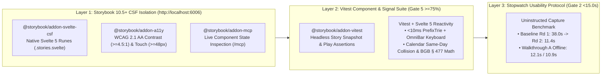

# 🧪 UI/UX Verification Harness, Storybook CSF & Usability Benchmark Overview (`DOC-UX-06`)

**Document Reference:** `DOC-UX-06`  
**Academic Institution:** SRH University of Applied Sciences (*SRH Hochschule*)  
**Course Module:** *Computer & Media Lab* (Wintersemester 2026) · **Instructor:** Prof. Franziska Schwarz  
**Working Team:** **Team 6**  
**Project:** *Warranty, Subscription & Tax-Ready Wallet + Policy Wiki (MCP/API-Enabled)*  
**Active Milestone:** Session 5 — MVP Scope Lock & Working Core User Journey Gate  
**Role Owner & Author:** **Prushti** — *UX/UI Lead (Member C)* · *Co-Verified with **Mojtaba** (Quality / Media Lead)*

---

## 1. UI/UX Verification Architecture (`Gates 2, 5, 6 & 7`)

With a locked **26-hour Sprint 1 UX/UI allocation** inside Team 6's 92-hour capacity ceiling, visual regressions, WCAG 2.1 AA contrast failures, touch-target violations, and capture-latency regressions cannot be caught via manual click-throughs alone. Every Svelte 5 component across `[Project].pages.dev` (Showcase) and `app.[Project].pages.dev` (Wallet App) is verified through a **3-Layer Automated & Empirical UI/UX Harness**:



---

## 2. Layer 1: Storybook 10.5+ Svelte CSF Configuration & Standards

### 2.1 Persistent Server & Addon Stack
* **Dev Server & MCP Endpoint:** Runs persistently on `http://localhost:6006` with `@storybook/addon-mcp` mounted at `http://localhost:6006/mcp` for live AI/developer state inspection.
* **Required Addons (`ADR-04`):**
  1. `@storybook/svelte-vite` (`10.5+`) — Zero-config Vite + Svelte 5 Runes builder.
  2. `@storybook/addon-svelte-csf` — Authoring expressive `.stories.svelte` stories directly with Svelte 5 `$state`, `$derived`, and snippet children.
  3. `@storybook/addon-a11y` — Automated `axe-core` verification enforcing `color-contrast` ($\ge 4.5:1$), `target-size` ($\ge 48\times 48\text{px}$), and `aria-required-attr` (`Gate 6`).
  4. `@storybook/addon-vitest` — Converts every `.stories.svelte` file into an executable Vitest test in CI (`Gate 5`).
* **Design Token Enforcement:** `.storybook/preview.ts` imports `../src/styles/tokens.css` globally and configures viewport presets (`375x812px` iPhone SE/14, `412x915px` Pixel 7, `1280x800px` Showcase Desktop). Hardcoded hex values inside stories are prohibited.

### 2.2 Canonical `.stories.svelte` Reference (`OmniBar.stories.svelte`)
Verified via `svelte-autofixer` (`0 issues, 0 suggestions`):

```svelte
<script module lang="ts">
	import { defineMeta } from '@storybook/addon-svelte-csf';
	import OmniBar from './OmniBar.svelte';

	const { Story } = defineMeta({
		title: 'Wallet/OmniBar',
		component: OmniBar,
		tags: ['autodocs'],
		parameters: {
			viewport: { defaultViewport: 'mobile1' },
			a11y: {
				config: {
					rules: [
						{ id: 'color-contrast', enabled: true },
						{ id: 'aria-required-attr', enabled: true },
						{ id: 'target-size', enabled: true }
					]
				}
			}
		}
	});
</script>

<Story
	name="IdleDefault"
	args={{
		suggestions: [],
		placeholder: 'Search saved vault, Policy Wiki, or log a purchase...'
	}}
/>

<Story
	name="MixedPolicyAndSavedResults"
	args={{
		suggestions: [
			{
				id: 'saved-sony-xm4',
				group: 'saved',
				label: 'Sony WH-1000XM4 (Saturn Berlin)',
				sublabel: 'Protected · 16m left · BGB § 477 Abs. 1 active'
			},
			{
				id: 'wiki-sony',
				group: 'wiki',
				label: 'Sony Electronics — Policy Wiki',
				sublabel: '24m BGB § 438 Statutory · 12m Commercial Guarantee'
			}
		]
	}}
/>
```

### 2.3 Mandatory Story Coverage Matrix (Sprint 1 Gate)

| Story Suite (`src/components/*.stories.svelte`) | Primary, Variant, Responsive & Error/Empty States Verified | Mapped DoD Gate |
| :--- | :--- | :---: |
| **`OmniBar.stories.svelte`** | `IdleDefault`, `MixedPolicyAndSavedResults`, `ZeroMatchCreateDyson` (`Screen 06`), `ShowcaseReadOnly`, `Mobile375Touch` | Gates 1, 2, 6 |
| **`MonthlyCalendarGrid.stories.svelte`** | `StandardMonth`, `SameDayCollision_Nov1` (`3 Renewals · €34.97`), `EmptyMonth`, `KeyboardRovingTabindex` | Gates 1, 3, 6 |
| **`BgbCliffTimelineWidget.stories.svelte`** | `Month4_Active477` (`#059669`), `Month11_CliffWarning` (`#D97706`), `Month16_Post12m`, `Month23_475eExtension` | Gates 1, 3, 6 |
| **`UrgencyCountdownWidget.stories.svelte`** | `Urgent7d_GymCancel` (`#DC2626`), `Warning14d_NoticeWindow`, `Protected_Hardware`, `PushDeniedTopBanner` | Gates 1, 3, 6 |
| **`QuickCaptureModal.stories.svelte`** | `Empty3FieldDefault`, `SonyTrieAutoFilled`, `ValidationMissingName` (`Screen 03`), `ReceiptHashedGoBD`, `CameraPermissionFallback` | Gates 1, 2, 3, 6 |
| **`ClaimGeneratorModal.stories.svelte`** | `Maengelruege_437_Within12m`, `Kuendigung_312k6_Fristlos`, `MissingReceipt_Kontoauszug`, `PdfWorkerTimeoutFallback`, `LexFoxFooterLocked` | Gates 1, 3, 7 |
| **`TaxSummaryView.stories.svelte`** | `EmptyTaxLedger`, `BMF2022_Sofortabschreibung`, `MixedUse80PercentSlider`, `StBerGDisclaimerLocked` | Gates 1, 7 |
| **`McpExplorerIsland.stories.svelte`** | `PolicyLookup_200OK`, `ClaimDossier_200OK`, `InvalidParams_Minus32602` | Gate 4 |

---

## 3. Layer 2: Automated Vitest, Type-Check & Accessibility CI Pipeline (`Gate 5`)

In collaboration with **Mojtaba** (`QA Lead`), every Pull Request targeting `main` must pass four deterministic CLI checks with **`>= 75%` branch/line coverage** and **`0` static errors**:

1. **Static Svelte 5 & Astro Type Verification:**
   * `npx astro check && npx svelte-check --tsconfig ./tsconfig.json` — enforces `0` TypeScript or Svelte 5 rune binding errors.
2. **Storybook Interaction & Accessibility Test Runner (`@storybook/addon-vitest`):**
   * Executes every story's `play` function and `axe-core` audit headlessly in Chromium, failing the build if any color contrast drops below `4.5:1`, any interactive bounding box shrinks below `48x48px`, or any `combobox` lacks `aria-controls` / `role="option"`.
3. **Deterministic Reactivity & Performance Unit Assertions (`vitest run`):**
   * **`OmniBar` + `PrefixTrie` Latency Test:** Asserts `performance.now()` delta for searching 20 seeded brands + 500 mock `Dexie.js` items (`fake-indexeddb`) completes in **`< 10.0ms`**.
   * **DST Calendar & Countdown Invariance Test:** Simulates Germany's March (`CET -> CEST`) and October (`CEST -> CET`) transitions against `UrgencyCountdownWidget` and `AlertScheduler.ts`, asserting **`0ms` / `0h` drift** from `09:00:00 Europe/Berlin`.
   * **Non-Bypassable Legal Safe-Harbor Assertion (`Gate 7`):** Asserts that every rendered output of `ClaimGeneratorModal` and `TaxSummaryView` contains verbatim `BGH VIII ZR 285/18` (`RDG §§ 2, 3`) or `StBerG § 2` substrings.

---

## 4. Layer 3: `<15.0s` Uninstructed Stopwatch Usability Protocol (`Gate 2`)

To prevent UI regressions from eroding our **`11.4s` Peer Lab Round 2** and **`10.9s–12.1s` Walkthrough A** onboarding speed (`ADR-01 #27`), any layout change to `OmniBar.svelte` or `QuickCaptureModal.svelte` requires re-running the standardized **Session 5 Gate 2 Stopwatch Protocol**:

1. **Device & Network Setup:** Real or emulated `390x844px` / `412x915px` mobile viewport with **Network set to Offline (Airplane Mode)** to confirm zero cloud dependency.
2. **Timer Start (`t = 0.0s`):** Tester rests on `app.[Project].pages.dev` View 1 (`Dashboard`) and receives an uninstructed physical/sample receipt (e.g., *Saturn Sony WH-1000XM4 · €279* or *FitX Monthly Contract · €29*).
3. **Execution Path:** Tester initiates capture via either the **Unified Omni-Bar** (`+ Log "[Query]" in <15s`) or `[+ Quick Capture]`, selects the Prefix-Trie suggestion (`>= 2` chars), attaches the sample receipt image (verifying `<500ms` thumbnail + `GoBD SHA-256` stamp), optionally toggles `§ 9 EStG` tax deductibility, and taps `[Save to Protected Wallet]`.
4. **Timer Stop & Pass Criteria:** Timer stops when View 1 renders the newly persisted card with its active `Protected` / `Urgent` badge.
   * **Hard Pass Ceiling (`Gate 2`):** Median elapsed duration across 3 uninstructed runs **$< 15.0\text{ seconds}$** (`100%` receipt attachment rate, `0` facilitator interventions).
