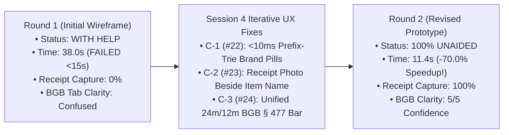

# 🔍 Authentic User Research & Usability Synthesis (`DOC-UX-02`)

**Document Reference:** `DOC-UX-02`  
**Academic Institution:** SRH University of Applied Sciences (*SRH Hochschule*)  
**Course Module:** *Computer & Media Lab* (Wintersemester 2026) · **Instructor:** Prof. Franziska Schwarz  
**Working Team:** **Team 6** (Peer Lab Partner: **Team 7**)  
**Project:** *Warranty, Subscription & Tax-Ready Wallet + Policy Wiki (MCP/API-Enabled)*  
**Active Milestone:** Session 5 — MVP Scope Lock & Working Core User Journey Gate  
**Role Owner & Author:** **Prushti** — *UX/UI Lead (Member C)* · *In collaboration with **AmirHossein** (Product/Research Lead) & **Mojtaba** (Quality/Peer Lab Lead)*

---

## 1. Consumer Friction Asymmetry & Problem Framing

Across Germany, university students, *Werkstudenten*, and young professionals routinely forfeit **€200–€800+ per year** across unasserted hardware defects, unwanted subscription auto-renewals, and unclaimed income tax deductions. Our empirical research in Sessions 2–4 identified **Consumer Friction Asymmetry** as the structural root cause:

1. **Chemical & Digital Proof Decay:** Retailers issue thermal paper receipts (*Thermopapier-Kassenbons*) coated with leuco dyes that fade to blank paper within 6–18 months due to heat and plasticizer migration, while digital invoices scatter across university portals, personal webmail, and 15,000-image smartphone camera rolls.
2. **Statutory Cliff Blindness (`BGB § 477 Abs. 1` vs. `§ 438`):** Over 75% of student consumers confuse voluntary 12-month manufacturer commercial guarantees (*Garantie*, `BGB § 443`) with mandatory 24-month seller statutory liability (*Gewährleistung*, `BGB § 438 Abs. 1 Nr. 3`) and remain unaware that waiting past **Month 12** forfeits the statutory reversed burden of proof (*Beweislastumkehr*, `BGB § 477 Abs. 1`).
3. **Corporate Dark Patterns & Action Paralysis:** Subscription providers bury cancellation flows (`Risk R-2 #14`) in violation of `BGB § 312k`, while electronics retailers demand multi-page RMA forms that intimidate non-lawyers into abandoning valid €50–€400 claims.
4. **Onboarding Abandonment Trap:** If logging a purchase takes more than **15 seconds** or forces users to look up legal warranty durations manually, up to 68% abandon onboarding immediately.

---

## 2. Qualitative Problem Discovery: Persons 1–4 Synthesis (Session 2)

In Session 2, Team 6 conducted four structured qualitative consumer interviews (`DOC-PRD-01` §2.1). Every widget, Omni-Bar capability, and view in our UI/UX specification traces directly to an observed behavioral failure in Persons 1–4:

| Persona ID | Profile & Real-World Loss Incident | Behavioral Pain Mechanics Observed | Direct UI/UX Design Translation (`app.[Project].pages.dev`) |
| :---: | :--- | :--- | :--- |
| **Person 1** | **University Student** *Laptop Screen Flickering at Month 14* | Searched university email, Gmail, iCloud Photos, and desk folders for 3 days without finding the invoice. Assumed coverage expired after the 1-year manufacturer guarantee; missed the **Month 12 `BGB § 477 Abs. 1` *Beweislastumkehr* cliff** and forfeited a 24-month statutory seller repair (`BGB § 438`). | • **Calendar Type 2 (`BgbCliffTimelineWidget`):** Visualizes both the `12m` reversal boundary and `24m` statutory horizon. • **Month 11 (`T-30d`) Proactive Alert** (`US-03`). • **Missing-Receipt Evidentiary Fallback** (`Scenario 5.3`: `Kontoauszug` / bank statement clause in View 4). |
| **Person 2** | **Young Consumer** *USB-C Charger Failure at Month 9 + Forgotten App Trials* | Photographed a Saturn receipt at purchase, losing it under **15,000 camera-roll photos**. When the €49 Anker GaN charger died at Month 9, froze in **action paralysis** (unsure whether to contact Saturn or Anker, intimidated by RMA jargon) and bled ~€35/mo across forgotten trials. | • Proved **passive storage fails**; added **View 4 (1-Tap `BGB § 437` *Mängelrüge* & `§ 312k` *Kündigung* Compiler)**. • Unified hardware warranties and recurring subscriptions (`ADR-02 #28`) inside the **Unified Omni-Bar** and **Modular Dashboard**. |
| **Person 3** | **Household Consumer** *Washing Machine Bearing Defect at Month 18 (Blank Thermal Slip)* | Stored an authentic thermal paper receipt in a dark drawer; by Month 18 the ink had completely vanished. Stated verbatim: ***"I want reminders more than storage."*** Discovered statutory rights only after expiry. | • Immediate `<1.5MB` client-side receipt capture in **View 2** with pre-encryption **GoBD `SHA-256` hash** (`US-02`). • **Calendar Type 3 (`UrgencyCountdownWidget`)** + `09:00 Europe/Berlin` local push reminders at `T-30d`, `T-7d`, `T-1d` + `§ 475e Abs. 1 BGB` 4-month extension badge. |
| **Person 4** | **Master's Student & *Werkstudentin*** *Lost €300–€600 Annual German Tax Refund* | Purchased study hardware, external monitor, and developer software (`JetBrains`, `Adobe CC`), but lost receipts by tax filing season and was unaware of **1-year 100% immediate write-off (*Sofortabschreibung* per `BMF 22.02.2022`)** under `§ 9 EStG` (*Werbungskosten*). | • 1-tap **`Werbungskosten (§ 9 EStG)` Toggle** inside View 2 (`QuickCaptureModal`). • **View 5 (German Tax Summary)** with mixed-use % slider, `BMF 2022` indicator, UTF-8 BOM CSV export (WISO/Taxfix), and `§ 2 StBerG` disclaimer. |

---

## 3. Why We Rejected Camera OCR (`Session 3 Benchmark` & `ADR-01 #27`)

Before designing View 2 and the Unified Omni-Bar, Team 6 tested cloud/mobile OCR across **50 real student receipts** (crumpled Saturn/MediaMarkt thermal slips, café lighting, skewed PDFs). Empirical failure forced `ADR-01` (`WON'T-HAVE US-09 #12`):

* **42.0% Extraction Failure Rate (`58.0%` accuracy):** Thermal crease lines, German comma decimals, and multi-item totals caused frequent date/merchant misreads requiring slow manual correction.
* **0.0% Statutory Policy Extraction:** German retail receipts **never** print `BGB § 438` 24-month statutory warranties, `BGB § 477 Abs. 1` 12-month reversal dates, or `BGB § 309 Nr. 9` 1-month subscription notice rules.
* **Privacy, Cost & Offline Failure:** Multimodal OCR burns `$0.02–$0.15/scan`, leaks plaintext receipts to third-party clouds (violating `GDPR Art. 25` / `Red Line #2`), and fails completely in Airplane Mode.
* **UX Resolution:** Pairing the **Unified Omni-Bar** and **View 2 Prefix-Trie Autocomplete (`<10ms`)** with `policy_wiki_seed_v1.json` achieves **100% statutory enrichment accuracy at `$0.00` cost in `11.4s` offline**.

---

## 4. Session 4 Peer Lab Usability Validation with Team 7 (`Board C`)

In Session 4, Prushti and Mojtaba conducted **two uninstructed 15-minute usability testing rounds** with peer testers from **Team 7** (`workshop-materials/board-c/01_prototype_screens_prushti.md` and `02_peer_lab_test_record_mojtaba.md`).

### 4.1 Uninstructed Goal Prompt
> *"You just purchased a pair of Sony WH-1000XM4 headphones on sale at Saturn with a paper receipt. Log your new headphones into your wallet so you are protected against hardware defects, get alerted before statutory deadlines, and check your legal warranty rights."*

### 4.2 Quantitative Round 1 vs. Round 2 Telemetry

| Usability Metric | Round 1 (Initial Sketch) | Observed Behavioral Bottleneck | UX Design Iteration Applied | Round 2 (Revised Wireframes) | Net Improvement |
| :--- | :---: | :--- | :--- | :---: | :---: |
| **Completion Autonomy** | *With help* (2 facilitator prompts) | Froze `12.0s` hunting for OCR scan icon; froze `7.0s` asking how long Sony's German warranty lasts. | **`Iteration C-1 (#22)`:** Pre-seeded Prefix-Trie brand autocomplete + suggestion pills (`"So"` $\rightarrow$ `Sony`, `Hardware`, `24m BGB § 438`). | **Unaided** (`0` prompts) | Autonomous flow |
| **End-to-End Stopwatch Time** | **`38.0 seconds`** (`+23.0s` over SLA) | Manual character-by-character typing + legal duration uncertainty. | **`Iteration C-1 (#22)`:** Auto-filled category, 24m statutory expiry, and 12m cliff in `<10ms`. | **`11.4 seconds`** (`3.6s` safety margin under `15.0s`) | **`-70.0%` (`-26.6s`)** |
| **First-Pass Receipt Capture** | **`0%`** (Premature save error) | Camera attachment button was placed below optional notes at bottom of modal; tester tapped `"Save"` without proof. | **`Iteration C-2 (#23)`:** Elevated Receipt Photo Vault container directly beside `Item Name` with live thumbnail & `SHA-256` badge. | **`100%`** snapped prior to save | **`+100%` proof validity** |
| **Statutory Rights Clarity** | **`2 / 5`** (`6.0s` tab hesitation) | Split tabs (`[Commercial Guarantee 12m]` vs. `[BGB Gewährleistung 24m]`) caused decision paralysis. | **`Iteration C-3 (#24)`:** Single unified 24m timeline bar demarcating active `12m BGB § 477 Abs. 1` *Beweislastumkehr* + 1-tap claim CTA. | **`5 / 5`** immediate comprehension | Zero legal confusion |

---

## 5. Pre-Session 5 External Target-User Field Walkthroughs (`#25` & `#26`)

To verify that our classroom Peer Lab improvements generalized to real-world hardware and multi-subscription scenarios outside Team 7, Team 6 executed two external walkthroughs:

### 5.1 Walkthrough A (`#25`) — Participant Alpha (Hardware + Offline Airplane Mode + German Tax)
* **Participant Archetype:** 24-year-old SRH Master's student & part-time *Werkstudentin* at a Berlin logistics startup (matches **Person 4**).
* **Test Conditions:** Google Pixel 7 (`412x915px`), **100% Airplane Mode (`navigator.onLine === false`)**, facilitated by **Kyle** & **Mojtaba** (Oct 24, 2026).
* **Assigned Task:** Capture a newly purchased €249 LG UltraWide 29" monitor from MediaMarkt with paper receipt photo, flag it for German *Werbungskosten* (`§ 9 EStG`), and verify both 24-month statutory coverage and 1-year *Sofortabschreibung* (`BMF 22.02.2022`).
* **Empirical Outcome:** Completed **100% unaided in `12.1s` (Run 1) and `10.9s` (Run 2)**. Local `Dexie.js` audit verified `statutoryWarrantyMonths: 24`, `reversedBurdenOfProofEndDate` at `+12m`, `isTaxDeductible: true`, `taxCategory: "Arbeitsmittel"`, `depreciationSchedule: "BMF_2022_IMMEDIATE_1_YEAR"`, and a 64-hex-char GoBD `receiptSha256`.

### 5.2 Walkthrough B (`#26`) — Participant Beta (7 Subscriptions + `BGB § 312k Abs. 6` Cancellation)
* **Participant Archetype:** 21-year-old undergraduate student managing 7 active recurring contracts (`Spotify`, `Netflix`, `iCloud+`, `FitX Gym`, `Adobe CC`, `ChatGPT Plus`, `Amazon Prime Student` — matches **Person 2**).
* **Test Conditions:** Mobile smartphone viewport (`390x844px`), facilitated by **Prushti** using **AmirHossein's** deterministic legal templates (Oct 25, 2026).
* **Assigned Task:** Spot an upcoming gym renewal within 7 days on the dashboard, inspect `BGB § 309 Nr. 9` rolling cutoff rights, and generate an immediate termination dossier invoking `BGB § 312k Abs. 6` where the online cancellation button is obstructed.
* **Empirical Outcome:** Completed **100% unaided**. Participant immediately noticed the high-contrast Red `Urgent (7d)` countdown card (`#DC2626`), navigated to View 4 in 1 tap, and exported a complete German termination notice citing `§ 309 Nr. 9` and `§ 312k Abs. 6 BGB` with the mandatory `BGH VIII ZR 285/18` (*LexFox*) RDG safe-harbor footer intact.

---

## 6. Research-to-Interface Traceability Summary

1. **Dual-Domain Showcase (`[Project].pages.dev`):** Lets skeptical first-time students test the preview Unified Omni-Bar, sample calendar widgets, and live Policy Wiki / MCP tools with **zero sign-up friction** before opening `app.[Project].pages.dev`.
2. **Unified Search / Activity / Request Omni-Bar:** Directly resolves Observation 1 from the Team 7 Peer Lab by turning any typed product or brand query into an instant `<10ms` bridge between saved vault records, verified German statutory rules, and `<15s` new-item creation.
3. **Three Distinct Calendar Widgets:** Directly answer Person 1's missed 12-month `BGB § 477` cliff, Person 2's multi-subscription bleed, and Person 3's demand for proactive temporal visibility over passive receipt folders.
