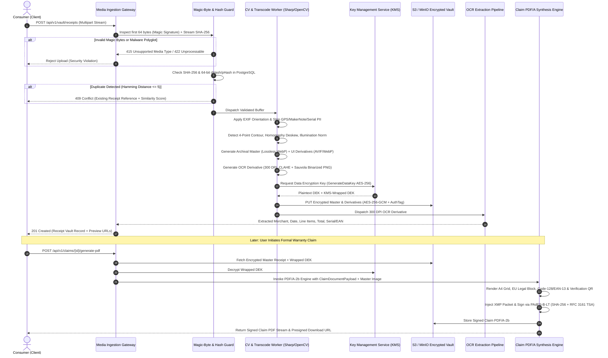
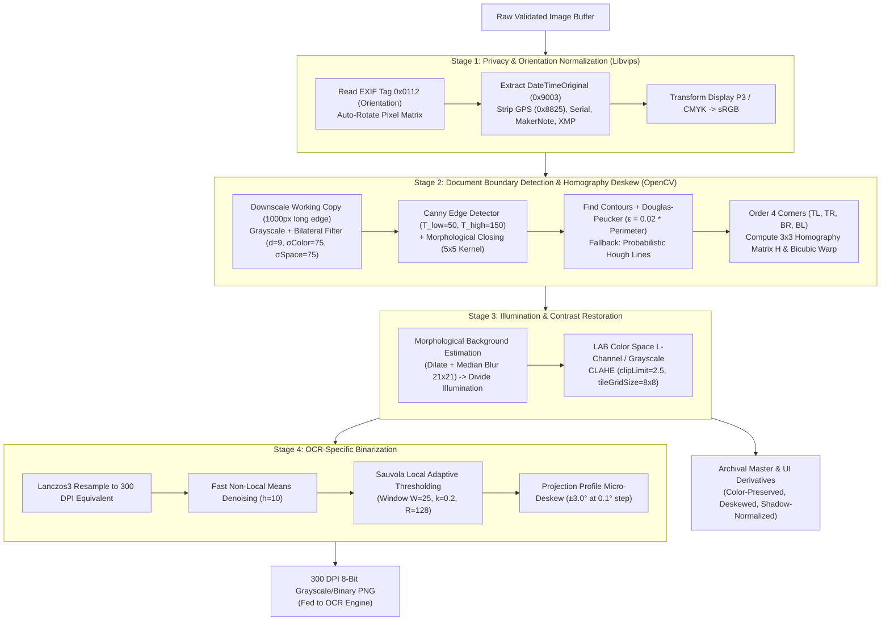
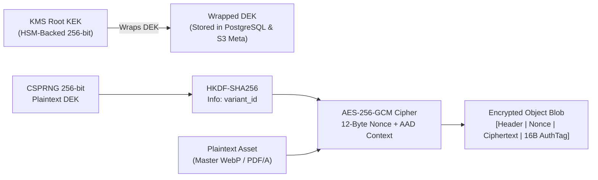
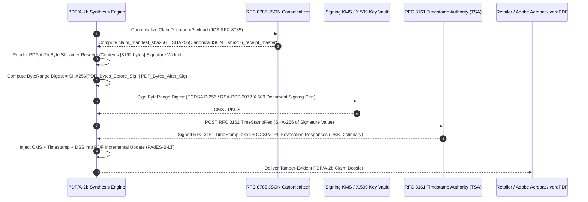

# Milestone 5 — Member D (Development & Quality / Media Lead)
# 03: Media Formats, Receipt Vault Ingestion Pipeline & Warranty Claim PDF Synthesis Engine

**Course / Lab:** SRH University — Computer & Media Lab  
**Project:** Warranty & Subscription Wallet  
**Role:** Member D — Development & Quality / Media Lead  
**Document Version:** 1.0.0 (Production Specification)  
**Status:** Approved for Implementation  

---

## 1. Media Architecture Overview (Computer & Media Lab Focus)

The **Warranty & Subscription Wallet** treats consumer receipts, invoices, serial number plates, and warranty certificates not merely as static blob attachments, but as **cryptographically verifiable, legally admissible digital evidence**. Under European Union consumer protection directives (e.g., Directive (EU) 2019/771 on certain aspects concerning contracts for the sale of goods and German BGB § 437 / § 477), the burden of proof and claim processing rely heavily on legible, untampered proof-of-purchase documentation and structured claim submissions.

To satisfy both the **Computer & Media Lab** requirements (advanced digital image restoration, multi-format transcoding, perceptual hashing, color-managed archival rendering) and production software engineering standards, the media subsystem is architected around a **Dual-Pipeline Design**:

1. **Pipeline A — Inbound Receipt Vault Media Ingestion & Archival Pipeline:**  
   Handles raw multi-format capture (`JPEG`, `PNG`, `WebP`, `HEIC`/`HEIF`, `PDF`), strict magic-byte validation, privacy-preserving EXIF normalization, computer-vision document boundary recovery (4-point homography deskew), thermal receipt restoration (CLAHE + Sauvola adaptive binarization), perceptual deduplication (`pHash`/`dHash`), multi-tier derivative generation (`AVIF`/`WebP` UI variants + 300 DPI OCR bitmap), and envelope-encrypted (`AES-256-GCM`) archival storage.
2. **Pipeline B — Outbound Warranty Claim PDF Synthesis Engine:**  
   Synthesizes standardized, print-ready (`A4`, 300 DPI), long-term archival **PDF/A-2b (ISO 19005-2)** claim dossiers. Embeds sRGB ICC profiles, subsetted OpenType fonts (`Inter`, `Roboto Mono`), high-resolution receipt annexes, machine-readable retail barcodes (`Code-128` / `EAN-13`), cryptographic verification QR codes (`ISO/IEC 18004`), custom **XMP metadata packets**, and **PAdES (ETSI EN 319 142)** digital signatures.

### 1.1 End-to-End Media Architecture Diagram

```mermaid
flowchart LR
    subgraph Client["Client Capture Layer (Mobile / Web)"]
        CAM["Camera / File Picker<br/>(HEIC, JPEG, PNG, WebP, PDF)"]
        PRE["Client Pre-Flight<br/>Size & MIME Check"]
        CAM --> PRE
    end

    subgraph PipelineA["Pipeline A: Inbound Receipt Vault Media Ingestion"]
        VAL["1. Magic-Byte &<br/>Polyglot Validator"]
        EXIF["2. EXIF Orientation &<br/>PII Scrubber (Libvips)"]
        DEDUP["3. Exact (SHA-256) &<br/>Perceptual (pHash/dHash) Guard"]
        CV["4. OpenCV Vision Pipeline<br/>Canny/Hough 4-Pt Warp + CLAHE"]
        DERIV["5. Multi-Variant Transcoder<br/>(Archival Master + AVIF/WebP + OCR PNG)"]
        ENC["6. Envelope Encryption<br/>(AES-256-GCM + KMS KEK)"]

        PRE --> VAL --> EXIF --> DEDUP --> CV --> DERIV --> ENC
    end

    subgraph Storage["Encrypted Tiered Object Vault (S3 / MinIO)"]
        MASTER[("Vault Master Bucket<br/>WebP Lossless / PDF/A-2b")]
        CDN[("Private CDN Bucket<br/>AVIF/WebP 320w, 768w, 1440w")]
        OCR_TMP[("Ephemeral OCR Staging<br/>300 DPI 8-bit Grayscale PNG")]
        
        ENC --> MASTER
        ENC --> CDN
        DERIV --> OCR_TMP
    end

    subgraph Intelligence["OCR & Structured Extraction"]
        OCR_ENG["Vision / OCR Worker<br/>(Tesseract 5 / Cloud Vision)"]
        DB[("PostgreSQL Metadata &<br/>Hash Registry")]
        OCR_TMP --> OCR_ENG --> DB
        DEDUP <--> DB
    end

    subgraph PipelineB["Pipeline B: Outbound Warranty Claim PDF Synthesis Engine"]
        PAYLOAD["ClaimDocumentPayload<br/>(JSON Data Contract)"]
        BARCODE["Vector Barcode & QR Gen<br/>(Code-128, EAN-13, QR Level M)"]
        LAYOUT["PDF/A-2b Layout Engine<br/>(A4 210x297mm, sRGB, Subset Fonts)"]
        XMP["XMP Metadata &<br/>Annex Embedder"]
        PADES["PAdES-B-LT Signer<br/>(X.509 + RFC 3161 TSA)"]

        DB --> PAYLOAD
        MASTER --> XMP
        PAYLOAD --> BARCODE --> LAYOUT --> XMP --> PADES
    end

    OUT_PDF["Signed Warranty Claim Dossier<br/>(PDF/A-2b + PAdES Signature)"]
    PADES --> OUT_PDF
```



### 1.2 Asynchronous Processing Sequence



---

## 2. Part I: Receipt Vault Media Specification & Image Processing Pipeline

### 2.1 Supported Input Formats & Validation Rules

Consumer receipts originate from diverse sources: mobile smartphone cameras (`HEIC` on iOS, `JPEG`/`WebP` on Android), email attachments (`PDF`), and desktop screenshots (`PNG`). Relying on the HTTP `Content-Type` header or file extension is prohibited; the ingestion gateway enforces **strict magic-byte inspection** on the first 64 bytes of the stream and validates container structure before decoding.

| Format | MIME Type | Allowed Extensions | Magic Bytes (Hex Signature & Offset) | Max File Size | Min Resolution | Max Resolution / Pages | Color Space Handling |
| :--- | :--- | :--- | :--- | :--- | :--- | :--- | :--- |
| **JPEG / JFIF / Exif** | `image/jpeg` | `.jpg`, `.jpeg` | `FF D8 FF E0`, `FF D8 FF E1`, `FF D8 FF E8`, `FF D8 FF DB` (Offset `0`) | `25 MB` | `600 × 800 px` (~150 DPI for 10×13cm slip) | `12000 × 12000 px` (Max `100 MP` decompression bomb limit) | Convert CMYK/YCbCr/AdobeRGB to `sRGB IEC61966-2.1` |
| **PNG** | `image/png` | `.png` | `89 50 4E 47 0D 0A 1A 0A` (Offset `0`) | `25 MB` | `600 × 800 px` | `12000 × 12000 px` (`100 MP`) | Strip uncalibrated gamma chunks; normalize to 8-bit/channel `sRGB` |
| **WebP** | `image/webp` | `.webp` | `52 49 46 46` (`RIFF` at `0`) + `57 45 42 50` (`WEBP` at `8`) | `20 MB` | `600 × 800 px` | `16383 × 16383 px` (VP8L spec max) | Preserve lossless alpha or flatten onto `#FFFFFF` for print/OCR |
| **HEIC / HEIF** | `image/heic`, `image/heif` | `.heic`, `.heif` | `66 74 79 70` (`ftyp` at `4`) followed by brand `heic`, `heix`, `mif1`, or `msf1` | `30 MB` | `600 × 800 px` | `12000 × 12000 px` (Single primary item extracted; burst sequences ignored) | Convert Apple Display P3 (`icc` / `nclx`) to `sRGB` via LittleCMS2 |
| **PDF (Raster / Vector)** | `application/pdf` | `.pdf` | `25 50 44 46 2D` (`%PDF-` at `0`, versions `1.3` to `2.0`) | `50 MB` | Vector or embedded raster $\ge 150\text{ DPI}$ | Max `15 pages` per receipt/invoice upload | Reject password-protected/encrypted PDFs or PDFs with `/JS`, `/JavaScript`, `/Launch` actions |

#### Security & Legibility Validation Rules
1. **Decompression Bomb Protection (Pixel Flood Guard):** Libvips/OpenCV decoders are configured with a hard ceiling of `MAX_PIXELS = 100,000,000` (100 Megapixels) and maximum memory allocation of `256 MB` per worker thread to prevent maliciously crafted `1 KB` PNG/GIF files from exhausting server RAM.
2. **PDF Sanitization:** Inbound PDF documents are parsed via `qpdf` / `pdfcpu` in strict mode. Any PDF containing embedded `/JavaScript`, `/JS`, `/Launch`, `/EmbeddedFiles`, `/RichMedia`, or XFA forms is immediately rejected with HTTP `422 Unprocessable Entity` (`ERR_PDF_ACTIVE_CONTENT_FORBIDDEN`).
3. **Minimum Effective OCR Resolution:** Thermal receipts typically measure $80\text{ mm} \times 150\text{ mm}$ ($3.15\text{ in} \times 5.9\text{ in}$). At the minimum required legibility threshold of **150 DPI**, the cropped receipt bounding box must maintain at least $472\text{ px}$ in width. If the detected document quadrilateral width after perspective warp falls below $450\text{ px}$ or exhibits a Laplacian variance blur score $\sigma^2_{\text{Laplacian}} < 65.0$, the API returns a structured warning (`WARN_LOW_OCR_LEGIBILITY`) prompting the user to retake the photo.

---

### 2.2 Pre-Processing & Computer Vision Pipeline (OpenCV / Sharp / Libvips)

Physical receipts—particularly thermal point-of-sale (POS) paper—suffer from severe optical degradation: crumpled folds, perspective keystone distortion from angled handheld capture, uneven ambient shadows, and low-contrast dye fading. Before archival master encoding or OCR extraction, every raster asset traverses a deterministic 5-stage computer vision pipeline.



#### Stage 1: EXIF Orientation Auto-Correction & Privacy-First Metadata Stripping
Smartphone sensors write pixel buffers in hardware sensor orientation and record a rotation flag in EXIF tag `0x0112` (`Orientation`, values `1`–`8`). Furthermore, raw smartphone photos embed sensitive Personal Identifiable Information (PII): exact home/store GPS coordinates (`GPSLatitude`, `GPSLongitude`, `GPSAltitude`), device serial numbers (`BodySerialNumber`, `LensSerialNumber`), Apple/Google `MakerNote` proprietary blobs, and embedded EXIF thumbnails that may retain uncropped background scenes.

1. **Cryptographic Capture Timestamp Preservation:** Before stripping metadata, the pipeline parses `Exif.Photo.DateTimeOriginal` (`0x9003`), `Exif.Photo.SubSecTimeOriginal` (`0x9291`), and `Exif.Photo.OffsetTimeOriginal` (`0x9011`). This timestamp is serialized into an encrypted JSON metadata envelope stored alongside the receipt record in PostgreSQL (`capture_timestamp_utc`, `exif_present_flag`), preserving evidentiary provenance without exposing raw EXIF headers in downloadable derivatives.
2. **Physical Pixel Rotation:** Using `libvips` (`vips_autorot`), the pixel matrix is losslessly transposed/rotated according to tag `0x0112`, and the orientation tag is reset to `1` (`Horizontal (normal)`).
3. **Complete Metadata Scrubbing:** All `EXIF`, `IPTC`, `XMP`, `GPS`, `MakerNote`, and embedded thumbnail IFD1 segments are stripped (`keep_metadata = false`), retaining only a clean `sRGB IEC61966-2.1` ICC color profile (`3,144 bytes`).

#### Stage 2: Edge Detection & Perspective Warp (4-Point Homography)
When a user photographs a receipt on a table at an oblique angle, perspective foreshortening degrades OCR character recognition accuracy by up to 40%.
1. **Edge-Preserving Smoothing:** A working copy is downscaled so its longest dimension is $1000\text{ px}$ (preserving aspect ratio scale factor $s$). A Bilateral Filter ($d=9, \sigma_{\text{color}}=75, \sigma_{\text{space}}=75$) smooths paper texture noise while keeping receipt paper edges sharp.
2. **Canny & Morphological Closing:** Canny edge detection ($T_{\text{low}}=50, T_{\text{high}}=150$) extracts gradient boundaries, followed by morphological closing with a $5 \times 5$ rectangular structuring element to bridge gaps caused by fingers or low-contrast corners.
3. **Quadrilateral Approximation & Hough Fallback:** Contours are sorted by descending area. For any contour covering $\ge 18\%$ of the image frame, Douglas-Peucker polygonal approximation ($\epsilon = 0.02 \times \text{arcLength}$) checks for a convex 4-vertex polygon. If crumpled edges produce $>4$ vertices, Probabilistic Hough Line Transform (`cv2.HoughLinesP`) extracts dominant boundary lines and computes their 4 pairwise intersections.
4. **Homography Perspective Transform:** The 4 vertices are ordered clockwise as $\mathbf{p}_{\text{TL}}, \mathbf{p}_{\text{TR}}, \mathbf{p}_{\text{BR}}, \mathbf{p}_{\text{BL}}$ scaled back by $1/s$ to full resolution. Target Euclidean dimensions $(W', H')$ are calculated as:
   $$W' = \max\left(\|\mathbf{p}_{\text{BR}} - \mathbf{p}_{\text{BL}}\|_2,\ \|\mathbf{p}_{\text{TR}} - \mathbf{p}_{\text{TL}}\|_2\right), \quad H' = \max\left(\|\mathbf{p}_{\text{TR}} - \mathbf{p}_{\text{BR}}\|_2,\ \|\mathbf{p}_{\text{TL}} - \mathbf{p}_{\text{BL}}\|_2\right)$$
   The $3 \times 3$ perspective transformation matrix $\mathbf{H}$ is solved via `cv2.getPerspectiveTransform` and applied using bicubic interpolation (`cv2.INTER_CUBIC`). If no reliable quadrilateral with interior angles in $[45^\circ, 135^\circ]$ is found, the pipeline gracefully falls back to full-frame micro-deskewing without cropping so zero receipt content is ever lost.

#### Stage 3: Illumination Normalization & CLAHE (Faded Thermal Paper Restoration)
Thermal receipts fade unevenly and often exhibit harsh smartphone shadow gradients across the page.
1. **Background Illumination Division:** To eliminate macroscopic shadows without destroying ink strokes, the luminance channel $L$ is dilated with a $7 \times 7$ kernel and median-blurred with a large $21 \times 21$ kernel to estimate the pure paper background illumination field $B(x,y)$. The normalized reflectance image $R(x,y)$ is computed as:
   $$R(x,y) = 255 - \text{clip}\left(\frac{|L(x,y) - B(x,y)| \times 255}{\max(B(x,y), 1)}, 0, 255\right)$$
2. **CLAHE (Contrast Limited Adaptive Histogram Equalization):** Applied to the $L$ channel in CIE $L^*a^*b^*$ space (or grayscale channel) using tile grid size $8 \times 8$ and clip limit $\beta = 2.5$. This locally amplifies faint thermal dye strokes while preventing noise amplification in uniform white paper regions.

#### Stage 4: Adaptive Binarization for OCR Feed (Sauvola / Gaussian)
Global Otsu thresholding fails on receipts with residual creases or stains. For the dedicated OCR derivative (`300 DPI` grayscale/binary PNG), the pipeline applies **Sauvola Local Adaptive Thresholding** over a sliding window $W = 25 \times 25$:
$$T(x, y) = \mu(x, y) \cdot \left[ 1 + k \cdot \left( \frac{\sigma(x, y)}{R} - 1 \right) \right]$$
where $\mu(x, y)$ and $\sigma(x, y)$ are the local mean and standard deviation computed in $O(1)$ time via integral images, $R = 128$ is the dynamic range of standard deviation for 8-bit grayscale, and $k = 0.20$ controls sensitivity to faint thermal ink.

#### Reference Implementation: OpenCV + Sharp Vision Pipeline

```python
# file: services/media-pipeline/vision_processor.py
import cv2
import numpy as np
from typing import Tuple, Optional

class ReceiptVisionPipeline:
    """
    Production Computer Vision pipeline for receipt boundary detection,
    4-point homography perspective warp, shadow removal, CLAHE enhancement,
    and Sauvola binarization for OCR ingestion.
    """
    MIN_QUAD_AREA_RATIO = 0.18
    CLAHE_CLIP_LIMIT = 2.5
    CLAHE_TILE_GRID = (8, 8)
    SAUVOLA_WINDOW = 25
    SAUVOLA_K = 0.20

    @staticmethod
    def order_points(pts: np.ndarray) -> np.ndarray:
        """Orders 4 coordinates clockwise: [top-left, top-right, bottom-right, bottom-left]."""
        rect = np.zeros((4, 2), dtype="float32")
        s = pts.sum(axis=1)
        rect[0] = pts[np.argmin(s)]   # Top-left has smallest sum (x + y)
        rect[2] = pts[np.argmax(s)]   # Bottom-right has largest sum (x + y)
        diff = np.diff(pts, axis=1)
        rect[1] = pts[np.argmin(diff)]  # Top-right has smallest difference (y - x)
        rect[3] = pts[np.argmax(diff)]  # Bottom-left has largest difference (y - x)
        return rect

    @classmethod
    def detect_and_warp_document(cls, img_bgr: np.ndarray) -> Tuple[np.ndarray, bool]:
        """Detects receipt quadrilateral and applies 4-point homography perspective warp."""
        orig_h, orig_w = img_bgr.shape[:2]
        scale = 1000.0 / max(orig_h, orig_w)
        resized = cv2.resize(img_bgr, (int(orig_w * scale), int(orig_h * scale)), interpolation=cv2.INTER_AREA)

        gray = cv2.cvtColor(resized, cv2.COLOR_BGR2GRAY)
        filtered = cv2.bilateralFilter(gray, d=9, sigmaColor=75, sigmaSpace=75)
        edged = cv2.Canny(filtered, threshold1=50, threshold2=150)
        kernel = cv2.getStructuringElement(cv2.MORPH_RECT, (5, 5))
        closed = cv2.morphologyEx(edged, cv2.MORPH_CLOSE, kernel)

        contours, _ = cv2.findContours(closed, cv2.RETR_LIST, cv2.CHAIN_APPROX_SIMPLE)
        contours = sorted(contours, key=cv2.contourArea, reverse=True)[:5]

        frame_area = resized.shape[0] * resized.shape[1]
        doc_cnt: Optional[np.ndarray] = None

        for c in contours:
            if cv2.contourArea(c) < frame_area * cls.MIN_QUAD_AREA_RATIO:
                break
            peri = cv2.arcLength(c, True)
            approx = cv2.approxPolyDP(c, 0.02 * peri, True)
            if len(approx) == 4 and cv2.isContourConvex(approx):
                doc_cnt = approx.reshape(4, 2) / scale
                break

        if doc_cnt is None:
            return img_bgr, False  # Graceful fallback: preserve full image

        rect = cls.order_points(doc_cnt)
        (tl, tr, br, bl) = rect

        width_a = np.linalg.norm(br - bl)
        width_b = np.linalg.norm(tr - tl)
        max_w = max(int(width_a), int(width_b))

        height_a = np.linalg.norm(tr - br)
        height_b = np.linalg.norm(tl - bl)
        max_h = max(int(height_a), int(height_b))

        dst = np.array([
            [0, 0],
            [max_w - 1, 0],
            [max_w - 1, max_h - 1],
            [0, max_h - 1]
        ], dtype="float32")

        homography_matrix = cv2.getPerspectiveTransform(rect, dst)
        warped = cv2.warpPerspective(img_bgr, homography_matrix, (max_w, max_h), flags=cv2.INTER_CUBIC)
        return warped, True

    @classmethod
    def normalize_illumination_and_clahe(cls, img_bgr: np.ndarray) -> np.ndarray:
        """Removes shadow gradients and enhances faded thermal ink via LAB-space CLAHE."""
        lab = cv2.cvtColor(img_bgr, cv2.COLOR_BGR2LAB)
        l_chan, a_chan, b_chan = cv2.split(lab)

        # Estimate ambient shadow field via morphological dilation + median blur
        dilated = cv2.dilate(l_chan, np.ones((7, 7), np.uint8))
        bg_field = cv2.medianBlur(dilated, 21)
        diff = 255 - cv2.absdiff(l_chan, bg_field)
        norm_l = cv2.normalize(diff, None, alpha=0, beta=255, norm_type=cv2.NORM_MINMAX, dtype=cv2.CV_8UC1)

        # Apply CLAHE to normalized Luminance channel
        clahe = cv2.createCLAHE(clipLimit=cls.CLAHE_CLIP_LIMIT, tileGridSize=cls.CLAHE_TILE_GRID)
        enhanced_l = clahe.apply(norm_l)

        merged_lab = cv2.merge((enhanced_l, a_chan, b_chan))
        return cv2.cvtColor(merged_lab, cv2.COLOR_LAB2BGR)

    @classmethod
    def produce_ocr_sauvola_binary(cls, img_bgr: np.ndarray) -> np.ndarray:
        """Produces a 300-DPI-ready 8-bit Sauvola binarized grayscale matrix via integral images."""
        gray = cv2.cvtColor(img_bgr, cv2.COLOR_BGR2GRAY)
        denoised = cv2.fastNlMeansDenoising(gray, None, h=10, templateWindowSize=7, searchWindowSize=21)

        # Compute local mean and standard deviation using integral images
        w = cls.SAUVOLA_WINDOW
        pad = w // 2
        padded = cv2.copyMakeBorder(denoised, pad, pad, pad, pad, cv2.BORDER_REFLECT)
        integral_sum, integral_sq = cv2.integral2(padded)

        h_img, w_img = denoised.shape
        area = float(w * w)

        s1 = (integral_sum[w:h_img + w, w:w_img + w] - integral_sum[0:h_img, w:w_img + w]
              - integral_sum[w:h_img + w, 0:w_img] + integral_sum[0:h_img, 0:w_img])
        s2 = (integral_sq[w:h_img + w, w:w_img + w] - integral_sq[0:h_img, w:w_img + w]
              - integral_sq[w:h_img + w, 0:w_img] + integral_sq[0:h_img, 0:w_img])

        mean = s1 / area
        variance = np.maximum((s2 / area) - (mean ** 2), 0.0)
        std = np.sqrt(variance)

        threshold = mean * (1.0 + cls.SAUVOLA_K * ((std / 128.0) - 1.0))
        binary = np.where(denoised > threshold, 255, 0).astype(np.uint8)
        return binary
```

---

### 2.3 Master vs. Derivative Asset Encoding

To optimize both legal evidentiary integrity and frontend rendering speed across mobile and desktop clients, every ingested receipt generates a structured hierarchy of **1 Archival Master** and **7 Derivative Variants**.

| Tier / Variant ID | Target Purpose | Container / Codec | Resolution / Scaling | Bit Depth & Color Space | Compression / Quality Profile | Target Size Budget | Retention Policy |
| :--- | :--- | :--- | :--- | :--- | :--- | :--- | :--- |
| **`master_archive`** | Legal Evidentiary Master & Claim PDF Annex Source | **WebP** (VP8L Lossless / Near-Lossless) or **PDF/A-2b** (if input was PDF) | Native Deskewed Resolution (up to `4096px` long edge) | 24-bit `sRGB IEC61966-2.1` | `nearLossless: true`, `quality: 95`, `effort: 6` (preserves razor-sharp typography at 45% smaller size than PNG) | `400 KB – 2.5 MB` | Permanent (Warranty Lifetime + 10 yrs tax/legal retention) |
| **`ocr_300dpi`** | Vision / OCR Extraction Engine Input | **PNG** (`image/png`) | Resampled to `300 DPI` equivalent (`~2480px` height for A4, `~1200px` width for POS slip) | 8-bit Grayscale (`Grayscale-8`, Sauvola Binarized) | `compressionLevel: 9`, `adaptiveFiltering: false` | `150 KB – 600 KB` | Ephemeral (`7 days` TTL in staging bucket; regenerable from Master) |
| **`ui_thumb_320w`** | Receipt Vault List / Grid Card Thumbnail | **AVIF** (Primary) + **WebP** (Fallback) | `320px` width (auto height, `fit: inside`, `withoutEnlargement: true`) | 24-bit `sRGB`, Chroma `4:2:0` | AVIF: `quality: 58, effort: 4`<br/>WebP: `quality: 75, smartSubsample: true` | `12 KB – 28 KB` | Permanent (Cached on CDN edge via signed cookie/URL) |
| **`ui_preview_768w`** | Mobile Detail View & Split-Pane Drawer | **AVIF** (Primary) + **WebP** (Fallback) | `768px` width (auto height, `withoutEnlargement: true`) | 24-bit `sRGB`, Chroma `4:2:0` | AVIF: `quality: 65, effort: 4`<br/>WebP: `quality: 80, smartSubsample: true` | `45 KB – 110 KB` | Permanent |
| **`ui_zoom_1440w`** | High-DPI Desktop Lightbox & Pinch-to-Zoom | **AVIF** (Primary) + **WebP** (Fallback) | `1440px` width (auto height, `withoutEnlargement: true`) | 24-bit `sRGB`, Chroma `4:4:4` (AVIF) for crisp text edges | AVIF: `quality: 74, chromaSubsampling: '4:4:4'`<br/>WebP: `quality: 85` | `140 KB – 380 KB` | Permanent |

#### Why Chroma `4:4:4` on `ui_zoom_1440w` and Near-Lossless WebP on `master_archive`?
Standard lossy JPEG/WebP (`4:2:0` chroma subsampling) introduces high-frequency ringing artifacts around high-contrast black-on-white receipt text. By encoding `master_archive` with **VP8L near-lossless WebP** (or preserving native vector **PDF/A-2b** for digital PDFs) and configuring `1440w` AVIF with `4:4:4` chroma subsampling, fine serial numbers and barcode bars remain free of mosquito noise while achieving a **62% storage reduction** compared to raw camera JPEGs.

---

### 2.4 Perceptual Hashing & Deduplication

Users frequently upload the same receipt twice—either by accidentally selecting the same file, re-saving an image via messaging apps (which re-compresses JPEG and alters SHA-256), or taking two consecutive photos of the same receipt seconds apart. The vault implements a **Two-Tier Deduplication Engine**:

1. **Tier 1 — Cryptographic Exact Match (`SHA-256`):**
   - Computed over both the **raw uploaded byte stream** (`sha256_raw`) and the **EXIF-stripped canonical pixel buffer** (`sha256_canonical`).
   - Lookup complexity: $O(1)$ via a unique B-Tree index on `(tenant_id, sha256_canonical)`.
   - Action on match: Immediate idempotent return (`HTTP 200 OK` or `409 Conflict` with existing `receipt_id`).

2. **Tier 2 — Perceptual Visual Match (`64-bit dHash` + `64-bit DCT pHash`):**
   - **Difference Hash (`dHash`, 64-bit):** Resizes the deskewed grayscale receipt to $9 \times 8$ pixels using area averaging and sets bit $i$ to `1` if $P(x, y) > P(x+1, y)$. Highly resilient to aspect ratio rescaling and recompression.
   - **Discrete Cosine Transform Perceptual Hash (`pHash`, 64-bit):** Resizes the grayscale receipt to $32 \times 32$, computes the 2D Discrete Cosine Transform (DCT-II), extracts the top-left $8 \times 8$ low-frequency AC coefficients (excluding the DC $(0,0)$ component), and sets each of the 64 bits to `1` if the coefficient exceeds the median of the 64 values.
   - **Hamming Distance Thresholds:**
     $$D_H(\text{hash}_A, \text{hash}_B) = \text{popcount}(\text{hash}_A \oplus \text{hash}_B)$$
     - $D_H \le 3$: **Auto-Block Duplicate** (`HTTP 409 Conflict`, confidence $\ge 98.5\%$) — identical receipt re-compressed or screenshotted.
     - $4 \le D_H \le 5$: **Soft Duplicate Warning** (`WARN_PROBABLE_DUPLICATE_RECEIPT`) — prompts user in UI with side-by-side comparison before committing.
     - $D_H > 5$: Treated as a distinct receipt.

#### PostgreSQL Bitwise Hamming Distance Query (Indexed via `pg_bitcount`)

```sql
-- Fast Perceptual Duplicate Lookup scoped to User Vault
SELECT
    r.id AS receipt_id,
    r.merchant_name,
    r.purchase_date,
    r.total_amount_cents,
    bit_count(r.phash_64 # $2::bit(64)) AS phash_hamming_dist,
    bit_count(r.dhash_64 # $3::bit(64)) AS dhash_hamming_dist
FROM vault_receipts r
WHERE r.user_id = $1
  AND r.deleted_at IS NULL
  AND (
      r.sha256_raw = $4
      OR r.sha256_canonical = $5
      OR bit_count(r.phash_64 # $2::bit(64)) <= 5
      OR bit_count(r.dhash_64 # $3::bit(64)) <= 5
  )
ORDER BY LEAST(
    bit_count(r.phash_64 # $2::bit(64)),
    bit_count(r.dhash_64 # $3::bit(64))
) ASC
LIMIT 3;
```

---

### 2.5 Encrypted Storage & Vault Security

Because receipts contain personal purchasing habits, partial payment card numbers (PAN last 4 digits), home billing addresses on invoices, and high-value serial numbers, the Receipt Vault enforces **Zero-Trust Envelope Encryption** at rest and strict short-lived access controls in transit.

#### 1. Envelope Encryption Architecture (`AES-256-GCM` + KMS KEK)
Every receipt asset (Master and Derivatives) is encrypted prior to S3/MinIO object storage using an isolated **Data Encryption Key (DEK)**:
- **Key Hierarchy:**
  - **Root KEK (Key Encryption Key):** Hardware-backed 256-bit key residing in AWS KMS / HashiCorp Vault Transit Engine (`alias/warranty-wallet-vault-kek`), rotated automatically every 365 days.
  - **Per-Receipt DEK (Data Encryption Key):** A cryptographically random 256-bit (`32-byte`) key generated via CSPRNG (`crypto.randomBytes(32)` or KMS `GenerateDataKey`) uniquely for each `receipt_id`.
- **Cipher Construction:** `AES-256-GCM` (Authenticated Encryption with Associated Data - AEAD).
  - **Initialization Vector (IV / Nonce):** Unique 96-bit (`12-byte`) random nonce generated per derivative variant (`master`, `320w`, `768w`, `1440w`).
  - **Additional Authenticated Data (AAD):** Binds the ciphertext to its context so an attacker with storage access cannot swap object keys between users or receipts:
    $$\text{AAD} = \text{UTF8}\left(\texttt{"v1:"} \parallel \text{user\_id} \parallel \texttt{":"} \parallel \text{receipt\_id} \parallel \texttt{":"} \parallel \text{variant\_id} \parallel \texttt{":"} \parallel \text{sha256\_plaintext}\right)$$
  - **Authentication Tag:** 128-bit (`16-byte`) GCM tag appended/stored in object metadata; verified before streaming a single decrypted byte to the caller.



#### 2. S3 / MinIO Object Key Naming Convention
Object paths are partitioned deterministically by environment, tenant/user UUID prefix, year/month, and receipt UUID, completely free of user-supplied filenames (preventing path traversal and PII leakage in bucket logs):

```text
s3://warranty-vault-{env}-encrypted/
  └── v1/
      └── usr_{shard_2char}/
          └── {user_uuid}/
              └── {yyyy}/{mm}/
                  └── rcp_{receipt_uuid}/
                      ├── master.{webp|pdf}.enc          # Archival Master (AES-256-GCM)
                      ├── ocr_300dpi.png.enc             # 7-Day Lifecycle Rule (Ephemeral)
                      ├── ui_320w.{avif|webp}.enc        # Thumbnail Derivative
                      ├── ui_768w.{avif|webp}.enc        # Preview Derivative
                      └── ui_1440w.{avif|webp}.enc       # High-DPI Zoom Derivative

s3://warranty-vault-{env}-encrypted/
  └── v1/
      └── usr_{shard_2char}/
          └── {user_uuid}/
              └── claims/
                  └── clm_{claim_uuid}/
                      └── warranty_claim_{claim_number}_signed.pdf.enc
```
*Note: `{shard_2char}` is the first 2 hex characters of `SHA256(user_uuid)` (`00`–`ff`) to distribute S3 prefix IOPS evenly across storage partitions.*

#### 3. Presigned URL & Streaming Access Policies
| Asset Category | Delivery Mechanism | Max TTL | Security Controls |
| :--- | :--- | :--- | :--- |
| **UI Thumbnails & Previews (`320w`, `768w`, `1440w`)** | Media Gateway Streaming Proxy or CloudFront Signed URL | **`900 seconds` (15 min)** | Bound to active JWT session, `Cache-Control: private, max-age=900, immutable`, `X-Content-Type-Options: nosniff` |
| **Archival Master Download (`master`)** | On-Demand Authenticated Stream (`GET /api/v1/vault/receipts/{id}/master`) | **`180 seconds` (3 min)** | Requires step-up session freshness; logs audit event `VAULT_MASTER_DOWNLOADED` |
| **Generated Warranty Claim PDF (`signed.pdf`)** | Presigned Download URL or Merchant Verification Portal Link | **`300 seconds` (5 min)** for direct S3 link; **7 days** via revocable Claim Share Token | Rate-limited (`10 req/min/IP`), watermarked with verification hash, audit-logged |

---

## 3. Part II: Warranty Claim PDF Specification & Rendering Engine

When a consumer files a warranty claim (e.g., repair, replacement, or price reduction under EU statutory warranty or manufacturer commercial guarantee), the platform synthesizes a formal, self-contained **Warranty Claim Dossier PDF**. This document is engineered so that any retailer service desk (e.g., MediaMarkt, Saturn, Amazon EU, Apple Authorized Service Provider) or manufacturer RMA department can process it both **visually** (human adjudicator), **optically** (POS laser/2D barcode scanner), and **programmatically** (embedded XMP metadata + PAdES cryptographic signature).

### 3.1 Standard & Compliance Specification

| Compliance Dimension | Technical Specification | Engineering Rationale |
| :--- | :--- | :--- |
| **Archival Standard** | **PDF/A-2b** (`ISO 19005-2:2011`, Level B — Basic Visual Reproducibility) | Guarantees 100% deterministic visual reproduction across all PDF viewers for 10+ years; permits JPEG2000/flate compression, transparency flattening, and PAdES digital signatures. |
| **PDF Base Version** | PDF `1.7` (`ISO 32000-1`) with `/GTS_PDFA1` OutputIntent dictionary | Universally supported by enterprise ERP/RMA systems (SAP, Salesforce Service Cloud, Zendesk). |
| **Color Profile Embedding** | Embedded **`sRGB IEC61966-2.1`** ICC Profile (`DestOutputProfile`) | PDF/A-2b prohibits device-dependent color (`DeviceRGB`, `DeviceCMYK`) without an explicit `/OutputIntents` ICC profile. All vector colors and receipt images are mapped to calibrated sRGB. |
| **Typography & Font Subsetting** | **100% Embedded & Glyph-Subsetted OpenType/TrueType (`CIDFontType2`)**:<br/>• Primary UI/Prose: **`Inter`** (`Regular 400`, `Medium 500`, `SemiBold 600`, `Bold 700`)<br/>• Monospace / Hashes / Serials / Prices: **`Roboto Mono`** (`Regular 400`, `Medium 500`) | Prevents font substitution or missing Euro (`€`) / diacritic (`ä, ö, ü, ß`) glyphs on headless Linux printers. Includes complete `/ToUnicode` CMap tables for copy-paste and screen-reader accessibility. |
| **Page Geometry & Print Resolution** | **ISO A4 Portrait**: $210.0\text{ mm} \times 297.0\text{ mm}$ ($595.28\text{ pt} \times 841.89\text{ pt}$ at $72\text{ pt/inch}$)<br/>Raster Resolution: **$300\text{ DPI}$** ($2480\text{ px} \times 3508\text{ px}$ equivalent) | Standard European print & archival format; `15.0 mm` ($42.52\text{ pt}$) safe non-bleed hardware printer margin on all 4 sides. |
| **Prohibited PDF Constructs** | Zero external font links, zero `/JavaScript`, zero audio/video annotations, zero LZW encryption, zero uncalibrated `DeviceCMYK` | Required by strict `veraPDF` ISO 19005-2 validation rules. |

---

### 3.2 Document Anatomy & Layout Grid (A4 `210mm × 297mm`, 300 DPI)

The Warranty Claim Dossier uses a **deterministic 2-Page (or $N$-Page) Modular Grid**:
- **Page 1 — Formal Warranty Claim & Legal Cover Sheet:** Contains structured claimant/merchant identities, product & coverage timelines, scannable retail barcodes (`Code-128`/`EAN-13`), EU statutory warranty legal citation, defect declaration, requested remedy, and cryptographic verification footer.
- **Page 2 — High-Resolution Evidentiary Annex (Proof of Purchase & Defect Photos):** Contains the deskewed, contrast-restored `300 DPI` Master Receipt image alongside an immutable SHA-256 chain-of-custody header and optional defect evidence photographs.

#### Coordinate System & Margin Specification
- **Origin $(0, 0)$:** Top-Left corner in layout engine coordinates ($X \in [0, 210\text{ mm}]$, $Y \in [0, 297\text{ mm}]$; $1\text{ mm} = 2.83465\text{ pt}$).
- **Safe Printable Area:** $X \in [15.0\text{ mm}, 195.0\text{ mm}]$ (Printable Width $W_{\text{print}} = 180.0\text{ mm} = 510.24\text{ pt}$), $Y \in [15.0\text{ mm}, 282.0\text{ mm}]$ (Printable Height $H_{\text{print}} = 267.0\text{ mm} = 756.85\text{ pt}$).

#### ASCII / Box-Grid Wireframe (Page 1 & Page 2)

```text
================================================================================
PAGE 1: FORMAL WARRANTY CLAIM DOSSIER (A4: 210mm x 297mm | Safe Margin: 15mm)
================================================================================
Y=15mm  +----------------------------------------------------------------------+
        | [BRAND LOGO] WARRANTY & SUBSCRIPTION WALLET   CLAIM ID: CLM-2026-8941|
        | FORMAL WARRANTY & STATUTORY GUARANTEE CLAIM   ISSUED: 2026-11-02 UTC |
        | Status: SUBMITTED | Jurisdiction: DE / EU     [QR CODE: 26mm x 26mm] |
Y=43mm  +----------------------------------------------------------------------+
Y=46mm  +----------------------------------+-----------------------------------+
        | 1. CLAIMANT (CONSUMER)           | 2. MERCHANT / OBLIGOR             |
        | Name:    Max Mustermann          | Merchant: MediaMarkt Saturn GmbH  |
        | Address: Bonhoefferstr. 11       | Branch:   Heidelberg #0412        |
        |          69123 Heidelberg, DE    | VAT/USt:  DE129273398             |
        | Email:   m.mustermann@example.de | Invoice:  INV-2025-9948120        |
        | Phone:   +49 151 23456789        | Purchase: 2025-05-14 14:32 CEST   |
Y=84mm  +----------------------------------+-----------------------------------+
Y=87mm  +----------------------------------------------------------------------+
        | 3. PRODUCT & WARRANTY COVERAGE SUMMARY                               |
        | Product:   Sony WH-1000XM5 Wireless Noise Cancelling Headphones      |
        | Brand/SKU: Sony / WH1000XM5B.CE7       Price Paid: 329,00 EUR (incl) |
        | Serial No: S01-6482910-X               EAN / GTIN: 4548736132603     |
        | Coverage:  EU Statutory (24M) -> Ends 2027-05-14 [ACTIVE: 193d left] |
        |                                                                      |
        | [ ||||||||||||||||||||||||||||||| ]    [ ||||||||||||||||||||||| ]    |
        |   Code-128 Serial: S01-6482910-X         EAN-13: 4548736132603       |
Y=136mm +----------------------------------------------------------------------+
Y=139mm +----------------------------------------------------------------------+
        | 4. LEGAL BASIS — EU STATUTORY WARRANTY & CONSUMER RIGHTS             |
        | Notice pursuant to Directive (EU) 2019/771 & German Civil Code (BGB) |
        | §§ 434, 437, 439, 477: The goods exhibited a lack of conformity      |
        | within the 24-month statutory liability period. Under BGB § 439(1),  |
        | the consumer exercises the statutory right to subsequent performance |
        | (Nacherfüllung) free of charge, postage, labor, and material costs.  |
Y=167mm +----------------------------------------------------------------------+
Y=170mm +----------------------------------------------------------------------+
        | 5. DEFECT DESCRIPTION & REQUESTED REMEDY                             |
        | Defect Category: Hardware / Acoustic Transducer Failure              |
        | First Observed:  2026-10-28          Occurrence: Persistent          |
        | Detailed Description:                                                |
        | Right earcup ANC feedback microphone produces continuous high-pitched|
        | oscillation (8kHz whine) and fails to charge past 15% via USB-C PD.  |
        | No liquid ingress or physical drop damage present.                   |
        |                                                                      |
        | PRIMARY REMEDY:   [X] Free Replacement (Ersatzlieferung, BGB §439)   |
        | SECONDARY REMEDY: [ ] Free Repair      [ ] Full Refund (329,00 EUR)  |
        | IBAN (if refund): DE89 3704 0044 0532 0130 00 (Max Mustermann)       |
Y=232mm +----------------------------------------------------------------------+
Y=235mm +----------------------------------------------------------------------+
        | 6. DECLARATION & ATTACHED EVIDENTIARY ANNEXES                        |
        | Annex A (Page 2): Original POS Receipt (Master SHA-256: 8f9c2a...e41)|
        | Consumer Signature:  Max Mustermann (Authenticated via Passkey/OIDC) |
Y=258mm +----------------------------------------------------------------------+
Y=261mm +----------------------------------------------------------------------+
        | CRYPTOGRAPHIC VERIFICATION FOOTER (PAdES-B-LT | PDF/A-2b ISO 19005-2)|
        | Receipt SHA-256: 8f9c2a7d1e4b6083c59a0124f78d3e9b1c204f6a8d0e2b4c6f1 |
        | Claim Manifest : 3d71e90a4c2f81b6e05d92a7c4f18e3b60a92d4e7f1b3c5a8d2 |
        | Verify Online  : https://verify.warranty-wallet.eu/c/CLM-2026-8941   |
Y=282mm +----------------------------------------------------------------------+
                        (15mm Bottom Safe Margin to Y=297mm)

================================================================================
PAGE 2: EVIDENTIARY ANNEX A — HIGH-RESOLUTION PROOF OF PURCHASE (300 DPI)
================================================================================
Y=15mm  +----------------------------------------------------------------------+
        | ANNEX A: VERIFIED ARCHIVAL RECEIPT REPRODUCTION    CLM-2026-8941 P2/2|
        | Capture Date: 2025-05-14 14:35:12Z | Vault ID: rcp_01928a4f-7c8b...  |
        | Master SHA-256: 8f9c2a7d1e4b6083c59a0124f78d3e9b1c204f6a8d0e2b4c6f1  |
Y=35mm  +----------------------------------------------------------------------+
Y=38mm  +----------------------------------------------------------------------+
        |                                                                      |
        |            +--------------------------------------------+            |
        |            |        MEDIAMARKT HEIDELBERG #0412         |            |
        |            |        Hebelstr. 22, 69115 Heidelberg      |            |
        |            |--------------------------------------------|            |
        |            | 1x SONY WH-1000XM5 SCHWARZ      329,00 EUR |            |
        |            |    EAN: 4548736132603                      |            |
        |            |    S/N: S01-6482910-X                      |            |
        |            |--------------------------------------------|            |
        |            | SUMME EUR                       329,00     |            |
        |            | inkl. 19% MwSt (52,53 EUR)                 |            |
        |            | Kartenzahlung Girocard                     |            |
        |            | Beleg-Nr: 9948120   14.05.2025 14:32       |            |
        |            +--------------------------------------------+            |
        |         (Centered 300 DPI Deskewed Master Receipt Image,             |
        |          aspect-ratio preserved within 170mm x 215mm box,            |
        |          surrounded by 0.5pt calibration scale ruler ticks)          |
        |                                                                      |
Y=260mm +----------------------------------------------------------------------+
Y=263mm +----------------------------------------------------------------------+
        | CHAIN OF CUSTODY ATTESTATION: This image was ingested into the       |
        | Warranty Wallet Vault, deskewed via homography, and sealed with      |
        | AES-256-GCM & RFC 3161 trusted timestamping. Page 2 of 2.            |
Y=282mm +----------------------------------------------------------------------+
```

#### Exact Block Coordinate & Typography Specification Table

| Block ID | Block Name | Bounding Box $(X_1, Y_1) \rightarrow (X_2, Y_2)$ in `mm` | Dimensions ($W \times H$ `mm`) | Typography & Visual Styling |
| :--- | :--- | :--- | :--- | :--- |
| **`BLK_01`** | Header & QR Banner | $(15.0, 15.0) \rightarrow (195.0, 43.0)$ | $180.0 \times 28.0$ | Fill `#0F172A` (Slate 900) header bar or `#F8FAFC` with `1.5pt` `#1E293B` border; Title `Inter Bold 14pt`; Claim ID `Roboto Mono SemiBold 11pt`; Right-aligned QR code ($26\text{ mm} \times 26\text{ mm}$). |
| **`BLK_02`** | Claimant & Merchant 2-Col Table | $(15.0, 46.0) \rightarrow (195.0, 84.0)$ | $180.0 \times 38.0$ (2 cols of $88.5\text{ mm}$, $3\text{ mm}$ gutter) | Section header `Inter SemiBold 8.5pt` uppercase (`#475569`); Key labels `Inter Medium 8.5pt`; Values `Inter Regular 9pt` (`#0F172A`). |
| **`BLK_03`** | Product, Coverage & Barcode Box | $(15.0, 87.0) \rightarrow (195.0, 136.0)$ | $180.0 \times 49.0$ | Border `0.75pt` `#CBD5E1`; Status badge `#DCFCE7` fill / `#166534` text; Serial & EAN rendered in `Roboto Mono Medium 9.5pt` + vector `Code-128B` & `EAN-13` bars at bottom of box. |
| **`BLK_04`** | EU Statutory Warranty Citation | $(15.0, 139.0) \rightarrow (195.0, 167.0)$ | $180.0 \times 28.0$ | Left accent bar `3.0mm` `#2563EB` (Royal Blue), fill `#EFF6FF`; Body `Inter Regular 8pt` (`11.5pt` leading) citing EU Dir. 2019/771 & national law (e.g., German BGB §§ 437, 439, 477). |
| **`BLK_05`** | Defect Description & Remedy | $(15.0, 170.0) \rightarrow (195.0, 232.0)$ | $180.0 \times 62.0$ | Defect narrative in `Inter Regular 9pt` (max 650 chars); Remedy checkboxes rendered as vector SVG squares ($3.5\text{ mm} \times 3.5\text{ mm}$); IBAN in `Roboto Mono 9pt`. |
| **`BLK_06`** | Declaration & Annex Index | $(15.0, 235.0) \rightarrow (195.0, 258.0)$ | $180.0 \times 23.0$ | Lists attached Annexes with truncated SHA-256 fingerprint and claimant digital authentication attestation. |
| **`BLK_07`** | Cryptographic Verification Footer | $(15.0, 261.0) \rightarrow (195.0, 282.0)$ | $180.0 \times 21.0$ | Fill `#F1F5F9`, border `0.5pt` `#94A3B8`; Full 64-hex `SHA-256` digests in `Roboto Mono Regular 7.5pt`; Verification URL in `Inter Medium 8pt`. |
| **`BLK_08`** | Page 2 High-Res Receipt Annex | $(15.0, 38.0) \rightarrow (195.0, 260.0)$ | $180.0 \times 222.0$ | Embeds deskewed `master_archive` image scaled via `fit: contain` inside $170\text{ mm} \times 212\text{ mm}$ inner viewport at minimum `300 DPI` effective resolution. |

---

### 3.3 Barcode, QR Code & Machine-Readable Metadata

To bridge digital claims with physical retail point-of-sale (POS) systems and warehouse RMA scanners, all barcodes and 2D matrix codes are synthesized as **pure PDF vector paths (`re` / `f` operators)** rather than raster bitmaps. This guarantees zero pixelation at any zoom level or printer DPI.

#### 1. Cryptographic Verification QR Code (`ISO/IEC 18004:2015`)
- **Placement:** Page 1 Header (`BLK_01`), top-right $(X=166.0\text{ mm}, Y=16.0\text{ mm})$, physical size $26.0\text{ mm} \times 26.0\text{ mm}$ including a mandatory **4-module quiet zone**.
- **Error Correction Level:** **Level M** ($15\%$ codeword recovery capability), balancing dense payload capacity with resilience against paper smudges or folding.
- **Encoded Compact Verification Payload (URI + Detached JWS/Hash):**
  ```text
  https://verify.warranty-wallet.eu/v1/verify?c=CLM-2026-8941&r=8f9c2a7d1e4b6083c59a0124f78d3e9b1c204f6a8d0e2b4c6f1a9b8c7d6e5f40&t=1793585589&s=MEYCIQDa9x...
  ```
  And structured JSON representation when queried against the verification endpoint:
  ```json
  {
    "ver": 1,
    "claim_id": "CLM-2026-8941",
    "receipt_id": "rcp_01928a4f-7c8b-7d12-9a4e-60123456789a",
    "sha256_receipt_hash": "8f9c2a7d1e4b6083c59a0124f78d3e9b1c204f6a8d0e2b4c6f1a9b8c7d6e5f40",
    "sha256_claim_manifest": "3d71e90a4c2f81b6e05d92a7c4f18e3b60a92d4e7f1b3c5a8d2f4e6c8a0b1d3e",
    "timestamp": "2026-11-02T02:13:09Z",
    "issuer": "urn:warranty-wallet:srh-media-lab:v1"
  }
  ```

#### 2. Retail Service Desk 1D Barcodes (`Code-128` & `EAN-13`)
Retailer customer service desks use handheld 1D laser or linear CMOS scanners to look up serial numbers, EAN/GTIN product codes, and original receipt numbers directly from the customer's printout or smartphone screen:

| Symbology | Standard | Encoded Field | Physical Dimensions in PDF (`BLK_03`) | Quiet Zone & X-Dimension | Human-Readable Interpretation (HRI) |
| :--- | :--- | :--- | :--- | :--- | :--- |
| **`Code-128` (Auto Subset B/C)** | `ISO/IEC 15417` | Product Serial Number (`serial_number`, e.g., `S01-6482910-X`) & Original Receipt Number (`invoice_number`) | Width: $68.0\text{ mm}$ max<br/>Bar Height: $12.0\text{ mm}$ | Min $X\text{-dim} = 0.33\text{ mm}$ ($13\text{ mil}$); Left/Right Quiet Zone $\ge 10X$ ($3.5\text{ mm}$) | `Roboto Mono Medium 8.5pt` centered $1.5\text{ mm}$ below bars |
| **`EAN-13` / `GTIN-13`** | `ISO/IEC 15420` (GS1 General Spec) | 13-Digit European Article Number (`ean_13`, e.g., `4548736132603` with Modulo-10 check digit verified) | Width: $37.29\text{ mm}$ (Nominal 100% GS1 magnification)<br/>Bar Height: $12.0\text{ mm}$ (truncated height for document table) | $X\text{-dim} = 0.33\text{ mm}$; Left Quiet Zone $11X$ ($3.63\text{ mm}$), Right $7X$ ($2.31\text{ mm}$) | Standard GS1 1+6+6 digit split below guard bars in `Roboto Mono 8.5pt` |

#### 3. Embedded XMP Metadata Packet (`ISO 16684-1`)
PDF/A-2b mandates that the PDF Catalog dictionary (`/Metadata` stream) contain an uncompressed **Extensible Metadata Platform (XMP)** RDF/XML packet synchronized with the document info dictionary and extended with the custom namespace `xmlns:ww="https://schemas.warranty-wallet.eu/ns/claim/1.0/"`. This enables automated B2B intake portals to ingest the PDF without running OCR on the claim sheet itself:

```xml
<?xpacket begin="" id="W5M0MpAiehiHzreSzNTczkc9d"?>
<x:xmpmeta xmlns:x="adobe:ns:meta/">
  <rdf:RDF xmlns:rdf="http://www.w3.org/1999/02/22-rdf-syntax-ns#">
    <!-- PDF/A-2b Conformance Identification (Required by ISO 19005-2) -->
    <rdf:Description rdf:about=""
        xmlns:pdfaid="http://www.aiim.org/pdfa/ns/id/">
      <pdfaid:part>2</pdfaid:part>
      <pdfaid:conformance>B</pdfaid:conformance>
    </rdf:Description>

    <!-- Standard Dublin Core & XMP Core Metadata -->
    <rdf:Description rdf:about=""
        xmlns:dc="http://purl.org/dc/elements/1.1/"
        xmlns:xmp="http://ns.adobe.com/xap/1.0/"
        xmlns:pdf="http://ns.adobe.com/pdf/1.3/">
      <dc:format>application/pdf</dc:format>
      <dc:title>
        <rdf:Alt>
          <rdf:li xml:lang="x-default">Warranty Claim Dossier CLM-2026-8941 — Sony WH-1000XM5</rdf:li>
        </rdf:Alt>
      </dc:title>
      <dc:creator>
        <rdf:Seq>
          <rdf:li>Warranty &amp; Subscription Wallet Synthesis Engine v1.0</rdf:li>
        </rdf:Seq>
      </dc:creator>
      <xmp:CreateDate>2026-11-02T02:13:09Z</xmp:CreateDate>
      <xmp:ModifyDate>2026-11-02T02:13:09Z</xmp:ModifyDate>
      <xmp:CreatorTool>WarrantyWallet-PDFEngine/1.0.0 (PDF/A-2b; Libvips; PAdES)</xmp:CreatorTool>
      <pdf:Producer>WarrantyWallet PDF/A-2b Renderer</pdf:Producer>
    </rdf:Description>

    <!-- PDF/A Extension Schema Declaration for Custom Warranty Wallet Namespace -->
    <rdf:Description rdf:about=""
        xmlns:pdfaExtension="http://www.aiim.org/pdfa/ns/extension/"
        xmlns:pdfaSchema="http://www.aiim.org/pdfa/ns/schema#"
        xmlns:pdfaProperty="http://www.aiim.org/pdfa/ns/property#"
        xmlns:ww="https://schemas.warranty-wallet.eu/ns/claim/1.0/">
      <pdfaExtension:schemas>
        <rdf:Bag>
          <rdf:li rdf:parseType="Resource">
            <pdfaSchema:schema>Warranty Wallet Claim Metadata Schema v1.0</pdfaSchema:schema>
            <pdfaSchema:namespaceURI>https://schemas.warranty-wallet.eu/ns/claim/1.0/</pdfaSchema:namespaceURI>
            <pdfaSchema:prefix>ww</pdfaSchema:prefix>
            <pdfaSchema:property>
              <rdf:Seq>
                <rdf:li rdf:parseType="Resource">
                  <pdfaProperty:name>ClaimID</pdfaProperty:name>
                  <pdfaProperty:valueType>Text</pdfaProperty:valueType>
                  <pdfaProperty:category>external</pdfaProperty:category>
                  <pdfaProperty:description>Unique Warranty Claim Identifier</pdfaProperty:description>
                </rdf:li>
                <rdf:li rdf:parseType="Resource">
                  <pdfaProperty:name>ReceiptSHA256</pdfaProperty:name>
                  <pdfaProperty:valueType>Text</pdfaProperty:valueType>
                  <pdfaProperty:category>external</pdfaProperty:category>
                  <pdfaProperty:description>SHA-256 hex digest of the archival master receipt</pdfaProperty:description>
                </rdf:li>
                <rdf:li rdf:parseType="Resource">
                  <pdfaProperty:name>ProductEAN13</pdfaProperty:name>
                  <pdfaProperty:valueType>Text</pdfaProperty:valueType>
                  <pdfaProperty:category>external</pdfaProperty:category>
                  <pdfaProperty:description>GS1 EAN-13 / GTIN-13 product barcode identifier</pdfaProperty:description>
                </rdf:li>
                <rdf:li rdf:parseType="Resource">
                  <pdfaProperty:name>ProductSerialNumber</pdfaProperty:name>
                  <pdfaProperty:valueType>Text</pdfaProperty:valueType>
                  <pdfaProperty:category>external</pdfaProperty:category>
                  <pdfaProperty:description>Manufacturer hardware serial number</pdfaProperty:description>
                </rdf:li>
                <rdf:li rdf:parseType="Resource">
                  <pdfaProperty:name>RequestedRemedy</pdfaProperty:name>
                  <pdfaProperty:valueType>Text</pdfaProperty:valueType>
                  <pdfaProperty:category>external</pdfaProperty:category>
                  <pdfaProperty:description>Consumer statutory remedy selection under EU 2019/771</pdfaProperty:description>
                </rdf:li>
              </rdf:Seq>
            </pdfaSchema:property>
          </rdf:li>
        </rdf:Bag>
      </pdfaExtension:schemas>

      <!-- Machine-Readable Claim Properties -->
      <ww:ClaimID>CLM-2026-8941</ww:ClaimID>
      <ww:ReceiptSHA256>8f9c2a7d1e4b6083c59a0124f78d3e9b1c204f6a8d0e2b4c6f1a9b8c7d6e5f40</ww:ReceiptSHA256>
      <ww:ProductEAN13>4548736132603</ww:ProductEAN13>
      <ww:ProductSerialNumber>S01-6482910-X</ww:ProductSerialNumber>
      <ww:RequestedRemedy>REPLACEMENT</ww:RequestedRemedy>
    </rdf:Description>
  </rdf:RDF>
</x:xmpmeta>
<?xpacket end="w"?>
```

---

### 3.4 JSON-to-PDF Data Contract Schema (`ClaimDocumentPayload`)

The Warranty Claim PDF Synthesis Engine operates as a stateless, deterministic microservice that accepts a strongly typed `ClaimDocumentPayload` JSON contract validated against **JSON Schema Draft 2020-12** prior to rendering.

#### 1. JSON Schema Definition (`ClaimDocumentPayload.schema.json`)

```json
{
  "$schema": "https://json-schema.org/draft/2020-12/schema",
  "$id": "https://schemas.warranty-wallet.eu/v1/ClaimDocumentPayload.schema.json",
  "title": "ClaimDocumentPayload",
  "description": "Strict data contract for synthesizing a PDF/A-2b Warranty Claim Dossier.",
  "type": "object",
  "required": [
    "schema_version",
    "claim_meta",
    "claimant",
    "merchant",
    "product",
    "warranty_coverage",
    "defect_report",
    "evidence_annex",
    "cryptographic_proof"
  ],
  "additionalProperties": false,
  "properties": {
    "schema_version": {
      "type": "string",
      "const": "1.0.0"
    },
    "claim_meta": {
      "type": "object",
      "required": ["claim_id", "claim_uuid", "issued_at_utc", "locale", "jurisdiction_country"],
      "additionalProperties": false,
      "properties": {
        "claim_id": { "type": "string", "pattern": "^CLM-[0-9]{4}-[0-9]{4,8}$" },
        "claim_uuid": { "type": "string", "format": "uuid" },
        "issued_at_utc": { "type": "string", "format": "date-time" },
        "locale": { "type": "string", "enum": ["de-DE", "en-IE", "fr-FR", "nl-NL", "es-ES", "it-IT"] },
        "jurisdiction_country": { "type": "string", "pattern": "^[A-Z]{2}$" }
      }
    },
    "claimant": {
      "type": "object",
      "required": ["full_name", "address_line_1", "postal_code", "city", "country_code", "email"],
      "additionalProperties": false,
      "properties": {
        "full_name": { "type": "string", "minLength": 2, "maxLength": 120 },
        "address_line_1": { "type": "string", "minLength": 2, "maxLength": 120 },
        "address_line_2": { "type": ["string", "null"], "maxLength": 120 },
        "postal_code": { "type": "string", "minLength": 3, "maxLength": 16 },
        "city": { "type": "string", "minLength": 2, "maxLength": 80 },
        "country_code": { "type": "string", "pattern": "^[A-Z]{2}$" },
        "email": { "type": "string", "format": "email" },
        "phone_e164": { "type": ["string", "null"], "pattern": "^\\+[1-9][0-9]{6,14}$" },
        "refund_iban": { "type": ["string", "null"], "pattern": "^[A-Z]{2}[0-9]{2}[A-Z0-9]{11,30}$" }
      }
    },
    "merchant": {
      "type": "object",
      "required": ["legal_name", "invoice_number", "purchase_timestamp_utc"],
      "additionalProperties": false,
      "properties": {
        "legal_name": { "type": "string", "minLength": 2, "maxLength": 120 },
        "store_branch_id": { "type": ["string", "null"], "maxLength": 80 },
        "address": { "type": ["string", "null"], "maxLength": 200 },
        "vat_id": { "type": ["string", "null"], "pattern": "^[A-Z]{2}[A-Z0-9]{8,12}$" },
        "invoice_number": { "type": "string", "minLength": 1, "maxLength": 64 },
        "purchase_timestamp_utc": { "type": "string", "format": "date-time" },
        "payment_method_summary": { "type": ["string", "null"], "maxLength": 64 }
      }
    },
    "product": {
      "type": "object",
      "required": ["name", "brand", "serial_number", "price_cents", "currency"],
      "additionalProperties": false,
      "properties": {
        "name": { "type": "string", "minLength": 2, "maxLength": 160 },
        "brand": { "type": "string", "minLength": 1, "maxLength": 80 },
        "model_sku": { "type": ["string", "null"], "maxLength": 64 },
        "serial_number": { "type": "string", "minLength": 3, "maxLength": 64 },
        "ean_13": { "type": ["string", "null"], "pattern": "^[0-9]{13}$" },
        "price_cents": { "type": "integer", "minimum": 0, "maximum": 100000000 },
        "vat_amount_cents": { "type": ["integer", "null"], "minimum": 0 },
        "currency": { "type": "string", "pattern": "^[A-Z]{3}$" }
      }
    },
    "warranty_coverage": {
      "type": "object",
      "required": ["coverage_type", "start_date", "end_date", "remaining_days", "legal_citation_code"],
      "additionalProperties": false,
      "properties": {
        "coverage_type": { "type": "string", "enum": ["EU_STATUTORY_24M", "COMMERCIAL_MANUFACTURER", "EXTENDED_INSURANCE"] },
        "start_date": { "type": "string", "format": "date" },
        "end_date": { "type": "string", "format": "date" },
        "remaining_days": { "type": "integer" },
        "legal_citation_code": { "type": "string", "enum": ["EU_2019_771_DE_BGB_437", "EU_2019_771_GENERIC"] }
      }
    },
    "defect_report": {
      "type": "object",
      "required": ["category", "first_observed_date", "occurrence_frequency", "description", "primary_remedy"],
      "additionalProperties": false,
      "properties": {
        "category": { "type": "string", "maxLength": 80 },
        "first_observed_date": { "type": "string", "format": "date" },
        "occurrence_frequency": { "type": "string", "enum": ["PERSISTENT", "INTERMITTENT", "PROGRESSIVE"] },
        "description": { "type": "string", "minLength": 20, "maxLength": 650 },
        "primary_remedy": { "type": "string", "enum": ["REPLACEMENT", "REPAIR", "PRICE_REDUCTION", "FULL_REFUND"] },
        "secondary_remedy": { "type": ["string", "null"], "enum": ["REPLACEMENT", "REPAIR", "PRICE_REDUCTION", "FULL_REFUND", null] }
      }
    },
    "evidence_annex": {
      "type": "object",
      "required": ["receipt_id", "master_s3_key", "master_mime_type", "master_width_px", "master_height_px", "sha256_receipt_master"],
      "additionalProperties": false,
      "properties": {
        "receipt_id": { "type": "string" },
        "master_s3_key": { "type": "string" },
        "master_mime_type": { "type": "string", "enum": ["image/webp", "application/pdf"] },
        "master_width_px": { "type": "integer", "minimum": 450 },
        "master_height_px": { "type": "integer", "minimum": 600 },
        "sha256_receipt_master": { "type": "string", "pattern": "^[a-f0-9]{64}$" },
        "capture_timestamp_utc": { "type": ["string", "null"], "format": "date-time" }
      }
    },
    "cryptographic_proof": {
      "type": "object",
      "required": ["verification_url", "qr_payload_uri", "claim_manifest_sha256", "consumer_auth_method"],
      "additionalProperties": false,
      "properties": {
        "verification_url": { "type": "string", "format": "uri" },
        "qr_payload_uri": { "type": "string", "format": "uri" },
        "claim_manifest_sha256": { "type": "string", "pattern": "^[a-f0-9]{64}$" },
        "consumer_auth_method": { "type": "string", "enum": ["WEBAUTHN_PASSKEY", "OIDC_MFA", "EMAIL_OTP_STEPUP"] }
      }
    }
  }
}
```

#### 2. Sample Production Payload (`ClaimDocumentPayload`)

```json
{
  "schema_version": "1.0.0",
  "claim_meta": {
    "claim_id": "CLM-2026-8941",
    "claim_uuid": "0192ec84-9b12-7a40-8f11-4a92c3e1098b",
    "issued_at_utc": "2026-11-02T02:13:09Z",
    "locale": "de-DE",
    "jurisdiction_country": "DE"
  },
  "claimant": {
    "full_name": "Max Mustermann",
    "address_line_1": "Bonhoefferstraße 11",
    "address_line_2": "Campusgebäude Computer & Media Lab",
    "postal_code": "69123",
    "city": "Heidelberg",
    "country_code": "DE",
    "email": "m.mustermann@example.de",
    "phone_e164": "+4915123456789",
    "refund_iban": "DE89370400440532013000"
  },
  "merchant": {
    "legal_name": "MediaMarkt Saturn Retail Group GmbH",
    "store_branch_id": "Heidelberg #0412",
    "address": "Hebelstraße 22, 69115 Heidelberg, DE",
    "vat_id": "DE129273398",
    "invoice_number": "INV-2025-9948120",
    "purchase_timestamp_utc": "2025-05-14T12:32:00Z",
    "payment_method_summary": "Girocard Contactless (PAN *4819)"
  },
  "product": {
    "name": "Sony WH-1000XM5 Wireless Noise Cancelling Headphones",
    "brand": "Sony",
    "model_sku": "WH1000XM5B.CE7",
    "serial_number": "S01-6482910-X",
    "ean_13": "4548736132603",
    "price_cents": 32900,
    "vat_amount_cents": 5253,
    "currency": "EUR"
  },
  "warranty_coverage": {
    "coverage_type": "EU_STATUTORY_24M",
    "start_date": "2025-05-14",
    "end_date": "2027-05-14",
    "remaining_days": 193,
    "legal_citation_code": "EU_2019_771_DE_BGB_437"
  },
  "defect_report": {
    "category": "Hardware / Acoustic Transducer & Power Management Failure",
    "first_observed_date": "2026-10-28",
    "occurrence_frequency": "PERSISTENT",
    "description": "Right earcup ANC feedback microphone produces continuous high-pitched oscillation (8kHz whine) upon activation and battery fails to charge past 15% over USB-C PD. No liquid ingress or physical drop damage present.",
    "primary_remedy": "REPLACEMENT",
    "secondary_remedy": "REPAIR"
  },
  "evidence_annex": {
    "receipt_id": "rcp_01928a4f-7c8b-7d12-9a4e-60123456789a",
    "master_s3_key": "v1/usr_4f/9c210e4a-88b1-42c3-90e1-77a123456789/2025/05/rcp_01928a4f-7c8b-7d12-9a4e-60123456789a/master.webp.enc",
    "master_mime_type": "image/webp",
    "master_width_px": 1840,
    "master_height_px": 3120,
    "sha256_receipt_master": "8f9c2a7d1e4b6083c59a0124f78d3e9b1c204f6a8d0e2b4c6f1a9b8c7d6e5f40",
    "capture_timestamp_utc": "2025-05-14T12:35:12Z"
  },
  "cryptographic_proof": {
    "verification_url": "https://verify.warranty-wallet.eu/c/CLM-2026-8941",
    "qr_payload_uri": "https://verify.warranty-wallet.eu/v1/verify?c=CLM-2026-8941&r=8f9c2a7d1e4b6083c59a0124f78d3e9b1c204f6a8d0e2b4c6f1a9b8c7d6e5f40&t=1793585589",
    "claim_manifest_sha256": "3d71e90a4c2f81b6e05d92a7c4f18e3b60a92d4e7f1b3c5a8d2f4e6c8a0b1d3e",
    "consumer_auth_method": "WEBAUTHN_PASSKEY"
  }
}
```

---

### 3.5 Tamper-Evident Integrity & Digital Signature (PAdES-B-LT)

To prevent fraudulent receipt editing (e.g., altering a purchase date or price in a PDF editor) and give retailers cryptographic certainty that the claim dossier and its embedded receipt are authentic, every generated PDF undergoes a **two-layer cryptographic sealing workflow**:



#### 1. Canonical Manifest Digest (`claim_manifest_sha256`)
Before rendering the PDF, the `ClaimDocumentPayload` (excluding `cryptographic_proof.claim_manifest_sha256`) is serialized using **RFC 8785 JSON Canonicalization Scheme (JCS)** (lexicographically sorted UTF-8 keys, zero whitespace) and concatenated with the raw archival receipt hash:
$$\text{claim\_manifest\_sha256} = \text{SHA-256}\Big(\text{JCS}(\text{Payload}) \parallel \texttt{":"} \parallel \text{sha256\_receipt\_master}\Big)$$
This digest is printed in `BLK_07`, encoded in the QR code, and written into the XMP metadata stream.

#### 2. PAdES-B-LT Electronic Signature (`ETSI EN 319 142-1`)
The finalized PDF/A-2b byte stream is signed using **PAdES Baseline Long-Term (`PAdES-B-LT`)**:
- **Signature Dictionary (`/Type /Sig`):**
  - `/Filter /Adobe.PPKLite`
  - `/SubFilter /ETSI.CAdES.detached` (RFC 5652 CMS `SignedData` structure)
  - `/ByteRange [0 offset_start offset_end length_after]`: Covers the entire PDF file except the hexadecimal `/Contents` signature placeholder itself. Modifying a single byte of text, barcode, XMP metadata, or the embedded receipt image immediately invalidates the signature in Adobe Acrobat, Foxit, macOS Preview, and automated verification tools.
- **Document Security Store (`/DSS`) & RFC 3161 Trusted Timestamp:**
  - Embeds an **RFC 3161 `TimeStampToken`** proving that the claim was generated and the receipt existed in the vault prior to the warranty expiration date—crucial when a consumer submits a claim on day 729 of a 730-day (24-month) statutory warranty period.
  - Embeds the full X.509 certificate chain and OCSP/CRL revocation responses inside the PDF `/DSS` dictionary so the signature remains verifiable offline years after the signing certificate expires.

---

## 4. Quality Assurance & Automated Media Verification Matrix (Member D)

To enforce production quality across both pipelines, the Media & Quality Lead maintains an automated test suite integrated into CI/CD:

| Test Suite ID | Target Component | Verification Tool / Assertion | Pass Threshold |
| :--- | :--- | :--- | :--- |
| **`QA-MED-01`** | Magic-Byte & Polyglot Guard | Feed `.exe` renamed to `.jpg`, polyglot `GIFAR`, and `100000×100000` PNG decompression bomb | 100% rejected within `< 5 ms` with zero worker OOM crashes |
| **`QA-MED-02`** | EXIF PII Sanitization | Inspect all generated vault derivatives (`master`, `320w`, `768w`, `1440w`) with `exiftool -a -G1` | `0` GPS, `0` MakerNote, `0` Serial tags present; only `ICC_Profile:sRGB` retained |
| **`QA-MED-03`** | Homography & Sauvola OCR Accuracy | Benchmark 50 skewed ($15^\circ$–$35^\circ$), shadow-cast thermal receipts before vs. after CV pipeline | Character Error Rate (CER) reduced by $\ge 35\%$; Word Error Rate (WER) $\le 4.0\%$ on merchant/total/date fields |
| **`QA-MED-04`** | Perceptual Hash Deduplication | Re-save receipt at JPEG Q=60, WhatsApp compression, and $2^\circ$ crop | `pHash` / `dHash` Hamming distance $D_H \le 5$; false positive rate on distinct receipts from same store $< 0.1\%$ |
| **`QA-MED-05`** | ISO 19005-2 PDF/A-2b Conformance | Validate synthesized Claim PDF against official **`veraPDF` (flavour `2b`)** | `0` failed rules across 142 ISO 19005-2 checks (ICC OutputIntent, font subsetting, XMP extension schemas) |
| **`QA-MED-06`** | Barcode & QR Optical Scannability | Decode rendered Page 1 (`300 DPI` rasterized) using `ZXing` + `ZBar` automated scanner harness | 100% decode rate on `QR Level M`, `Code-128` serial, and `EAN-13` product barcode |
| **`QA-MED-07`** | PAdES-B-LT Tamper Detection | Flip 1 bit in the embedded receipt stream or price text of a signed Claim PDF; validate with `pdfsig` / `pyHanko` | Unmodified PDF passes `SIGNATURE VALID + TIMESTAMP VALID`; 1-bit mutated PDF fails with `DIGEST_MISMATCH` |
